# DEVLOG

## 手机抽屉导航后收起、/channel/new 总开新话题、网关 401 直接去登录（dev4/sidebar-m3-1）

**动机**：审计 `/workspace/audit/03-sidebar.md` 的 M3-1 / M3-11 / M3-14；另外两条：`/channel/new` 会落到最近的旧对话而不是新话题；线上 0.1.110 会话过期后卡在加载约 5 分钟，之后 SW 在 20 秒时给出 503「服务器响应慢」卡片。

**根因**：
- 抽屉：`Channel` 行、搜索结果行、`BotMenuContent` 里的跳转都没有调用关闭抽屉，只有机器人行自己关。会话行的 `<Link>` 上带了 `type="button"`（`<a>` 上无效）。
- `/channel/new`：路由 loader 用 `latestChannelFor` 找到最近的一对一对话就重定向过去，不管里面有没有消息。
- 401：网关 `auth_request` 失败时，非导航请求（`/api/me`）拿到 JSON 401（`openbotAuthRequired: true`），导航拿到 302 到 `/login?next=`。应用收到 401 后在页面里转到 `/sign`，但网关不提供 `/sign`（nginx 把它 302 到 `/login`，SPA 内跳转不会经过它），页面就停在加载。网关注入的 `workspace.js` 有 fetch 401 拦截，但它看到应用自己的 `#chisabot-account-control` 就提前退出，所以从没生效。SW 这边：导航超过 20 秒给 503 慢卡片；卡片的重试探测是普通 fetch，拿到 JSON 401（< 500）就当成「好了」刷新页面，刷新后又走同一条路，循环。线上「先卡 5 分钟」的确切时长没有在本地复现，上面是能解释现象的路径，已用假网关验证修复后不再出现。

**改法**：
- `components/ui/sidebar.tsx` 新增 `useCloseMobileDrawer()`（手机且抽屉打开时关掉）。`channel.tsx` 会话行 `onClick` 关抽屉、去掉 `type="button"`；`app-sidebar.tsx` 搜索结果行、机器人行、`BotMenuContent` 的「机器人资料」「历史对话」「新话题」「面板」做完都关抽屉；打开对话框的菜单项（电脑操作、主机器人、恢复、删除）不关，对话框挂在抽屉里。`BotChatMenuItems` 加可选 `onDone`。
- `lib/channels/latest.ts` 加 `reusableEmptyChannelFor`：只在最近的一对一对话没有任何消息时复用。`/channel/new` 改用它。原来依赖重定向「接着聊」的入口（资料页、agent-profile、agent-dialog、`/bot`、open-thread 兜底、删除后回主机器人、交接卡片）改用新的 `lib/channels/open-bot-chat.ts`（`botChatChannelId` / `useOpenBotChat`）直接去最近的对话，没有才去 `/channel/new`，行为不变。
- `lib/auth/login-redirect.ts`：`isGatewayLoginRequired`（401 + `openbotAuthRequired`）、`goToLogin`（`location.replace("/login?next=…")`，只跳一次，已在 `/login` 不跳）、`installLoginRedirect`（包一层同源 fetch，任何接口拿到网关 401 都去登录）。`auth/queries.ts` 的 `/api/me` 401 也走它；`_authed.tsx` 在已经去登录页时不再转 `/sign`。没有网关的部署（普通 401，无 `openbotAuthRequired`）照旧去应用自己的 `/sign`。
- 审查修复：SW 的导航和重试卡片探测原来一见 401 就跳 `/login`，没网关的部署没有 `/login`。改成和前端 `isGatewayLoginRequired` 同一判断（JSON 响应体 `openbotAuthRequired: true`）；探测脚本会被 toString 进页面，只能内联同一段判断。其它 401：导航原样交给浏览器，探测照旧刷新。四种情况都有测试。截图不进仓库，推送后贴在 PR 描述里。自测：typecheck 0、app build 0、test:app 1825 pass 0 fail；改动文件 Biome 无新增。
- `public/sw.js`（`SW_VERSION` 4）：导航拿到 401 返回 302 到 `/login?next=`；慢卡片探测拿到 401 直接 `location.replace` 去登录页，不再刷新；`/login` 加进 `SKIP_NAV`。
- 审查修复 2（登录跳转死循环）：后端在会话有效时也会回 401 + `openbotAuthRequired`（`server/src/index.ts` 身份头重放、`server/auth/gateway-identity.ts` 签名校验失败）。这时 `/login` 的 login.js 查 `/auth/session` 看到已登录，立刻 `replace(next)` 回来，又 401，循环。
  - `login-redirect.ts`：`goToLogin` 跳之前在 sessionStorage 记 `chisabot:login-redirect-at`；30 秒（`LOGIN_LOOP_WINDOW_MS`）内又要跳就不跳，置 `isLoginLoopDetected()` 并通知订阅者。时间戳在未来、不是数字、sessionStorage 抛错都按「没跳过」处理。`signOutAndReLogin`：POST `/api/auth/sign-out`（失败也继续）、重记时间戳、`replace("/login")`。`loginHref` 在 `/sign` 上不带 `next`。
  - 新组件 `components/auth/auth-loop-notice.tsx`：「登录状态异常」卡片 + 「退出重新登录」按钮（设计系统 `Button`，沿用 `page-loader-*` 卡片样式，没有新的 backdrop-filter）。挂在 `main.tsx` 路由外面，因为 `_authed` 这时停在启动骨架上（`isGoingToLogin() || isLoginLoopDetected()`）不转 `/sign`。
  - `sw.js`（`SW_VERSION` 5）：导航分支 `request.referrer` 是同源 `/login` 时，网关 401 原样交给浏览器（真没登录的导航网关自己回 302，这个分支碰到的基本都是「已登录但被拒」）。重试卡片探测和应用共用同一个 sessionStorage 时间戳：30 秒内已经去过 `/login` 又是网关 401，就停下、显示「登录状态异常」和「退出重新登录」按钮，否则记时间戳再去 `/login?next=`。
  - 测试：`login-redirect.test.ts` 加 9 个（记时间戳、刚回来又 401 不跳并标记、`/api/me` 路径、旧时间戳照跳、未来/非数字、storage 抛错、退出重登两种、`/sign` 不带 next），新文件 `auth-loop-notice.test.tsx` 3 个（happy-dom：无循环不显示；刚回来又 401 时出现卡片且按钮获得焦点；点按钮走退出流程），`sw-navigation.test.ts` 加 5 个（referrer=/login 原样交给浏览器；别的 referrer 照旧 302；卡片 30 秒内停下并能退出重登；旧时间戳照跳并记时间；卡片 HTML 带按钮和参数）。去掉循环判断和 `/sign` 处理后，前两个文件 4 个用例失败；把 sw.js 换回 2ee6efde 后 SW 的 4 个用例失败（第 5 个检查「别的 referrer 照旧 302」，改前改后都应通过）。
  - 复现（假网关：会话有效、所有 /api 回网关 401、/login 看到已登录就 `replace(next)`）：改前 10 秒内 `/login` 被请求 48 次，改后 1 次，然后停在「登录状态异常」；点「退出重新登录」会 POST `/api/auth/sign-out` 1 次，然后到 `/login`。截图在 box 的 `/workspace/dev4-m31-xfer/shots/loop/`，不进仓库。自测：typecheck 通过，app build 通过，test:app 1893 pass、0 fail。
  - Biome：`latest.ts` 的格式问题里有一行是本 PR 新加的（`reusableEmptyChannelFor` 里的 `continue`），已修；其余格式问题和 `sidebar.tsx` 的导入排序 / 格式在 base（c99ee37e）上就有，不是本 PR 引入的，没动。

**测试**：`tests/sidebar-drawer-nav.test.tsx`（真实 `Channel` 在手机抽屉里点击后抽屉关闭；`BotChatMenuItems` 调 `onDone`；`BotMenuContent` 接线）、`tests/channel-new-topic.test.ts`（空对话复用、有消息开新、按最近活动挑、群聊不算）、`tests/login-redirect.test.ts`（网关 401 跳 `/login?next=`、只跳一次、`/login` 上不跳、普通 401 不跳、跨域不管）、`tests/sw-navigation.test.ts` 新增 4 个 401 用例。新用例在 base（c99ee37e）上都失败，改后通过。

**截图**（390×844 触屏，独立 headless Chrome 和临时 profile，假网关静态服务器）：

| 场景 | 改前（c99ee37e） | 改后 |
|---|---|---|
| 抽屉搜索「论文」后点结果 | 进了 `/channel/c2`，抽屉仍盖在页面上 | 进 `/channel/c2`，抽屉已收起 |
| 机器人「⋯」→「机器人资料」 | 进了 `/bots/a1`，抽屉仍开着 | 进 `/bots/a1`，抽屉已收起 |
| 打开 `/channel/new?agent=a1` | 被转到旧对话 `/channel/c1` | 停在 `/channel/new?agent=a1`（新话题） |
| 页面开着时会话过期（SW 已控制页面） | 8 秒后仍停在 `/settings` | 约 0.2–0.4 秒跳到 `/login?next=%2Fsettings` |
| 过期后重新打开 `/channel/c1?x=1`（经 SW） | 页面直接显示网关的 JSON 401 | 跳到 `/login?next=%2Fchannel%2Fc1%3Fx%3D1` |

截图首轮还发现一个真问题：触屏点会话后抽屉关了，导航却被抽屉的返回记录清理（`history.back()`）退回去。原因是路由的 push 在微任务里才落地。`useCloseMobileDrawer` 改为推迟一拍再关抽屉（167cfd6f），并补了一个回归测试：手机模式、真实 browser history，不修时失败。上表是修复后的结果。

**自测**：
- typecheck 通过。app build 通过（改前 / 改后都构建了，SW 版本分别是 3 和 4）。
- test:app：整批跑仍然只有一个与本 PR 无关的超时失败，`control-poll-single-source.test.tsx`（期望 4 次请求，实际 5 次）。这个文件单独重跑 3/3 通过，在 base 上也通过。上一轮整批跑时失败的是 `overlay-back.test.tsx` 超时（box 负载约 40），单独跑 10/10 通过；这一轮整批里它通过了。
- 相关测试：sidebar-drawer-nav、overlay-back、channel-new-topic、login-redirect、sw-navigation 共 59 个，全部通过。
- Biome：585 个错误，和 base 一样，没有新增。

## 联网搜索质量（fix/hark-search-quality）

**动机**：hark 对比（0.1.108，`/workspace/hark-compare/chisabot-381/after/compare.md`）里搜索类用例都不好：#8 上海咖啡店搜了 4 次只写「未核实」，没有地址、人均和来源；#5 搜 6 次、31.6→39.9 秒；#3 五条新闻全来自同一家网站；#11 只给价格区间、没有来源，两个备选前面是空白灰色方块。

**根因（2026-10-29 用 cbtest 在线上抓 run 的 SSE，记下每次 web_search 的查询和结果）**：
- 线上所有搜索结果都是 `bing.com/ck/a` 跳转链接，也就是 DuckDuckGo 每次都失败、落到了 Bing 回退；失败被 `.catch(() => null)` 静默吞掉。原因（发布部署在 Haupt 上只读核实）：Haupt 的 DNS 和 SSRF 检查都正常，是 DuckDuckGo 的 HTML 端点对 Haupt 出口 IP 回 HTTP 202 反爬页（页面里是 `anomaly` 验证脚本，`result__a` 0 个）；Bing 正常（200，约 0.15 秒）。本 PR 初稿里推测的「DNS 被污染 / fake-IP 被 SSRF 拒绝」不对，以此为准（那是 Ayase 和 box 本机的情况，不是线上的）。
- Bing 的结果为什么无关（2026-10-29 在 Ayase 用 #8 / #11 的 5 个查询逐项对比）：我们的请求（ChisaBot UA + `setlang=zh-CN`）、Chrome UA、加 `mkt=zh-CN&cc=CN`、`form=QBLH`、先拿首页 cookie 再搜、RSS 端点，相关结果分别是 1/50、1/50、0/50、1/50、0/50、2/50；用真实的 headless Chrome 打开同样的 Bing 搜索页，结果也一样无关（上海市维基百科、Plus500、华为官网首页）。所以不是我们的解析、中文编码或缺参数，是 Bing 对这类匿名请求本身就给这种结果，调参数修不好。Bing 只能当最后的兜底，并且必须过相关性。
- Bing 给的无关结果举例：「上海 咖啡店 推荐 静安 武康路」回成人视频站，「上海咖啡馆 必去」回哔哩哔哩百度知道，「科技新闻 2026年10月29日」回 QQ 邮箱登录页，「500元以内 降噪耳机」回 Plus500 和彩票网，「漫步者 W820NB Plus」回星巴克。结果不是没传进上下文、也不是被截断，是内容本身没用；模型照 PROVENANCE_GUIDANCE 如实写「未核实」是对的。
- 搜索次数多：搜不到时返回的话是「没有搜到结果。换个说法再搜一次」，加上结果无关，模型就一遍遍换词重搜；每次搜索本身只要 0.2–0.6 秒，慢在每一步一个模型回合（1.5–9 秒）。
- 单一来源：几次搜索都没用，模型只能 web_fetch 一个自己知道的网站（#3 是 MIT Technology Review），五条新闻自然都出自它。另外 Bing 的跳转链接让每条结果看起来都来自 bing.com，模型也没法区分来源网站。
- #11 灰色方块：json-render `List` 只要 `item.icon` 有值就画带底色的 `jr-list-ic` 方块，图标名认不出时 `RichIcon` 返回空，只剩一个空方块；`Card` 标题的图标同理。没有商品卡是因为搜索没给出可用的商品页（价格、图片、链接都没有）。

**改法**：
- `server/src/web/tools.ts`：认出 DuckDuckGo 的 anomaly 反爬页（`isDuckDuckGoChallenge`），记一行 `web-search-engine-miss`（reason=challenge），之后 10 分钟内不再请求 DuckDuckGo，直接走 Bing，省掉每次白等的一个来回。DuckDuckGo 不可用且 Bing 没有相关结果时，工具结果直接说「当前搜索源不可用」，让模型这一轮别再搜（读确定的网址，或说明没有联网核实）；DuckDuckGo 正常回页面只是没结果，仍按「没搜到」处理。Bing 结果过相关性（`relevantHits`，规则见下面「返修」），全都不相关就当没搜到；只过滤 Bing，DuckDuckGo 的结果原样保留。`unwrapBingUrl` 把 `ck/a` 跳转还原成真实网址。没搜到的提示（`NO_SEARCH_HITS`）改成最多再换一次关键词，之后读确定的网址或说明没有联网核实。web_search 描述加一句「多条新闻 / 推荐尽量来自不同网站，每条注明来源网站」。DuckDuckGo 失败时日志记一行（每 10 分钟最多一行，不含查询和网址）。
- `app/src/lib/copilot/json-render/registry.tsx`：`List` 和 `Card` 先用 `iconFor` 判断图标名认不认得，认不出就不画图标位。样式未改。
**返修（小爱审查 aa92289b，2026-10-29）**：
- 相关性对中文太严：原来要求至少命中两个关键词（中文按相邻两字），「科技新闻 今天」会丢掉「IT之家 科技资讯」（只命中「科技」）。改成：查询里任一按空格分开的完整词（`queryWords`，去掉 site: 语法、泛词、年份日期和纯数字）出现在结果里就保留；都没出现时按关键词兜底，命中一个就保留；英文 / 数字按整词匹配（「AI」不算命中 `mail.qq.com`）；留下的按命中多少排序（完整词权重 10，关键词 1），同分保持原顺序。测试用真实查询：「科技新闻 今天」「漫步者 W820NB 价格」「上海 咖啡店」「小米 手环」，以及 hark 对比 #3 #5 #8 #11 线上真实发出的查询，相关的保留、Plus500 / QQ 邮箱 / LEO 词典 / 维基这类无关页丢掉。代价：「上海 咖啡店」这类查询里只命中「上海」的泛泛页面（如上海市百科）也会留下，只是排在后面。
- 过滤后为空不再报「搜索源不可用」：`sourceDown` 只在 DuckDuckGo 失败、并且 Bing 也失败或一条结果都没解析出来时为真；Bing 给了结果但全被过滤掉，按「没搜到相关结果」（`NO_SEARCH_HITS`）处理。
- 「最多再换一次词」以前只在提示词里：现在在 web_search 里按轮计数（键是这一轮的取消信号，每轮一个；没有就用确认上下文里的这一轮），一轮已有 2 次没搜到相关结果后，下一次直接返回「本轮不再搜索」（`SEARCH_TURN_STOPPED`），不联网；某次返回了「搜索源不可用」后，本轮后面的搜索也直接返回「本轮不再搜索」（`SEARCH_TURN_STOPPED_DOWN`）。有结果的搜索不计数。
- 顺手：`unwrapBingUrl` 解出来的地址若是内网 / 本机（`checkPublicUrl` 不通过），保留原 Bing 链接；`isDuckDuckGoChallenge` 不再把所有 202 当反爬，要页面里有 anomaly 验证脚本且没有 `result__a` 结果才算。
- 和 main 的 #392（web_fetch 重试、`WebIo`）有冲突，普通 merge 了 origin/main（没有 rebase）：`searchWeb` 带上超时参数，`WebIo` 加可选的 `outcome`（带「搜索源能不能用」）。
- 没改的：SSRF 名单（安全边界）、PROVENANCE_GUIDANCE（安全相关提示词，测试按 sha256 钉住）。真正让结果变好的是一个线上能用的搜索源：代码里目前不支持任何搜索 API（没有 Brave / Tavily / SearXNG 之类的配置），需要另行决定是否接入；这次的改动保证搜不到时不拿无关页面当结果、不再连搜。

## 流式回复时打字不再乱序、不再残留（分支 dev2/stream-composer，随 0.1.111 发布）

来源：性能审查 01-chat-streaming 第 1 项。4x 降速下边流式输出边打 `abcdefghij`，得到 `bcdefghija`，光标跳回开头；文档卡流式时打字再退格，会留下残字，并跟着下一条消息发出去。

### 根因

- 流式回复每到一块，`ChannelChat` 重渲染一次，传给 Composer 的 `agents={toAgentOptions(...)}` 是内联新数组（`agents = []` 默认值也是每次新数组）。
- 于是 `triggers`（`useMemo([agents, commands])`）和 `handleChange`（`useCallback([commands])`）每块都换新引用。这两个都是 prompt-area@0.6.8 值同步 effect 的依赖：`useEffect(() => { if (!composing && value !== lastEmitted) renderSegmentsToDOM(value) }, [value, renderSegmentsToDOM, …, onChange])`。
- 每块提交后都留下一个待执行的 passive effect，里面捕获的是旧 `value`。按键恰好落在“提交之后、effect 执行之前”时，按键的同步 setState 会先把这个 effect 冲掉：用旧值重写 DOM，光标被夹回旧长度；下一次渲染再把文字写回来时光标位置已经错了，后面的字就插错位置。退格同理，被删掉的字被旧值写回来，成为残留。

### 改动

- `composer.tsx`：`agents` / `commands` 放进 ref，`triggers` 只建一次（`buildTriggers({ agents: () => agentsRef.current, commands: () => commandsRef.current })`），`handleChange` / `flushPendingChange` 读 `commandsRef.current`、依赖为空。流式块不再让值同步 effect 重跑，按键之间不会再插进旧值。
- `triggers.ts`：`agentTrigger` / `slashCommandTrigger` / `buildTriggers` 接受数组或取值函数（`OptionSource`），在 `onSearch` 时才读，@ 提及和 / 命令列表始终是最新的。
- prompt-area 不打补丁、不升级：0.7.0 是破坏性版本（新增 `cn` peer 依赖、要求 Node 20+），0.7.1 只有性能改动，都没修这个竞态；问题出在我们每块都换依赖，从 Composer 这边修掉即可。

### 测试

- 新增 `app/tests/composer-stream-typing.test.tsx`：父组件每“块”重渲染一次 Composer（内联 agents / commands 新数组），在 useLayoutEffect 里（提交之后、passive effect 之前）送一个按键。
  - 打 `abcdefghij`：main 上得到 `bcdefghija`，修后完全一致；
  - 打 `测试输入abc` → 退格到空 → 打 `继续` → 发送：main 上编辑器里是 `试输入abc测`，修后只发出 `继续`。
  - 两个用例在 main 上都失败，修后都通过。

### 实测（Jun 电脑，本地 server + app + mock 模型，独立 headless Chrome，GPU 开：ANGLE / RTX 3060 Laptop D3D11）

4x 降速，文档卡流式时连打 6 轮 `abcdefghij` 再退格 10 次：

| | 打字正确 | 典型错误 |
| --- | --- | --- |
| main | 1/6 | `bcdefghija`、`abcdefgijh`，退格后残留 1 个字 |
| 修后 | 6/6 | 无 |

这一项只修正确性，不改性能；流式时的长任务和 INP 在 dev2/stream-perf 里处理。

## 新话题首字延迟（perf/first-text）

**动机**：新话题从按发送到第一个字要 5.7–7.2 秒，而且前 1.8 秒画面上什么都没有（`/workspace/ft/PR2-notes.md` 里有线上逐请求时间线）。`/run` 之前串着几次互相等的请求：POST /api/channels 要等频道列表刷新完才算建好（~0.5 秒）→ 跳到新对话后接入回放（~0.45 秒）→ 读历史（~0.35 秒）→ 面板会话（~0.4 秒），最后 `/run` 在 2.2 秒左右才发出。搜索类问题还会先 skill_load research-public-web 一轮（2.5–4.5 秒），模型也常常一声不吭连搜好几次。

**做法**：
1. 串行改并行（前端）：`createChannelMutationOptions` 的 onSuccess 不再把 invalidate 的 promise 交回去，mutateAsync 建好就返回，列表在后台刷新；带着第一句话（seed）挂载的新对话，线程是刚建的、服务器上什么都没有，挂载后第一次跳过接入回放和读历史，直接放行；`deliver` 一开始就去拿面板会话，和就绪 / 接入两道等待同时进行，出错时仍撤回刚加的消息并抛出。
2. 发送后立刻有状态（前端）：新建页把 `busy={sent !== null}` 交给 ConversationView；新对话用 `seedSending`（seed 发出去之前一直为真）并进 `chatBusy`。原因：ChatTranscript 只在「忙之后列表变了」才算这一轮在跑，第一帧不忙就会把带着 seed 的列表记成「已答完」。用的是现有的「思考中」，样式一个没改。
3. 先一句再动手、按需搜索（提示词，`WORK_STYLE_GUIDANCE`）：动手前先写一句 15 字以内的话，紧接着调工具，不复述问题、不列计划；能直接答的（常识、解释、计算、写作、翻译、出主意、闲聊）不调工具，只有取决于最新或具体事实的才搜。没改 web/tools.ts，免得和 #407 冲突。
4. 研究技能按需预置：`looksLikeResearch` 认出新闻、价格、推荐、对比、天气、汇率之类的问题，只有这时、而且共享技能 research-public-web 对这个人可见，才把它的方法附在技能目录后（约 250 字），省掉一轮 skill_load。普通对话一个字不加；宁可漏判，所以不收「今天」「现在」「比较」这类日常词。个人记忆加载器多收一个参数（这一轮用户最后说的话）。另外，个人记忆、技能目录、GitHub、文件、待确认这几段原来一段等一段，现在用 Promise.all 同时读，拼接顺序不变。
5. 服务器分段计时：`agents/run-timing.ts`。`/api/copilotkit/*` 进门时用 AsyncLocalStorage 记下时刻，Hermes 每轮结束打一行 `{"type":"run-timing",...}`，字段有 queueMs（进门到 agent.run，含会话守卫、建线程、个人记忆）、memoryMs、assembleMs、prepareMs、remoteStartMs、firstTokenMs、firstToolMs、firstTextMs、totalMs、toolCalls，只有毫秒数和计数，不含内容。
6. 可插拔搜索 provider 没动。

**测量（页面内 SSE，cbtest，线上 ayase.cn:8443，2026-10-29 17:17–17:44 北京时间，三类各 5 次）**：

| 中位数 | 新话题 前→后 | 已有话题 前→后 | 搜索类 前→后 |
|---|---|---|---|
| 「思考中」出现 | 1.80 s → 0.044 s | 0.046 → 0.046 s | 1.78 s → 0.044 s |
| `/run` 发出 | 2.17 → 0.84 s | 0.37 → 0.40 s | 2.15 → 0.84 s |
| 第一个字（SSE） | 4.79 → 2.96 s（2.44–4.53） | 3.08 → 3.47 s（模型波动） | 见下 |
| 第一次工具调用 | — | — | 5.76 → 3.36 s |

- 「后」是用 Playwright 的 route 把线上页面的前端换成这个分支本地构建的 `app/dist`，接口仍然走线上服务器。所以「后」**只包含前端的改动（1、2）**；服务器的改动（3、4、5 和记忆并行读）没部署，不在这组数字里，只有单元测试覆盖。合并部署后可以看 `run-timing` 日志和再跑一次同样的探针。
- 新话题首字中位数降到 3 秒以下，但单次仍有 4.5 秒的：`/run` 到第一个字这段（中位 2.1–2.6 秒）基本是远端 Hermes 和模型的时间，前端已经没剩多少可省。
- 搜索类的「第一个字」前后都是几十秒（2.6–122 秒），因为线上提示词下模型在调工具前不说话，第一个字要等全部搜完。这正是第 3 条要改的，但这次测不到。
- 「前」用的是装着 Service Worker 的旧浏览器配置；「后」为了让 route 生效换了新配置并屏蔽了 Service Worker。只影响打开页面的速度，不影响按发送之后的计时。

**自测**：typecheck 0；app build 0；test:app（见 PR）；server 相关测试 127 pass / 0 fail（新增 first-text-latency、memory-runtime、chisa-skills、hermes-runtime、hermes-context、reply-style、copilot 等）；app 新增 first-text-latency 等 21 pass；Biome 43 → 43，没有新增。

## Unreleased — 链接预览服务端：GitHub 预览图、视频/百科卡片、反爬降级（分支 dev3/link-preview）

来源：审查报告第 6 项（链接卡片）。只改 `server/src/link-preview/`，没有动 SSRF 规则、guardedFetch 和网关配置。

1. **GitHub 无图根因**：页面正常，`og:image` 也拿到了（`opengraph.githubassets.com/<hash>/owner/repo`）。但这个图片地址经常返回 `429 text/html "Too many requests"`（`x-ratelimit-remaining: 0`，`retry-after: 900`）。`sniffImage` 判它不是图片，紧接着的重试也是 429，于是卡片无图，而且被“成功”缓存锁了 24 小时。和 UA、大小、类型都无关。修复：
   - 图片失败时记录日志 `link-preview-image-failed`，内容包括 role、去掉查询串的 url 和 reason；
   - 只有网络错误、5xx、空响应才重试；
   - 先依次尝试 `opengraph.githubassets.com/1/{owner}/{repo}` 和 `avatars.githubusercontent.com/{owner}`；
   - 有图却没取到时 TTL 改为 30 分钟。
2. **YouTube / bilibili / 百度百科**：分别走 oEmbed、`x/web-interface/view`、`BaikeLemmaCardApi`。前两者带 `kind: "video"`。API 失败就退回抓网页；退回后图片失败也用短 TTL。知乎没有公开接口，页面和 API 都是 403 加 JS 反爬，只能识别后降级，不绕过。
3. **反爬页**：sec.* / captcha 主机、“安全验证 / Just a moment”这类标题、知乎 zse-ck 都按失败处理（degraded、30 分钟）。没有标题、描述和图片的空 200 页也一样。卡片显示的域名取原始链接，不取跳转后的地址。
4. Punycode 显示为 Unicode；HTML4 的 252 个命名实体全部解码；直链图片的标题用文件名（没有文件名时用“图片”），不再显示成扩展名。
5. **no-store**：根因在网关（`location /` 的 `proxy_hide_header Cache-Control`，再由安全头加 `no-store`），应用自己的头是对的。评审决定在本 PR 里改网关，单独 commit，只改仓库文件：
   - `Cache-Control: no-store` 从 `security-headers.conf` 拆到 `cache-no-store.conf`，原来 include 安全头的地方都同时 include 它，其他路径的响应头不变；
   - 新增精确匹配的 `location = /api/link-preview`（照抄 `location /`），透传应用的 `private, max-age=600`；非 2xx 且上游没给 Cache-Control 时，由 `$preview_cache_control` map 补 `no-store`；
   - 应用端：该路由所有非 2xx 自己设 `no-store`。
   - 部署：`nginx.conf` 和 `cache-no-store.conf` 必须一起上线，先跑 `nginx -t`。
6. **同形字与验证页误判（返修）**：punycode 只在标签是纯拉丁或汉字 / 假名 / 韩文时转 Unicode，西里尔、希腊等文字或混合文字保留 `xn--`（`xn--pple-43d.com` 不再显示成 аpple.com）。验证页标题改为整标题匹配；「请稍候 / Access denied」这类只按前缀匹配，并且要有 403/429/503 状态码或挑战页特征佐证，「短信验证码接口设计 - 知乎」「Access Denied (2023 film)」「请稍候，正在加载」不再误判。

测试：`server/tests/link-preview-service.test.ts` 共 26 个用例，覆盖缓存过期、降级、直链图片、图片失败与回退、并发去重、限流（40 次/分钟，缓存命中不计数）、各 API 源。原有的 `link-preview.test.ts` 照常通过。

## Unreleased — 壁纸隐私、上传上限、IndexedDB 存储、滑块写入防抖（分支 fix/wallpaper-privacy-upload）

来源：审查报告第 6 项（M5 壁纸 / 天空引擎）和性能报告第 7 项（滑块拖动卡顿）。只修功能和安全，`styles.css` 和视觉外观都没改。

1. **隐私**：`wallpaper_core.html` 的 `hark.ipLocate()` 原来会请求 `https://ipapi.co/json/`，把用户 IP 发给第三方。现在改用 `Intl.DateTimeFormat().resolvedOptions().timeZone`，在内置城市表里取第一个同时区的城市，给出粗略位置和正确的本地时间；找不到同时区的城市就沿用原来的“无法确定位置”提示。城市搜索、GPS 定位、手动选城市都不受影响。`sky-background.tsx` 的 fetch 拦截层也兜底拦掉 `ipapi.co`（返回 403）。
2. **上传**：新增 `validateWallpaperFile`，只放行 `accept` 列出的五种类型，原图不超过 20 MB，超限的文件不会被 FileReader 读进内存。压缩后的 Data URL 超过约 6 MB 时报错，原来 JPEG 兜底分支不查大小。新增 `saveUploadedWallpaper`：先写进 IndexedDB，成功了才应用；写入失败抛出“壁纸保存失败，可能是浏览器存储空间不足”，由现有 toast.error 显示，不再出现“已上传并应用、刷新就没了”。壁纸只保存在本机，没有服务端上传接口，所以没有服务端校验可加。
3. **lint**：`appearance-preferences.tsx` 现在实测是 6 个 error（审查时记的是 7 个）。三处自绘 ARIA 单选按钮和拖放区（里面嵌了按钮，外层不能是 `<button>`）按仓库惯例加了带理由的 `biome-ignore`。“操作区 div 上只拦冒泡的 onClick”改成在两个按钮自己的 onClick 里 `stopPropagation`。DOM 结构和 class 都不变。该文件 lint 错误从 6 降到 0；剩下的 format 提示 main 上本来就有，这次没有整文件重排。
4. **滑块**：透明度、模糊度、压暗度三个键改成防抖写入（`SLIDER_WRITE_DELAY_MS = 200`，停手后写一次；`pagehide` 时立即 `flushAppearanceWrites`）。状态、CSS 变量、订阅者仍然每一步同步更新。其它键照旧立即写，并且只写改动过的键。
5. **存储**：新增 `lib/wallpaper-store.ts`，用 IndexedDB 存储（库 `chisabot-appearance`，表 `wallpaper`，键 `custom`），后端可注入。localStorage 的 `chisabot-wallpaper-custom-url` 只存占位标记 `idb:custom-wallpaper`；普通网址仍按原样存。启动时：
   - 读到占位标记：先按“没有壁纸”渲染，异步从 IndexedDB 读回后补上。
   - 读到旧版本的 `data:`：照常显示，随后迁移进 IndexedDB，成功后把 localStorage 里的值换成标记；迁移失败就保留旧数据，壁纸不丢。
   - 移除壁纸时同时删掉 IndexedDB 里的记录。

测试：`app/tests/wallpaper-privacy-storage.test.ts` 共 15 个用例，覆盖 1–5：
- 源码里没有 ipapi 请求，ipLocate 改用时区；拦截层兜底；
- 类型 / 大小校验，超限文件在读入前被拒；压缩后超限报错；保存失败时抛错且状态不变；CSS 转义；
- 滑块拖动过程中不写 localStorage，停手后写最终值；flush 立即写出；
- 上传后只有占位标记，刷新后能读回；旧数据迁移和迁移失败的情况；移除时清掉 IndexedDB；直接设置 Data URL 也走 IndexedDB。

原有的 `appearance-preferences.test.ts` 4 个用例照常通过。

### 追加（返修）：刷新时不再先闪天空

问题：localStorage 里只有占位标记时，启动先按“没有壁纸”渲染，等 IndexedDB 读回才补上壁纸，中间会先把天空挂出来闪一下。

做法：
- `appearance.ts` 增加“壁纸读取中”状态：启动时读到占位标记且 `wallpaperId === "custom"` 就进入（`isWallpaperLoading()` / `useWallpaperLoading()`）。IndexedDB 读回成功时，先填上壁纸再结束读取中，两步合成一次通知，中间不会出现“没壁纸、也不在读取中”的状态。读取失败、没有记录或超过 `WALLPAPER_LOAD_TIMEOUT_MS = 1500` 就结束读取中，退回天空。
- 超时后 IndexedDB 才读回的，照样补上壁纸，只是晚一点，不会丢。读取中用户改选了别的壁纸，就立即结束读取中，迟到的结果不覆盖用户的选择（只在仍是自定义壁纸且没有地址时才填）。
- `sky-background.tsx`：读取中只渲染一个 `#sky-root[data-wallpaper-loading]`，内联 `background: var(--sky-2)`。不挂 `#skyph`、WebGL 画布和光斑，也不加载天空引擎（`resolveSkyMode` 把读取中当作有壁纸，`html[data-sky-off]`）。`--sky-2` 就是 body 自己的 `background-color`，会跟随深浅色、时段和主题色。这一处用内联样式实现，`styles.css` 没改。
- 没改的：JS 加载前 `index.html` 的启动壳本身就画着天空渐变，这次不动。

测试：新增 `app/tests/wallpaper-loading.test.tsx`（6 个用例），渲染真实的 `<ThemeProvider><SkyBackground/></ThemeProvider>`，fetch 打桩成 404。用 MutationObserver 检查每一次 DOM 变化，用 subscribeAppearance 检查每一次状态变化：只要“挂着天空却没有壁纸盖住”出现过一次，就判失败。
- 读回成功：读取中只有纯色，读回后直接显示壁纸，天空一次都没露出来；
- 读取失败、没有记录：退回天空；
- 永远不返回：200ms 时仍是纯色，约 1.5s 后退回天空；
- 边界：超时后才读回照样补上；读取中改选别的壁纸立即结束，迟到的结果不覆盖。
把 `sky-background.tsx` 换回改动前的版本，这 4 个主用例全部失败。

## Unreleased — 工具步骤失败后整轮没有回答 / web_fetch 稳定性（Hark 对比 A4）

### 动机

- Hark 对比第 12 条「帮我总结这个网页 https://en.wikipedia.org/wiki/Liquid_glass」第一次整轮失败：开场白「我先读一下网页内容。」之后工作卡「1 步失败」（web_fetch），没有任何回答，界面显示「这一轮没有收到回答」；重试才正常。总耗时 21.6 秒，和 web_fetch 原来 20 秒超时吻合。
- 复现：在 Jun 电脑上直接调 `webFetch(维基)` 连续 3 次都是 `请求超时`（20.0 秒），之后网络好了又能读到——读维基本身就是间歇性失败，而 web_fetch 不重试、不降级。
- 运行链路（`server/src/copilot.ts` → `BuiltInAgent`）对「工具失败之后模型不再说话」没有任何兜底：只要第二步模型返回空内容，这一轮照样 `RUN_FINISHED`，就是空回复。用 aimock 模拟（web_fetch 返回 `Refused. 读取失败：请求超时`，第二步空内容）在 origin/main 上稳定复现：最后一个工具结果之后没有一个字。
- 另外，web_fetch 以前把报错里带 `abort` 的错误（连接被对方中途掐断的 `aborted`、超时的 AbortError）一律说成「用户已停止这一轮」，模型会以为是人让它停的。

### 改动

- `server/src/web/tools.ts`（web_fetch）：
  - 第一次 12 秒超时；超时 / 断线这类临时错误再试一次（8 秒）。
  - 两次都失败：降级成搜索（维基用条目名，其余用域名 + 路径，每个搜索引擎 8 秒），把结果摘要交给模型，并要求说明是根据摘要整理的；这一步不再算失败。整个工具最坏约 36 秒，在卡死看门狗（60 秒）之内。
  - 搜索也没有结果：仍返回 `Refused. 读取失败：<原因>`，并让模型直接告诉用户读不到和原因、不要反复读同一网址。
  - 只有这一轮真的被停了（signal.aborted）才说「用户已停止」。
  - `webTools(io)` 可注入网络层，方便测试；`webSearch` / `webFetch` 增加可选超时参数，默认不变。
- `server/src/agents/final-answer-guard.ts` + `copilot.ts`：内置机器人的每次运行套一层 `guaranteeFinalAnswer`。这一轮最后一个工具结果是失败（`Refused.` / `Error:`，不含用户按停止），之后没有任何回答文字就要结束时，在 `RUN_FINISHED` 前补一条说清原因的回答（例：「抱歉，这一轮没能给出回答：「读取网页」这一步失败了（读取失败：请求超时）。可能是网站暂时连不上。再发一次试试，或者把网页内容直接贴给我。」）。这句是一条普通回答，界面上不会出现「重试」按钮（那个按钮只在「这一轮没有收到回答」的错误卡上），所以不写「点重试」。模型自己解释了、成功工具后不说话的后台回合、等审批 / 交给浏览器的工具都不动。
- 没动链接卡、链接预览和 `WORK_STYLE_GUIDANCE`。

### 测试

- `server/tests/turn-failure-final-answer.test.ts`：aimock 模型 + 失败的 web_fetch，断言最后有回答（origin/main 上失败：`Expected: not ""`）；模型已解释时不重复补话；用户停止时不补话；web_fetch 重试一次成功、两次超时降级为搜索摘要、`aborted` 不再说成用户停止、搜索词生成。

### 线上验证

- 用 cbtest 跑第 12 条 3 次，由测试同学在发版后到线上验证。

## 回复来源结构化（feat/reply-sources-stability）

**动机**：Hark 把来源画成回复下方一组叠起来的链接卡；ChisaBot 让模型在正文最后写「来源：[站点](网址)」（#5、#12 对比），来源和正文混在一起，也没法统一排版。要先把数据格式定下来，前端再画。

**为什么不新增存储 / 事件 / 工具**：会话历史在 Intelligence 网关里，不在我们的库里；而 web_fetch 的调用和结果本来就随消息流式下发、也在历史里。从它们读来源，实时和翻历史一致，旧会话也有来源。让模型调一个「cite_sources」工具也考虑过：模型在工具之后不再说话时，客户端会把这一轮判成「做完…之后没有接着做」（stopped-turn.ts），风险大。

**格式**：见 shared/reply-sources.ts（ReplySource / ReplySources / replySourcesByMessage）。只算 2xx 的 web_fetch，web_search 的结果不算；按网址去重，最多 5 个；只放行 http(s)；标题是不可信文本，只能当纯文字显示。

**开关**：CHISABOT_REPLY_SOURCES 默认关。打开后随 render_ui 工具把一段来源规则带进提示词（只有网页聊天有 render_ui，IM 照旧写来源行），覆盖通用规则里的「来源：」行。前端画好卡片之前不要打开。

**未做**：web_fetch 重试 / 兜底和 #12 首次无回复的根因按分工转给开发3。

## Unreleased — 附件缩略图 `?w=`（B1）

### 动机

- 对话里用户发的图，单张最宽画 320 CSS 像素、一摞里的卡片 220 像素，`` 却直接指向 `/api/attachments/:id` 的原图。手机照片常见 1–3 MB、4032×3024，打开一个有几张图的对话就要下几 MB、解码几千万像素，手机上尤其慢，滚动也卡。
- 实测（同一对话：1 张单图 + 一摞 3 张，3 张 4032×3024 级 JPEG + 1 张 1280×800 PNG 截图）：打开时图片附件传输 5.30 MB。

### 根因

- 服务器只有一种表示：附件原样字节。前端没有别的地址可用，只能拿原图画小图（`rich-previews.tsx` 的 `ImagePile` 单张 / 一摞都是 `src={image.src}`）。

### 改动

- `shared/attachments.ts`：档位 `ATTACHMENT_THUMB_WIDTHS = [240, 480, 960]`，`parseAttachmentThumbWidth`（只认原样写法）、`attachmentThumbUrl`、`pickAttachmentThumbWidth(cssWidth, dpr)`（够清楚的最小一档，都不够取最大）。不用 `srcset`：原图更窄时服务器回原图，`w` 描述会不准。
- `server/src/channels/attachment-thumbs.ts`（新）：`createThumbnailer`，sharp 懒加载（动态 `import("sharp")`，`sharp.cache(false)`）。
  - 只缩 PNG / JPEG / WebP；GIF 和多帧图（`pages > 1`）不缩（缩成一帧会丢动画）。原图不比这一档宽、转出来的 WebP 反而比原图大，都回原图。
  - `limitInputPixels` 4000 万、`failOn: "error"`、`rotate()`（按 EXIF 摆正）、`resize({ width, withoutEnlargement })`、10 秒超时、`webp({ quality: 80 })`。
  - 失败（sharp 装不上、解不开、超时）从不抛错，回原图。
- **并发上限（复审返修）**：原来没命中缓存的请求各自直接进 sharp，一个对话同时打开十几张大图、或几个人同时刷新，就会有十几个解码同时跑，每个都占几十 MB 内存和 libvips 的多个线程，小机器上会把 CPU 和内存一起打满、拖慢别的请求。现在 `createThumbnailer` 里有一个进程内信号量，同时最多 `DEFAULT_MAX_CONCURRENT = 2` 个缩图在算，多出来的按先来后到排队；加载 sharp 时设 `sharp.concurrency(1)`（每个缩图只用一个 libvips 线程），所以缩图最多占 2 个核。缓存命中、同一项并发去重、非图片 / GIF 回原图这些不进 sharp 的路径不排队；缩图失败 / 超时也会把名额还回去。
- **sharp 加载失败的日志（复审返修）**：原实现加载失败时已经只 `console.warn` 一次（加载 Promise 被记住），但文案只是笼统一句、没有测试，从日志看不出缩图整体关了。现在 `loadSharp` 导出、可注入，第一次用到缩图时若加载失败打一条固定的 `SHARP_LOAD_FAILED_WARNING`：「sharp could not be loaded, so image thumbnails (?w=) are OFF: every image is served at its original size. Check that sharp's native binary for this platform (@img/sharp-<os>-<arch>) is installed.」后面跟原始错误信息；之后同一进程不再重试、不再打印。
- **缓存策略和上限**：进程内存 LRU（`Map` 插入顺序），键 = 附件 id + 档位。附件字节写入后不变，所以不需要过期。总上限 64 MiB、最多 2000 项，超出先丢最久没用的；单项 > 2 MiB 不进缓存；「回原图」也记一个很小的标记（按 64 字节计），避免对同一张反复重算。同一项并发请求共享一个 Promise。进程重启即清空，多进程各一份，不落盘（不占磁盘、不用清理任务）。**缓存只存字节、不存权限**。
- `server/src/channels/attachments.ts`（`GET /api/attachments/:id`）：
  - `?w=` 不是档位 → 400（不读任何数据，不泄露附件是否存在）。ETag 带档位（`"id-w480"`），304 照旧先答。
  - 缓存命中：仍用 `visibleToActor` 查一遍可见性（只选 name / mimeType，不读 `bytes`），能看才回缓存里的 WebP。
  - 没命中：照原来的路径读原图、做完原来的全部检查，图片再交给 thumbnailer；回 WebP 或原图。
  - 带 `?w=` 的 HEAD 走完整路径（缩略图多大不缩不知道）；不带 `?w=` 的行为一字未变。
- 前端：`LightboxImage` 加可选 `thumb`；`ImagePile` 的单张和一摞卡片画 `image.thumb ?? image.src`，看大图 / 失败记录仍按 `src`（原图地址）；尺寸记忆见下面「复审返修（二）」，改成按实际加载的地址。`chat-transcript.tsx` 的 `AttachmentTiles` 按单张 320 / 一摞 220 × `devicePixelRatio` 选档位。不动链接卡、不改样式。

### 复审返修（二）

- **排队上限**：信号量的等待队列原来没有上限。一个对话里几十张大图第一次打开、或很多人同时刷新，等待的请求会一直堆着，每个都握着已经读进内存的原图字节和一个挂着的 HTTP 响应，排在最后的要等前面全部算完才有回应，比直接给原图还慢。现在超过 `DEFAULT_MAX_QUEUED = 8` 个在等时，新请求立刻回原图（和改动前的行为一样，不会坏）。这个「回原图」**不进缓存**：它只是一时忙，不代表这张图缩不了，下次请求照常缩。同一项在排队时再来请求仍共享那一个 Promise，不额外占队列位置。
- **测试标题**：`attachment-thumbs.test.ts` 原来那条「缓存命中不排队」实际只测了 GIF 不排队，标题改成如实描述；另补真正的缓存命中（`maxConcurrent 1`、`maxQueued 0`、名额被占时缓存命中仍立即回）、`toBuffer` 异步 reject 后名额归还、排队中同一项去重、超过 8 个在等时回原图且不缓存（空闲后重试能缩）四条测试。
- **尺寸记忆的键**：`rich-previews.tsx` 的 `rememberImageSize` 在缩略图 `onLoad` 时记下的是缩略图的自然尺寸（比如 480×360），却存在原图地址名下；同一原图地址在别处（看大图、Markdown 图片）再画时会拿到缩略图尺寸去预留位置。可选两种修法：按实际加载的地址记，或只记宽高比。选了**按实际加载的地址（`image.thumb ?? image.src`）记**：
  - 只记宽高比会丢掉自然尺寸，`reservedImageBox` 就不知道图本来多大，小图会被放大到上限宽度去预留，反而引入新的跳动；
  - 服务器对 `?w=` 回原图（窄图、GIF、sharp 不可用、队列满）时，记在缩略图地址下的就是原图的真实尺寸，同样正确，不需要区分；
  - 原图地址名下只有原图（或调用方给出的 `width` / `height`）的尺寸，不再被缩略图污染。
  消息里已带的 `width` / `height` 仍记在原图地址下（那是原图的真实尺寸）。

### sharp 在各部署下的可用性

- 依赖 `sharp@^0.34.5` 加在 `server/package.json`；`bun.lock` 里带了全部平台的预编译包（`@img/sharp-win32-x64`、`@img/sharp-linux-x64` / `arm64`、`linuxmusl-*`、`darwin-*` 及对应 `@img/sharp-libvips-*`），按 `os` / `cpu` 只装本机那一份，**不需要编译、不需要系统装 libvips**。
- Windows：在 Windows 机器（win32-x64，Bun）上 `bun install --frozen-lockfile` 后实际缩放成功。
- Linux：在 Linux x64（glibc，Bun）上跑通测试，libvips 8.17.3。
- Docker：`Dockerfile` 是 `ubuntu:24.04`（glibc）+ `bun install --frozen-lockfile --production --linker hoisted`，sharp 是 server 的生产依赖。**已实测**：在一台 Linux x64 机器上用本分支代码本地 `docker buildx build --target runtime`（没推镜像、没用任何生产密钥、没碰 Haupt），镜像里是 Ubuntu 24.04.5，`/app/node_modules/@img/` 下有 `sharp-linux-x64` 和 `sharp-libvips-linux-x64`；在 `/app/server` 里用 bun 1.3.14 和 node 24.18.1 分别 `require('sharp')` 都成功（sharp 0.34.5、libvips 8.17.3，解析到 `/app/node_modules/sharp`），把 1200×900 PNG 缩成 480×360 WebP 也成功。`deploy/Dockerfile.zh` 同样是 `--production --linker hoisted`，没单独构建。本 PR 没改任何部署文件。
- 万一 sharp 装不上（例如冷门平台、离线装依赖跳过了 optional 包）：服务照常启动，`?w=` 回原图，第一次用到时打一条上面那句明确的警告（只打一次）——功能退回到改动前的样子，不会坏。

### 测试

- `server/tests/attachment-thumbs.test.ts`：档位 / 选档 / 地址；真 sharp 缩到 480×360 WebP；窄图、GIF、文本不缩；sharp 缺失 / 坏数据回原图；缓存命中与并发去重；LRU 淘汰；单项上限；并发上限（同时只有 2 个在算、第 3 个排队直到前一个结束，峰值 2；失败也还名额；GIF 不排队）；加载 sharp 时调 `cache(false)` + `concurrency(1)`，真 sharp 加载后 `sharp.concurrency() === 1`；加载失败时 3 次缩图只 import 一次、只打一次指定文案的警告，结果都是原图。
- `server/tests/attachment-thumb-route.test.ts`（真 Postgres）：`?w=` 回 WebP + 带档位 ETag；非法档位 400（不读任何行）；非成员带不带 `w` 都是同样的 404；缓存命中不读 `bytes` 但仍查成员；带档位 ETag 的 304；非图片 / 窄图 / sharp 缺失回原文件；带 `w` 的 HEAD 与 GET 一致。
- `app/tests/image-dims.test.tsx`：缩略图加载后尺寸记在缩略图地址名下、不记在原图地址下，重画时按缩略图地址预留 318px、宽高比 480/360；普通原图仍记在原图地址下；消息给的尺寸仍在原图地址下。
- `app/tests/transcript-attachments.test.tsx`：单张图画缩略图地址、一摞卡片画 240 档、点开大图仍是原图地址（原有用例改断言为缩略图地址）。

### 截图（`docs/images/attachment-resize/`）

- `bytes-before-after.webp`：打开同一对话的图片传输字节数，之前 5.30 MB → 之后 53.6 KB（桌面 1280×800 @1x，−99.0%）/ 203.6 KB（手机 390×844 @2x，−96.2%）；点开大图仍请求原图（1089.6 KB）。
- `desktop|mobile-before|after-conversation.webp`：前后外观一致；`desktop|mobile-after-lightbox.webp`：大图是原图。
- 前端是真实 `ConversationView` / `ChatTranscript`，接口由 Playwright 拦截，`?w=` 用真实 `attachment-thumbs.ts` + sharp 生成。

### 没覆盖到 / 限制

- 缓存在进程内存里，重启后第一次打开要重新缩（一张 4032×3024 JPEG 约百毫秒级）；多实例各缓存一份。
- 只有用户消息里的附件图（`ImagePile`）用缩略图；composer 里还没发出的预览（本地 blob）、`SentAttachmentTile` 的非站内图、Markdown 里的图片、链接卡都不变。
- 选档在渲染时按当时的 `devicePixelRatio` 定，之后缩放浏览器不会换档。
- 截图来自组件级夹具 + mock，不是完整应用壳。Docker 镜像只验证了 sharp 能加载和缩放，没在镜像里起整个服务。
- 并发上限是每个进程一份；多实例时总并发 = 2 × 实例数。排队没有长度上限（每个排队项只是一个等待中的 Promise，原图字节此时已在内存里）。

## 回复风格对齐 Hark（feat/reply-style-hark）

**动机**：同一组 12 条消息分别发给 Hark 和 ChisaBot（v0.1.105，GPT-6-Luna）对比，ChisaBot 的问题集中在“说话方式”：
- 回答总是套「短导语 → 卡片 → 下一步建议」三段式，简单问题也被拉长成 3 个气泡；Hark 默认一个气泡、结论先行。原因就是 WORK_STYLE_GUIDANCE 里那条“必须采用三段式”。
- #5（参数对比表）：render_ui 画了表格卡，后面又用 Markdown 把同一张表写了一遍。
- #11（500 元以内降噪耳机）：搜了 8 次，一个型号都没给，最后反问“入耳还是头戴”。步数提醒要到第 10 次工具调用才出现，太晚；提示词里也没有“推荐题要收敛”的说法。
- #9（解方程）：输出 LaTeX（\[ … \]、\boxed），前端早已把 katex 换成空壳，所以原样显示成乱码。前端不恢复 katex（体积），改成让模型用 Unicode。

**改法**：
- shared/bot-prompt.ts：WORK_STYLE_GUIDANCE 改长度规则（默认 1 个气泡 1–4 句），删三段式那条，换成“长内容才用 doc 卡 / 文件，下一步建议有用才写”；render_ui 那条加“画过表格就不再写 Markdown 表格”；新增“推荐题”和“数学”两条。
- server/src/generative-ui/render-ui.ts：成功结果里加一句“画了表格就不要再写一份 Markdown 表格”。服务端不去删流式正文里的表格：文字已经流到浏览器，事后删会让界面和历史不一致，不安全。
- server/src/web/tools.ts：web_search 的工具描述写明一般搜 1–3 次、推荐题拿到候选就停。按分工 PR-A 只改提示词和工具描述，不加服务端搜索次数硬上限（最初版本有 withSearchBudget，已撤掉）。
- 安全相关（UNTRUSTED_GUIDANCE、PROVENANCE_GUIDANCE、COMPUTER_GUIDANCE、NO_ANSWER_CAME）一字未动；server/tests/reply-style.test.ts 按改动前的 sha256 钉住，并检查内置机器人的提示词里仍有它们。

## Hark 式链接卡 + GitHub 预览图（feat/hark-linkcard）

**动机**：对比反馈截图（2026-10-29，ChisaBot 与 Hark 各一张），我们的 GitHub 链接卡只有「图标 + 域名 + 标题 + 一行说明」，没有预览图；Hark 是上半 og:image 大图、下面两行标题和「GitHub · v0.1.13」。另外同一个「链接卡」有两份实现：正文链接卡（`rich-previews.tsx` 的 `LinkCard`，会取 `/api/link-preview`）和 json-render 的 `Link`（`rich.tsx` 的 `LinkCard`，只画模型写的字段），长得不一样，修一处另一处不跟着变。

**GitHub 的 og:image 为什么没显示（结论）**：
- 截图里的两张 GitHub 卡都是 json-render 的 `Link`（`.jr-link`），不是正文链接卡。旧组件只用模型写的 `url / title / description / image / meta`，从不调 `/api/link-preview`；模型几乎不会给 `image`（GitHub 的 og 图地址是现算的哈希，模型也写不出来），所以永远没有图。这是根因，本次修掉：缺的图、标题、站点名一律用预览补。
- 逐项排除的其它可能：
  - 服务端解析：在 box 上用 `guardedFetch` + `parsePage` 实跑 `https://github.com/ChisaAlter/ChisaBot`：200，`og:image` = `https://opengraph.githubassets.com/<hash>/ChisaAlter/ChisaBot`（1200×600），站点名 GitHub；这张图连下两次都是 200 `image/png`（约 114 KB）。github.com 首页、release 页同样解析得出图。解析没问题。
  - 相对 URL：GitHub 给的是绝对地址；`parse.ts` 本来就按 `<base href>` / 页面地址补全相对地址。
  - CSP：主应用的 CSP 是 Report-Only，`img-src 'self' data: blob: https:`；预览图走本站 `/api/link-preview/asset/…`（`'self'`），不会被拦。网关的强制 CSP 只挂在 `/login`。
  - egress 白名单：链接预览在 server 进程里用 `shared/net/guarded-fetch.ts` 直连公网，不走 agent-computer 的出口过滤代理，不受 Bot 放行名单影响。
- 一个要留意、但这次没改的点：`shared/net/ssrf.ts` 把 `198.18.0.0/15`（基准测试网段）当内网拒绝。box 的 DNS 是 fake-IP（`github.com` → `198.18.0.1`），在 box 上不放行时所有预览都是 `BlockedUrlError` → 422。如果 Haupt 的 DNS 也走 Clash 一类 fake-ip 代理，链接预览会全部退成兜底卡。按规定没有登 Haupt 核实；需要时在 Haupt 上 `getent ahosts github.com` 看一眼即可。SSRF 名单属于安全边界，不在这次改。

**改法**：
- 新组件 `app/src/components/rich-previews/link-card.tsx`，正文链接卡和 json-render `Link` 共用。字段合并是纯函数 `app/src/lib/rich-previews/link-fields.ts`（`mergeLinkFields`）：给的优先（模型的 title / image / meta，正文链接的 `[标签](网址)`），缺的用预览补；模型给的 https 图先用，加载失败换预览的转存图；标题、图、站点名都给全了才不去问预览。
- 版式：固定宽约 280px（`min(280px, 100%)`）；有图时上半 40:21 的预留框放 og:image（cover，上方两角跟卡片圆角），下面两行粗体标题（固定两行高）、一行浅色「站点 · 补充信息」；没有图时同宽紧凑横卡。半透明底 + 内侧高光边（inset box-shadow），不用 backdrop-filter（聊天里卡多，模糊贵，也和 #363 的性能预算一致）。
- 不跳动：取预览时的骨架和有图的卡用同一套类、同一个预留比例、标题同样固定两行高；图片 `loading="lazy"`，`width` / `height` 用服务器量好的尺寸（没有就按 1200×630）。只有「最后确实没有图」时会收成紧凑横卡；给了标题的 json-render 卡在骨架里先把标题写上。
- 预览查询（类型、缓存、`previewQuery`）从 `rich-previews.tsx` 拆到 `link-preview-query.ts`，两处共用同一个查询缓存，不需要外层 Provider。
- 样式全在组件自己的 `link-card.css`，只有 `lc-` 开头的新类（多卡扇形叠放挂在已有的 `.rp-links[data-deck]` 容器下）；styles.css 一行没改。旧的 `.rp-link*` / `.jr-link*` 规则现在没人用了，按「不动已有样式」留着，等前端改版时一起清。

**测试**：`app/tests/link-card-unified.test.tsx`（字段合并优先级、有图 / 无图两种卡、骨架和卡片同尺寸、全给了不发请求）；`link-cards.test.tsx`、`json-render-rich.test.tsx` 按新类名更新断言。

**审查后修改（小爱对照 Hark 截图审 #380，2026-10-29）**：
- 范围：前端会把链接卡视觉重做成 Hark 那种错落叠放的卡片，所以 #380 只做数据侧和「不留空白」，图片内缩、圆角、字重、颜色这类视觉细节不在这里改（link-card.css 里只动了高度，styles.css 没动）。
- 动机：①模型写的标题常常只是「GitHub」「ChisaBot」，比 og:title 信息少，却因为「给了的优先」盖掉了 og:title；②有图的卡标题固定两行高、站点行固定一行高，一行标题时下面空出一大块。
- ① 标题选择（`link-fields.ts` 的 `isWeakLinkTitle`）：给的标题等于站点名、域名（带不带 `www.`、只写主名如 `github` 都算），或者整个被 og:title 包含，就改用 og:title；比较忽略大小写和首尾空白。没有 og:title 或预览降级时不换。
- 「站点 · 补充信息」所需字段：`mergeLinkFields` 对每个链接给出 `image`（+ `imageFallback`、宽高）、`site`（给的站点名 → og:site_name → 域名）、`extra`（给的 meta / 标签 → 模型写的一句话 description；和站点名或标题重复的不给），所以底下一行是 Hark 那样的「GitHub · v0.1.13」。
- ② 去掉真卡上标题 `height: 40px` 和站点行 `height: 18px`，高度跟着内容走；只有骨架（`.lc-skel`）里预留两行标题、一行站点。图区仍和骨架同一个预留比例，图到了不跳；文字区可能比骨架矮一行，这是允许的。
- 测试：字段合并挪到新的 `app/tests/link-fields.test.ts`，补了站点名 / 域名 / 被包含 / 不该换 / 降级不换和「站点 · 补充信息」的用例；`link-card-unified.test.tsx` 改成断言真卡文字区不定高、只有骨架定高。
- json-render-rich：见 PR 描述里的连跑结果。之前那一次 5 s 超时出现在改完大量文件后的第一次冷启动（`await import` 整个注册表要现转译）；这个用例里的链接卡不等 `/api/link-preview`（断言只要 `.lc-card`，骨架也带这个类），不是链接卡引起的。

## Unreleased — 对话记录增量同步 + 卡片共享时钟（性能清单第 5 项）

### 动机

- `use-thread-inbox.ts` 在服务器自己跑一轮时每 1.2 秒拉一次**整份**对话记录，再把本地和服务器的两份 `[id, content]` 各转成一整串 JSON 比较；长对话下每次轮询都传几百 KB 到 MB 级、在主线程上解析 + 两次全量 stringify，大多数时候内容其实没变。
- `work-card` / `worker-card` / `local-agent-card` 各自开一个 1 秒 `setInterval`，页面上同时有几张在跑的卡片就是几个计时器、几次独立的重画。

### 改动

- 服务器 `server/src/thread-messages-delta.ts` + `app.ts` 在 `/api/copilotkit/*` 上加一层中间件（本地后端和 Intelligence 两条路都会经过）：`GET …/threads/:id/messages` **带 `since` / `cursor` 参数时**改写响应：
  - `version` = 条数 + 逐条前缀哈希（按消息内容算，不依赖 `updated_at`，因为并非每个写入点都会更新它）；`since` 等于当前 version → 只回 `{ unchanged: true, version, cursor }`。
  - `cursor` 指向「除最后一条外」的前缀（最后一条可能还在流式增长）；带回来的 cursor 前缀仍吻合 → 只回 `{ start, messages: 尾部 }`；中间有编辑 / 删除 / 插入对不上 → 回整份（`start: 0`）。
  - 原始响应体哈希 → 前缀指纹做了 64 条的小缓存（只存哈希不存内容），「没变」的轮询不用再解析、逐条哈希。
  - **不带参数的旧客户端响应完全不变。**
- 客户端 `app/src/lib/copilot/thread-sync.ts`（纯函数）+ `use-thread-inbox.ts`：
  - 记下上次同步时服务器给的 version / cursor 和当时放进 agent 的那组消息对象；本地消息仍是同一组对象（逐个引用相同）时才带参数去问，否则（流式、发送、别的同步改过）拿整份。
  - unchanged → 什么都不做（不 setMessages、不重画）；尾部 → 前缀原样保留（同一批对象）拼上尾部，只比较尾部的 id + content，变了才 setMessages。
  - 回答对不上当前本地（请求途中本地被改过、start 越界、格式不对）就丢掉基准，下次拿整份重新对。旧服务器（没有 version）照旧整份比较。
- `app/src/lib/use-now.ts`：模块级共享时钟，第一个订阅者来时开一个 1 秒 interval、最后一个走时停；`useNow(active)` 用 `useSyncExternalStore` 订阅，不 active 时不订阅、停在最后看到的时间。三张卡片删掉各自的计时器改用它。
- 没改样式（`styles.css` 未动）、没升版本号。

### 局限

- AG-UI 的 `setMessages` 会 structuredClone 整份消息，所以**确实有变化**时 agent 里的对象引用仍会整体换新、该重画的照样重画；省下的是「没变化」的那些轮询（不传、不解析、不比、不 setMessages）和变化时的传输 / 比较量。
- 服务器端每次带参数的请求多一次响应体哈希；内容变了时还要解析 + 逐条哈希（2000 条约 6 ms），在服务器上做，不占浏览器主线程。

### 性能（本机 Bun 1.3.14 微基准，经真实中间件；客户端只算解析 + 比较）

| 场景 | 每次轮询传输 | 服务器 | 客户端 |
| --- | --- | --- | --- |
| 600 条 / 415 KiB，没变化：旧 → 新 | 425 KB → 83 B | 0.18 → 0.85 ms | 0.87 → 0.004 ms |
| 600 条，最后一条流式增长：旧 → 新 | 425 KB → 1.3 KB | 0.19 → 2.37 ms | 1.59 → 0.008 ms |
| 2000 条 / 1.4 MiB，没变化：旧 → 新 | 1.42 MB → 85 B | 0.88 → 6.09 ms | 6.24 → 0.011 ms |
| 2000 条，流式增长：旧 → 新 | 1.42 MB → 1.3 KB | 1.11 → 6.39 ms | 5.54 → 0.012 ms |

- 轮询路径的 React 更新次数：旧实现在内容没变时也不调 setMessages，所以两边一样（没变 0 次、变了 1 次）；测试锁住「没变化不触发更新」。
- 卡片计时器：N 张在跑的卡片从 N 个 interval（N 次独立提交）变成 1 个 interval（同一 tick 里一起更新）。

### 测试

- `server/tests/thread-messages-delta.test.ts`：首次读、unchanged、流式尾部、编辑 / 删除 / 截断回退整份、垃圾 token、旧客户端原样、缓存命中时旧 since 仍拿尾部。
- `app/tests/thread-sync.test.ts`：增量合并保留前缀引用、编辑 / 删除、没变化不更新、基准失效拒绝、旧格式兼容、结构化 content 按值比较。
- `app/tests/thread-inbox-incremental.test.tsx`：真 hook + 真轮询：首次整份、之后带 since/cursor、unchanged 时 `setMessages` 次数不变且 `agent.messages` 引用不变、尾部合并、本地改动后退回整份。
- `app/tests/shared-clock.test.tsx`：多张卡片只开 1 个 interval、不 active 的不重画、最后一个订阅者走后停、再来重新开。

### 返修（测试反馈）：界面实际路径接增量 + 共享时钟测试隔离

- **问题**：上面改的 `useThreadInbox` 服务器轮询在界面里没启用——唯一调用处 `channel-chat.tsx` 传 `pullServerTurns: false`，测试实测浏览器只发不带 since 的整份请求（600 条对话整份 484 KB）。
- **界面实际读对话记录的路径**（变化检测本身是 `useBotThread` 每 2 秒轮询很小的 `/api/bot-threads/…/sync` 变化戳，有变化就走 `connectAgent` 回放；整份记录只在下面这些地方读）：
  1. `readThreadMessages`（`lib/copilot/thread-messages.ts`，`…/messages?agentId=`）：`channel-chat.tsx` 的挂载预读 / 恢复、历史重试（1.5s/4s/10s）、远端一轮结束后补尾巴、「Bot 在别处说了话」时的拉取（0/750/1500ms 三次）、发送看门狗、断线补齐，以及 `transcript-cache.ts`。
  2. `useConversationSync` 每轮结束 800ms 后的对话顺序核对（同一 URL，不带 agentId，`fetch` + `credentials: include`）。
- **接法**：两条都改走新的 `readStoredRows`（`thread-messages.ts`）：
  - 每条对话（agentId + threadId 为键，最多 8 条）在内存里记下服务器上次发来的原始行和 version / cursor，下次带 `since` / `cursor`；第一次 `since=`（空），服务器回整份 + version / cursor。
  - `unchanged` → 直接复用上次那份原始行数组；`readThreadMessages` 按数组缓存解析结果，返回**同一个 `StoredThread` 对象**，`mergeStoredMessages` / `withStoredTail` 原样返回本地数组，调用方不 `setMessages`。
  - 尾部 → 前缀拼尾部（纯函数 `applyStoredAnswer`，`thread-sync.ts`）；回答对不上基准（start 越界、格式不对）→ 丢掉基准、再整份读一次。
  - 非 2xx（401 / 5xx）→ 清掉基准，返回值和以前一样（`readThreadMessages` 给 unavailable，顺序核对直接返回）；请求超时被 abort 的不更新基准。
  - 服务器不回 version（旧服务器）→ 不存基准，每次照旧整份。编辑 / 删除由服务器前缀对不上回整份，调用方拿到的始终是整份，合并 / 重建逻辑一行没改；流式仍走 connect / run 的事件流，不经过这里。
- **请求大小**（本机，真实 `readThreadMessages` + 真实服务器中间件，600 条对话）：

| 步骤 | 旧（整份） | 新 |
| --- | --- | --- |
| 挂载首读 | 532.6 KiB | 532.7 KiB（`since=`） |
| 之后没变化的每次读 | 532.6 KiB | 83 B（返回同一对象，不 setMessages） |
| Bot 新增一条回复 | 532.6 KiB | 3.2 KiB |
| 最后一条变长 | 532.6 KiB | 1.6 KiB |
| 较早消息被编辑 / 删除 | 532.6 KiB | 约 534 KiB（整份） |

- **共享时钟测试**：`shared-clock.test.tsx` 单跑能过、在 `bun run test:app` 共享进程里挂（前面文件留下的 `jest.useFakeTimers` 和没卸载、仍订阅着模块级时钟的卡片）。`use-now.ts` 加仅测试用的 `resetClockForTests()`，测试每个用例前后 `jest.useRealTimers()` + 卸载 + 还原时钟；共享进程里已通过，不需要加进 ISOLATED。
- **新测试**：`app/tests/stored-thread-sync.test.ts`（since → since+cursor、unchanged 返回同一对象、尾部、编辑 / 删除整份、对不上重读、401 清基准、旧服务器、顺序核对不带 agentId）；`app/tests/channel-history-incremental.test.tsx`（真 `ChannelChat` + 按协议回答的假服务器：挂载发 `since=`，Bot 在别处说话后的拉取都带 since+cursor、只拿到 unchanged、`setMessages` 0 次；存储新增一条后只传尾部、界面补上新回复且不重复）。

## SW 导致登录 state_mismatch（fix/sw-auth-navigation）

**现象**：开着 Service Worker 时，Chrome 登录最后落到 `/api/auth/error?error=state_mismatch`，但会话其实已经写入；屏蔽 SW 后正常，main 上也能复现。

**根因**：`app/public/sw.js` 在 activate 里 `navigationPreload.enable()`。preload 是浏览器对**每个**导航先发的请求，并不只限于 SW 要拦的那些，所以 `/api/auth/callback` 也会先被预请求一次。这个请求到达服务器，写好会话并消费掉 state。而 sw.js 对 `/api|/auth|/sign-in…`（`SKIP_NAV`）的导航不调 `respondWith`，此时 Chrome 会丢弃 preload 的响应，回退成普通网络请求再发一次；第二次 state 已经没了，于是 state_mismatch。

注意：「丢弃 preload 响应再发一次」是按 Chrome 的行为推断的，没有在真实浏览器里复现，需要测试 bot 在 Chrome 里确认 callback 只发一次。

**改法**：
- activate 改成 `navigationPreload.disable()`。preload 的开关存在 registration 上，换了 sw.js 也不会自己关，所以要显式关。
- `SW_VERSION` 从 2 改成 3。sw.js 内容变了，浏览器本来就会更新；资产缓存名不变，没有必要清缓存。
- 普通页面导航照旧在 SW 里 `fetch` 一次。如果激活前那一刻还有 preload 响应，就直接用它，不再发第二次。
- `SKIP_NAV` 路径照旧不 `respondWith`，由浏览器自己发一次。

**为什么不选「对跳过的路径 respondWith(preloadResponse)」**：那样认证回调就要经过 SW 转交，违背「/api 一律不拦」的原则。关掉 preload 的代价只是普通页面导航多等一次 SW 启动（几十毫秒），可以接受。

**测试**（`app/tests/sw-navigation.test.ts`）：
- `/api/auth/callback` 等路径的导航不 respondWith、SW 不 fetch；
- 激活时只调用 disable；
- 普通导航只 fetch 一次；
- 有 preload 响应时用它、不再 fetch。

## 审计 #5：nginx 真实 IP + 网关身份头防重放（fix/nginx-realip-gateway-replay）

**真实 IP。** 公网入口是 Cloudflare → nginx，`$remote_addr` 原来是 Cloudflare 边缘节点：`limit_req` 按边缘 IP 限流（一个节点后面的所有人共用额度、单个攻击者换节点就绕过），`X-ChisaBot-Client` / `X-Forwarded-For` 给应用的也是边缘 IP。现在 http 块里 `real_ip_header CF-Connecting-IP`，`set_real_ip_from` 只列 Cloudflare 官方 v4/v6 网段（https://www.cloudflare.com/ips/ ，2026-10-29 取）。不是从这些网段来的连接带的 `CF-Connecting-IP` 不被采信，所以绕过 Cloudflare 直连源站也伪造不了 IP。没有加 `real_ip_recursive`，CF 只给一跳。`scripts/ops/check-trust-boundary.sh` 和 `server/tests/trust-boundary-redline.test.ts` 检查指令与每个网段都在、且没有 `0.0.0.0/0` / `::/0`。Cloudflare 改网段时要同步改这三处。

**真实 IP（补充：别让客户端自带的头漏到应用）。** realip 只改 `$remote_addr`，nginx 默认仍把客户端发来的 `CF-Connecting-IP` 原样转给上游。绕过 Cloudflare 直连源站的人可以随便填这个头；应用如果读它，就能伪造 IP。IM OneBot 反向连接的失败限速原来就先读 `cf-connecting-ip`，换着填就能无限试 token。

- nginx：每个转发 location（14 个，含 Magpie 那个 server）都 `proxy_set_header CF-Connecting-IP ""` 清掉它，并 `proxy_set_header X-Real-IP $remote_addr`（realip 处理后的真实 IP）。nginx 的 `proxy_set_header` 不从外层继承（location 里只要写了一条就全不继承），所以逐个 location 写，不放在 server 级。
- 应用：新增 `gatewayClientIp`（`server/src/auth/gateway-identity.ts`）：X-Real-IP 优先，其次 X-Forwarded-For 第一段，从不读 CF-Connecting-IP；直连（不经网关）为 null。设备令牌限速（原 `devices/routes.ts` 自己的 `clientIp`）和 IM OneBot 失败限速都改用它，不再各写一份。
- 检查：`check-trust-boundary.sh` 用 awk 逐个 location 检查「有 proxy_pass 就必须两条都有」；`trust-boundary-redline` 测试用 `nginxPinsClientIpHeaders`（`shared/trust-boundary.ts`）做同样的检查，另有一条反例。
- 测试：`server/tests/im-onebot-rate-limit.test.ts`：换着伪造 `CF-Connecting-IP` 绕不过限速，伪造别人的 IP 也不会把别人拖进限速，计数键始终是网关给的真实 IP。
**防重放。** 身份头本来只靠 ±2 分钟时间窗：窗内截获的头（日志、代理、调试抓包）可以原样重放。

- 网关（`deploy/public/auth/server.ts` 的 `signIdentity`）和应用里的 `signGatewayIdentity` 在 payload 里加 `j`（16 字节随机数，base64url）。没有它的话，同一用户同一毫秒的两个并发请求会签出完全相同的头，按签名去重就会误拒正常请求。
- `GatewayReplayCache`：键 = 整个头的 SHA-256，过期 = 签发时间 + 2 分钟（之后 verify 本身就拒绝），上限 10 万条。满了先清过期的，仍满就丢最早的：宁可极端洪峰下少记几条，也不让内存无限涨或误拒正常用户。
- **在哪里消费**：只在 `serve()` 的 `fetch` 入口每个 HTTP 请求消费一次（含 WebSocket 升级）。应用内同一个请求会被 resolve 好几次（守卫中间件、CopilotKit 的身份和权限各一次、WebSocket 手动守卫），如果在 `resolveGatewayRequest` 里消费，第二次就会把自己当重放。`resolveGatewayRequest` 保持无状态。
- **兼容**：网关每个请求都是现签的（nginx `auth_request` 每个请求一次），正常请求不会出现同一个头两次。不带 `j` 的旧格式（升级前的网关签的）照旧放行、不去重，滚动升级不会断；网关升级后旧头最多 2 分钟就全部过期。
- **窗口没缩短**：有了一次性检查，窗口长短只影响缓存大小，不再决定重放面；网关和应用在同一台机器上，2 分钟留给时钟漂移和慢请求足够也不算多，缩短反而可能误拒长排队的请求。
- **防重放的边界（运维须知）**：
  - **只在内存里**：去重记录在应用进程内存里，不落盘。应用重启后清空：重启前签发、还没过期的头（最长 2 分钟）重启后可以再被用一次（前提是已经被截获）。
  - **多实例各记各的**：几个应用实例之间不共享，同一个头可以在每个实例上各用一次。现在只有一个应用进程；以后若横向扩容，要么把去重挪到共享存储（同样的 TTL），要么让 nginx 把同一会话固定到同一实例。
  - **上限 10 万条**：每个请求一条、TTL 2 分钟，大约对应持续 800 req/s。满了先清过期的，仍满就丢最早的：极端洪峰下可能漏记几条，换来内存有界、不误拒。
  - **旧格式过渡**：不带 `j` 的旧格式现在照旧放行，为了滚动升级不断。过渡期结束（确认网关都已升级）后会加一个开关，拒绝不带 `j` 的头，届时旧格式直接 401。

## Unreleased — CI：Biome 只拦新增、完整 test:app、pc/ 安装构建（审查清单第 3 项）

### 动机

- 全仓 Biome 有上千个存量 error，CI 里一直没跑 Biome，新代码的问题也没人拦；一次改全仓风险太大。
- CI 只跑挑出来的 app 测试子集，其余 app/tests 文件改坏了没人发现。
- pc/ 是独立 npm 项目，平时 CI 只跑它的 node 测试；chisabot-node 无头包只在 app 构建里顺带打，失败时仅打印警告（默认 isolated linker 下 `ws` 解析不到会静默跳过）。

### 改动

- `scripts/biome-new-issues.ts`：取基线（默认 origin/main 的 merge-base）与当前工作区之间新增/修改/改名的文件和未跟踪文件，把基线版本连同基线的 biome 配置写进临时目录，两边各跑一次 `biome check --reporter=json`，按「文件 + 规则」比较 error/warning 数，变多就退出 1 并列出新增诊断（在 GitHub Actions 里输出 `::error` 注释）。存量问题不拦，顺手修掉的只会让数变少。
  - 局限：同一文件同一规则里「修一个、新增一个」数不变，拦不住；格式问题 Biome 每个文件只报一条。
- `.github/workflows/chisabot.yml` 新增三个 job：
  - `biome`：`fetch-depth: 0`，PR 以目标分支 base sha、push 以 `github.event.before` 为基线（没有基线时退回 HEAD^1）。
  - `app-tests`：hoisted 安装后跑 `bun run test:app`。web-and-models 里原有的子集保留不动。
  - `pc-build`：在 pc/ 里 `npm ci`（跳过 Electron 二进制下载），用和 `app/vite.config.ts` 里 chisabotNodeBundle 相同的 esbuild 参数打包 `src/headless.js`，`node --check` 并比对 `--version` 与 pc/package.json。pc/ 保持独立，不进 workspaces / 主构建；带 Electron 的 Windows 安装包仍由 release.yml 打。
- 不改任何版本号。

### 已知情况

- `test:app` 目前在 main 上会红：共享进程里有测试互相干扰，另有几个文件单独跑也失败。根因修复在 `fix/test-isolation` 分支，合入后这个 job 才会绿。

**回归后加固（小爱复查）**：
- 放行漏洞：原来 Biome 没输出 JSON（例如 biome.json 写坏、二进制出错）时，脚本直接 `continue`，最后算出「没有新增」、退出 0。现在只要退出码非 0、又解析不到 `diagnostics` 数组，就退出 2。
- 原来在 `try` 里调 `process.exit`，`finally` 不执行，`/tmp/biome-base-*` 会残留（本机临时目录里找到 10 个旧目录，已清掉）。现在整段包成 `run()`，返回退出码；入口只设 `process.exitCode`，所以临时目录总会被清理。
- 用法注释里原来写「CI 用 HEAD^1」，实际 workflow 传的是 PR base sha / push before，两者都没有才退回 HEAD^1。注释已改成一致。
- 测试 `scripts/biome-new-issues.test.ts`：在临时 git 仓库里覆盖五种情况，每个用例都断言临时目录被清理：
  - 正常改动、没有新增 → 0；
  - 加 debugger → 1；
  - biome.json 写坏 → 非 0；
  - 假 Biome 退出 3 且不输出 → 2；
  - 二进制不存在 → 失败。
- 实测：
  - 在本仓库跑一遍：没有新增，退出 0；
  - 临时写坏 biome.json：parse / deserialize 诊断变多，失败（之后已还原）；
  - 临时加 debugger：`noDebugger` 0 → 1，失败。
- 追加（复查）：
  - **默认 `error` 自递归**：`const error = options.error ?? ((line) => error(line))`，箭头函数里的 `error` 指向它自己。没传回调时（CI 和命令行入口都不传），一旦要输出错误（有新增问题、Biome 出错、git 出错），就无限调用自己。JSC 对严格模式的尾调用不加栈，所以不是爆栈而是卡死：旧脚本在子进程里 60 秒超时也没退出。之前的测试都传了 `log` / `error` 回调，所以没测出来。默认值改为 `console.error`；`log` 默认是 `console.log`，没有这个问题。
  - **找不到可执行文件**：`Bun.spawnSync` 遇到不存在的可执行文件直接抛错（ENOENT），不返回退出码，原来一路抛到入口、退出 1，和注释写的 2 不一致。现在 git 和 Biome 的启动都包一层，抛错转成内部失败、退出 2，报「启动不了 Biome / git」。
  - **测试**：新增 3 个子进程用例：`bun -e` 导入脚本、调用 `run()` 时不传回调，超时 60 秒，TMPDIR / TMP / TEMP 指到独立目录：
    - 有新增问题 → 退出 1，stderr 列出文件和 `noDebugger`；
    - 假 Biome 出错 → 退出 2，stderr 带原因；
    - 找不到 Biome → 退出 2。
    三个用例都断言没有残留的 `biome-base-*`。原「二进制不存在」用例改为断言 2。用旧脚本跑：前两个超时（退出码 null），后两个退出码 1；新脚本 8 个全过。

## Unreleased — test:app 测试干扰与过时测试（审查清单第 3 项第二部分）

### 动机

审查时记录 test:app 共享进程有 319 个失败。现在 main 上实测（Windows）：共享进程 1644 pass / 7 fail（212 个文件），隔离名单里 startup-resilience 1 fail；另有 5 个 server 测试单独跑也失败。

### 根因和改动

- **control-poll-single-source（干扰，2 个）**：`use-control.ts` 的 `listenForWake` 用模块级布尔值，只给第一个页面挂 focus/online/pagehide/pageshow 监听。GlobalRegistrator 每个文件换一个 happy-dom 窗口，并把新窗口的成员拷到同一个 globalThis 上，所以 `window` 看起来没变，`addEventListener` 和 `document` 却已经是新窗口的。监听永远挂在旧窗口上，后面的文件派发 focus 叫不醒 store。改为记住接监听时的 `window.document`，换了就重新挂；浏览器里页面不换，行为不变。
- **self-host-banner（app，干扰，1 个）**：`schedule-runs-query.test.ts` 用 `mock.module("@/lib/client")` 把 client 整个换成「永远返回一个日程」。Bun 的 mock.module 是进程级的，而且换不回来，排在后面的 self-host-banner 点关闭后，偏好被这个返回值覆盖，横幅又冒出来。改为在该测试里给 fetch 打桩并在 afterEach 还原。
- **gateway-account-control（单独跑也失败，4 个）**：happy-dom 20+ 默认禁用 JS 求值，Bun 下 VM 上下文里也没有 `eval`。改为 `new Function("window", "document", script)` 执行登录网关脚本，并在 afterEach 关闭窗口（脚本起了 45 秒的 setInterval）。
- **startup-resilience（单独跑也失败，1 个）**：v0.1.102 起根组件还会请求 `/wallpaper_core.html`，覆盖了测试里挂起的 `/api/me` 回调。测试只挂起 `/api/me`，其余请求返回 404。
- **server 测试（与现行行为不符）**：
  - guards：`/api/me` 多了 `profileNeedsSetup`（bd06cf50）。
  - user-preferences-routes：默认偏好多了 `mainBotId` / `brandAccent` / `brandRest`（79f6bf71）。
  - approvals-frontend：报错文案已改成中文「活跃会话」。
  - self-host-banner：横幅不再是 createApp 的最后一个参数，改为按参数名找位置。
  - bot-lifecycle-audit：**测试过时，不是代码 bug**。a1b235fd 起机器人一律私有（`server/src/agents/routes.ts` 固定 `visibility = "private"`，DESIGN.md「所有的机器人都是私有」），审计记录存下来的值 private 是对的。
- **server/package.json**：`local-conversations-inbox.integration.test.ts` 直接 import `@copilotkit/core`，补成 devDependency，版本取 lock 里已有的 1.77.0。
- **app/vite.config.ts**：chisabot-node 打包失败时，在 CI（环境变量 CI 非空）里直接让构建失败，其他地方照旧只告警。默认 isolated linker 下 `ws` 解析不到会静默跳过；CI 与镜像一样用 hoisted，在这里失败就说明镜像也会缺文件。本机和 Docker 构建行为不变。
- db-client-address 需要真实数据库，按要求跳过。

- 追加（小爱复查）：Linux 共享进程里 `agent-roster-error.test.tsx`「each Bot on /bots links to its profile and to its chat」挂，原因是 `schedule-fired.test.tsx` 把 `@tanstack/react-router` 的 `Link` 进程级地 mock 成丢掉 aria-label 的 ``。已把它加进 `scripts/run-app-tests.ts` 的隔离名单，并把替身改成把所有 props 透传给 `<a>`（href = href ?? to）。两份文件同进程两种顺序都过，全量 `test:app` 通过。
- 追加（第二次复查）：
  - **schedule-fired 的 Link 替身**：上一版替身直接把 `to` 当 href，没用 params 填 `$agentId`；能过只是因为进了隔离名单。用 `bun test A B` 实测，bun 按命令行给的顺序跑文件：schedule-fired 在前时，agent-roster-error 期望 `/bots/mine-1`，实际拿到 `/bots/$agentId`。现在替身先 `useRouter({ warn: false })`：有 RouterProvider 就直接渲染真 `Link`（mock.module 会原地改写模块命名空间，所以 mock 之前先存住真的 `Link` / `useRouter`）；没有路由（本文件就是）才渲染 `<a>`，props 透传，href 用 params 填路径参数。已从隔离名单移出，两种顺序同进程都过。
  - **avatar-picker-shape 的 2 个 Unhandled error**：报错其实是 `window is not defined`（react-dom 在被动 effect 回调里读 `window.event` 时 window 已经没了），不是 window.event 的定义问题。最后一个用例被 cleanup 卸载时，React 已经往调度器排了被动 effect 回调（bun 下是 setImmediate）；`afterAll` 紧接着 `GlobalRegistrator.unregister()` 删掉了 window，回调晚一拍才跑。其他 React 测试文件都在 unregister 前 `await settleReactWork()`，这份漏了。补上后错误消失，没有屏蔽任何错误。
  - 验收：`bun run test:app` 和 `CI=1 bun run test:app` 都 0 失败、退出码 0。

## 2026-10-29 修复干净安装：补声明 @json-render/* 等缺失依赖（分支 fix/json-render-deps）

### 动机

- main 干净安装时是坏的：全新克隆后执行默认 `bun install`（Bun 1.3 对 workspaces 默认使用隔离 linker），`bun run typecheck` 在 server 阶段即失败：
  `shared/json-render/catalog.ts: Cannot find module '@json-render/core'`、`'@json-render/react/schema'`，`empty-sections.ts`、`panel-title.ts` 同样报错。
- 原因：`shared/` 不是 workspace，由 app 与 server 以相对路径引入。隔离 linker 下其中的裸导入只会沿目录向上解析到根 `node_modules`，而 `@json-render/*` 只在 app/server 的 package.json 中声明，根没有。hoisted linker 会把它们提升到根，所以此前只有 `--linker hoisted` 能跑通。
- 修好 server 之后，app typecheck 在隔离 linker 下暴露了同类问题：`app/tests/*` 直接 import `@ag-ui/client`、`rxjs`，`app/vite.config.ts` 构建时动态 `import("esbuild")`，但 app 都没声明它们（以前靠 hoisted 从别的包间接拿到）。esbuild 这一步包在 try/catch 里，解析失败时会被静默跳过，构建产物会缺少 pc headless 脚本。

### 改动

- 根 `package.json` 的 `dependencies` 增加 `@json-render/core`、`@json-render/react`，版本 `0.21.0`，与 app/server 及 lockfile 中已解析的版本一致。
- 这沿用仓库已有约定：`shared/` 用到的第三方包（`css-tree`、`parse5`、`zod`）本来就声明在根 `package.json`。没有把 `shared` 改成独立 workspace 包，以免改动所有相对导入路径和 workspace 配置。
- `app/package.json` 的 devDependencies 增加 `@ag-ui/client` 1.0.1、`rxjs` 7.8.1、`esbuild` 0.28.2，均为 lockfile 中已解析的版本：前两者与 server 的声明一致，esbuild 与 vite 实际使用的一致。只有测试和构建配置用到它们，所以放在 devDependencies。
- `bun.lock` 只在 workspace 声明区增加上述条目，没有新增或变更任何包解析结果，`bun install --frozen-lockfile` 可以通过。
- 未修改任何版本号。

### 验证

- 全新克隆、不复制 node_modules，用默认 `bun install` 与 `bun install --frozen-lockfile` 安装后，`bun run typecheck`、server build、app build 全部通过。
- 已知遗留（不在本 PR 范围）：`pc/` 是独立的 npm 项目（自带 package-lock，不在 Bun workspaces 内）。如果没有单独在 `pc/` 执行安装，app build 中 best-effort 的 chisabot-node 打包步骤会因解析不到 `ws` 而打出 warning 并跳过，但 app build 本身仍然成功。本 PR 修复后，这一步至少能加载 esbuild，并给出明确的跳过原因。

## 2026-10-29 出口过滤代理按 Bot 独立鉴权（分支 `fix/egress-auth-hardening`）

### 动机

审计（2026-10-28）H1 / L1：

- 出口过滤代理（agent-computer 内 127.0.0.1 上的 HTTP 代理）所有 Bot 共用同一个密钥，且 `botFromProxyAuthorization` 在密码为空时直接放行：任何进程写 `http://<别的botId>:@127.0.0.1:<port>` 就能按别的 Bot 的放行名单出网（v0.1.93 起 shell 本身就是这么发的）。
- 无凭据连接按「本机所有 Bot 策略」判定，单 Bot 电脑上等于按那个 Bot 判定。
- `0.0.0.0/8`、`100.64.0.0/10` 不在硬拒绝网段内。
- 服务器发往电脑 `/exec` 的 body 一直不带 botId，服务器发起的命令实际都走无凭据路径。

### 改动

- `agent-computer/src/egress.ts`
  - `botProxyKey`：HMAC-SHA256(进程内随机主密钥, `chisabot-egress-proxy:v1:` + botId)；`egressFor`（浏览器）与 `egressShellEnvironmentForBot`（shell）都用它。
  - `proxyCallerFrom`：凭据三态。无头 → anonymous；正确派生密钥 → bot；其余（非 Basic、无 botId、空密码、错误密码、A 冒充 B）→ rejected，直接 403，不降级。
  - `anonymousPolicies` / `ANONYMOUS_EGRESS_POLICY`：无凭据的独立兜底，只放行 `DEFAULT_EGRESS_DESTINATIONS`；只读各 Bot 的 mode 做上限（任一 `allowlist_only` / `deny_all` 即拒绝），从不读任何 Bot 的 rules，不用 Bot 的上游代理。集中在一个函数里，方便以后改成直接拒绝。
  - `noteAnonymousEgress`：节流日志 `EGRESS_ANONYMOUS`（每 60 秒逐条最多 5 条，其余计数），只记来源 socket 与目标 host:port，不记凭据。
  - `ALWAYS_DENIED` 新增 `0.0.0.0/8`、`100.64.0.0/10`。
- `agent-computer/src/index.ts`：`/exec` 在 body / query 无 botId 时回退到 `x-chisabot-bot-id` / `x-openbot-bot-id` 头，不回退到 `DEFAULT_BOT_ID`。
- `server/src/computer/gateway.ts`：`runCommand` 发往 `/exec` 的 body 带上网关自己的 `botId`。
- 测试：新增 `agent-computer/tests/egress-auth.test.ts`；更新 `egress-policy.test.ts`、`server/tests/command-timeout.test.ts`。

### 兼容

- 不新增环境变量；主密钥每次进程启动随机生成、只在内存。电脑重启后旧代理凭据失效。
- 不升版本号。

## 2026-10-29 — 安装版 `/api` 代理的 Content-Encoding

**动机**：性能实测（`chisabot-perf-2026-10-28`）发现，本地用 `bun serve.ts` 时 `/api/me` 直接失败，浏览器报 `ERR_CONTENT_DECODING_FAILED`。原因是 Bun 的 `fetch` 会自动解压上游 gzip 响应，而 `app/serve.ts` 把上游 `Response` 原样返回，保留了 `Content-Encoding: gzip` 和压缩后的 `Content-Length`。安装版 PC 客户端走的就是 `serve.ts`。

**改动**：

- 新增 `proxiedResponseHeaders()`：复制上游响应头，删掉 `content-encoding`、`content-length`，以及逐跳头 `transfer-encoding`、`connection`（及其列出的头）、`keep-alive`、`proxy-connection`、`trailer`、`upgrade`；`Set-Cookie` 用 `getSetCookie()` 逐条追加，多值不合并。
- `/api` 转发改为用上游的 body / status / statusText 和上述头重新构造 `Response`，body 仍是流式，不缓冲。
- `app/tests/serve.test.ts` 新增两条测试：头过滤单测；起一个返回 gzip 的上游假服务器，经真实 `serve.ts` 进程代理后，客户端能解析 JSON、无 gzip 编码头（含关闭自动解压直接读原始字节）、两条 `Set-Cookie` 都在。

**未改**：WebSocket 转发、静态文件、版本号。

## 2026-10-29 发版 0.1.104

**合并的 PR**（按顺序，全部为 merge commit，未 rebase）：

- #365 `fix/json-render-deps` → `1c82f69`：干净安装（Bun 默认隔离 linker）下 `shared/json-render` 解析不到 `@json-render/*`，app 测试 / `vite.config.ts` 用到的 `@ag-ui/client`、`rxjs`、`esbuild` 也没声明，typecheck / build 只能靠 hoisted linker 才过；补声明，lockfile 解析结果不变。
- #364 `fix/egress-auth-hardening` → `6b155c8`：审计 H1 / L1——出口过滤代理原来所有 Bot 共用凭据，空 / 错密码会降级放行；改为 HMAC 派生的每 Bot 密钥，伪造一律 403，无凭据连接走不含 Bot 放行名单的兜底策略，硬拒绝补 `0.0.0.0/8`、`100.64.0.0/10`。
- #363 `perf/ui-render-budget` → `079c3aa`：性能审计发现卡顿主要来自同屏 14 层毛玻璃、空闲时也满帧重画的 WebGL 天空、驱动 layout / paint 的无限动画；收到渲染预算内（桌面同屏模糊层 14 → 4），不改布局和配色。
- #367 `fix/serve-proxy-content-encoding` → `0f0e356`：安装版 `app/serve.ts` 把 Bun 已解压的响应仍带着 `Content-Encoding: gzip` 转发，`/api/me` 报 `ERR_CONTENT_DECODING_FAILED`；转发前去掉编码 / 长度和逐跳头。
- #369 `feat/hark-tokens` → `8a93056`：Hark 改版第 1 步，只落令牌（深 / 浅两套、Inter Variable、唯一玻璃材质 `.glass`），玻璃参数沿用 #363 的预算。原 base 为 `perf/ui-render-budget`，#363 合入后改 base 为 main，diff 只有本 PR 的两个提交。

**冲突**：#364、#363、#367、#369 与 main 只在 `CHANGELOG.md`、`docs/CHANGELOG.md`（及 #364 / #367 的 `docs/DEVLOG.md`）冲突，均在 merge commit 里保留双方条目；DEVLOG 去掉了 #367 带来的重复一级标题。没有代码文件冲突。

**验证**：合并后的 main 上干净安装（`bun install --frozen-lockfile`）后 `bun run typecheck` 通过；相关测试（render-budget、sky-window、serve、egress-auth、egress-policy、command-timeout）109 pass / 0 fail。

**版本**：根、`app`、`server` 升到 `0.1.104`；PC / Android 不变（五个 PR 均未改 `pc/`、`android/`）。不打 tag、不发 Release。

**部署**（2026-10-29 04:10–04:22 北京时间）：部署前手动跑 `backup.sh`（`daily/20261029.dump`，767 条目）；`deploy-serial.sh ed93b05` 全量构建，镜像 `local/chisabot:auto-202610282010-ed93b05`，`/api/version` 为 `0.1.104` / `ed93b05`。`health.sh` 通过（容器 healthy、本机 `/health` 200、公网 `/login` 200），`request.sh smoke` PASSED（admin 模型自检 `ok:true persisted:false`），sidecar 隔离 ALL GREEN，未回滚。回滚目标 `auto-202610281801-d6cd2ec`；保留镜像：当前（即 BASE_IMAGE）ed93b05、上一版 d6cd2ec、`keep-628d527`，48edb21 已被 updater 按 `KEEP_IMAGES=1` 清理。

## 2026-10-29 发版 0.1.105

**合并的 PR**（按小爱给的顺序，全部为 merge commit，未 rebase、未强推；合并前核对 head 与审查时一致）：

- #368 `fix/test-isolation`（head `9c86a88`）→ `bcae53b`：修 `test:app` 共享进程里的测试互相干扰和 5 个过时的 server 测试，`test:app` 退出码恢复 0。与 main 无冲突，直接合并。
- #366 `fix/ci-biome-tests`（head `76c36bc` → `7f4f213`）→ `eaad514`：CI 新增 Biome「只拦新增问题」、完整 `test:app`、pc/ 独立安装 + chisabot-node 打包三道检查。
- #372 `fix/nginx-realip-gateway-replay`（head `5b2a2ae` → `f654611`）→ `7abf37f`：审计 #5——公网 nginx 只信任 Cloudflare 网段给的 `CF-Connecting-IP`，每个转发清掉客户端自带的 `CF-Connecting-IP` 并设 `X-Real-IP`；网关身份头加一次性随机数防重放。
- #373 `fix/sw-auth-navigation`（head `0ab4fb9` → `4114b19`）→ `d2387db`：sw.js 关掉 navigation preload（`SW_VERSION` 3），修 Chrome 登录回调被发两次导致的 `state_mismatch`。

**冲突**：#366、#372、#373 与 main 只在 `CHANGELOG.md`、`docs/CHANGELOG.md`、`docs/DEVLOG.md` 冲突。按要求把 origin/main merge 进 PR 分支、两边条目都保留、普通 push 到 PR 分支后再合并，所以这三个 PR 的 head 多了一个合并提交（见上）。没有代码文件冲突。

**验证**：合并后的 main 上 `bun install --frozen-lockfile`、`bun run typecheck`、`bun run build` 通过；本次改动相关测试（gateway-identity、im-onebot-rate-limit、trust-boundary-redline、guards、self-host-banner、user-preferences-routes、approvals-frontend、bot-lifecycle-audit、auth accounts、biome-new-issues、sw-navigation）142 pass / 0 fail。`bun run test:app` 在 Windows 本机负载较高时有 2 个用例超 5 秒默认超时（brokered-account-row、form-submit-controls，这一版都没改到），单独以 60 秒超时重跑 43 pass / 0 fail。

**版本**：根、`app`、`server` 升到 `0.1.105`；PC / Android 不变（四个 PR 均未改 `pc/`、`android/`）。不打 tag、不发 Release。

## 2026-10-29 — 手机尺寸左栏抽屉改成 Hark 的一层面板

**动机**：0.1.104 的 PC 小窗（420×860）反馈截图里，抽屉是「半透明白色外板 + 里面一张圆角卡片」，两层边缘都看得见；里面的卡片不到底，账号卡单独漂在下面、中间有缝；右侧没有压暗；关闭按钮单独浮在右上角，上面空一大块。目标是 Hark 手机端的样子：一层面板、一排顶栏、底部账号、右侧压暗。

**改动**：

- `ui/sidebar.tsx`：手机抽屉宽度变量改成 `min(85vw, 320px)`；抽屉元素加 `glass hk-drawer`（`.glass` 是唯一的玻璃层），遮罩加 `hk-drawer-overlay`。`ui/sheet.tsx` 的 `SheetContent` 新增可选的 `overlayClassName`，只加在这块抽屉自己的遮罩上。
- `styles.css`：删掉两条旧的抽屉玻璃规则（各自写了 `rgba(…, 0.72 / 0.86)` 底 + `backdrop-filter` + 16px 内边距）、手机安全区内边距和 PC 下 `top: 40px` 的规则，在原位置（文件中段，不在 #374 追加的文件末尾）新增「手机尺寸左栏抽屉」一节：
  - 面板全高、贴左、`border-radius: 0 20px 20px 0`、内边距 0；里面的 `.glass-side-card` / `.acct-card` 把旧三档玻璃层读的 `--lg-surface` / `--lg-blur` / `--lg-shadow` 设成透明 / none（不加 `!important`），不再是第二层。
  - 顶部一行：关闭按钮绝对定位到搜索行右端（搜索行右侧留出按钮宽度），行的中线 = 顶栏按钮的中线（`--safe-t + (--glass-top − 44px) / 2`）；PC 客户端里这一行从 44px 开始，让开 40px 高的窗口按钮 / 拖动条。设置页的 `.rail-title` 同样处理。
  - 账号卡：同一块面板最下面，用内投影画 1px 分隔线（旧玻璃层把 `border` 锁成 0），底部 `8px + 安全区`。
  - 遮罩：`rgba(0,0,0,.32)`（深色 `.5`），`backdrop-filter: none`。
  - 动画：`transition-property: transform`、200ms，开始 / 结束态 `transform: translateX(-100%)`、`opacity: 1`；`prefers-reduced-motion` 下 `transition: none`。
  - 性能模式 / 减少透明度：面板 `rgb(246,247,250)` / `rgb(29,31,36)`，与 #375 `perf-noblur.css` 的 `--glass-bg-opaque` 同色，`backdrop-filter: none`。
- 没有新增 `:has()`，没有 `!important`。

**实测**（Chrome，真手机 390×844 触屏 2x、PC 小窗 420×860 带窗口按钮，本地假数据）：

| | 改前 | 改后 |
|---|---|---|
| 面板 | 0,0,288×844（PC 0,40,288×820），直角，内边距 12 / 16px | 0,0,320×844（PC 320×860），右侧 20px 圆角，内边距 0 |
| 模糊层 | 3（抽屉、列表卡、账号卡） | 1（抽屉 `.glass`） |
| 遮罩 | `rgba(40,60,90,.16)` + `blur(4px)` | `rgba(0,0,0,.32)` / 深色 `.5`，无模糊 |
| 顶部一行 | 关闭按钮单独一行（y=6 / PC 50），搜索在 y=84 / PC 120 | 搜索 + 新建 + 关闭同一行，手机 y=6（与菜单按钮同一条中线），PC y=44（窗口按钮下面） |
| 账号 | 浮在卡片下面（12,776,263×56） | 面板底部整宽（0,784,320×60），上方分隔线 |
| 性能模式 / 减少透明度 | — | 不透明底，0 层模糊 |

点遮罩关闭：手机（减少动态效果）和 PC 小窗都关上了。

截图（`docs/images/mobile-drawer/`）：

| | 改前 | 改后 |
|---|---|---|
| 手机 浅色 | 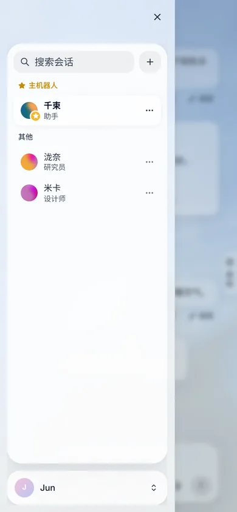 | 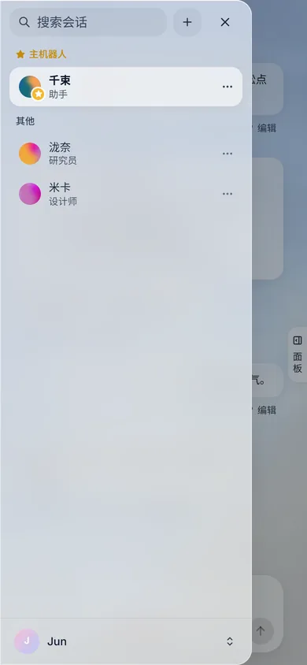 |
| 手机 深色 | 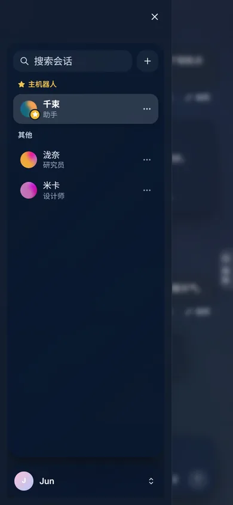 | 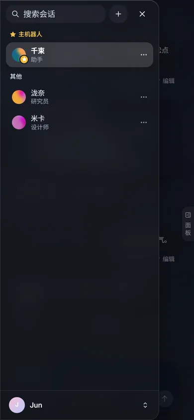 |
| PC 小窗 浅色 | 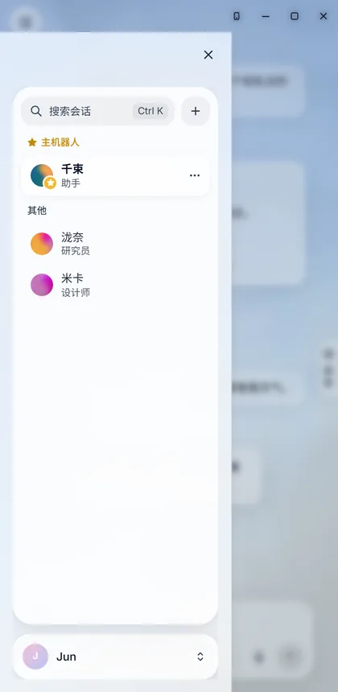 | 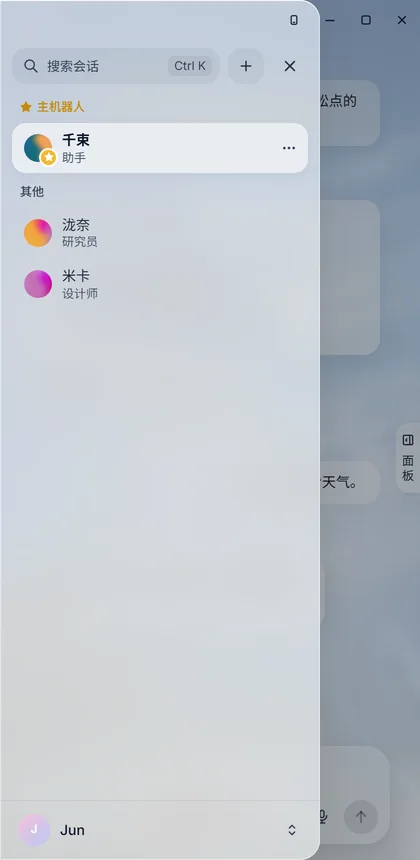 |
| PC 小窗 深色 | 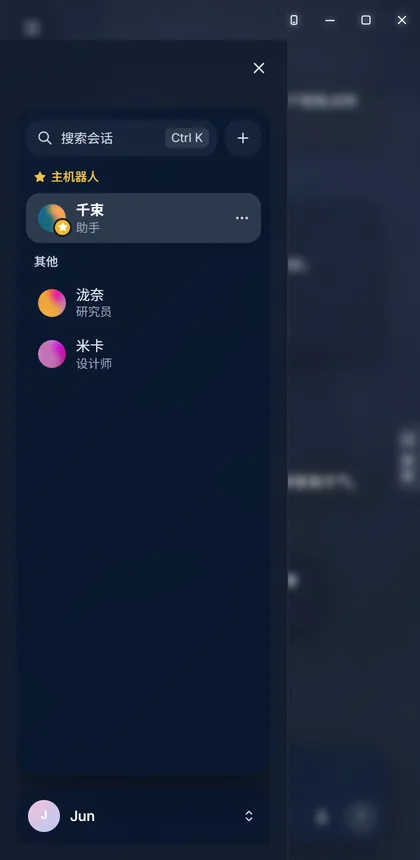 | 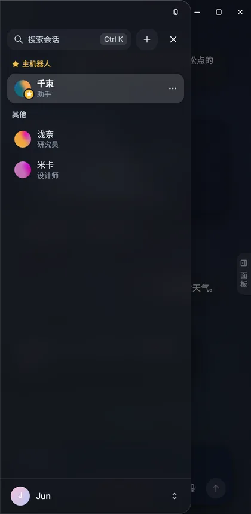 |

**测试**：新增 `app/tests/mobile-drawer.test.tsx`（面板只有一层 `.glass`、遮罩存在、点遮罩关抽屉、抽屉规则不写模糊 / 里面卡片关掉旧玻璃层 / 遮罩不模糊、只动 transform 200ms、减少动态效果无动画、性能模式和减少透明度不透明）；`render-budget.test.ts` 的模糊名单删掉两条已经不模糊的旧抽屉选择器。

**未改**：桌面宽窗口的左栏、#374 改过的顶栏 / 左栏文件、#375 的 perf-noblur.css、版本号。

**部署**（2026-10-29 08:45–08:58 北京时间）：部署前在 Haupt 另做数据库备份 `/opt/chisabot-backups/pre-release/v0.1.105-20261029T002243Z.dump`（`pg_restore -l` 767 条目），备份网关 `nginx.conf`（`nginx.conf.bak-pre-v0.1.105-20261029T002243Z`），给 d6cd2ec 打 `local/chisabot:keep-d6cd2ec` 防清理。`deploy-serial.sh 3856d36` 全量构建（依赖有变），镜像 `local/chisabot:auto-202610290045-3856d36`（同时成为 BASE_IMAGE），`/api/version` 为 `0.1.105` / `3856d36`。

**网关 nginx（#372）**：deploy-serial 只做 `sync-nginx --check`，不会套用新模板，所以手动把仓库 `deploy/public/nginx.conf` 按线上域名 / 端口渲染（与渲染旧模板得到的线上配置逐字节一致，只多出 #372 的 59 行），写入挂载进 `chisabot-public-gateway` 的 `/opt/chisabot-zh/public/nginx.conf`，容器内 `nginx -t` 通过后 `nginx -s reload`（容器未重建）。`nginx -T` 与渲染结果 md5 一致：22 条 `set_real_ip_from`、`real_ip_header CF-Connecting-IP`、14 个转发都清 `CF-Connecting-IP` 并设 `X-Real-IP`。宿主机 `/opt/chisabot-ops/deploy/public/nginx.conf` 模板同步为 main 版（已备份）。

**检查**：`request.sh smoke` PASSED（admin 模型自检 `ok:true persisted:false`），`health.sh` 通过，公网 `/login` 200，sidecar 隔离 ALL GREEN，未回滚。reload 后 access log 里经 Cloudflare 进来的请求记的是真实客户端 IP（从 Ayase 经 Cloudflare 发的请求带 CF-RAY，日志里是客户端公网 IP），reload 前同类请求是 172.71.x / 104.22.x / 162.158.x 等 Cloudflare 节点；reload 后唯一一条 Cloudflare 地址是 reload 前建立、reload 后才关闭的 WebSocket。线上 `sw.js` 的 `SW_VERSION` 为 `"3"`（公网 `/sw.js` 需要登录，未登录 401；应用容器内和 :3001 取到的都是 3，网关对已登录客户端返回 200）。

**镜像**：当前（BASE_IMAGE）3856d36、上一版回滚目标 `auto-202610282010-ed93b05`、`keep-d6cd2ec`、`keep-628d527`。

**待办**：`deploy/public/auth/server.ts`（网关签身份头时加 `j`）属于登录服务，不随一键更新，这次没有手工部署 `chisabot-web-auth`；在它更新前，网关签的仍是不带 `j` 的旧格式，应用照旧放行，防重放实际上还没生效。另外宿主机 `/opt/chisabot-ops/scripts/ops/sync-nginx.sh` 是旧版（要求 `/_openbot/auth-check` 标记），`--check` 读的是 10-18 生成、未挂载的 `nginx.generated.conf`，没有反映线上真实配置，建议之后把宿主机 ops 脚本同步成 main 版。

## 2026-10-29 发版 0.1.106

- #370 `perf/thread-inbox-incremental`（head `47ea175` → `d554c24`）→ `6d91044`：对话记录 `…/threads/:id/messages` 支持 `since` / `cursor` 增量读，频道聊天页读历史和每轮结束后的顺序核对都改成增量；三张卡片的每秒计时器合并为共享时钟。

**冲突**：与 main 只在 `CHANGELOG.md`、`docs/CHANGELOG.md`、`docs/DEVLOG.md` 冲突，把 origin/main merge 进 PR 分支、两边都保留、普通 push 后再合并。没有代码文件冲突。

**版本**：根、`app`、`server` 升到 `0.1.106`；PC / Android 不变。不打 tag、不发 Release。

**0.1.106 部署**（2026-10-29 10:03–10:16 北京时间）：部署前在 Haupt 另做数据库备份 `/opt/chisabot-backups/pre-release/v0.1.106-20261029T020328Z.dump`（`pg_restore -l` 767 条目）。`deploy-serial.sh 0ba9676` 镜像 `local/chisabot:auto-202610290203-0ba9676`（同时成为 BASE_IMAGE），`/api/version` 为 `0.1.106` / `0ba9676`。`request.sh smoke` PASSED（admin 模型自检 `ok:true persisted:false`），`health.sh` 通过，公网 `/login` 200，容器 healthy、无重启，sidecar 隔离 ALL GREEN，未回滚。网关 nginx 配置未变（md5 与部署前备份一致），`nginx -T` 仍有 22 条 `set_real_ip_from`、`real_ip_header CF-Connecting-IP`。镜像清理：更新器已自动删除 `auto-202610282010-ed93b05`，手动删除 `keep-d6cd2ec`；保留当前（BASE）0ba9676、上一版 3856d36、`keep-628d527`。

## 2026-10-29 发版 0.1.107

- #378 `fix/mobile-drawer-hark`（head `c25464a` → `274ed1a`）→ `adbe51f`：手机尺寸左栏抽屉改成 Hark 手机端的一层全高面板。
- #380 `feat/hark-linkcard`（head `8975949` → `8747ef7`）→ `c5dcb0a`：链接卡照 Hark 改版，数据侧修正标题 / 预览图（GitHub 预览图）。

**流程**：先在临时 worktree 里本地试合并（PR 分支各自 merge 最新 main、再 `--no-ff` 合进 main，顺序 #378 → #380），`bun install --frozen-lockfile`、`typecheck`、`build`、`test:app`（222 个文件 1722 pass / 0 fail，退出码 0）全部通过后，才把 PR 分支普通 push、main 快进到本地验证过的合并提交，线上 main 树与验证结果一致。

**冲突**：两个 PR 与 main 都只在 `CHANGELOG.md`、`docs/CHANGELOG.md`、`docs/DEVLOG.md` 冲突，两边都保留；没有代码、package.json 或锁文件冲突。发版时去掉了从旧 PR 分支带回 Unreleased 的 #373 重复条目（它已在 0.1.105 发布）。

**版本**：根、`app`、`server` 升到 `0.1.107`；PC / Android 不变。不打 tag、不发 Release。

**0.1.107 部署**（2026-10-29 12:07 北京时间开始）：部署前在 Haupt 另做数据库备份 `/opt/chisabot-backups/pre-release/v0.1.107-20261029T040728Z.dump`（`pg_restore -l` 767 条目）。`deploy-serial.sh 6790ef7` 镜像 `local/chisabot:auto-202610290407-6790ef7`（同时成为 BASE_IMAGE），`request.sh smoke` PASSED（admin 模型自检 `ok:true persisted:false`），`health.sh` 通过，公网 `/login` 200，容器 healthy、无重启、日志无错误，sidecar 隔离 ALL GREEN，未回滚。网关 nginx 配置未变（22 条 `set_real_ip_from`、`real_ip_header CF-Connecting-IP`）。镜像：更新器已自动删除 3856d36；保留当前（BASE）6790ef7、上一版 0ba9676、`keep-628d527`。

## 2026-10-29 发版 0.1.108

- #381 `feat/reply-style-hark`（head `bad6187` → `94bab32`）→ `1bd5416`：回复风格对齐 Hark（提示词 + 服务端），去掉固定三段式，默认一个气泡、结论先行。

**流程**：先在临时 worktree 本地试合并（PR 分支 merge 最新 main，再 `--no-ff` 合进 main），`bun install --frozen-lockfile`、`typecheck`、`build` 通过；`test:app` 1722 个用例里只有 `form-submit-controls` 超 5 秒默认超时（扫描全部表单，单独跑 3.6–5.0 秒，在 origin/main 上同样贴着 5 秒线，本 PR 未改 app 代码），单独以 60 秒超时重跑通过，按既有的计时抖动处理。验证通过后 PR 分支普通 push、main 快进到本地验证过的合并提交。

**冲突**：只在 `CHANGELOG.md`、`docs/CHANGELOG.md`、`docs/DEVLOG.md` 冲突，两边都保留，没有重复的已发布条目；没有代码、package.json 或锁文件冲突。

**版本**：根、`app`、`server` 升到 `0.1.108`；PC / Android 不变。不打 tag、不发 Release。

**0.1.108 部署**（2026-10-29 14:51 北京时间开始）：部署前在 Haupt 另做数据库备份 `/opt/chisabot-backups/pre-release/v0.1.108-20261029T065111Z.dump`（`pg_restore -l` 767 条目）。`deploy-serial.sh 9e9ca0d` 镜像 `local/chisabot:auto-202610290651-9e9ca0d`（同时成为 BASE_IMAGE），`/api/version` 为 `0.1.108` / `9e9ca0d`；`request.sh smoke` PASSED（admin 模型自检 `ok:true persisted:false`），`health.sh` 通过，公网 `/login` 200，容器 healthy、无重启、日志无错误，sidecar 隔离 ALL GREEN，未回滚。网关 nginx 配置未变（22 条 `set_real_ip_from`、`real_ip_header CF-Connecting-IP`）。镜像：更新器已自动删除 0ba9676；保留当前（BASE）9e9ca0d、上一版 6790ef7、`keep-628d527`。

## 2026-10-29 发版 0.1.109

- #391 `feat/reply-sources-stability`（head `2a6a2ab` → `f9926e6`）→ `5319bc0`：回复来源结构化（数据格式先行），生产环境 `CHISABOT_REPLY_SOURCES` 保持关闭。
- #392 `fix/turn-failure-web-fetch`（head `a6fbe90` → `2b57e1a`）→ `d27cce0`：web_fetch 重试 + 搜索摘要降级，工具失败后这一轮一定有回答（Hark A4）。
- #376 `fix/wallpaper-privacy-upload`（head `efa5abe` → `434b323`）→ `3ae5e59`：壁纸与外观收尾（IndexedDB，只改 app）。

**流程**：先在临时 worktree 本地试合并（每个 PR 分支先 merge 当时的 main，再按 #391 → #392 → #376 `--no-ff` 合进 main），`bun install --frozen-lockfile`、`typecheck`、`build` 通过；`test:app` 224 个文件 1743 个用例里只有 `form-submit-controls` 超 5 秒默认超时（已知的计时抖动），单独重跑 1.9 秒通过。验证通过后 PR 分支普通 push、main 快进到本地验证过的合并提交。

**冲突**：只在 `CHANGELOG.md`、`docs/CHANGELOG.md`、`docs/DEVLOG.md` 冲突，两边都保留，没有重复的已发布条目；没有代码、package.json 或锁文件冲突。#392 没写 CHANGELOG 条目，发版时补上。

**版本**：根、`app`、`server` 升到 `0.1.109`；PC / Android 不变。不打 tag、不发 Release。

**0.1.109 部署**（2026-10-29 16:07 北京时间开始）：部署前确认 Haupt 上 `chisabot-zh` 的容器环境、s6 环境和配置文件里都没有设置 `CHISABOT_REPLY_SOURCES`（代码默认关）；另做数据库备份 `/opt/chisabot-backups/pre-release/v0.1.109-20261029T080656Z.dump`（`pg_restore -l` 767 条目）。`deploy-serial.sh 63914d8` 镜像 `local/chisabot:auto-202610290807-63914d8`（同时成为 BASE_IMAGE），`/api/version` 为 `0.1.109` / `63914d8`；`request.sh smoke` PASSED，`POST /api/admin/smoke` 模型自检 `ok:true persisted:false`，`health.sh` 通过，公网 `/login` 200，容器 healthy、无重启、日志无错误，sidecar 隔离 ALL GREEN，未回滚；部署后运行中的容器仍未设置 `CHISABOT_REPLY_SOURCES`（关）。网关 nginx 配置未变（22 条 `set_real_ip_from`、`real_ip_header CF-Connecting-IP`）。镜像：更新器已自动删除 6790ef7；保留当前（BASE）63914d8、上一版 9e9ca0d、`keep-628d527`。

## 2026-10-29 性能模式 / 减少透明度：全局不模糊（分支 `perf/global-no-backdrop`）

### 动机

流畅优先。#363 给毛玻璃定了预算，性能模式下大部分面板也已经不模糊，但它是一个个选择器去关的：新加的、第三方的、Tailwind 写的模糊就会漏。实测 main 上开着性能模式，桌面聊天页还有 1 层（streamdown 代码块右上角的操作条 `div.pointer-events-auto.flex.shrink-0`，`backdrop-blur` 8px），设置页 14 层（外观设置的玻璃预览和色板的勾），手机抽屉 2 层（代码块操作条 + 遮罩）。系统「减少透明度」也一样。

### 改动

- **`app/src/perf-noblur.css`（新文件，`main.tsx` 里紧跟 `styles.css` 引入）**：
  - `html[data-perf="on"]:not(#chisabot-no-blur) *, …::before, …::after { --lg-blur: none; backdrop-filter: none }`，`@media (prefers-reduced-transparency: reduce)` 里同一套（前缀 `html:not(#chisabot-no-blur)`）。
  - 不用 `!important`：`:not(#id)` 给选择器加一个 id 的优先级，压过所有类 / 属性规则，引入顺序也不要紧；旧「三档玻璃」层的 `backdrop-filter: var(--lg-blur) !important` 不去比，直接把 `--lg-blur` 设成 `none`。
  - 不透明底色 `--glass-bg-opaque`（浅 `rgb(246 247 250)`、深 `rgb(29 31 36)`）：原来模糊的元素（左右栏、账号卡、输入框、顶栏搜索、菜单 / 选择框 / 浮层 / 对话框 / 抽屉、手机侧栏、提示条、代码块 / 图表操作条、外观设置的玻璃预览）都换成它；旧玻璃层改 `--lg-surface`。色板上的勾用实心深色。
  - 全屏遮罩、agent-orb 点阵层、电脑画面上的小标签只去掉模糊，保留自己的半透明底（压暗 / 装饰，不该变成不透明）。
- **审计**：`styles.css` 里所有会模糊的规则、Tailwind 的 `backdrop-blur-*`（dialog / sheet 遮罩、avatar-picker、chat-transcript、computer-view）、内联样式（无）、组件内嵌 `<style>`（agent-orb）、第三方样式（streamdown 2.6.0 的代码块 / 图表操作条和缩放按钮；copilotkit、prompt-area、tw-animate、shadcn 没有 `backdrop-filter`）。`agent-computer/`、`server/` 的页面不在 app 里，不受影响。
- **`app/tests/no-backdrop.test.ts`（新）**：引入顺序；两种开关都覆盖 `*` / `::before` / `::after` 且设了 `--lg-blur: none`；`perf-noblur.css` 不含 `!important`、页面上没有 `chisabot-no-blur` 这个 id；`app/src` 里不许内联 `backdropFilter`、Tailwind important 模糊类、新的 `backdrop-filter … !important`；两种开关的不透明名单一致；`styles.css` 里每条会模糊的规则都在不透明名单里，或者在豁免名单里写了原因（桌面左栏外层、平常就不模糊的小按钮 / 气泡 / 对话里的卡片 / 设置页卡片）。
- **`DESIGN.md` §10.3.1** 写下这条规则。
- 没改 `styles.css` 和 #374 改过的代码文件；没改版本号。

### 验证

浏览器审计（`noblur.mjs`，和之前一样数可见且 computed `backdrop-filter` 不为 none 的元素，含伪元素；减少透明度用 CDP `Emulation.setEmulatedMedia` 模拟）：

| 场景 | 普通（main） | 普通（本分支） | 性能模式（main → 本分支） | 减少透明度（main → 本分支） |
| --- | --- | --- | --- | --- |
| 桌面 聊天 / 代码块 / 账号菜单 | 5 | 5 | 1 → 0 | 1 → 0 |
| 桌面 设置页 | 16 | 16 | 14 → 0 | 14 → 0 |
| 手机 聊天 / 代码块 / 菜单 | 2 | 2 | 1 → 0 | 1 → 0 |
| 手机 设置页 | 1 | 1 | 1 → 0 | 1 → 0 |
| 手机 抽屉 | 6 | 6 | 2 → 0 | 2 → 0 |

深浅色结果相同。性能模式下原来模糊的元素底色 alpha 都是 1（遮罩除外，见上）。

截图（`docs/images/perf-noblur/`）：

- 性能模式代码块：`after-perf-code-desk-light.webp`、`after-perf-code-desk-dark.webp`（手机：`after-perf-code-phone-*.webp`）
- 性能模式面板：`after-perf-chat-desk-light.webp`、`after-perf-chat-desk-dark.webp`、`after-perf-settings-desk-*.webp`、手机抽屉 `after-perf-drawer-phone-*.webp`
- 普通模式前后：`before-normal-chat-desk-*.webp` / `after-normal-chat-desk-*.webp`，手机 `before-normal-chat-phone-*.webp` / `after-normal-chat-phone-*.webp`

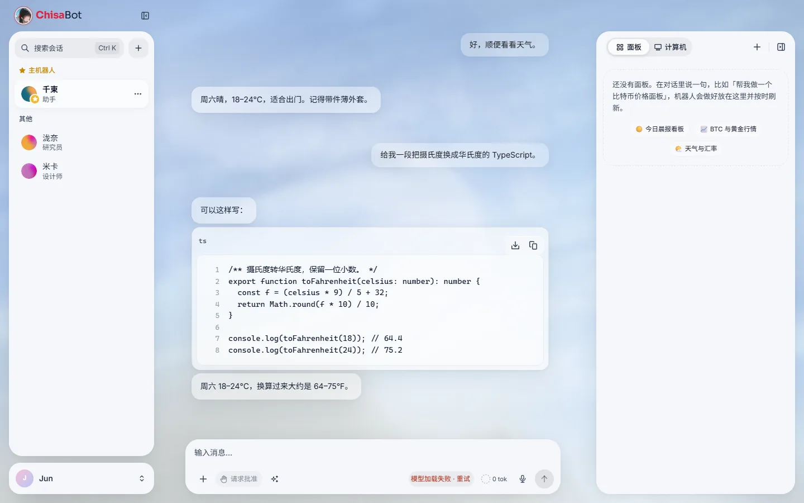
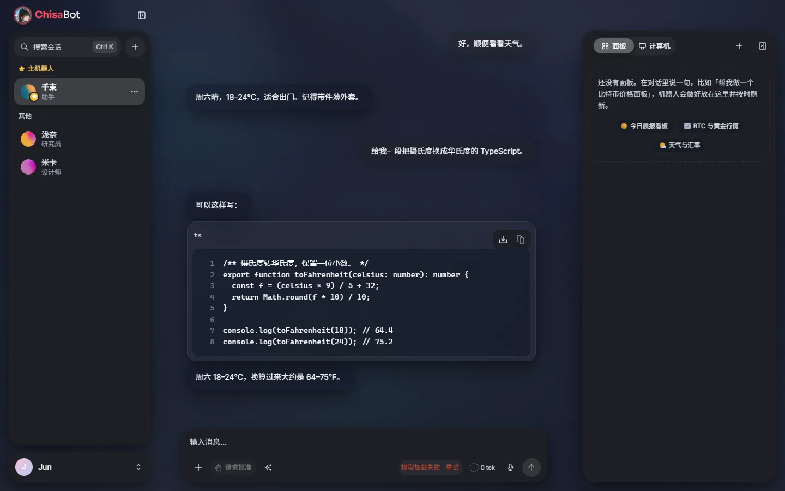
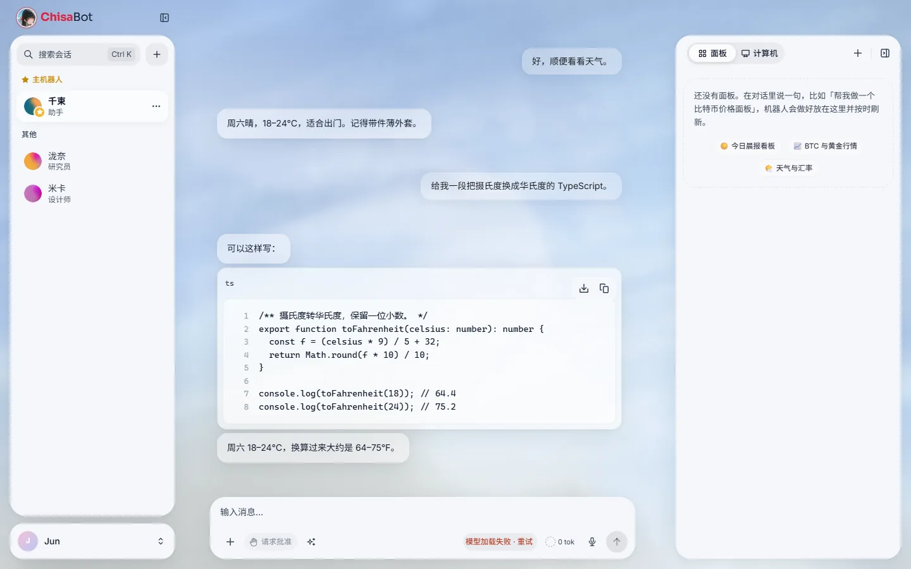
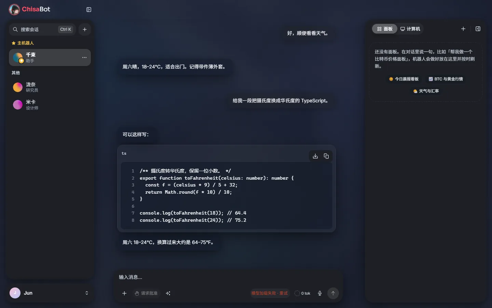

## 2026-10-29 Hark 顶栏外壳（Hark 改版第 2 步，分支 `feat/hark-topbar`）

### 动机

- Hark 改版 RFC（`docs/rfc/hark-redesign.md`，在 `feat/hark-redesign` 分支）的第 2 步是换顶栏：左上角放主页入口，右上角放搜索和账号，中间不再放分段切换，主界面只保留「聊天」一个视图。`feat/hark-redesign` 的 28154958 已经做出了效果，但那里和其它改版改动混在一起，而且有两条测试是失败的（搜索历史、组字时按 Esc）。这次只把顶栏单独搬过来，可以单独审查。
- 第 1 步（#369）把 Hark 令牌放进了 `html:root` / `html.dark`。`--font`、`--glass-shadow`、`--text-secondary`、`--stroke-primary` 和旧的深色层同名，而 `html:root` 的优先级高于旧的 `.dark`，所以只要漏写深色值，深色模式就会被浅色值盖掉。这条规则需要写进设计规范，并用测试守住。

### 改动

- `glass-topbar.tsx`：左上是圆形主页按钮（品牌头像）+ 品牌名 + 左栏开关；右上是搜索胶囊 + 圆形头像（账号菜单向下弹出）；PC 窗口按钮 `.win-ctrls` 仍在最右。
- `sidebar-search-field.tsx` 新增 `variant="topbar"`，和左栏共用同一份搜索状态，结果仍显示在左栏里。电脑上左栏不再放搜索框，手机抽屉里保留。
- 玻璃：只有搜索胶囊用 `.glass`（`--glass-filter`，20px），而且不加过渡；圆钮用 `.glass.is-flat`，不模糊。同屏模糊层：桌面从 4 层变成 5 层（开一个弹层时 6 层），手机仍是 1 层。
- 测试：`channel-pagination.test.tsx` 把顶栏搜索框和左栏一起渲染，修好了上面那两条测试；新增 `hark-token-dark.test.ts`，检查同名令牌在 `html.dark` 里都有深色值。
- 设计规范：DESIGN.md 新增 §10.5「Hark 令牌与同名旧令牌」。
- PC 窗口：客户端支持「小窗模式」时标题按钮有 4 个，原来顶栏右边只按 3 个（`46px * 3 + 12px`）让位，头像压在了小窗按钮上（改前头像不在顶栏，所以看不出来）。现在 4 个按钮时让出 `46px * 4 + 12px`，窄窗口仍走 36px 的规则。`after-pcwin-*` 截图已重拍。
- 不再用挂在大容器上的 `:has()`：左栏收起和标题按钮个数改由 `GlassTopBar` 直接输出 `data-sidebar` / `data-winctrls`，样式写成 `.glass-topbar[data-sidebar="collapsed"]` / `.glass-topbar[data-winctrls="4"]`，免得流式输出时整个外壳反复重算样式；`app/tests/no-container-has.test.ts` 冻结 main 上已有的 9 条大容器 `:has()`，新增一条就失败。
- 没有新增 `!important`，没有升版本号，禁区（`bot-bubbles.tsx`、`wallpaper_core.html`、壁纸上传、外观设置样式）都没碰。

### 截图

改前是 `main`，改后是本分支。截图用本地静态服务和 mock 的 `/api` 生成，没有连后端。

| | 改前 | 改后 |
|---|---|---|
| 桌面 深 | 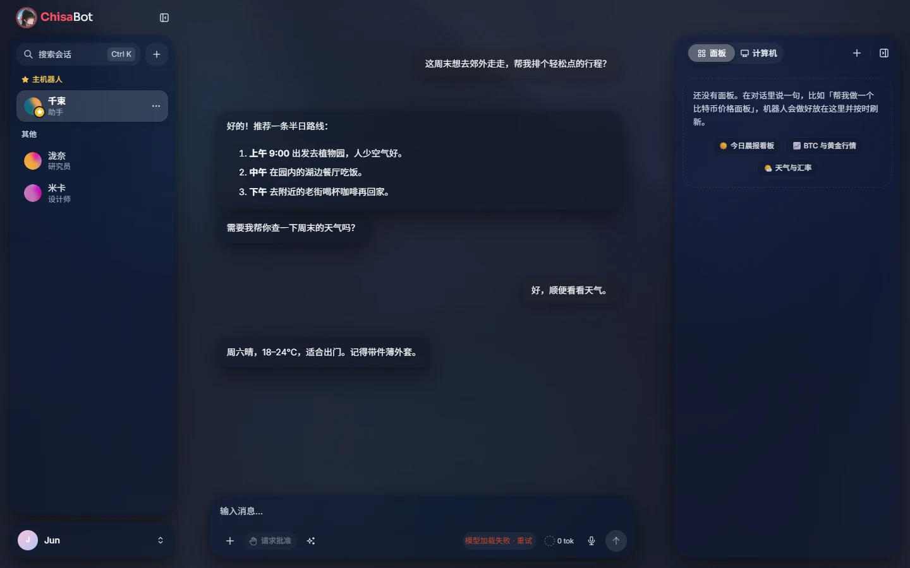 | 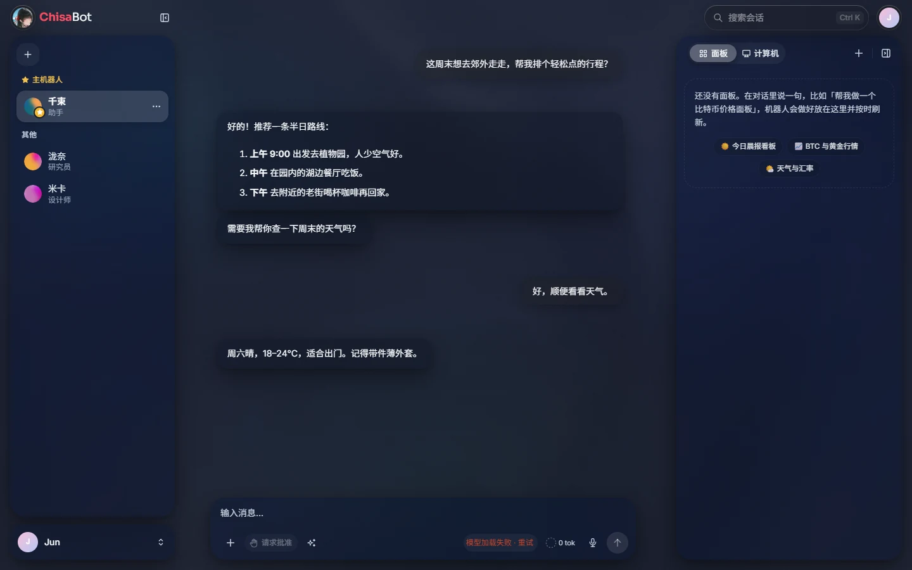 |
| 桌面 浅 | 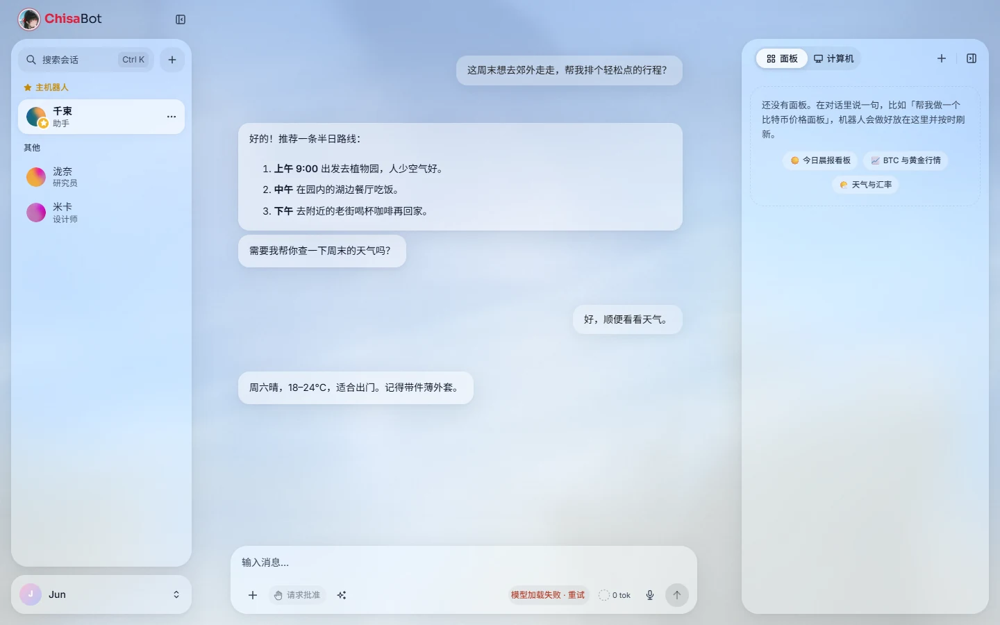 | 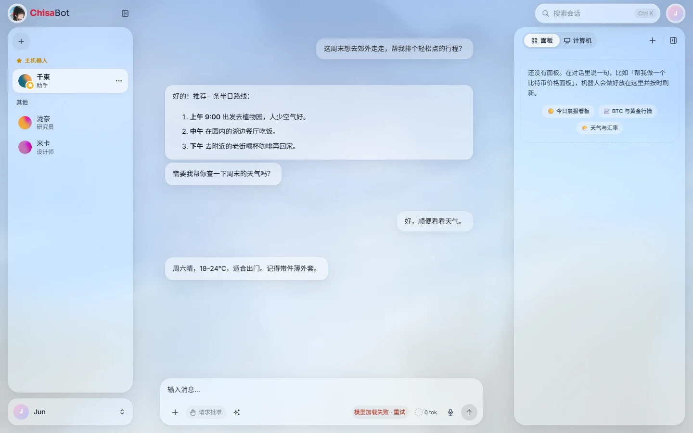 |
| 手机 深 | 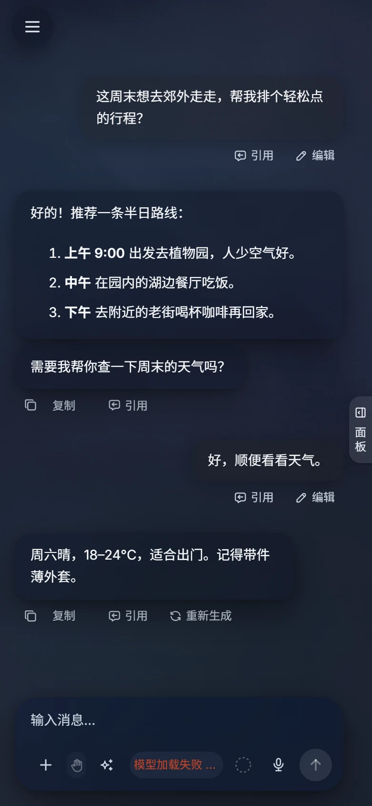 | 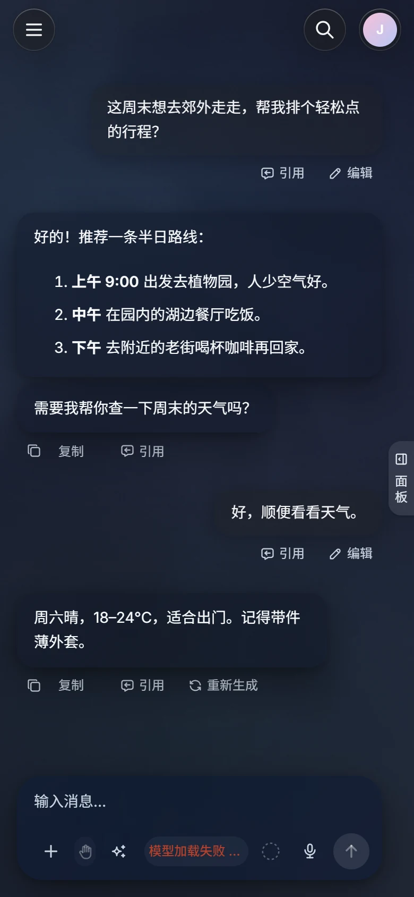 |
| 手机 浅 | 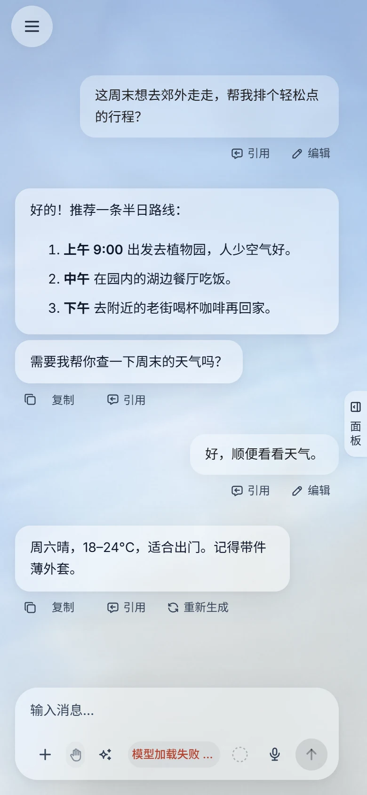 | 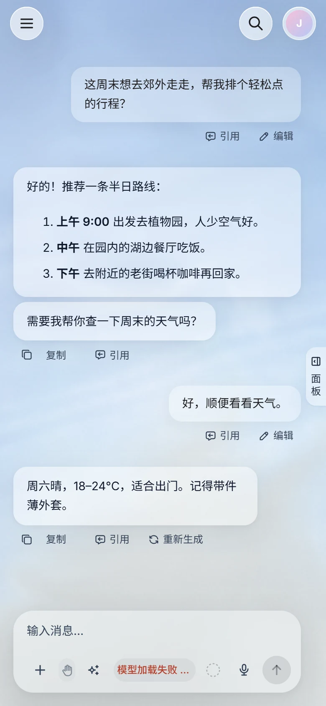 |

PC 窗口（深 / 浅）的截图也在 `docs/images/hark-topbar/`，文件名是 `*-pcwin-*.webp`。

## 2026-10-29 发版 0.1.110

- #375 `perf/global-no-backdrop`（head `83a29e3`）→ `e35a9cb`：性能模式 / 减少透明度下全局关掉毛玻璃，原来模糊的面板换成不透明底色。
- #374 `feat/hark-topbar`（head `f601ab3`）→ `f05beca`：Hark 顶栏外壳（圆形主页按钮、右上搜索胶囊 + 头像）。
- #394 `dev3/fix-open-double-history-read`（head `a35cfb7`）→ `875ae8f`：打开对话时只读一次历史。
- #396 `dev3/fix-reconnect-backfill`（head `710e31a`）→ `a14669d`：断线重连后补齐漏掉的消息。

**流程**：先在临时 worktree 本地按 #375 → #374 → #394 → #396 `--no-ff` 合进 origin/main（PR head 合并前核对未变），`bun install --frozen-lockfile`、`typecheck`、`build` 通过，`test:app` 229 个文件 1759 pass / 0 fail（退出码 0，form-submit-controls 这次没超时）。验证通过后 main 快进到本地验证过的合并提交。

**冲突**：只在 `CHANGELOG.md`、`docs/CHANGELOG.md`、`docs/DEVLOG.md` 冲突，两边都保留，没有重复的已发布条目；没有代码、package.json 或锁文件冲突。

**版本**：根、`app`、`server` 升到 `0.1.110`；PC / Android 不变。不打 tag、不建 Release。

**0.1.110 部署**（2026-10-29 18:06 北京时间开始）：部署前在 Haupt 另做数据库备份 `/opt/chisabot-backups/pre-release/v0.1.110-20261029T100654Z.dump`（`pg_restore -l` 767 条目），备份网关 `nginx.conf`（`nginx.conf.bak-pre-v0.1.110-20261029T100654Z`）。`deploy-serial.sh 249aefa` 镜像 `local/chisabot:auto-202610291007-249aefa`（同时成为 BASE_IMAGE），`/api/version` 为 `0.1.110` / `249aefa`；`request.sh smoke` PASSED，`POST /api/admin/smoke` 模型自检 `ok:true persisted:false`，`health.sh` 通过（容器 healthy、无重启、本机 `/health` 200、公网 `/login` 200），sidecar 隔离 ALL GREEN，未回滚。网关 nginx 配置未变（22 条 `set_real_ip_from`、`real_ip_header CF-Connecting-IP`）。镜像：更新器已自动删除 9e9ca0d；保留当前（BASE）249aefa、上一版 63914d8、`keep-628d527`。

## 2026-10-29 天空换场景渐变小修（fix/sky-crossfade）

**问题**：天空背景只在「醒着」的窗口里画（快照模式，约 15fps）。主线程有长任务时，引擎某一拍会跳过不画（这一拍画了 0 层），旧代码按「这拍没在渐变」算，醒着的窗口就到期了，渐变停在 0.76～0.98，等下一次唤醒才跳完。另一处：天气数据的响应头到了就算完，body 晚到时引擎改了天空却没人叫醒画面，这次天气渐变一帧都不画。

**改法**：新文件 `app/src/lib/sky-fade.ts`。`noteSkyFrame` 记录渐变开始时间，渐变中（最多 `SKY_FADE_HOLD_MS` = 8 秒）每拍都把醒着的窗口往后延 3 帧，画了 0 层的那拍也延；画回 1 层就清掉。`wakeSkyOnWeather` 包住天气请求，响应到了叫醒一次，body 读完（或读失败）再叫醒一次，返回新的 Response（204/205/304 原样返回）。`sky-background.tsx` 改用这两个函数；`wallpaper_core.html` 没动。测试 `app/tests/sky-fade.test.ts`。

**实测**（Ayase 真 GPU Chrome，分别构建改前/改后的 dist；JANK=1 是每 0.9 秒插一个 120～360ms 的长任务；「停顿」= 渐变中的一帧之后 ≥400ms 没有下一帧）：
- 卡顿，连续换场景 12 次 × 2 轮：改前有一轮 12 次里 10 次停在半路，共 43 次停顿（例如停在 0.76、0.81、0.93，各停 1～4 秒），帧间隔中位数 1001ms；改后 2 轮 24 次只出现 1 次 402ms（在 0.17，刚过门槛），每次都画到 1，35～38 帧，帧间隔约 62ms。
- 卡顿，加载后 4～12 秒第一次换场景（12 个时间点）：改前启动渐变停顿 4 次，换场景后停在半路 3 次（0.76 停 3.8 秒、0.91 停 3.2 秒、0.99 停 1.8 秒）；改后都是 0。第 3 轮复测记录完整帧序列：改前停在 0.98 后 3.2 秒没有新帧，改后 12 次都画到 1。
- 天气 body 晚 3.5 秒（BODYDELAY=3500），连续换场景 12 次：改前每次只画出 38～40 帧（场景渐变），天气那次渐变一帧都没画；改后第 1 轮 77～80 帧（场景和天气两段都画）。点下一次时接着正在进行的渐变走（0.05→0.08、0.39→0.44），不跳。
- 性能规矩没变：活动时约 16fps，空闲、失焦、隐藏（包括渐变中隐藏）4 秒内都是 0 次绘制。
- 天气请求失败数是网络噪声（卡顿那组改前 28/128、改后 0；第 3 轮 5/72 对 9/72），和改动无关。

对比图：`docs/images/sky-crossfade/sky-crossfade-before-after.png`。未升级版本号。

## 2026-10-29 发版 0.1.111

- #393 `dev3/fix-multi-message-display`（head `785ee59`）→ `89c14fb`：机器人连发多条消息全部显示。
- #401 `feat/attachment-resize`（head `9693f9f`）→ `e305830`：附件缩略图（server 新增依赖 `sharp@^0.34.5`，bun.lock 随 PR）。
- #402 `fix/sky-crossfade`（head `851035e`）→ `67f2683`：天空换场景渐变不再停在半路。
- #405 `dev3/perf-form-submit-test`（head `7f6b55c`）→ `1190828`：form-submit-controls 测试只解析写了 onSubmit 的文件。
- #407 `fix/hark-search-quality`（head `424635b`）→ `46e9d4b`：联网搜索质量。
- #408 `dev2/stream-composer`（head `6139521`）→ `dff0cd3`：流式回复时打字不再乱序、不再残留。
- #411 `dev3/fix-reconnect-backfill-empty`（head `84a07bf`）→ `c6ea5b1`：空对话第一轮从本机发出后断线重连也补齐（PR 的 base 是 `dev3/fix-reconnect-backfill`，不会自动关闭，发版后手动关闭）。
- #413 `perf/first-text`（head `05df45c`）→ `718025a`：新话题首字延迟。
- 不合：#406 `dev3/feat-avatar-morph`（head `644be13`）。`app/src/styles.css` 末尾冲突，要求和测试的合并结果 0681d692 核对，但本地和 GitHub 都找不到这个对象；而且两边原样保留会让 HEAD 一侧末尾的 `@media (max-width: 767px)` 少一个 `}`。#403（含 #395、#398）按要求不进这一版。

**流程**：在临时 worktree 从 origin/main（`b975b1c`）按上面顺序 `--no-ff` 合并，合并前核对 PR head 未变。`bun install --frozen-lockfile`、`typecheck`、`build` 通过，`test:app` 234 个文件：共享进程 1790 pass / 0 fail；独立进程的 message-scroll-reduced-motion 在整跑时 beforeAll 超时（5s），单跑在发版分支和 main 上都通过，算负载导致；第一次整跑（机器上同时有其他构建，CPU 90%+）23 个超时失败，单跑全部通过（build-cache 在 main 和发版分支安静时都 13/13）。验证通过后 main 快进到本地验证过的提交。

**冲突**：只在 `CHANGELOG.md`、`docs/CHANGELOG.md`、`docs/DEVLOG.md` 冲突（两边都保留）；没有代码、package.json 或锁文件冲突。#411 的 CHANGELOG 条目原本自动并进了 0.1.110 段，发版时挪到 0.1.111。

**版本**：根、`app`、`server` 升到 `0.1.111`；PC / Android 不变。不打 tag、不建 Release。

**0.1.111 部署**（2026-10-29 21:48 北京时间开始）：部署前在 Haupt 另做数据库备份 `/opt/chisabot-backups/pre-release/v0.1.111-20261029T134745Z.dump`（`pg_restore -l` 767 条目），备份网关 `nginx.conf`（`nginx.conf.bak-pre-v0.1.111-20261029T134745Z`）。`deploy-serial.sh a4fce00` 因为 server 新增依赖 `sharp` 走了完整构建（609 秒），镜像 `local/chisabot:auto-202610291348-a4fce00`（同时成为 BASE_IMAGE），`/api/version` 为 `0.1.111` / `a4fce00`；`request.sh smoke` PASSED，`POST /api/admin/smoke` 模型自检 `ok:true persisted:false`，`health.sh` 通过（容器 healthy、无重启、本机 `/health` 200、公网 `/login` 200），sidecar 隔离 ALL GREEN，未回滚。网关 nginx 配置未变（22 条 `set_real_ip_from`、`real_ip_header CF-Connecting-IP`）。镜像：更新器已自动删除 63914d8；保留当前（BASE）a4fce00、上一版 249aefa 作回滚。#411 的 base 不是 main，已在 GitHub 上手动关闭并留言。

## 2026-10-29 发版 0.1.112

- #412 `dev3/link-preview`（head `e2b9cde`）→ `d8c8f19`：链接预览服务端（GitHub 预览图回退、视频 / 百科卡片、反爬降级）。
- #421 `dev3/fix-open-read-and-backfill-dup`（head `5bb67cf`，相对已审的 `a7ccfc3` 只多一行 CHANGELOG）→ `69a96fc`：冷打开只读一次完整历史，重连回填和刷新一致。
- 不合：#395 `dev2/settings-perf`（head `72326cf`）、#398 `dev2/settings-perf-2`（head `77a7f71`）、#403 `dev2/settings-perf-3`（head `e2bcc03`）三个叠在一起，一起放弃：#395 合到 `e0e79a0` 时 `app/src/components/layout/glass-shell.tsx`、`glass-topbar.tsx` 代码冲突（main 上 `f601ab3` perf(topbar) 和 `5cd6e8c` hark 顶栏改过同一处）。需要作者基于新 main 重新整理。

**流程**：在临时 worktree 从 origin/main（`e0e79a0`）按顺序 `--no-ff` 合并，合并前核对 PR head 未变、都没有改版本号。`bun install --frozen-lockfile`、`typecheck`、`build`、`test:app` 在发版提交 `0c06ef7` 上全过（bun 1.3.14）：test:app 1850 pass / 0 fail（245 个文件）。

**冲突**：#412 只在 `docs/DEVLOG.md`、#421 只在 `CHANGELOG.md` 冲突（两边都保留）；没有代码、package.json 或锁文件冲突。#421 的 CHANGELOG 条目原本并进了文件下方旧的 `## Unreleased` 段，发版时挪到 0.1.112。去掉 #408 留下的 `## Unreleased` 标题前缀（那段已随 0.1.111 发布）。

**网关**：#412 改了 `deploy/public/nginx.conf`、`cache-no-store.conf`、`security-headers.conf`。线上网关 `chisabot-public-gateway` 的 2053 端口还反代 Magpie（`127.0.0.1:3430`，`ghcr.io/yetone/magpie`），不是只服务 ChisaBot，按规则这次只部署应用、不动网关，仓库模板和线上 nginx 会暂时不一致（需要另行决定）。

**版本**：根、`app`、`server` 升到 `0.1.112`；PC / Android 不变。不打 tag、不建 Release。

**0.1.112 部署**：22:41（北京时间）先备份数据库 `pre-release/v0.1.112-20261029T144123Z.dump`（`pg_restore -l` 767 项）和网关 `nginx.conf`、`security-headers.conf`、`magpie-private.conf`，再 `deploy-serial.sh 0c06ef7 jun-grokbot`。依赖有变化走完整构建，22:51 上线 `local/chisabot:auto-202610291441-0c06ef7`（613 秒），回滚镜像 `auto-202610291348-a4fce00`，`isolate-sidecar-app` 全绿。冒烟：`request.sh smoke` 通过，模型自检 `ok:true persisted:false`；`health.sh` 通过；`/api/version` 为 0.1.112；公网 `/login` 200，安全头齐全；`/devices` 和静态资源匿名 401（要登录），本机 3001 上正常返回；real_ip 22 条 `set_real_ip_from` 加 `real_ip_header CF-Connecting-IP` 没变。网关 nginx 没动（md5 不变，没有 reload），#412 的网关配置还没上线。
