# DEVLOG

## 登录循环保护小补丁（dev4/login-loop-followup，#442 后续）

**动机**：#442 审查时留下的三处小问题。
- 循环保护的时间戳只在跳 /login 时写、从不清：登录成功后 30 秒内会话真的过期（或被踢），会被当成死循环，停在「登录状态异常」而不是直接去 /login。
- 「登录状态异常」卡片盖在启动骨架上，骨架中间的「正在加载 ChisaBot…」还在，两段字叠在同一块。
- `perf/README.md` 的构建命令 `../node_modules/vite` 只在 CI 的 hoisted 安装下存在，本地默认安装在 `app/node_modules/vite`（开发3 反馈）。

**改法**：
- `login-redirect.ts` 新增 `clearLoginRedirectMark()`；`auth/queries.ts` 的 currentUser 在 `/api/me` 200 时调用。
- `AuthLoopNotice` 打开时给 `<html>` 挂 `data-auth-loop-open`（卸载 / 关闭时拿掉）；`styles.css` 在这个属性下藏起 `.sky-skel-hint.is-loading` 和 index.html 的 `#chisabot-startup-loading`。没加 backdrop-filter。
- README 改成 `bun run --cwd app build`（app 的 build 脚本两处路径都会找）。CI 的 perf.yml / chisabot.yml 用 hoisted 安装，`../node_modules/vite` 在那里是对的，没改。
- 测试：新 `login-redirect-clear.test.ts`（200 清时间戳、之后 401 直接去 /login；500 保留）；`auth-loop-notice.test.tsx` 加属性挂上 / 拿掉和 CSS 规则两条。去掉实现后新增的行为测试失败。

**验证**：typecheck、app build、test:app 通过；Biome 改动文件无新增（`auth/queries.ts` 在 main 上就有 1 处格式问题，未动）。headless Chrome 截图（`/workspace/dev4-m31b-xfer/shots/`）：卡片打开时「正在加载」可见元素 0 个，拿掉属性后 1 个（在卡片后面）。

## 打开设置提速（dev2/jank-settings-open，FIX-PLAN P1-6）

**动机**：点账号卡 →「设置」在 4x 降速下要 0.3s 以上，而且第二次打开反而比第一次慢（main：冷 284ms，热 337ms，两次点击首帧之和）。原因：账号菜单是模态的，开关时为全屏遮罩量整页布局；点菜单项要等退场动画和路由代码块加载完才切页；进设置后藏着的聊天和右栏整棵重渲；section-rail 在打开那一帧同步 scrollIntoViewWithin 强制排版。

**改法**（头像仍先弹菜单，Jun 的决定）：
- `account-menu.tsx`：`modal={false}`；点菜单项时加 `is-leaving` 去掉退场动画，收起那一帧画完（rAF + setTimeout 0）就 navigate，不再等 preloadRoute；菜单打开时顺手预取 `/settings`。
- `authed-shell.tsx`：`PanelRail`、`ChannelPage` 用 memo 包住，进出设置只翻 `visible`，藏着的部分不重渲；外壳空闲（requestIdleCallback，兜底 2s）时预取设置页代码块（设置路由无 loader，不发 API）。
- `channel-page.tsx`：`ChannelBody` memo。
- `section-rail.tsx`：滚动选中行挪到 rAF 里，行已在可视区内就不滚（新导出 `rowOutOfView`）。
- `perf/jank.mjs`：settings 场景改点左下账号卡（#440 之后电脑顶栏没有头像）。
- 测试 `app/tests/settings-open-fast.test.tsx`（3 条）。

**验证**：bun 1.3.14。typecheck、build 通过；test:app 1918 pass / 0 fail；server + DB 4643 pass / 28 fail，失败项与 main 同一批；Biome 改动文件无新增问题。perf 4x CPU、3 次、不带 trace（base = main 500b810c）：settings-open-cold worst INP 184→168，settings-open-warm 232→112；两次点击首帧之和 冷 266→249ms、热 322→170ms，都在 0.3s 内，第二次打开比第一次快。settings-pages 的 long-task 总量 169→277ms（+64%），各页 INP / 首帧持平，留给后续排查。

## 改窗口大小时暂停 WebGL 天空（dev4/perf-resize-pause，FIX-PLAN P2-3 JS 部分）

**动机**：卡顿分析根因 6：resize 场景主线程 composite 约 7s、CrGpuMain 6.4s，fps 9–12。天空引擎（wallpaper_core.html）每个 resize 事件都改 `canvas.width`（清空画布），宿主再 `drawSkyNow` 当帧补画一整帧 WebGL；拖一次窗口就是几十帧满屏重绘。

**做法**：
- 新增 `app/src/lib/resize-state.ts`：`initResizeState()`（`main.tsx` 调一次，幂等，返回拆除函数）监听 resize；第一次事件后在 rAF 里给 `<html>` 挂 `data-resizing=""`，最后一次事件后 150ms 拿掉；`isResizing()`、`resizeInProgress()`（从第一次事件就算）、`subscribeResizing()`。和前端约定的接口：CSS 用 `html[data-resizing]` 去掉 backdrop-filter / box-shadow，本 PR 不写 CSS。
- `sky-background.tsx`：`skyCanRun` 在 `isResizing()` 时返回 false；引擎脚本里裸写的 `addEventListener` 作为 `new Function` 的参数传进去，`resize` 监听收进宿主，由 `onSkyResizeEvent` 调度——拖动中只记一笔，停下时（订阅 resize-state 的结束通知）按最终尺寸调一次引擎 `resize()` 再 `drawSkyNow()`，并 `wakeSky` 把可能被打断的渐变画完。拖动中画布是旧尺寸，`#gl` 是 100%×100%，CSS 拉伸，不露空画布。引擎本身未改。
- 测试 `app/tests/resize-state.test.ts`（手写假时钟）：属性挂上 / 拿掉的时机、订阅通知、天空循环暂停 / 恢复、拖动中引擎不改尺寸停下后改一次、init 幂等且拆掉后不留监听和计时器；去掉实现后 5 条都失败。

- 小爱复审后补：测试用导出改名 `__skyLoopForTestOnly`；`onSkyResizeEvent` 注释写明依赖 resize-state 的监听先注册；resize-state 逐个 try/catch 调订阅者（抛错只 `console.error`，不挡其他订阅者），加了对应测试。

**验证**：基于 headless harness 的 resize 场景（PC 客户端真机 trace 没录）。4x 降速、不带 trace、各 3 次中位数：fps 13.8 → 48.7，p95 帧 133 → 33ms，长任务 4581 → 163ms，脚本 378 → 154ms；样式 / 布局不变（那部分等前端的 CSS）。SwiftShader 会放大 GPU 部分，真机收益要打折。

## 切会话即时反馈（dev2/jank-chat-switch，FIX-PLAN P1-1 / F0）

**动机**：切会话时左栏高亮和整段对话在同一次提交里渲染，点下去要等 0.3–2s 才有任何变化（4x 降速下 INP 最差 2216ms）。FIX-PLAN F0：高亮先单独提交，对话延后渲染，目标首帧 <16ms。

**改法**：
- 新文件 `lib/chat/pending-switch.ts`：一个外部小 store 记「正在切过去的机器人」。左栏 `BotRow` / `MiniBot` 普通左键点击时先 `markPendingBot`，只重画左栏那几行（高亮按 `pending ?? 路由` 算，旧会话那一行同时熄灭）；导航排在这一帧画完之后（rAF + setTimeout）。带修饰键 / 中键照常走链接。路由 5s 没跟上自动清掉。
- `authed-shell.tsx`：`ChatStage` 用 `useDeferredValue` 延后对话地址，整段对话的重新挂载变成可打断的延后渲染；地址对象 memo 化，`ChannelPage` 包 `memo`，高亮那次提交不重画对话。新对话换上后清掉 pending。
- `keep-alive.tsx` + `styles.css`：延后期间旧的一页加 `data-switching`，opacity 0.6（只动合成层）且 `pointer-events: none`（防止往旧会话里输入），不留白、不放骨架。
- 测试 `app/tests/chat-switch-feedback.test.tsx`：高亮先到再清、连点三个只停最后一个、修饰键不算、导航排在高亮之后、切换中旧页半透明可见且不 inert。

**验证**：bun 1.3.14。typecheck、build 通过；相关测试 5/5；test:app 1862 pass / 0 fail；server + DB 测试 4643 pass / 28 fail（本 PR 不动 server/，server 代码与 main 逐字相同，失败为 box 环境下 main 已有的同一批）；Biome 改动文件的诊断数与 main 相同，新文件无问题。perf harness（#443）switch 场景 4x 降速、3 次中位数：最差 INP 2216 → 80ms，最差首帧 2172 → 62ms，长任务总计 16793 → 9246ms（表见 PR）。首帧在 4x 降速下 40–53ms，折合原速约 10–13ms。
- 补充（小爱复核 #448）：切换中旧的一页同时设 `inert`（键盘也进不去），输入框发送前用 `sendTargetsStaleChannel` 核对所属会话与地址栏 / 左栏切换状态，不一致就不发、草稿留着；淡出改为延迟 100ms、opacity 0.8，`prefers-reduced-motion` 下无过渡，快切不再闪；`afterNextPaint` 只留最新一次，排队期间再点别处或按 Enter 会撤掉旧导航并熄掉左栏的「正在切过去」。新增测试：切换中按 Enter 不发送、连排两次只跑最后一次、点别处撤销。
- 补充（小爱复核 #448 第二轮）：发送拦截只针对切走的那段旧对话的输入框（`markPendingBot` 记下切走时的频道），导航被拦下 / 失败时别的输入框不受影响；输入法选词的 Enter（`isComposing` / keyCode 229）不撤销排队的导航。各补一条测试。
- 合入 main（11bacde2，含 #445/#446）：左栏机器人行改用 main 的 `useCloseMobileDrawer`；手机抽屉里点机器人照旧走链接、不延后导航（抽屉收起要跟路由 push 同一拍）。

## 电脑端布局回退 #374 的顶栏改动（dev2/pc-layout-fix）

**动机**：#374（5cd6e8c3，Hark 第 2 步顶栏）之后，Jun 的原话：「把右下原本有的搬到左上，又弄一个头像什么意思；搜索会话放在那是什么意思；右侧栏的收起和打开都在右侧栏上，左侧栏为什么单独拿出来了」。电脑上同时有两个头像（顶栏左上的品牌头像 / 右上的账号头像 + 左栏底部账号卡），搜索会话跑到顶栏右上，左栏开关单独放在顶栏。

**改法**：
- 身份只留左栏底部账号卡：`glass-shell.tsx` 不再给顶栏传 `account`；`glass-topbar.tsx` 去掉左上 BrandAvatar 主页圆钮，只留品牌文字；`account-menu.tsx` 删掉 `placement="topbar"` 分支。
- 搜索回到左栏：`app-sidebar.tsx` 卡片顶行恢复 `<SidebarSearchField/>`（和 + 新建同一行，#374 之前的样子）；删掉 `TopBarSearch` 和搜索框的 `variant="topbar"`。Ctrl K 仍由外壳处理：左栏收起时先展开再聚焦搜索。手机不变（顶栏 ☰ + 搜索圆钮，抽屉里有搜索框）。
- 左栏开关挪到左栏上，和右栏「面板」开关对称：新文件 `roster-toggle.tsx`，展开时在卡片右上角（聊天：搜索行最右；设置 / 管理：区域标题右边），收起成 80px 那列时在列顶。手机抽屉不画。顶栏只剩品牌文字和 PC 窗口按钮。
- styles.css 删掉 `.hk-topbar*`、`.hk-search*`、`.hk-home`、`.hk-avatar-btn`、`.hk-brand` 残留，以及顶栏账号按钮和「收起时开关跟在品牌后面」的旧规则（顺带少一条挂在 `.glass-shell` 上的 `:has()`，`no-container-has` 清单同步去掉）；`.hk-circle` 留给手机顶栏。palette 段没动；`ui/sidebar.tsx` 的宽度动画没动。
- 测试：`channel-pagination.test.tsx` 不再单独渲染顶栏搜索框；新增 `pc-layout-topbar.test.ts`（顶栏没有头像 / 搜索 / 开关，账号菜单没有顶栏分支，左栏有搜索和开关，没有残留样式）。

**验证**：bun 1.3.14。typecheck、build 通过；test:app 1854 pass / 0 fail；server + DB 测试的失败项是 main 上同一批（本改动只动 app/）；Biome 无新增问题。真 Chrome（headless，本地单用户服务）截了聊天页 / 设置页 × 左栏展开 / 收起 × 浅色 / 深色 × 1024 / 1440 共 16 张，每张可见的用户头像 1 个、品牌头像 0 个，顶栏只有品牌名；左栏收起时按 Ctrl K 会展开并聚焦「搜索会话」。

- 补充（小爱复核）：手机布局保持 #374 时原样——顶栏右上角恢复圆形头像（账号菜单入口，`AccountMenu placement="topbar"` / `.hk-avatar-btn`），只在手机布局（含 PC 小窗 < 768px）里画；电脑顶栏仍然没有头像，身份只在左栏底部账号卡。手机顶栏列宽恢复为 `auto minmax(0,1fr) auto`、右侧按钮间距 8px。`tests/pc-layout-topbar.test.ts` 断言头像只在手机分支里渲染；360px 浅色/深色聊天页截图已补到 PR。

## 卡顿测量工具 perf/（dev4/perf-harness，FIX-PLAN P0）

**动机**：卡顿分析（stage 1 和 FIX-PLAN）的数字都出自 box 上的临时脚本，别人没法复现，PR 之间也没法比。FIX-PLAN 要求每个性能 PR 附 4x 降速下的前后对比表，先把测量脚本整理进仓库。

**做法**：
- `perf/mock-server.mjs` 托管 `app/dist`（SPA 回退），按 `perf/fixtures/api.json` 回答 `/api/*`：已登录用户、两个频道、`c1` 一个 240 条消息的线程、发送时的 AG-UI SSE 流；`/api/me` 可切成 401 用来测登录页光球；没匹配的一律 404。
- `perf/jank.mjs`：playwright-core 驱动系统 Chrome，每次运行新建临时 profile 并在结束后删除。页面里用 PerformanceObserver（longtask、event）、rAF 帧记录和 MutationObserver 采数据，CDP `Performance.getMetrics` 取样式 / 布局 / 脚本耗时差值。按 `--runs` 跑多次，`summary.json` 取中位数。`--trace` 另存 trace，并由 `trace-summary.mjs` 算主线程按类别的自身耗时和带 JS 栈的强制样式 / 布局（原来是 Python 脚本，改成 JS 不用另装环境）。
- `perf/compare.mjs` 打印 markdown 表，单元格是 `前 → 后 (Δ%)`，变化 ≥10% 标 ✅/⚠️。
- CI `perf.yml`：PR 上构建 head 和 base（`git worktree`），各跑 1 次，表写进 job summary，结果上传 artifact；job 级 `continue-on-error`，不拦 PR（CI 机器噪声大，阻塞门槛放到 P2-4）。zizmor 本地检查无问题。

**验证**：box 上对 main（c99ee37e）构建跑了全部场景（1 次带 trace，3 次不带）。trace 本身有开销，带 trace 那次长任务和脚本耗时约为不带的 1.5–2 倍，所以 README 写明不要混着比。

## 手机抽屉导航后收起、/channel/new 总开新话题、网关 401 直接去登录（dev4/sidebar-m3-1）

**动机**：审计 `/workspace/audit/03-sidebar.md` 的 M3-1 / M3-11 / M3-14；另外两条：`/channel/new` 会落到最近的旧对话而不是新话题；线上 0.1.110 会话过期后卡在加载约 5 分钟，之后 SW 在 20 秒时给出 503「服务器响应慢」卡片。

**根因**：
- 抽屉：`Channel` 行、搜索结果行、`BotMenuContent` 里的跳转都没有调用关闭抽屉，只有机器人行自己关。会话行的 `<Link>` 上带了 `type="button"`（`<a>` 上无效）。
- `/channel/new`：路由 loader 用 `latestChannelFor` 找到最近的一对一对话就重定向过去，不管里面有没有消息。
- 401：网关 `auth_request` 失败时，非导航请求（`/api/me`）拿到 JSON 401（`openbotAuthRequired: true`），导航拿到 302 到 `/login?next=`。应用收到 401 后在页面里转到 `/sign`，但网关不提供 `/sign`（nginx 把它 302 到 `/login`，SPA 内跳转不会经过它），页面就停在加载。网关注入的 `workspace.js` 有 fetch 401 拦截，但它看到应用自己的 `#chisabot-account-control` 就提前退出，所以从没生效。SW 这边：导航超过 20 秒给 503 慢卡片；卡片的重试探测是普通 fetch，拿到 JSON 401（< 500）就当成「好了」刷新页面，刷新后又走同一条路，循环。线上「先卡 5 分钟」的确切时长没有在本地复现，上面是能解释现象的路径，已用假网关验证修复后不再出现。

**改法**：
- `components/ui/sidebar.tsx` 新增 `useCloseMobileDrawer()`（手机且抽屉打开时关掉）。`channel.tsx` 会话行 `onClick` 关抽屉、去掉 `type="button"`；`app-sidebar.tsx` 搜索结果行、机器人行、`BotMenuContent` 的「机器人资料」「历史对话」「新话题」「面板」做完都关抽屉；打开对话框的菜单项（电脑操作、主机器人、恢复、删除）不关，对话框挂在抽屉里。`BotChatMenuItems` 加可选 `onDone`。
- `lib/channels/latest.ts` 加 `reusableEmptyChannelFor`：只在最近的一对一对话没有任何消息时复用。`/channel/new` 改用它。原来依赖重定向「接着聊」的入口（资料页、agent-profile、agent-dialog、`/bot`、open-thread 兜底、删除后回主机器人、交接卡片）改用新的 `lib/channels/open-bot-chat.ts`（`botChatChannelId` / `useOpenBotChat`）直接去最近的对话，没有才去 `/channel/new`，行为不变。
- `lib/auth/login-redirect.ts`：`isGatewayLoginRequired`（401 + `openbotAuthRequired`）、`goToLogin`（`location.replace("/login?next=…")`，只跳一次，已在 `/login` 不跳）、`installLoginRedirect`（包一层同源 fetch，任何接口拿到网关 401 都去登录）。`auth/queries.ts` 的 `/api/me` 401 也走它；`_authed.tsx` 在已经去登录页时不再转 `/sign`。没有网关的部署（普通 401，无 `openbotAuthRequired`）照旧去应用自己的 `/sign`。
- 审查修复：SW 的导航和重试卡片探测原来一见 401 就跳 `/login`，没网关的部署没有 `/login`。改成和前端 `isGatewayLoginRequired` 同一判断（JSON 响应体 `openbotAuthRequired: true`）；探测脚本会被 toString 进页面，只能内联同一段判断。其它 401：导航原样交给浏览器，探测照旧刷新。四种情况都有测试。截图不进仓库，推送后贴在 PR 描述里。自测：typecheck 0、app build 0、test:app 1825 pass 0 fail；改动文件 Biome 无新增。
- `public/sw.js`（`SW_VERSION` 4）：导航拿到 401 返回 302 到 `/login?next=`；慢卡片探测拿到 401 直接 `location.replace` 去登录页，不再刷新；`/login` 加进 `SKIP_NAV`。
- 审查修复 2（登录跳转死循环）：后端在会话有效时也会回 401 + `openbotAuthRequired`（`server/src/index.ts` 身份头重放、`server/auth/gateway-identity.ts` 签名校验失败）。这时 `/login` 的 login.js 查 `/auth/session` 看到已登录，立刻 `replace(next)` 回来，又 401，循环。
  - `login-redirect.ts`：`goToLogin` 跳之前在 sessionStorage 记 `chisabot:login-redirect-at`；30 秒（`LOGIN_LOOP_WINDOW_MS`）内又要跳就不跳，置 `isLoginLoopDetected()` 并通知订阅者。时间戳在未来、不是数字、sessionStorage 抛错都按「没跳过」处理。`signOutAndReLogin`：POST `/api/auth/sign-out`（失败也继续）、重记时间戳、`replace("/login")`。`loginHref` 在 `/sign` 上不带 `next`。
  - 新组件 `components/auth/auth-loop-notice.tsx`：「登录状态异常」卡片 + 「退出重新登录」按钮（设计系统 `Button`，沿用 `page-loader-*` 卡片样式，没有新的 backdrop-filter）。挂在 `main.tsx` 路由外面，因为 `_authed` 这时停在启动骨架上（`isGoingToLogin() || isLoginLoopDetected()`）不转 `/sign`。
  - `sw.js`（`SW_VERSION` 5）：导航分支 `request.referrer` 是同源 `/login` 时，网关 401 原样交给浏览器（真没登录的导航网关自己回 302，这个分支碰到的基本都是「已登录但被拒」）。重试卡片探测和应用共用同一个 sessionStorage 时间戳：30 秒内已经去过 `/login` 又是网关 401，就停下、显示「登录状态异常」和「退出重新登录」按钮，否则记时间戳再去 `/login?next=`。
  - 测试：`login-redirect.test.ts` 加 9 个（记时间戳、刚回来又 401 不跳并标记、`/api/me` 路径、旧时间戳照跳、未来/非数字、storage 抛错、退出重登两种、`/sign` 不带 next），新文件 `auth-loop-notice.test.tsx` 3 个（happy-dom：无循环不显示；刚回来又 401 时出现卡片且按钮获得焦点；点按钮走退出流程），`sw-navigation.test.ts` 加 5 个（referrer=/login 原样交给浏览器；别的 referrer 照旧 302；卡片 30 秒内停下并能退出重登；旧时间戳照跳并记时间；卡片 HTML 带按钮和参数）。去掉循环判断和 `/sign` 处理后，前两个文件 4 个用例失败；把 sw.js 换回 2ee6efde 后 SW 的 4 个用例失败（第 5 个检查「别的 referrer 照旧 302」，改前改后都应通过）。
  - 复现（假网关：会话有效、所有 /api 回网关 401、/login 看到已登录就 `replace(next)`）：改前 10 秒内 `/login` 被请求 48 次，改后 1 次，然后停在「登录状态异常」；点「退出重新登录」会 POST `/api/auth/sign-out` 1 次，然后到 `/login`。截图在 box 的 `/workspace/dev4-m31-xfer/shots/loop/`，不进仓库。自测：typecheck 通过，app build 通过，test:app 1893 pass、0 fail。
  - Biome：`latest.ts` 的格式问题里有一行是本 PR 新加的（`reusableEmptyChannelFor` 里的 `continue`），已修；其余格式问题和 `sidebar.tsx` 的导入排序 / 格式在 base（c99ee37e）上就有，不是本 PR 引入的，没动。

**测试**：`tests/sidebar-drawer-nav.test.tsx`（真实 `Channel` 在手机抽屉里点击后抽屉关闭；`BotChatMenuItems` 调 `onDone`；`BotMenuContent` 接线）、`tests/channel-new-topic.test.ts`（空对话复用、有消息开新、按最近活动挑、群聊不算）、`tests/login-redirect.test.ts`（网关 401 跳 `/login?next=`、只跳一次、`/login` 上不跳、普通 401 不跳、跨域不管）、`tests/sw-navigation.test.ts` 新增 4 个 401 用例。新用例在 base（c99ee37e）上都失败，改后通过。

**截图**（390×844 触屏，独立 headless Chrome 和临时 profile，假网关静态服务器）：

| 场景 | 改前（c99ee37e） | 改后 |
|---|---|---|
| 抽屉搜索「论文」后点结果 | 进了 `/channel/c2`，抽屉仍盖在页面上 | 进 `/channel/c2`，抽屉已收起 |
| 机器人「⋯」→「机器人资料」 | 进了 `/bots/a1`，抽屉仍开着 | 进 `/bots/a1`，抽屉已收起 |
| 打开 `/channel/new?agent=a1` | 被转到旧对话 `/channel/c1` | 停在 `/channel/new?agent=a1`（新话题） |
| 页面开着时会话过期（SW 已控制页面） | 8 秒后仍停在 `/settings` | 约 0.2–0.4 秒跳到 `/login?next=%2Fsettings` |
| 过期后重新打开 `/channel/c1?x=1`（经 SW） | 页面直接显示网关的 JSON 401 | 跳到 `/login?next=%2Fchannel%2Fc1%3Fx%3D1` |

截图首轮还发现一个真问题：触屏点会话后抽屉关了，导航却被抽屉的返回记录清理（`history.back()`）退回去。原因是路由的 push 在微任务里才落地。`useCloseMobileDrawer` 改为推迟一拍再关抽屉（167cfd6f），并补了一个回归测试：手机模式、真实 browser history，不修时失败。上表是修复后的结果。

**自测**：
- typecheck 通过。app build 通过（改前 / 改后都构建了，SW 版本分别是 3 和 4）。
- test:app：整批跑仍然只有一个与本 PR 无关的超时失败，`control-poll-single-source.test.tsx`（期望 4 次请求，实际 5 次）。这个文件单独重跑 3/3 通过，在 base 上也通过。上一轮整批跑时失败的是 `overlay-back.test.tsx` 超时（box 负载约 40），单独跑 10/10 通过；这一轮整批里它通过了。
- 相关测试：sidebar-drawer-nav、overlay-back、channel-new-topic、login-redirect、sw-navigation 共 59 个，全部通过。
- Biome：585 个错误，和 base 一样，没有新增。

## 头像球空闲不动（dev4/perf-orb-idle）

**动机**：卡顿分析发现，登录页（`/sign`）和新手引导页的 `AgentOrb` 即使没有任何状态变化，也一直跑 `::before` 网格旋转和 `.agent-orb-sheen` 漂移两条无限 CSS 动画，外加 framer-motion 的呼吸缩放。4x 降速下光秃秃一个页面每 8 秒要算 500–650 ms 样式。

**改法**：`ambient = !reducedMotion && (active || state !== "idle")`。不是 ambient 时加 `is-still`，把两条动画设成 `none`，呼吸动作也退回 `scale: 1`。新增可选属性 `active`，给以后需要空闲也转的球用（例如选中的机器人）。这是从 stage 1（0dfb05da）里单独拆出来的光球部分；左栏、面板抽屉、`:has` 那几项不在这个 PR 里。

**测试**：`app/tests/agent-orb-idle.test.tsx` 覆盖 idle 停住、thinking 转起来、`active` 转起来三种情况。

**测量**（`bun run perf:jank -- --scenario=idle,orb --runs=3`，main c99ee37e 对比本分支）：

main (3 run, cpu 4x) → PR (3 run, cpu 4x); medians; ✅/⚠️ = ≥10% better/worse

| scenario | fps | p95 frame ms | long-task ms | max long task | style ms | layout ms | script ms |
|---|---|---|---|---|---|---|---|
| idle | 60.2 → 60 (0%) | 16.8 → 16.8 (0%) | 0 → 0 (0%) | 0 → 0 (0%) | 0 → 0 (0%) | 0 → 0 (0%) | 28 → 47 (+68%) ⚠️ |
| orb | 58.5 → 60 (+3%) | 16.8 → 16.7 (-1%) | 0 → 0 (0%) | 0 → 0 (0%) | 636 → 11 (-98%) ✅ | 4 → 4 (0%) | 127 → 168 (+32%) ⚠️ |

script ms 的差异是 box 噪声：本分支第 3 次运行里有一个与光球无关的 408 ms 长任务，三次运行分别是 21 / 168 / 407 ms。

## Unreleased — render_ui 列表行首不再留空灰方块（分支 fix/render-ui-list-icon-fallback）

来源：0.1.108 验收 #11（降噪耳机推荐卡，`hark-compare/chisabot-381/after/compare.md`）：两个备选前面各有一个空白灰色方块，像图标没加载出来。

**原因**：不是图片加载失败。模型给 List 项写了 `icon`，但名字不在 Tabler 子集 `ICON_NAMES` 里（抓取的 DOM 是 `<span class="jr-list-ic jr-tone-accent"></span>`，里面没有 svg，也没有 ``）。`registry.tsx` 的 List 只判断 `item.icon` 是否非空就画了 30×30 的 `.jr-list-ic` 底色块，`RichIcon` 认不出名字返回 `null`，于是留下一个只有 `--tone-soft` 底色的空方块。DESIGN.md §29 本来写的是「认不出的名字不画」。另一个隐患：有 `image` 但加载失败时，`SafeImg` 把 `` 收起，56×56 的 `.jr-list-thumb` 底框还在，同样是空方块。

**和 #407 的关系**：本分支开工后 main 合入了 #407（`2451621b`，「json-render 认不出的图标不画空方块」），已经修掉了上面第一种（认不出的 icon）——这次线上看到的灰方块就是这种，0.1.111 起应该不再出现。本 PR 在它之上补齐剩下的退化，并把三种情况收进一个组件。

**改动**（只动 List 行首，`render-ui-tool.tsx` 没动）：
- 新增 `ListMark`（`app/src/lib/copilot/json-render/registry.tsx`），替换 List 里原来的内联三元：
  - 有图：缩略图；`onError` 后换成标题首字 + 按名字定色的渐变底（`initials` / `hueOf`，和 `Avatar`、`Products` 的退化一样），图位不塌，列表对齐不变。以前加载失败留下 56×56 的空 `.jr-list-thumb` 底框。
  - 没图、icon 认得出：照旧画语义色图标块。
  - 没图、icon 认不出或没写：不占位（同 #407，DESIGN.md §29「认不出的名字不画」）。
- `styles.css` 加 `.jr-list-ph`（同 `.jr-product-ph` 的渐变底，字色加深到 32% 亮度，对比度 ≥ 4.5）。

**测试**：`app/tests/json-render-rich.test.tsx` 新增 2 个用例（与 #407 的用例并存）——无图 + 认不出的 icon / 无 icon 时没有任何图位、认得出的 icon 照常有 svg；有图时触发 `error` 后显示首字「RB」。在 0.1.110 的 main（`b975b1cb`）上这 2 个用例都失败，本分支通过。

**返修（小爱审查，首字）**：`initials()`（`rich-utils.ts`，Avatar / List 图位 / Products 共用）原来按 UTF-16 下标取字：「🎧 降噪耳机」取出半个 emoji（显示 �），「【推荐】小米」取出「【」，空标题显示「?」。改成按码点（`Array.from`）处理，开头的标点、符号、emoji（`\p{P}` `\p{S}` `\p{Extended_Pictographic}` 等）跳过，只认 `\p{L}` `\p{N}`（组合附加符号跟着前一个字）；中日韩取第一个字，其他取前两个词首字母。现在：「🎧 降噪耳机」→「降」，「【推荐】小米」→「推」，「«Le Monde»」→「LM」。名字为空或全是符号时返回空串，新组件 `InitialMark`（`json-render/initial-mark.tsx`）画中性通用图标（Avatar 用人形 `IconUser`，List / Products 用 `IconPhoto`），容器加 `data-empty`，底色换成中性的 `--glass-3`、图标 `--ink-3`，不再按名字定色，也不出「?」。顶栏账号头像的 `initialsOf` 是另一套，没动。测试：`json-render-rich.test.tsx` 新增 4 个用例（拉丁 / 中日韩正常名字、emoji / 标点 / 代理对、空和全符号、Avatar 与 List 渲染出中性图标）。可选项「有图列表里无图行对齐 56px 图位」没做：要么留透明空位，要么画底框，和本 PR「没图不占位」的方向冲突，留给设计决定。

**返修 2（小爱预审 63f3a9e6）**：大写改成逐字做，一个字一个字：`toLocaleUpperCase` 会把「ß」展开成「SS」（「ß straße」原来得「SSS」），展开的字保留原样，现在得「ßS」。数字开头：保留数字，如果紧跟字母就取这个字母（「1More 耳机」→「1M」、「3M」→「3M」、「7-Eleven」→「7E」），否则取第二个词首字母（「100 Days」→「1D」），第二个词是中日韩时只留数字（「2024 年报」→「2」）。不跳过数字，因为品牌名里数字常常就是名字本身。测试：再加 2 个用例。

**截图**：`docs/images/render-ui-list-fallback/`（before = 0.1.108 线上的 DOM 结构，after = 本分支渲染结果，headless Chrome）。

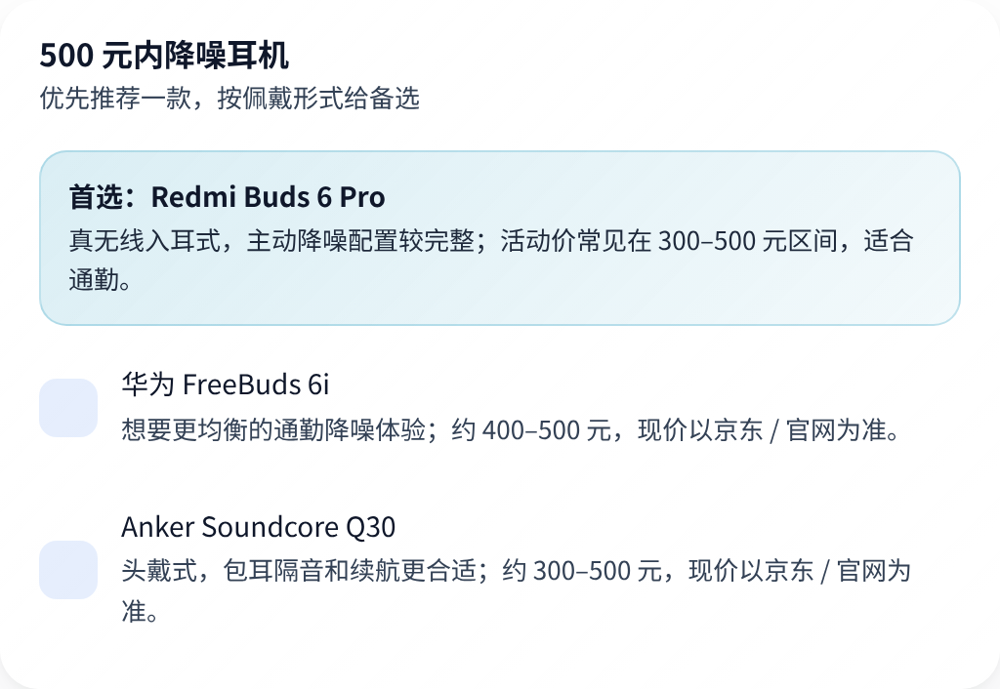
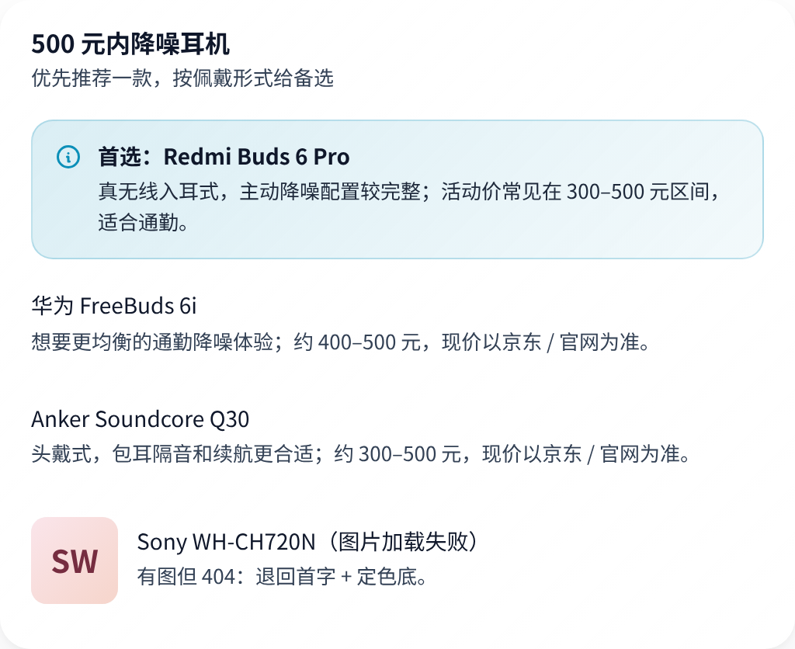

## 性能模式也关掉普通 filter: blur（dev2/perf-mode-blur，#375 跟进）

**动机**：#375 测试（tester-r375）发现性能模式 / 减少透明度只关了 backdrop-filter，普通 `filter: blur` 还在：链接卡片堆里变暗的卡（`.rp-link` / `.rp-pile-card` / `.lc-card` 的 `[data-dimmed]`，4–5px）和 agent-orb（光晕 `blur(orb-size×0.28)`、`::before` 色团 `blur(4px)`）。

**改动**：
- `app/src/perf-noblur.css`：两种情况（`html[data-perf="on"]` 和 `prefers-reduced-transparency: reduce`）各加三条，沿用 `:not(#chisabot-no-blur)` 的 id 优先级，不用 `!important`：变暗的卡 `filter: none` + `opacity: 0.36`（原来 0.46 / 0.52，去掉模糊后靠更低透明度区分）；`.agent-orb-glow` `filter: none`；`.agent-orb::before` 只留 `contrast() saturate()`。只加覆盖样式，没动 #397 的链接卡片分组结构。
- `agent-orb.tsx`：光晕的 blur 原来写在内联 style 里（id 优先级压不过），挪到组件自带 `<style>` 的 `.agent-orb-glow` 类上，数值不变。
- 新增 `app/tests/perf-noblur-filter.test.ts`：扫 styles.css、link-card.css 和 agent-orb 的 `<style>`，每条 `filter: blur` 规则在两种情况下都要有不含 blur 的覆盖；变暗卡片要有 opacity；组件不许内联写 `filter: blur`（壁纸模糊是用户自己调的，豁免）。在 main 上跑 11 条失败，本分支全过。

**测试**：typecheck ✅、build ✅、test:app ✅（1854 pass / 0 fail）、相关测试（新测试 + no-backdrop + render-budget）27 pass。Biome lint 全仓 1 error / 800 warnings / 143 infos，和 main 相同。

**浏览器（box 上 headless Chrome，沿用 tester-r375 的办法：数可见元素及其 ::before/::after 的 computed filter 里含 blur 的个数，再插入合成的 `.rp-link/.rp-pile-card/.lc-card[data-dimmed]` 看 computed filter）**，8 个页面（/sign、/、/settings、/settings/appearance、/settings/components-gallery、/memory、/bots/、/admin/models）：
- 修复前、性能模式开：/sign 有 2 个（orb 光晕 blur(15.68px)、orb::before blur(4px)），合成卡片 blur(5px)/blur(4px)/blur(5px)。
- 修复后、性能模式开：全部页面 0，合成卡片 filter none、opacity 0.36。减少透明度：同样全 0。
- 修复后、性能模式关（对照）：和修复前一样（/sign 2 个，合成卡片照旧模糊），正常模式不变。

| 修复前（性能模式） | 修复后（性能模式） | 修复后（正常模式） |
| --- | --- | --- |
|  |  |  |

**壁纸模糊（小爱 #432 决定：也关）**：
- `sky-background.tsx` 只改那一处内联 `filter: blur`：内联 style 只给 `--wallpaper-blur`（用户的模糊值）和 `--wallpaper-veil`（模糊值 / 40 × 0.55），模糊有值时加 `data-blur`；模糊本身写在 `styles.css` 的 `.chisabot-wallpaper-img[data-blur]` 上，正常模式效果不变。没动天空结构、动画和重画逻辑，用户保存的设置也不改。
- `perf-noblur.css` 两种情况各加：`.chisabot-wallpaper-img[data-blur]` `filter: none`，加一层 `::after` 半透明实色遮罩（不加新元素），颜色用已有的 `--glass-bg-opaque`（浅 / 深色各一份），透明度随用户模糊值变（20px → 0.275，40px → 0.55）。
- 测试：去掉 sky-background 的豁免；内联 `filter … blur(` 的检查改成跨行也能抓到（原来壁纸那种三元表达式写法漏掉了），新加一条检查壁纸变量和两种情况下的遮罩。旧代码上这两条都失败。
- 复测（壁纸模糊 20px，8 个页面）：性能模式开、减少透明度：computed filter 含 blur 的可见元素全部 0，壁纸 filter none、遮罩 opacity 0.275；性能模式关：每页都有壁纸 blur(20px)（/sign 另有 orb 两个），正常模式照旧。修复前性能模式开：每页壁纸 blur(20px)。
- typecheck ✅、build ✅、test:app ✅（1857 pass / 0 fail），相关测试 30 pass；Biome lint 1 error / 800 warnings / 143 infos，和 main 相同。

| 修复前（性能模式，壁纸模糊 20px） | 修复后（性能模式，同设置） | 修复后（正常模式，同设置） |
| --- | --- | --- |
|  |  |  |

## 例程数据安全：不误停、不发错地方、不误删（分支 dev2/routines-safety，审查模块 13 必修 M1/M2/M3 + 应修 S2/S6）

**动机**：审查 `/workspace/audit/13-routines.md`。定时任务有三条会伤数据的路径：正常回复被判失败、连 3 次自动暂停（M1）；原话题删了，结果发到这个机器人最近的另一个话题（M2）；读机器人资料时 DB 抖一下就把例程永久取消（M3）。另外进设置页就无确认硬删「孤儿」、服务端每 15 秒全表硬删（S2）；静默巡检收尾时整段读改写 messages JSON，会吞掉并发写入的消息（S6）。

**改法**：
- M1 `shared/schedules.ts` `classifyScheduleReply(text, signals)`：失败只看运行器信号（`toolErrors`、`runnerError`，比如推送到 IM 失败），或者结果以运行器自己写的固定开头（`运行失败：`、`没有执行：`）开始。不再拿正则扫模型正文。`TurnRunner` 的返回值加了可选的 `toolErrors`。只改分类这一段，`describeCronZh` 这些描述函数没动。
- M2 `service.ts` `threadFor`：原话题不在就返回 null，不再回退到「最近的对话」。到点时发现原话题不在：这次记 skipped（不算连续失败），任务改成 cancelled，last_result 写「原对话已删除…」。删话题（单个 DELETE，或清空全部）时，用 `cancelSchedulesForDeletedThreads` 取消挂在这些话题上的网页例程（IM 例程不动）。`ScheduleView.threadDeleted` 给设置页用，行内显示「原对话已删除」标签。为什么选取消、不选新建话题：在一个没有上下文的新话题里执行（可能还会对外推送），用户看不到也想不到；取消可以从 last_result 和标签看出来，不会发错地方。
- M3 `index.ts` 给定时任务的 `botAvailable` 不再吞异常。`fire()` 遇到异常按 BUSY_RETRY 重试（12 次 × 10s）；重试完还查不到就把这次记成 skipped，任务保持原状。只有查询成功、确认机器人已不在或已删，才改成 cancelled。
- S2 设置页去掉进页自动 `DELETE /api/schedules/orphans`，只剩「清理」按钮加确认框。服务端自动 purge 至多每小时跑一次，而且只删结束（done/cancelled）满 7 天的孤儿。「孤儿」的判定（purge 和 cancel 共用）改成：资料软删；或者资料行不存在，但这位用户还查得到别的有效机器人。资料表读不到（或这位用户一个有效机器人都查不到）时什么都不删、不取消。顺手修了 purge 删运行记录时 `ANY($1::text[])` 在 Bun SQL 下传数组报错、被吞掉的问题。
- S6 静默巡检收尾改成一条 `UPDATE … jsonb_array_elements WITH ORDINALITY`，在行锁内求值：只截掉触发消息和它后面的部分，后面有 user 消息就不动。不再整段读出来改完写回。

**测试**：
- `shared/schedules.test.ts`：O11 的 4 句回复误判，外加正文里出现「运行失败：」「没有执行：」的句子都判 ok；runner 信号判 failed。
- `server/tests/schedules-safety.test.ts`（新，Postgres）：M1 四句正常回复跑 4 次仍是 active、全部 ok；toolErrors 连 3 次才暂停。M2 原话题删除后不发任何回合、任务取消、带标记；删话题只取消挂在上面的。M3 异常重试后照常跑；一直异常时记 skipped、任务保持 active；确认已删才取消。S6 收起触发消息；后面有 user 消息时不动。S2 自动 purge 只删结束满 7 天的；资料读不到时不删；用户确认的 purge 只删确认的孤儿。
- 探针 `routines-probe.ts` 的 classify 段：4 句都从 `failed` 变成 `ok`。
- 截图：设置页标签没截。要截就得在 box 上起完整的 server + 登录 + DB，box 正在限流，没做。标签的 DOM 是 `[data-testid=schedule-thread-deleted]`。

## 工作流审批 / 执行竞态（fix/workflow-race，审查模块 13 S5）

**动机**：审查 `/workspace/audit/13-routines.md` S5 指出 `server/src/workflows/engine.ts` 四处竞态，都会让工作流多跑、误杀或超限：
- `approve` 先读状态再写，没有条件更新：两次并发批准（双击、两个设备）都能过，各自 `execute`，被审批的步骤跑两遍（重复发消息、重复花 token）。
- `execute` 的 `active.has` 检查之后才 `await getRun`，再 `active.set`：同一进程两次并发调用都能通过检查；跨容器则完全没有占位。
- `recover` 开机把所有 queued / running 标失败：部署时新旧容器重叠，新容器会把旧容器正在跑的运行标成「服务器重启，运行中断了」。
- `start` 先 `countActive` 再 `createRun`（TOCTOU）：并发启动能突破 `MAX_ACTIVE_RUNS_PER_USER=3`。

**改法**（只动 `server/src/workflows/engine.ts`、`store.ts` 和测试；没有新迁移）：
- `store.transitionRun(id, from, patch)`：`UPDATE … WHERE id = ? AND status IN (from)`，返回是否写成功。`approve` 先改好内存里的步骤状态，再用它把 `waiting_approval` 改成 `queued`（批准）或 `cancelled`（拒绝）；没抢到的返回 409「这一步已经被处理过了」。审批事件和审计在 CAS 成功之后才写，输掉的那次不留记录。
- `execute`：在第一个 `await` 之前同步 `active.set` 占位；再用 `store.claimRun`（`queued → running` 条件更新）跨进程占位，抢不到就退出。上一段执行还没退出时（刚停在审批关卡、`finally` 还没跑）又被调用，记一个 `rerun`，退出后再试一次，避免批准后卡在 queued。
- 心跳：运行期间每 30 秒 `store.touchRun` 刷新 `updated_at`（只对 running）；`recover` 只处理 `updated_at` 早于 90 秒（3 个心跳）的运行，并且标失败本身也是条件更新（`failStaleRun` 带 `updated_at < staleBefore`）。心跳新鲜的先不动，过了租约再自动查一次：真是本机上次没跑完的，晚 90 秒标失败；另一个容器还在跑的，心跳一直新鲜，不会被动。
- `store.createRunWithinLimit(input, max)`：一个事务里 `pg_advisory_xact_lock(hashtext('workflow:runs:<owner>'))`、计数、插入，超限返回 null，`start` 报 429。原来的 `createRun` 去掉（只有引擎在用）。
- 测试：`server/tests/workflows.test.ts` 加 5 条并发单测（两次并发批准只执行一次、批准和拒绝并发只有一个生效、同一运行并发 execute 只跑一次、并发启动第 4 个 429、recover 不动心跳新鲜的运行）；新增 `server/tests/workflow-race.integration.test.ts` 在真实 PostgreSQL 上验证同样几条（8 个并发启动只建 3 个、CAS、claim、引擎级并发批准、recover）。
- 没改：schedules 的 classify / service（别的分支在做）；`countActive` 留着（审查和其它读路径还能用）。

## 设备页：审批按钮状态、过期、离线禁用与无障碍（fix/devices-approvals-a11y）

**动机**：模块 14（电脑 / 设备）审计 `audit/14-computer.md`：审批行只有「拒绝」显示处理状态（S4）；倒计时到 0 后仍显示「即将自动拒绝」、按钮还能点（O1）；`useApprovalCountdown` 在本机时钟偏差、`naive<=0` 时退回整段 TTL（O2）；两个输入框没有标签、面包屑点击区只有 19px 高（O5）；错误卡标题 h4 让层级跳级（O6）；设备 404 是死胡同（O7）；离线设备的测试连接 / 紧急停止 / 开启完全访问还能点（O8）。

**改动**：
- `components/devices/devices.tsx`：`ApprovalRow` 拆成 `approve` / `deny` 两个 `useAsyncAction`，和 `chat/confirm-card.tsx` 同一套（各自 处理中 / 已允许·已拒绝 / 失败，一个在跑另一个禁用，成功后都锁住）；倒计时到 0 显示「已过期」徽标和「已过期，没有执行」，两个按钮禁用。倒计时改成 `approvalDeadline()`：有 `remainingMs` 用它，否则本机剩余时间夹在 [0, TTL]；第一次见到审批时把截止时刻钉在 `performance.now()` 上（按 id 记在模块里），之后刷新 / 重挂只会提前不会延长，到 0 停在 0。网页拿到的 `DeviceApprovalView` 目前没有 `remainingMs`（只发给 PC），服务器侧不在本次范围（开发2 S1/S2）。允许的文件夹、设备名称两个输入加 `aria-label`，文件夹校验错误用 `aria-describedby` 关联。
- 新 `components/devices/device-page-parts.tsx`：`DeviceCrumbs`（面包屑 min-h-8 = 32px）、`DeviceErrorCard`（sg-errcard 外观，标题 h2）、`DeviceNotFound`（「返回设备列表」+ 重试）、`DeviceOfflineNote`（离线说明）。
- `components/devices/full-access.tsx`：离线时禁用「开启完全访问…」和时长选择，显示说明并 `aria-describedby`。
- 路由 `settings/devices/$deviceId.tsx`、`settings/devices/index.tsx`（超出 components/devices，只改引用）：用上面几个部件；离线时「测试连接」「紧急停止」禁用并 `aria-describedby` 指向离线说明（「解除紧急停止」离线仍可点：它只改服务器上的标记，设备重连后生效）。
- 颜色 / 间距只用现有类和 Tailwind 刻度（仓库里设计规范是根目录 `DESIGN.md`，没有 `docs/design-system.md`）。

**INP**（4× CPU 降速，Playwright + CDP `Emulation.setCPUThrottlingRate`，Event Timing API，组件独立页面各点 5 次）：允许 before 48–64ms → after 48–72ms；拒绝 before 48–64ms → after 40–48ms，均 < 200ms。

**截图**：`docs/images/devices-approvals-a11y/14-{live,expired,notfound,offline}-{before,after}.png`（组件独立页面 + 构建出的 CSS）。

**测试**：`app/tests/device-approvals-a11y.test.tsx`（S4、O1、O2、O6、O7、O8）。

## Unreleased — 壁纸压缩移进 Worker、雾度滑块范围、恢复默认清天气快照（分支 dev5/wallpaper-worker）

来源：模块 11（主题 / 玻璃）审查报告第 10、11、13 条。

1. **第 11 条：壁纸压缩移进 Worker**。新增 `lib/wallpaper-compress.ts` 和 `lib/wallpaper-compress.worker.ts`：
   - Worker 里用 `createImageBitmap` 解码、`OffscreenCanvas` 缩放（`imageSmoothingQuality = "high"`）、`convertToBlob` 编码，`FileReaderSync` 转 Data URL，主线程只收一个字符串。
   - 目标最长边 = 屏幕最长边 × `devicePixelRatio`，最多 3840；拿不到屏幕尺寸时用 1920；原图更小不放大。以前固定 1920，2× 屏上会被放大发糊，1× 小屏上又白白存了大图。
   - 编码参数不变：WebP 0.84，Data URL 超过 350 万字符或浏览器不支持 WebP 编码（会悄悄给 PNG）就改 JPEG 0.8；之后仍过 `assertWallpaperDataUrlSize`（约 6 MB）。
   - 没有 Worker / OffscreenCanvas / createImageBitmap，或 Worker 出错、30 s 没回话，就退回主线程的老路径（同样的目标尺寸和编码参数）。
   - `appearance.ts` 里 `compressUploadedWallpaper` 只剩校验 + 调用，约 45 行主线程代码挪走。
2. **第 10 条：雾度滑块范围**。滑块原来是 5–45，存储层夹在 5–55，存过 46–55 的值一打开设置页就被滑块显示成 45，拖一下就被改掉。新增 `GLASS_OPACITY_MIN = 5` / `GLASS_OPACITY_MAX = 55`，存储读取、`updateAppearance` 和滑块共用。
3. **第 13 条：恢复默认清天空引擎的键**。`resetAppearanceDefaults` 现在还会删掉天空引擎（`wallpaper_core.html` 的 `SAVE_KEY`）存的地点 / 天气快照 `hark-wallpaper-v1`（`HARK_ENGINE_STORAGE_KEYS`），存储不可用时跳过。正在运行的引擎下一次取天气时可能再写一份当前快照，但之前搜过的城市不会再被沿用。

实测（headless Chrome，4000×2500 JPEG 4.57 MB，设置页上传，3 次取中位数）：

| 屏幕 | CPU | 版本 | 最长主线程长任务 | 最长掉帧间隔 | 从选文件到应用 | 输出 |
|---|---|---|---|---|---|---|
| 1440×900 @1 | 1× | main | 411 ms | 417 ms | 641 ms | 1920×1200，182 K 字符 |
| 1440×900 @1 | 1× | 本分支 | 0 | 17 ms | 302 ms | 1440×900，100 K 字符 |
| 1440×900 @1 | 4× | main | 1267 ms | 1283 ms | 1955 ms | 同上 |
| 1440×900 @1 | 4× | 本分支 | 144 ms | 150 ms | 622 ms | 同上 |
| 1440×900 @2 | 1× | main | 364 ms | 367 ms | 530 ms | 1920×1200，182 K 字符 |
| 1440×900 @2 | 1× | 本分支 | 112 ms | 33 ms | 975 ms | 2880×1800，1.43 M 字符 |
| 2560×1440 @2 | 4× | main | 1361 ms | 1383 ms | 1965 ms | 1920×1200，182 K 字符 |
| 2560×1440 @2 | 4× | 本分支 | 221 ms | 333 ms | 1950 ms | 3840×2400，2.44 M 字符 |

本分支剩下的长任务是应用壁纸本身（解码、绘制更大的背景图），不是压缩。高 DPR 下输出更大、总耗时更长，换来的是按屏幕物理分辨率显示。

测试：新增 `app/tests/wallpaper-compress.test.ts`（11 个：目标尺寸、等比缩放、Worker 成功 / 报错 / 崩溃 / 起不来 / 超时回退、能力检测、WebP/JPEG 选择、Worker 入口用替身跑一遍）和 `app/tests/appearance-haze-reset.test.tsx`（6 个：范围常量与夹取、设置页滑块 5–55 并正确显示存储的 50、恢复默认删掉 `hark-wallpaper-v1` 而不动别的键、存储抛错时不崩、引擎只用这一个键）。

和开发 4 的重叠：`appearance.ts` 只动了常量、两处 `clampNumber`、`resetAppearanceDefaults` 末尾和 `compressUploadedWallpaper`；样式重算、主题色、多标签同步、启动屏的代码都没碰。

## Unreleased — Hermes 备用模型 / 输出上限、长历史压缩（分支 feat/hermes-fallback-history）

动机：模块 8 PR2。Hermes 内核下有几处和内置内核不一致、或会互相打架的地方。

1. **备用模型和输出上限不生效**：管理员配置的备用模型和每个模型的输出上限只在内置内核里用，Hermes 内核每轮只收到模型 ID。主模型额度用完时 Hermes 直接报错，用户只看到失败。现在每轮传 `model:{id,fallbacks,maxOutputTokens}`，adapter 用 Hermes 自带的 `_init_fallback_chain` 按主模型同一个 provider / endpoint 建备用链，并设 `max_tokens`。Hermes 切换后回报 `modelFallback`，服务端核对后复用内置内核同一条日志和「已改用 X」提示。不同 Hermes 版本未必有这些内部接口，adapter 先检测、在 initialize 里如实宣告；设置页只有检测到不支持时才写「不生效」，旧桥（没有这项）不提示，不猜。
2. **长话题越聊越贵、最后超窗**：Hermes 每轮收到完整历史，长话题里大段旧工具结果（网页、文件内容）占大头，接近窗口时直接失败。现在按模型上下文窗口估算这一轮要发的 token（提示词 + 工具 schema + 历史）：
   - 估算仍用字符近似，但上一轮有 provider 返回的真实用量时，把上一轮实际发出的内容按同一方案重估，用「真实 / 估算」校准（限 0.8–3 倍）；没有就乘 1.15 的安全系数，估不准时宁可早压缩。
   - 超过 70%：较早的工具结果换成「已省略，原长 N 字」，超长旧消息只留首 1500 + 尾 500 字，最近 2 轮原样。工具调用 ID 和配对都保留。
   - 超过 85%：较早的轮次用已经缓存好的摘要代替，最近 4 轮原样；摘要后仍超 70% 再裁剪。
   - 体验优先：这一轮从不等摘要模型，首字时间不变。没有现成摘要就只裁剪，回复结束（RUN_FINISHED）后在后台生成摘要，下一轮再用；20 秒超时只用于后台，失败只记日志。最初的设计是当轮同步写摘要（最多卡 20 秒），审稿时改掉了，阻塞路径已删除。
   - 摘要按「话题 + 被摘要的轮次范围」缓存，键是这段消息内容的哈希，较早的消息被编辑、删除或重新生成时哈希变了就不再命中；截断时也按消息 ID 删掉相关缓存。范围变长时先用前缀摘要，后台只增量补新增几轮；连续续写 5 次或摘要超过 600 字就整段重摘，防止越续越走样。
   - 摘要模型用管理员配置的（新的「摘要模型」设置），未配置用主模型，不写死。
   - 同一次运行的续跑段复用第一次的方案，桥要求的「同一运行输入只追加」不被打破。
   - 只改发给 Hermes 的那一份，数据库完整历史、导出、搜索都不变。回复下方一行「已压缩前文」，有摘要可展开（`<details>` + 备用模型提示的现有类）。「开新话题」沿用上下文圆环，不加新 UI。
3. **不二次压缩**：读了 Hermes 源码，它自带的上下文压缩默认开启（`compression.enabled`，窗口 <512K 时 75% 触发），开跑前、运行中工具结果变多后、上下文溢出时都会压缩，适配器原来没关，所以会和宿主压缩叠加。现在宿主压缩过的运行带 `contextCompression: false`，适配器在这次运行里关掉 `agent.compression_enabled`，其它运行恢复 Hermes 默认。

跨 provider 的备用模型（不同 base_url / key）暂不支持，列为后续工作（见 `docs/rfc/hermes-fallback-history.md`）。

数据库：摘要缓存表 `chisabot_history_summaries` 由服务端首次使用时 `CREATE TABLE IF NOT EXISTS` 创建（带 `thread_id` 索引），每个话题最多留 10 条，不走 drizzle 迁移；DB 相关测试由测试 bot 跑。

Token 对比（`server/tests/history-budget.test.ts`，30 轮长话题夹具，每轮带一段长工具结果；字符估算 × 1.15 安全系数）：

| 情况 | 窗口 | 发给模型的估算 token |
|---|---|---|
| 改前 | — | 164,250（字符估算 142,826） |
| >70% 裁剪 | 200k（约 82%） | 48,736 |
| >85%，当轮（还没有摘要） | 160k | 48,736（只裁剪，后台写摘要） |
| >85%，下一轮（31 轮，改前 168,116） | 160k | 33,212（较早 26 轮由摘要代替） |

测试：`server/tests/history-budget.test.ts`（两个阈值、当轮不调用摘要模型 / 后台写好下一轮用、前缀摘要 + 增量续写、5 次 / 600 字整段重摘、编辑失效 / 截断失效、后台失败和超时不影响当轮、真实用量校准与安全系数、同一运行方案稳定、建表与索引、token 对比）、`hermes-runtime.test.ts`（wire model 含压缩开关、回报校验、metadata 合并）、`hermes-health.test.ts`、`history-summary-settings.test.ts`、`examples/acp-agent/bridge.test.ts`（透传、health、非法输入、不支持时 false/false）、Python `examples/hermes-agent/tests`（备用链和 `max_tokens`、mock 429 切换备用、宿主压缩过的运行关掉 Hermes 压缩、下一轮恢复）、`app/tests/chat-unify.test.ts` 和 `hermes-history-notes.test.ts`。

## 去掉滚动 / 流式热路径上的三处强制同步布局（perf/p1-5-forced-layout，FIX-PLAN P1-5 / 根因 4a–4c）

**动机**：卡顿报告（4x CPU 降速）里三处同步读布局：a) `keep-alive.tsx` capture 阶段的 scroll 监听每个事件读 `target.scrollTop`，长会话滚动 79 次 / 313ms；b) `chat-transcript.tsx` MutationObserver 每次变动读 `content.offsetHeight`，流式 731ms；c) `bot-bubbles.tsx` DocCard 的 `useLayoutEffect` 每个字读 `scrollHeight`，流式 474ms。

**改动**：
- a `KeepAliveStage`：滚动事件里只把容器记进一个 Set，不读位置；藏起来那一刻（同一次提交的 layout effect、绘制前）一次读完写进 `tops`，§98.5 的还原逻辑不变。试过改到 rAF→宏任务里批量读：流式时贴底滚动不停，读的时候布局又脏了，仍强制 60–85ms，所以放弃。
- b `ChatTranscript`：MutationObserver 只排 `pin()`（rAF），不再读 `offsetHeight`；高度变化全部交给已有的 `ResizeObserver(pinNow)`——它在同一帧布局之后、绘制之前回调，留白照样当帧吃掉 / 补上（§94），读的是已算好的布局。
- c `DocCard`：用 ResizeObserver 观察 `.chat-doc-inner` 的高度（`docIsTall(h)` = `h + 26 > 168 + 20`，与原 `scrollHeight` 阈值等价）；首次 observe 在第一帧绘制前回调，不会「先展开再收起」；没有 RO 的环境退回挂载时量一次。
- 测试：keep-alive 新增「滚动事件里 0 次读 scrollTop、藏起来后仍还原到最后位置」；chat-bubbles 新增 `docIsTall` 阈值等价与「DocCard 不再读 .scrollHeight」。

**前后对比**（dev4 harness #443 @671f6ac9，4x 降速，各 3 次取中位数，main c99ee37e → 本 PR；带 trace 与不带 trace 分开）：

| 场景 | 指标 | main | PR |
|---|---|---|---|
| stream（trace） | forced 合计 | 1311ms | 198ms（−85%） |
| stream（trace） | 4b MO 读 offsetHeight | 709–720ms / 39–42 次 | 0 |
| stream（trace） | 4c DocCard 读 scrollHeight | 285–371ms / 15–19 次 | 0 |
| stream（无 trace） | long-task ms / 最长 | 338 / 127 | 131 / 74 |
| scroll（trace） | 4a keep-alive 读 scrollTop | 311–350ms / 78–79 次 | 0 |
| scroll（trace） | forced 合计 | 324ms | 386ms |
| scroll（无 trace，两轮） | fps / style ms / script ms | 56.2 / 409 / 581；50.7 / 438 / 674 | 46.4 / 479 / 783；46.8 / 464 / 733 |

scroll 没有变好：每次滚动前样式本来就是脏的，keep-alive 不读之后，同样 79 次重算改由 `@shadcn/react` message-scroller 自己的 scroll 处理（`TPt → vF → getComputedStyle/getBoundingClientRect` 遍历全部行）付掉，总量不变（差值在噪声范围内，box 同时有其他任务）。要让滚动真正变快得改 message-scroller 的边缘计算（FIX-PLAN §1.2「补充」），不在本 PR 范围。原始数据：box `/workspace/dev5-p15-perf/`。
## 联网搜索质量（fix/hark-search-quality）

**动机**：hark 对比（0.1.108，`/workspace/hark-compare/chisabot-381/after/compare.md`）里搜索类用例都不好：#8 上海咖啡店搜了 4 次只写「未核实」，没有地址、人均和来源；#5 搜 6 次、31.6→39.9 秒；#3 五条新闻全来自同一家网站；#11 只给价格区间、没有来源，两个备选前面是空白灰色方块。

**根因（2026-10-29 用 cbtest 在线上抓 run 的 SSE，记下每次 web_search 的查询和结果）**：
- 线上所有搜索结果都是 `bing.com/ck/a` 跳转链接，也就是 DuckDuckGo 每次都失败、落到了 Bing 回退；失败被 `.catch(() => null)` 静默吞掉。原因（发布部署在 Haupt 上只读核实）：Haupt 的 DNS 和 SSRF 检查都正常，是 DuckDuckGo 的 HTML 端点对 Haupt 出口 IP 回 HTTP 202 反爬页（页面里是 `anomaly` 验证脚本，`result__a` 0 个）；Bing 正常（200，约 0.15 秒）。本 PR 初稿里推测的「DNS 被污染 / fake-IP 被 SSRF 拒绝」不对，以此为准（那是 Ayase 和 box 本机的情况，不是线上的）。
- Bing 的结果为什么无关（2026-10-29 在 Ayase 用 #8 / #11 的 5 个查询逐项对比）：我们的请求（ChisaBot UA + `setlang=zh-CN`）、Chrome UA、加 `mkt=zh-CN&cc=CN`、`form=QBLH`、先拿首页 cookie 再搜、RSS 端点，相关结果分别是 1/50、1/50、0/50、1/50、0/50、2/50；用真实的 headless Chrome 打开同样的 Bing 搜索页，结果也一样无关（上海市维基百科、Plus500、华为官网首页）。所以不是我们的解析、中文编码或缺参数，是 Bing 对这类匿名请求本身就给这种结果，调参数修不好。Bing 只能当最后的兜底，并且必须过相关性。
- Bing 给的无关结果举例：「上海 咖啡店 推荐 静安 武康路」回成人视频站，「上海咖啡馆 必去」回哔哩哔哩百度知道，「科技新闻 2026年10月29日」回 QQ 邮箱登录页，「500元以内 降噪耳机」回 Plus500 和彩票网，「漫步者 W820NB Plus」回星巴克。结果不是没传进上下文、也不是被截断，是内容本身没用；模型照 PROVENANCE_GUIDANCE 如实写「未核实」是对的。
- 搜索次数多：搜不到时返回的话是「没有搜到结果。换个说法再搜一次」，加上结果无关，模型就一遍遍换词重搜；每次搜索本身只要 0.2–0.6 秒，慢在每一步一个模型回合（1.5–9 秒）。
- 单一来源：几次搜索都没用，模型只能 web_fetch 一个自己知道的网站（#3 是 MIT Technology Review），五条新闻自然都出自它。另外 Bing 的跳转链接让每条结果看起来都来自 bing.com，模型也没法区分来源网站。
- #11 灰色方块：json-render `List` 只要 `item.icon` 有值就画带底色的 `jr-list-ic` 方块，图标名认不出时 `RichIcon` 返回空，只剩一个空方块；`Card` 标题的图标同理。没有商品卡是因为搜索没给出可用的商品页（价格、图片、链接都没有）。

**改法**：
- `server/src/web/tools.ts`：认出 DuckDuckGo 的 anomaly 反爬页（`isDuckDuckGoChallenge`），记一行 `web-search-engine-miss`（reason=challenge），之后 10 分钟内不再请求 DuckDuckGo，直接走 Bing，省掉每次白等的一个来回。DuckDuckGo 不可用且 Bing 没有相关结果时，工具结果直接说「当前搜索源不可用」，让模型这一轮别再搜（读确定的网址，或说明没有联网核实）；DuckDuckGo 正常回页面只是没结果，仍按「没搜到」处理。Bing 结果过相关性（`relevantHits`，规则见下面「返修」），全都不相关就当没搜到；只过滤 Bing，DuckDuckGo 的结果原样保留。`unwrapBingUrl` 把 `ck/a` 跳转还原成真实网址。没搜到的提示（`NO_SEARCH_HITS`）改成最多再换一次关键词，之后读确定的网址或说明没有联网核实。web_search 描述加一句「多条新闻 / 推荐尽量来自不同网站，每条注明来源网站」。DuckDuckGo 失败时日志记一行（每 10 分钟最多一行，不含查询和网址）。
- `app/src/lib/copilot/json-render/registry.tsx`：`List` 和 `Card` 先用 `iconFor` 判断图标名认不认得，认不出就不画图标位。样式未改。
**返修（小爱审查 aa92289b，2026-10-29）**：
- 相关性对中文太严：原来要求至少命中两个关键词（中文按相邻两字），「科技新闻 今天」会丢掉「IT之家 科技资讯」（只命中「科技」）。改成：查询里任一按空格分开的完整词（`queryWords`，去掉 site: 语法、泛词、年份日期和纯数字）出现在结果里就保留；都没出现时按关键词兜底，命中一个就保留；英文 / 数字按整词匹配（「AI」不算命中 `mail.qq.com`）；留下的按命中多少排序（完整词权重 10，关键词 1），同分保持原顺序。测试用真实查询：「科技新闻 今天」「漫步者 W820NB 价格」「上海 咖啡店」「小米 手环」，以及 hark 对比 #3 #5 #8 #11 线上真实发出的查询，相关的保留、Plus500 / QQ 邮箱 / LEO 词典 / 维基这类无关页丢掉。代价：「上海 咖啡店」这类查询里只命中「上海」的泛泛页面（如上海市百科）也会留下，只是排在后面。
- 过滤后为空不再报「搜索源不可用」：`sourceDown` 只在 DuckDuckGo 失败、并且 Bing 也失败或一条结果都没解析出来时为真；Bing 给了结果但全被过滤掉，按「没搜到相关结果」（`NO_SEARCH_HITS`）处理。
- 「最多再换一次词」以前只在提示词里：现在在 web_search 里按轮计数（键是这一轮的取消信号，每轮一个；没有就用确认上下文里的这一轮），一轮已有 2 次没搜到相关结果后，下一次直接返回「本轮不再搜索」（`SEARCH_TURN_STOPPED`），不联网；某次返回了「搜索源不可用」后，本轮后面的搜索也直接返回「本轮不再搜索」（`SEARCH_TURN_STOPPED_DOWN`）。有结果的搜索不计数。
- 顺手：`unwrapBingUrl` 解出来的地址若是内网 / 本机（`checkPublicUrl` 不通过），保留原 Bing 链接；`isDuckDuckGoChallenge` 不再把所有 202 当反爬，要页面里有 anomaly 验证脚本且没有 `result__a` 结果才算。
- 和 main 的 #392（web_fetch 重试、`WebIo`）有冲突，普通 merge 了 origin/main（没有 rebase）：`searchWeb` 带上超时参数，`WebIo` 加可选的 `outcome`（带「搜索源能不能用」）。
- 没改的：SSRF 名单（安全边界）、PROVENANCE_GUIDANCE（安全相关提示词，测试按 sha256 钉住）。真正让结果变好的是一个线上能用的搜索源：代码里目前不支持任何搜索 API（没有 Brave / Tavily / SearXNG 之类的配置），需要另行决定是否接入；这次的改动保证搜不到时不拿无关页面当结果、不再连搜。

## 流式回复时打字不再乱序、不再残留（分支 dev2/stream-composer，随 0.1.111 发布）

来源：性能审查 01-chat-streaming 第 1 项。4x 降速下边流式输出边打 `abcdefghij`，得到 `bcdefghija`，光标跳回开头；文档卡流式时打字再退格，会留下残字，并跟着下一条消息发出去。

### 根因

- 流式回复每到一块，`ChannelChat` 重渲染一次，传给 Composer 的 `agents={toAgentOptions(...)}` 是内联新数组（`agents = []` 默认值也是每次新数组）。
- 于是 `triggers`（`useMemo([agents, commands])`）和 `handleChange`（`useCallback([commands])`）每块都换新引用。这两个都是 prompt-area@0.6.8 值同步 effect 的依赖：`useEffect(() => { if (!composing && value !== lastEmitted) renderSegmentsToDOM(value) }, [value, renderSegmentsToDOM, …, onChange])`。
- 每块提交后都留下一个待执行的 passive effect，里面捕获的是旧 `value`。按键恰好落在“提交之后、effect 执行之前”时，按键的同步 setState 会先把这个 effect 冲掉：用旧值重写 DOM，光标被夹回旧长度；下一次渲染再把文字写回来时光标位置已经错了，后面的字就插错位置。退格同理，被删掉的字被旧值写回来，成为残留。

### 改动

- `composer.tsx`：`agents` / `commands` 放进 ref，`triggers` 只建一次（`buildTriggers({ agents: () => agentsRef.current, commands: () => commandsRef.current })`），`handleChange` / `flushPendingChange` 读 `commandsRef.current`、依赖为空。流式块不再让值同步 effect 重跑，按键之间不会再插进旧值。
- `triggers.ts`：`agentTrigger` / `slashCommandTrigger` / `buildTriggers` 接受数组或取值函数（`OptionSource`），在 `onSearch` 时才读，@ 提及和 / 命令列表始终是最新的。
- prompt-area 不打补丁、不升级：0.7.0 是破坏性版本（新增 `cn` peer 依赖、要求 Node 20+），0.7.1 只有性能改动，都没修这个竞态；问题出在我们每块都换依赖，从 Composer 这边修掉即可。

### 测试

- 新增 `app/tests/composer-stream-typing.test.tsx`：父组件每“块”重渲染一次 Composer（内联 agents / commands 新数组），在 useLayoutEffect 里（提交之后、passive effect 之前）送一个按键。
  - 打 `abcdefghij`：main 上得到 `bcdefghija`，修后完全一致；
  - 打 `测试输入abc` → 退格到空 → 打 `继续` → 发送：main 上编辑器里是 `试输入abc测`，修后只发出 `继续`。
  - 两个用例在 main 上都失败，修后都通过。

### 实测（Jun 电脑，本地 server + app + mock 模型，独立 headless Chrome，GPU 开：ANGLE / RTX 3060 Laptop D3D11）

4x 降速，文档卡流式时连打 6 轮 `abcdefghij` 再退格 10 次：

| | 打字正确 | 典型错误 |
| --- | --- | --- |
| main | 1/6 | `bcdefghija`、`abcdefgijh`，退格后残留 1 个字 |
| 修后 | 6/6 | 无 |

这一项只修正确性，不改性能；流式时的长任务和 INP 在 dev2/stream-perf 里处理。

## 新话题首字延迟（perf/first-text）

**动机**：新话题从按发送到第一个字要 5.7–7.2 秒，而且前 1.8 秒画面上什么都没有（`/workspace/ft/PR2-notes.md` 里有线上逐请求时间线）。`/run` 之前串着几次互相等的请求：POST /api/channels 要等频道列表刷新完才算建好（~0.5 秒）→ 跳到新对话后接入回放（~0.45 秒）→ 读历史（~0.35 秒）→ 面板会话（~0.4 秒），最后 `/run` 在 2.2 秒左右才发出。搜索类问题还会先 skill_load research-public-web 一轮（2.5–4.5 秒），模型也常常一声不吭连搜好几次。

**做法**：
1. 串行改并行（前端）：`createChannelMutationOptions` 的 onSuccess 不再把 invalidate 的 promise 交回去，mutateAsync 建好就返回，列表在后台刷新；带着第一句话（seed）挂载的新对话，线程是刚建的、服务器上什么都没有，挂载后第一次跳过接入回放和读历史，直接放行；`deliver` 一开始就去拿面板会话，和就绪 / 接入两道等待同时进行，出错时仍撤回刚加的消息并抛出。
2. 发送后立刻有状态（前端）：新建页把 `busy={sent !== null}` 交给 ConversationView；新对话用 `seedSending`（seed 发出去之前一直为真）并进 `chatBusy`。原因：ChatTranscript 只在「忙之后列表变了」才算这一轮在跑，第一帧不忙就会把带着 seed 的列表记成「已答完」。用的是现有的「思考中」，样式一个没改。
3. 先一句再动手、按需搜索（提示词，`WORK_STYLE_GUIDANCE`）：动手前先写一句 15 字以内的话，紧接着调工具，不复述问题、不列计划；能直接答的（常识、解释、计算、写作、翻译、出主意、闲聊）不调工具，只有取决于最新或具体事实的才搜。没改 web/tools.ts，免得和 #407 冲突。
4. 研究技能按需预置：`looksLikeResearch` 认出新闻、价格、推荐、对比、天气、汇率之类的问题，只有这时、而且共享技能 research-public-web 对这个人可见，才把它的方法附在技能目录后（约 250 字），省掉一轮 skill_load。普通对话一个字不加；宁可漏判，所以不收「今天」「现在」「比较」这类日常词。个人记忆加载器多收一个参数（这一轮用户最后说的话）。另外，个人记忆、技能目录、GitHub、文件、待确认这几段原来一段等一段，现在用 Promise.all 同时读，拼接顺序不变。
5. 服务器分段计时：`agents/run-timing.ts`。`/api/copilotkit/*` 进门时用 AsyncLocalStorage 记下时刻，Hermes 每轮结束打一行 `{"type":"run-timing",...}`，字段有 queueMs（进门到 agent.run，含会话守卫、建线程、个人记忆）、memoryMs、assembleMs、prepareMs、remoteStartMs、firstTokenMs、firstToolMs、firstTextMs、totalMs、toolCalls，只有毫秒数和计数，不含内容。
6. 可插拔搜索 provider 没动。

**测量（页面内 SSE，cbtest，线上 ayase.cn:8443，2026-10-29 17:17–17:44 北京时间，三类各 5 次）**：

| 中位数 | 新话题 前→后 | 已有话题 前→后 | 搜索类 前→后 |
|---|---|---|---|
| 「思考中」出现 | 1.80 s → 0.044 s | 0.046 → 0.046 s | 1.78 s → 0.044 s |
| `/run` 发出 | 2.17 → 0.84 s | 0.37 → 0.40 s | 2.15 → 0.84 s |
| 第一个字（SSE） | 4.79 → 2.96 s（2.44–4.53） | 3.08 → 3.47 s（模型波动） | 见下 |
| 第一次工具调用 | — | — | 5.76 → 3.36 s |

- 「后」是用 Playwright 的 route 把线上页面的前端换成这个分支本地构建的 `app/dist`，接口仍然走线上服务器。所以「后」**只包含前端的改动（1、2）**；服务器的改动（3、4、5 和记忆并行读）没部署，不在这组数字里，只有单元测试覆盖。合并部署后可以看 `run-timing` 日志和再跑一次同样的探针。
- 新话题首字中位数降到 3 秒以下，但单次仍有 4.5 秒的：`/run` 到第一个字这段（中位 2.1–2.6 秒）基本是远端 Hermes 和模型的时间，前端已经没剩多少可省。
- 搜索类的「第一个字」前后都是几十秒（2.6–122 秒），因为线上提示词下模型在调工具前不说话，第一个字要等全部搜完。这正是第 3 条要改的，但这次测不到。
- 「前」用的是装着 Service Worker 的旧浏览器配置；「后」为了让 route 生效换了新配置并屏蔽了 Service Worker。只影响打开页面的速度，不影响按发送之后的计时。

**自测**：typecheck 0；app build 0；test:app（见 PR）；server 相关测试 127 pass / 0 fail（新增 first-text-latency、memory-runtime、chisa-skills、hermes-runtime、hermes-context、reply-style、copilot 等）；app 新增 first-text-latency 等 21 pass；Biome 43 → 43，没有新增。

## Unreleased — 链接预览服务端：GitHub 预览图、视频/百科卡片、反爬降级（分支 dev3/link-preview）

来源：审查报告第 6 项（链接卡片）。只改 `server/src/link-preview/`，没有动 SSRF 规则、guardedFetch 和网关配置。

1. **GitHub 无图根因**：页面正常，`og:image` 也拿到了（`opengraph.githubassets.com/<hash>/owner/repo`）。但这个图片地址经常返回 `429 text/html "Too many requests"`（`x-ratelimit-remaining: 0`，`retry-after: 900`）。`sniffImage` 判它不是图片，紧接着的重试也是 429，于是卡片无图，而且被“成功”缓存锁了 24 小时。和 UA、大小、类型都无关。修复：
   - 图片失败时记录日志 `link-preview-image-failed`，内容包括 role、去掉查询串的 url 和 reason；
   - 只有网络错误、5xx、空响应才重试；
   - 先依次尝试 `opengraph.githubassets.com/1/{owner}/{repo}` 和 `avatars.githubusercontent.com/{owner}`；
   - 有图却没取到时 TTL 改为 30 分钟。
2. **YouTube / bilibili / 百度百科**：分别走 oEmbed、`x/web-interface/view`、`BaikeLemmaCardApi`。前两者带 `kind: "video"`。API 失败就退回抓网页；退回后图片失败也用短 TTL。知乎没有公开接口，页面和 API 都是 403 加 JS 反爬，只能识别后降级，不绕过。
3. **反爬页**：sec.* / captcha 主机、“安全验证 / Just a moment”这类标题、知乎 zse-ck 都按失败处理（degraded、30 分钟）。没有标题、描述和图片的空 200 页也一样。卡片显示的域名取原始链接，不取跳转后的地址。
4. Punycode 显示为 Unicode；HTML4 的 252 个命名实体全部解码；直链图片的标题用文件名（没有文件名时用“图片”），不再显示成扩展名。
5. **no-store**：根因在网关（`location /` 的 `proxy_hide_header Cache-Control`，再由安全头加 `no-store`），应用自己的头是对的。评审决定在本 PR 里改网关，单独 commit，只改仓库文件：
   - `Cache-Control: no-store` 从 `security-headers.conf` 拆到 `cache-no-store.conf`，原来 include 安全头的地方都同时 include 它，其他路径的响应头不变；
   - 新增精确匹配的 `location = /api/link-preview`（照抄 `location /`），透传应用的 `private, max-age=600`；非 2xx 且上游没给 Cache-Control 时，由 `$preview_cache_control` map 补 `no-store`；
   - 应用端：该路由所有非 2xx 自己设 `no-store`。
   - 部署：`nginx.conf` 和 `cache-no-store.conf` 必须一起上线，先跑 `nginx -t`。
6. **同形字与验证页误判（返修）**：punycode 只在标签是纯拉丁或汉字 / 假名 / 韩文时转 Unicode，西里尔、希腊等文字或混合文字保留 `xn--`（`xn--pple-43d.com` 不再显示成 аpple.com）。验证页标题改为整标题匹配；「请稍候 / Access denied」这类只按前缀匹配，并且要有 403/429/503 状态码或挑战页特征佐证，「短信验证码接口设计 - 知乎」「Access Denied (2023 film)」「请稍候，正在加载」不再误判。

测试：`server/tests/link-preview-service.test.ts` 共 26 个用例，覆盖缓存过期、降级、直链图片、图片失败与回退、并发去重、限流（40 次/分钟，缓存命中不计数）、各 API 源。原有的 `link-preview.test.ts` 照常通过。

## Unreleased — 设置搜索按稳定锚点定位（分支 dev2/settings-find）

来源：审查模块 12 应修第 2 条。cbtest 能看到的 28 个搜索条目里有 13 个「跳过去但没定位」：SettingsFind 只按标题文字（全等或前缀）找，registry 的 `find` 和页面标题对不上就静默放弃，用户只看到页面顶部。

改动：
- 新增 `app/src/lib/settings/locate.ts`：`locateSettingItem` 先找 `[data-setting-item~="页.项"]`（registry 的稳定 id），再找 `[data-setting-item~="<find 文字>"]`（外观页三块已有的属性），最后才按标题文字兜底。`settingTarget`：命中锚点就高亮锚点本身，命中文字才往上找所在的行 / 区块。
- `SettingsFind`（settings-search.tsx）改用上面两个函数，滚动（只滚设置页自己的容器）和 `setting-flash` 高亮不变。
- `PageSection` 加可选 `settingItem` 属性，渲染成 `data-setting-item`。给每个带 `find` 的条目补了锚点（共 40 个，含管理员页）；一块对应多条时用空格分开（账号连接的日历 / 邮箱 / 通知 / 晨报四条都落到「日程、收件箱、通知推送与每日晨报」）。
- **registry.ts 一行没改**：id 本来就稳定，find 文字只作兜底，前端改第 4 条文案不会和这里冲突。
- appearance-preferences.tsx 没动：主题配色 / 面板玻璃材质 / 背景壁纸三块的属性已经在，通过 find 文字锚点命中。

测试：
- 新增 `app/tests/settings-find-anchors.test.tsx`（45 个用例）：从 registry 推出每个带 find 的条目，断言源码里恰好有一个对应锚点；所有 `页.项` 形式的锚点都能在 registry 里找到；渲染 PageSection / 真实的 AppearancePreferences，断言「晨报」落到「日程、收件箱、通知推送与每日晨报」区块、锚点优先于同名标题、文字兜底仍可用。期望值都从 registry 推导，不写死条目文案。
- typecheck、build、test:app 全过；Biome 全仓 1082 errors / 800 warnings / 143 infos，与 main 相同，无新增。
- 实机（box 上独立 headless Chrome、临时 profile、本地生产构建、API 打桩）：打开 `/settings/connected-accounts#find=connected-accounts.morning-brief`（搜索「晨报」回车后就是这个地址）。

| 改前：停在页面顶部 | 改后：滚到「日程、收件箱、通知推送与每日晨报」并高亮 |
|---|---|
|  |  |

其它抽查（改前都定位不到）：已保存的登录、主题配色、一键整理记忆。

| 已保存的登录 | 主题配色 | 一键整理记忆 |
|---|---|---|
|  |  |  |

## Unreleased — 侧栏小字 / 字母头像对比度，强制颜色与增加对比度（分支 dev5/a11y-contrast）

来源：模块 11（主题 / 壁纸 / 玻璃）审计第 6、7 条。没有改 `appearance.ts`、主题色 meta、多标签同步和启动画面（开发4 在修）。

1. **对比度（第 6 条）**：三处小字改用新的颜色 token，浅色、深色各一份，定义在 `styles.css` 的 `:root` / `.dark` 块里：
   - 侧栏「主机器人」标题 `.glass-sec-main`：`--side-sec-main-ink`，浅色 #c48a0a → #553600，深色保持 #f2c14e。星形图标仍是琥珀色，只有文字加深。
   - 字母头像 `.glass-avatar`：`--avatar-ink`，白字 → #1e2a4a。粉蓝渐变底色很浅，白字只有 1.6:1。
   - 侧栏副标题 `.glass-item-s`：`--side-sub-ink`，深色 #94a3b8 → #b4bfcf。浅色 #475569 → #303d50 也一起加深，因为测试要求每种组合在模型最差的情况下也 ≥ 4.5。
2. **强制颜色 / 增加对比度（第 7 条）**：
   - `perf-noblur.css` 原来「减少透明度」时关模糊、换不透明底色的那条 `@media`，现在也匹配 `(prefers-contrast: more)` 和 `(forced-colors: active)`。
   - 新增 `a11y-modes.css`，在 `perf-noblur.css` 之后引入。和 perf-noblur 一样用 `html:not(#chisabot-no-blur)` 抬优先级，不用 `!important`。
   - 增加对比度：二级 / 三级文字的 alpha 和颜色加深，分隔线、输入框、焦点环加深，面板加 1px 实线边，焦点环改成 2px 实线。
   - 强制颜色：天空 / 壁纸 / 光斑装饰层不画；面板、卡片、弹层用 `CanvasText` 描边；当前项和选中项用 `Highlight` 描边；字母头像用 `Canvas` / `CanvasText`；`:focus-visible` 用 2px `Highlight` outline。

3. **壁纸最差情况（审查后补）**：对比度模型（`app/tests/contrast-model.ts`）加上壁纸：纯白、纯黑和所有预设 SVG 色标 × 压暗遮罩两个色标 × 不透明度 0 / 0.75 × 天幕薄纱 × 3 种玻璃 × 雾度 5% / 55%。原来的令牌在壁纸下不达标（浅色：纯黑壁纸 + 晶莹玻璃 + 不压暗，主机器人标题 / 副标题 2.82；深色：纯白壁纸，主机器人标题 3.41、副标题 2.63），所以不改令牌，给有壁纸时的左栏卡片加薄幕 `--side-wallpaper-scrim`（浅 .36、深 .6）。之后壁纸最差：主机器人标题 浅 4.82 / 深 7.45，副标题 浅 4.83 / 深 4.70，字母头像 8.36（浅深一样）。字母头像改深墨的说明写进 `DESIGN.md` §81.5。

4. **壁纸最差情况（第二轮审查）**：薄幕扩到账号卡（`.acct-card` / `.acct-mini-card`）、收起态左栏（`.glass-mini-card`）、机器人气泡和输入框；浅色薄幕 .36 → .44（账号卡副行 `--ink-3` 要 .44 才到 4.5）。壁纸下输入框占位字换成 `--glass-ink-3`。模型新增这 5 个元素（`SURFACES`，玻璃取渐变全部色标），薄幕是否生效直接读 `styles.css`。改前 → 改后最差：账号卡名字 浅 3.78 → 8.01 / 深 4.84 → 11.39，账号卡副行 2.19 → 4.64 / 3.41 → 8.02，收起态图标 3.10 → 6.56 / 4.11 → 9.66，机器人气泡和输入框文字 4.37 → 8.54 / 5.32 → 11.83，输入框占位字 1.86 → 4.95 / 2.17 → 8.34，我的气泡 8.62 / 8.31 不变；左栏主机器人标题浅色 4.82 → 5.36、副标题浅色 4.83 → 5.38（深色不变 7.45 / 4.70）。

5. **壁纸：只留一层薄幕（第二轮预审 fcfb25c6）**：上一版给账号卡、收起态左栏、气泡、输入框各自垫薄幕（`--side-scrim-layer`），有两个问题：气泡和 `.jr-card` 共用一条背景规则，`--side-scrim-layer` 又会继承，嵌在气泡里的卡片叠了两层薄幕（ink-3 浅 7.52 / 深 11.44，比别处更实）；直接落在壁纸上的字（时间、空状态、步骤行、顶栏、页面）、气泡外的卡片、右栏都没有薄幕，最差浅 1.01–2.38、深 1.46–3.58。改成一层：`.chisabot-wallpaper::after` 在压暗遮罩和天幕薄纱之间铺 `--wallpaper-scrim`（浅 .56、深 .55，深色由左栏副标题 #b4bfcf 卡在 .55），删掉每张卡片的薄幕和 `--composer-placeholder-ink`；有壁纸时 `--ink-4` / `--glass-ink-4` / `--text-tertiary` 提一级。模型改成「壁纸 → 压暗 → 薄幕 → 天幕薄纱 → 每层玻璃」，新增 4 种位置：直接在壁纸上（12 个文字令牌）、右栏、气泡外的 `.jr-card`、气泡里的 `.jr-card`（两层玻璃）；按完整选择器查规则（不再子串匹配），并检查全站只有一处画薄幕、每种位置只有一层。fcfb25c6 → 现在最差（浅 / 深）：直接在壁纸上 ink-3 1.38 → 4.79 / 2.52 → 6.69，ink-4 1.01 → 4.79 / 1.46 → 6.69，主文字 2.38 → 8.25 / 3.58 → 9.50；右栏 ink-3 2.19 → 5.60 / 3.41 → 7.77；气泡外卡片 ink-3 2.54 → 5.88 / 3.75 → 8.08；气泡里卡片 ink-3 7.52 → 6.81 / 11.44 → 9.25（去掉了第二层）；账号卡副行 4.64 → 5.60 / 8.02 → 7.77；收起态图标 6.56 → 7.91 / 9.66 → 9.36；气泡和输入框文字 8.54 → 10.14 / 11.83 → 11.46；占位字 4.95 → 5.88 / 8.34 → 8.08；我的气泡 8.62 → 13.06 / 8.31 → 13.34；左栏主机器人标题 5.36 → 6.34 / 7.45 → 7.20，副标题 5.38 → 6.35 / 4.70 → 4.58。代价：壁纸整体更淡（浅色多 56% 白、深色多 55% 深蓝）。

6. **壁纸薄幕降到最低值（小爱定的方案 1）**：薄幕浅 .56 → .53、深 .55 → .54，用对比度模型扫出来的「全部情况 ≥ 4.5」最低值（浅 .527 由直接在壁纸上的 --ink-3 卡住，纯黑自定义壁纸 + 压暗 0；深 .533 由侧栏副标题卡住）。试过浅 .45：直接在壁纸上的 --ink-3 / --ink-4 / --muted-foreground / --glass-ink-3 / --glass-ink-4 只有 3.88（压暗 18% 时 4.24，只看预设壁纸 4.00），不达标。不提一级字色时最低要浅 .702 / 深 .632。现在最差（浅 / 深）：直接在壁纸上 主文字 7.80 / 9.32、ink-3 和 ink-4 4.53 / 6.57、text-secondary / tertiary 5.87 / 7.41；账号卡、收起态左栏、右栏 ink-3 5.36 / 7.66；机器人气泡、气泡外卡片、输入框占位字 5.66 / 7.97；气泡里卡片 ink-3 6.62 / 9.16；我的气泡 12.79 / 13.24；左栏主机器人标题 6.10 / 7.10、副标题 6.12 / 4.53；字母头像 8.36。

实测数据：本地服务、单用户模式、headless Chrome 1440×900。对比度是把文字设成透明后，取元素背景像素的中位数，和文字颜色计算；范围是 6 个主题色里的最小到最大。

| 元素 | 方案 | 改动前 | 改动后 |
|---|---|---|---|
| 主机器人标题 | 浅色 | 2.02–2.52 | 7.35–9.14 |
| 主机器人标题 | 深色 | 9.66–10.57 | 9.53–10.49（颜色未变） |
| 侧栏副标题 | 浅色 | 6.65–7.15 | 9.65–10.36 |
| 侧栏副标题 | 深色 | 4.02–4.54 | 5.45–6.20 |
| 字母头像 | 浅色 | 1.62 | 8.73–8.75 |
| 字母头像 | 深色 | 1.65 | 8.58 |

模糊层数：数的是 computed `backdrop-filter` 不是 none 的可见元素。
- 强制颜色下，`/settings` 从 17 降到 0，`/bots` 从 4 降到 0；增加对比度下也一样，浅色、深色都是。
- 普通模式不变，仍是 17 / 4。

测试：
- `app/tests/a11y-contrast.test.ts`（14 个用例）加模型 `app/tests/contrast-model.ts`。直接解析 `styles.css` / `perf-noblur.css` 里的真实 token，按天空渐变 + 天空遮罩 + 玻璃面板（液态 / 晶莹 / 磨砂 × 不透明度 5–55）+ 悬停 / 选中行底色逐层合成，算出最差对比度。覆盖 6 个主题色 × 浅 / 深，三处都要 ≥ 4.5；增加对比度下的 token 要 ≥ 7。把三个 token 换回旧颜色，这些用例会失败。
- `app/tests/a11y-modes.test.ts`（5 个用例）：检查两种模式的 CSS 规则和引入顺序。
- `no-backdrop.test.ts` 跟着新的 `@media` 写法更新。

## Unreleased — 输入框与附件（审查模块 4，分支 dev3/composer-audit）

### 动机
审查报告 `04-composer.md`：手机上回车直接发送、软键盘打不出第二行（M4-1）；慢网上传 20 秒只有灰块、发送键变灰也没说为什么（M4-2）；上传失败文件直接消失、不能重试，断网显示英文「Failed to fetch」，500 时文件名出现两次（M4-3、M4-7）；拖文件过来没有高亮（M4-6）；× 和手机工具栏按钮太小（M4-9）；「队列消息」「驳回此拒绝」「再次记录」等文案和语音功能五种叫法（M4-10）；长粘贴不会折成附件（M4-11，对齐 Hark）。

### 改动
1. **触屏回车换行**：`useCoarsePointer()`（`pointer: coarse`）为真时给 PromptArea 传 `submitOnEnter={false}`，只有发送按钮能发；编辑区的 `enterkeyhint` 设成 `enter`（鼠标设备是 `send`）。PromptArea 不转发这个属性，所以在 effect 里直接写到 contenteditable 上。
2. **真实上传进度**：`attachments.ts` 的上传从 `fetch` 换成 XHR（`postWithProgress`），`xhr.upload.onprogress` 写进 `upload-progress.ts` 的外部 store（按附件自己的本地 id 记，只在整数百分比变化时通知）。只有图块上的百分比和发送键旁的「上传中 63%」订阅它，进度跳动不会让整个 Composer 重渲染。
3. **上传失败保留卡片**：SDK 的 `onUploadFailed` 里 `reason === "upload-failed"` 的，不再进拒绝列表，而是作为失败卡片留在附件栏，带「重试」（同一个 `File` 重新走 `stageFiles`）和 ×。断网（XHR `onerror` 且 `navigator.onLine === false`）显示「网络已断开，没能上传。联网后点「重试」。」，其他网络错误「网络出错，没能上传。请点「重试」。」。500 没有服务端原因时是「上传失败，请重试。」，不再带文件名。
4. **拖放高亮**：用上 SDK 的 `dragOver`，表单 `data-drag-over="true"` 时画虚线 outline（不用 ring，免得盖掉 `.glass-composer` 自己的阴影）。`dragleave` 移到子元素上时不算离开，避免闪烁。
5. **44px 触控区**：新增 `.touch-target::after`（以控件为中心、至少 44×44 的透明点击区），用在附件 × 和失败卡片的重试上；`@media (pointer: coarse)` 下工具栏所有按钮同样处理。外观尺寸不变。
6. **文案**：排队时发送键「排队发送」；拒绝条关闭键「关闭这条提示」/「关闭这 N 条提示」；麦克风出错的按钮「重新录音」；语音功能统一叫「语音输入」（「取消语音输入」「正在识别…」「停止并转成文字」「转成文字并发送」）。拒绝原因不再重复文件名（`picked-files.ts`）。麦克风被拒时「去哪里打开」的提示在 `lib/dictation/recording.ts` / `session.ts` 里，和语音 PR 改的是同几行，放到那个 PR 里做，避免两个 PR 冲突。
7. **长粘贴折成附件**：纯文本粘贴超过 `LONG_PASTE_CHARS = 2000` 字、且这个输入框能上传附件、且不超过模型能读的 `MAX_EXTRACTED_CHARACTERS`（12 万字）时，`onRawPaste` 拦下，变成「粘贴的文本 N.txt」文本附件，随消息一起发；卡片上的文件名可以点开对话框预览全文。短粘贴照旧进输入框；不能附件时也照旧进输入框，不会丢。超过 12 万字的粘贴不折成卡片，直接提示太长、请分几次粘贴（否则模型只读到前 12 万字）。
8. **上传中删附件会取消请求**：`postWithProgress` 接 `AbortSignal`，请求体还没发完时 × 掉卡片就 `xhr.abort()`；已经发完（`upload.onprogress` 到 100% 或 `upload.onload`）就让它落地，由对账逻辑把行还回去。每个上传的 AbortController、进度、粘贴预览都按附件的本地 id 记（`upload-identity.ts`：`stageFiles` 交给 SDK 前给每个 `File` 发一个 id；SDK 的占位卡只带文件名和大小，所以只在「占位卡对上哪个上传」这一步按文件名+大小、先进先出匹配）。两个同名同大小的文件一起上传时（SDK 默认一次只传一个，第二个在排队），删排队的第二个不会再取消正在传的第一个，第一个失败也照样显示；被删的排队文件不会再发出请求。删第一个也只取消第一个。上传成功或失败后都清掉对应记录。

### 测试
- 新增 `app/tests/composer-audit-m4.test.tsx`（13 个用例，在 main 上全部失败）：触屏回车不发送 + enterkeyhint、鼠标回车仍发送；进度回调 0.5→1、上传中显示「上传中 50%」且发送键禁用；500 不带文件名、断网中文提示；失败卡片 + 重试成功；拒绝原因不含文件名；拖放高亮且移到子元素不闪；× 有 touch-target、样式表有 44px 规则；文案；长粘贴变卡片、上传内容是原文、能预览，短粘贴不变。
- 新增 `app/tests/fetch-backed-xhr.ts`：上传改走 XHR 后，原来打桩 `global.fetch` 的 10 个附件测试文件改为先装这个转发到 `fetch` 的 XHR 替身，测试内容没改。改了文案的旧断言同步更新。
- 不在范围：Shift+Enter 4× 降速下的重渲染耗时（M4-5，另有人做）、PDF 支持（M4-8）。

## 性能模式下形象头像只留静态形状（dev3/perf-mode-avatar-still，叠在 #406 上）

**动机**：性能模式（`<html data-perf="on">`）的方向是「流畅优先、真的省活」（性能审计 2026-10-28：动态内容会让上面的玻璃每帧重绘，无限动画是卡顿来源之一）。#406 里 JS 的持续变形在性能模式下已经不登记，但 CSS 的表情动画只在 `prefers-reduced-motion` 时关：性能模式下 `data-morph` 不在，原来让位给变形引擎的 `sa-breathe / sa-look / sa-blink`（以及选中的 `sa-pop`、做完的 `sa-hop`、眼睛的过渡）反而重新跑起来；换形状的 motion 弹簧也只看减少动态效果。无头 Chromium 实测（左栏 24 个头像里 3 个在干活 + 3 个在想 + 1 个选中）：开性能模式后头像上一直有 24 个在跑的 CSS 动画（breathe 6、look 6、blink 12）。

**改法**：
- `styles.css`（`.sa` 一节，顶层）：`html[data-perf="on"] svg.sa :is(.sa-body, .sa-eyes, .sa-open, .sa-happy) { animation: none; transition: none; }`。不用 `!important`：优先级 (0,3,2) 压过所有 `.sa` 表情规则（最高 (0,3,0)）。减少动态效果原来那条 `@media (prefers-reduced-motion)` 规则不动。
- `shape-avatar.tsx`：换形状时减少动态效果 **或** 性能模式都直接画到位，不起 motion 的弹簧（它也是一个 rAF 循环）。变形本来就按同一个 `still` 不登记；性能模式中途打开时立刻摘掉（循环停、画回自己的形状），关掉立刻恢复。
- 表情本身（选中时眼睛放大、做完了的 ^ ^）照常切换，只是没有动画和过渡。
- `app/scripts/avatar-morph-harness/`：harness 能开关性能模式；新的 `perf-check.mjs`（`bun app/scripts/avatar-morph-harness/run.ts <输出目录> perf`）量开 / 关 / 再关三段的头像动画、变形帧和 rAF 调用。

**证据**（无头 Chromium，box 上，每段 2–3 s；`document.getAnimations()` 里 target 在 `.sa` 里且 `playState === "running"` 的个数）：

| 场景 | 阶段 | 改前：头像动画 / 变形帧 / rAF | 改后：头像动画 / 变形帧 / rAF |
| --- | --- | --- | --- |
| 左栏 24 个（3 干活 + 3 在想 + 1 选中） | 性能模式关 | 0 / 120 / 120 | 0 / 120 / 120 |
| | 性能模式开 | **24** / 0 / 0 | **0 / 0 / 0** |
| | 开着时再换状态 | **12** / 0 / 0 | **0 / 0 / 0** |
| | 再关 | 0 / 120 / 120 | 0 / 120 / 120 |
| 四种状态各一个 120px | 性能模式开 | **8** / 0 / 0 | **0 / 0 / 0** |
| | 再关 | 0 / 120 / 120 | 0 / 120 / 120 |

关着时 0 个 CSS 动画是因为变形引擎在管（`data-morph="on"` 时 CSS 动画让位），帧都在 rAF 里；开着时改后 CSS 和 JS 都是 0，关掉恢复原样。

**测试**：`app/tests/avatar-perf-still.test.tsx`（独立进程，加进 run-app-tests 的 ISOLATED）：性能模式开着渲染在干活 / 在想 / 选中的头像不登记变形、变形循环一帧不排、换形状直接画到位且不调 requestAnimationFrame；关掉恢复变形和弹簧，再开立刻停；styles.css 里有这条顶层规则（animation / transition 都是 none、没有 `!important`），优先级压过每一条会动的 `.sa` 规则。把 `shape-avatar.tsx` 和 `styles.css` 换回改前，前两个用例失败。

## 机器人资料和头像审计修复（模块 10，dev2/avatar，叠在 #406 上）

**动机**：审计 10 的问题：编辑资料时头像保存失败，错误一闪就没了（IdentityCard 用名字当 key，改名后整张卡重挂）；头像表在别的标签页或回到窗口时不刷新；加载中和 500 时显示一个随机花纹，看起来像是真的头像；上传框不说支持哪些格式；透明 PNG 被铺成白底；小图没有提示；拖拽没有反馈；关掉编辑框后焦点丢了；还有一些读屏的问题。方向：先和 Hark 一致、顺手，不动主题、毛玻璃和天空。

**改法（按审计条目）**：
- 1：`profile.tsx` 的 IdentityCard 改用 `key={agent.id}`。编辑时头像失败抛 `AvatarSaveError`，表单留在原处，提示「资料已保存，但头像没能保存。」，旁边有「重试保存头像」（资料已经一致，重试只重存头像）。
- 2：头像查询 `refetchOnWindowFocus: "always"`（`true` 会被 5 分钟 staleTime 挡住）；保存后通过 BroadcastChannel `chisabot:bot-avatars` 通知其他标签页去 invalidate（`BotAvatar` 引用计数订阅）。
- 3：头像表加载中显示中性占位（`.bot-ava-placeholder`、`aria-busy`）；500 等错误显示灰色首字，不再用随机花纹。老服务器 404 仍按空表处理。
- 6：上传框写明「PNG / JPEG / WebP / GIF / BMP，最大 15 MB」，不支持的类型（包括 SVG）报错时也带这句。
- 8：渲染不再先铺白底；只有回落到 JPEG 时才在下面补白。
- 9：原图短边小于 128px 时提示「这张图只有 W×H，放大成头像可能会糊；可以换一张更清晰的。」（role=status，不算错误）。
- 10：拖进来时上传框高亮、实线边框，文字变「松开就用这张」。
- 11：关掉编辑框后焦点回到「更换头像」（Base UI `finalFocus`，焦点落在 body 时再用 rAF 补一下）。
- 12：取景框 aria-label 说明怎么拖、怎么用方向键和怎么缩放。
- 13：表单字段 `aria-describedby` 指向各自的说明。
- 14：引导页的示例卡改用 `BotAvatar`（和其他地方同一套样子）。
- 15：保存按钮的状态（保存中 / 已保存 / 失败）通过 sr-only 的 `aria-live` 区域念出来。
- 16：新测试见下。
- 没做：4（Android）和 5（nginx）是开发 3 的；7 不在这次的任务里。

**测试**：`app/tests/bot-profile-avatar-failure.test.tsx`（改名 + 头像失败时错误还在、重试只重存头像；换回旧 key 时这条会失败）、`bot-avatars-lib.test.ts`（404 / 500、窗口焦点、跨标签页通知、格式提示、小图提示、透明 PNG 不铺白、JPEG 补白）、`bot-avatar-states.test.tsx`（加载中占位、错误首字、拖拽反馈、焦点返回、aria-label、aria-describedby）。typecheck、build 通过；test:app 1743 个通过 0 个失败，隔离文件全部通过；DB 测试用盒子上的嵌入式 postgres 跑（没用 docker），`bot-avatars.test.ts` 9/9 通过，其余 27 个失败都在和这次无关的服务端测试里（这个分支没改 server / shared）。Biome：lint 7 错 / 800 警告 / 143 提示，format 718 错，和 #406 一样（多出来的 6 个 lint 错是 #406 带来的）；origin/main 是 lint 1 / 800 / 143、format 720。

**评审修正（#418，小爱）**：
- `bot-avatar-states.test.tsx` 跑完不退出、拖住 test:app：每个用例的 QueryClient 在 afterEach 里 `clear()`（gcTime 定时器），对话框用 Base UI 自带的 `BASE_UI_ANIMATIONS_DISABLED` 关掉动画（happy-dom 里关窗收尾原来要 12 s），焦点用例不再要 20 s 超时。`subscribeAvatarSync` 最后一个退订时关频道，测试里自己开的频道也都关掉。
- 格式提示改成实际端到端都能用的「PNG / JPEG / WebP / GIF / BMP」：浏览器先解码再转成 WebP / JPEG 上传（服务器只收 PNG / JPEG / WebP）；HEIC 只有 Safari 解得开，AVIF 在老 WebView 上也不一定，所以从 accept 和提示里去掉。
- `refetchOnWindowFocus` 从 `"always"` 改回 `true`：切回窗口时超过 5 分钟 staleTime 才重拉；同一浏览器别的标签页仍靠 BroadcastChannel 马上失效。

**截图**（headless Chrome，临时 profile，左边是 #406、右边是这个分支）：`docs/images/audit10-1-avatar-fail-{before,after}.png`、`audit10-3-cold-*`、`audit10-3-err500-*`、`audit10-6-10-drop-*`、`audit10-8-transparent-*`。

## 形象头像「活」起来 + 预览表情单选（dev3/feat-avatar-morph）

**动机**：形象头像（DESIGN.md §81）在跑的时候只有 CSS 的呼吸缩放和眨眼，看起来是一张贴图在动，不像「活的」。要像 Grok Bot 的头像那样：果冻一样的轮廓、沿边缘流动的波、挤压拉伸、会眨会看的眼睛，状态之间全是弹簧过渡。另外头像编辑框「形象」页的三个预览按钮「选中 / 工作中 / 做完了」各自是开关，点「做完了」时「工作中」还亮着（Jun 报的 bug）。

**状态从哪来**：
- 选中：左栏当前对话那一行的 `selected`（原来就有）。
- 工作中 / 思考中：打开着的对话页最清楚，`channel-chat.tsx` 用 `activityOf(activeMessages, chatBusy)` 算：这一轮在跑且最后一条用户消息之后有发出去还没回结果的工具调用 = working，在跑但没有工具在跑（在想 / 在写）= thinking；发布到 `lib/agents/bot-activity.ts`。`BotAvatar` 按 agentId 读它，所以左栏、资料页、机器人列表等所有用 `BotAvatar` 的地方都跟着动；没打开对话的机器人仍按服务器的 `busy` 当 working。
- 做完了：从 working 落下来后的 2.4 s（原来的 `useShapeMood`）。
- 聊天页顶栏和消息旁边：现在的设计（DESIGN v4.1 §W5）聊天列没有顶栏、消息行不画机器人头像，所以没有接入点；以后加上时用 `BotAvatar agentId=…` 就自动有。

**改法**：
- 新的 `app/src/lib/agents/avatar-morph.ts`：全局一个 rAF 循环。每个在动的头像有 4 个状态权重弹簧（选中 / 思考 / 干活 / 做完）、一个欠阻尼的「果冻」弹簧（状态一变给一下冲量）、两个眼睛弹簧。每帧在 32 个半径上叠 3 道沿边缘走的波（k=2/3/5，周期 2.4–3.8 s，强度：干活 1、思考 0.6、选中 0.3），加 cos2θ 的挤压拉伸；干活时往相邻形状流过去最多 28%、身体 ±5° 慢转、眼睛左右扫并偏向右下（输出方向）；思考时眼睛往上飘；选中时轻轻一弹 + ±3° 慢摆、眼睛看正前方略放大；做完了跳两下（起跳拉长、落地压扁，^ ^ 眼睛沿用 CSS）。随机 2–5 s 眨一次眼。目标全回 0 且所有弹簧落定后画回自己的形状并退出循环。
- 只用 `setAttribute`（path 的 `d`、身体 g 和脸 g 的 `transform`），React 不重渲染；没有 blur / backdrop-filter。
- 标签页隐藏时停循环（visibilitychange），滚出视口的头像（共用一个 IntersectionObserver）跳过，全都看不见时循环停。
- 减少动态效果 / 性能模式：不登记变形（保持原来的 CSS 行为，减少动态效果下 CSS 动画本来就全关）。变形在动时 CSS 的 sa-breathe / sa-look / sa-blink / sa-pop / sa-hop 让位（`.sa[data-morph="on"]`），不会两套叠加。
- `ShapeAvatar` 新增 `thinking`、`mood`（只给预览强制表情）；`BotAvatar` 新增 `thinking` 并读实时状态。
- 头像编辑框的预览表情改成 `role="radiogroup"` 单选（`role="radio"` + `aria-checked`，方向键走 ui/segmented.tsx 的约定），选哪个只亮哪个，预览立刻换成那个动画；再点「做完了」重跳一次。

**性能（headless Chromium 1228，Jun 的 PC，`app/scripts/avatar-morph-harness/`，左栏样 24 个 28px 头像）**：
- 全部待机 3 s：循环 0 帧、0 次绘制；停止后 2 s：0 帧。
- 3 个 working + 1 个选中，10 s：601 帧，长任务 0；帧间隔 平均 16.67 ms / p95 16.7 / 最大 16.8 ms，>20 ms 的帧 0；每帧变形耗时 平均 0.37 ms / p95 0.7 / 最大 2.8 ms。
- 录屏（选中 / 思考 / 工作中 / 做完了）：`docs/images/avatar-morph-states-28px.gif`、`-100px.gif`、`avatar-morph-states.webm`；数字在 `docs/images/avatar-morph-perf.json`。

**测试**：`app/tests/avatar-morph.test.tsx`（待机 0 帧、多个头像共用一个循环、全部回弹后停循环、回弹精确回到原形状、隐藏 / 出视口暂停和恢复、性能模式不变形、每帧不重渲染、做完了会跳、干活会转和看、切换是弹簧不是硬切、activityOf）、`avatar-morph-reduced.test.tsx`（减少动态效果，独立进程）、`avatar-picker-shape.test.tsx` 加单选 / 方向键用例。两个新文件进了 run-app-tests 的隔离名单（motion 首次 import 时记 rAF 和减少动态效果）。

**第三轮（评审 16:17）**：
- 「做完了」看整轮：`useShapeMood` 改成看 `working || thinking` 从 true 落到 false。一轮中间工具跑完回到在想不再提前跳 ^ ^；只在想、不跑工具的一轮结束也会跳。用例：working → thinking → 空，中间不是 done、最后是 done。
- 小头像动得更明显：`MorphTarget.size()`，40px 以下按大小放大（到 18px 封顶）：流动 / 转动 / 跳 ×(1+1.6s)，眼睛 ×(1+2.6s)，s=(40−size)/22；28px 时约 ×1.87 / ×2.42。思考和选中的动作不一样了：思考 = 4.2 s 一个来回的慢慢歪头（±9°×增益）+ 眼睛往上、左右慢慢飘 + 上下漂；选中 = 每 1.6 s 轻轻蹦一下（落地压扁）+ 慢摆、眼睛看正前方放大，选中 4 s 后慢慢停下（循环退出）。干活：眼睛更快地左右扫（1.6 s）、0.9 s 快呼吸、±6° 转。窗口失去焦点时停（焦点进 iframe 不算），回来继续。
- 对话里的「思考中」和在跑的工作卡：`ChannelChat → ConversationView → ChatTranscript` 传 `agentId`，三个点换成 18px 的 `BotAvatar`（`components/agents/bot-work-mark.tsx`），只在机器人用形象头像时；其他头像照旧三个点。顶栏没动。
- 预览表情加「静止 / 思考」（静止 / 选中 / 思考 / 工作中 / 做完了），换一种预览会重新挂一个头像，切走不会冒出做完了。avatar-picker.tsx 的纯格式化改动撤回，只留功能改动。
- 手动停止或出错结束的一轮不跳「做完了」，直接回到静止：channel-chat 把 `stopping || runError` 交给 `activityOf`，结束时发布 `interrupted`；`useShapeMood` 收到 interrupted 不跳，已经开始的跳也收掉（出错时 busy 可能先落一拍）。
- 没做：「等用户批准的工具不算在干活」——待批准状态不在消息里（在 approval-context / 服务端闸门），要把它接进 activityOf 得动审批那套，改动面不小，留给以后。
- 新测试：BotAvatar + useBotActivity 集成（切换机器人 / 卸载后清理）、小头像动得更多、思考和选中动作不同、选中会停、失焦暂停、BotWorkMark（形象头像 / 其他头像 / 没 agentId）。
- 性能（同上环境）：待机 3 s 0 帧 0 次绘制；3 干活 + 1 选中 10 s：599 帧、长任务 0、帧间隔 平均 16.69 / p95 16.8 ms、每帧变形 平均 0.34 / p95 0.6 / 最大 1.5 ms；流式回复（每 30 ms 一段字 + 3 在想 + 3 干活 + 对话里 18px 在想）10 s：>50 ms 长任务 0、每帧变形 平均 0.53 / p95 0.8 / 最大 1.7 ms；停止后 2 s 0 帧。
- 录屏：`docs/images/avatar-morph-states-28px.gif`（左栏实际大小，验收用，2x 像素）、`avatar-morph-states-100px.gif`、`avatar-morph-states.webm`。

## Unreleased — 消息渲染三个必修：尖括号、Mermaid 解析、手机卡片按钮（分支 dev4/render-must-fix）

来源：审计报告 05（消息渲染）必修 1–3。应修项 4–10 不在这次范围。

1. **尖括号**：Streamdown 把 `Vec<String>` 里的 `<String>` 当未知 HTML 标签，harden 后整段文字消失。`SmoothStreamdown` 现在先过 `escapeUnknownTags`：标签名不是全小写的标准 HTML 元素就把 `<` 转成 `&lt;`。另外，紧跟在标识符字符（`[A-Za-z0-9_]`）后面的开标签一律转义：真 HTML 前面总有空格或标点，而 `Vec<option>`、`List<object>` 不转义会丢字，`Result<a>` 会变成链接吞掉后文，`Vec<i>` 会让后文全斜体。例外是 `br`、`wbr`、`sub`、`sup`：表格里的 `a<br>b`、`H<sub>2</sub>O`、`10<sup>3</sup>` 很常见，也没人拿它们当泛型名。这条规则只管开标签，闭合标签不受影响；`[A-Za-z0-9_]` 不含中文，所以 `按<kbd>Ctrl</kbd>` 这种中文后直接跟的真 HTML 照旧。围栏代码块、缩进代码块（前一行是空行、比所在列表项正文多缩进 4 格；制表符按 4 列算）和行内代码跳过。`<https://…>`、`<a@b.co>` 自动链接不符合标签形式，不受影响。标准元素原样交给 Streamdown，所以 `<script>`、`onerror` 等清洗规则不变（测试里经真实 Streamdown 验证）。
2. **mermaid-lite**：原来按行用正则切 `-->`，`A --> B --> C`、`-->|标签|`、`A & B` 都会把剩下的整串当成节点名，subgraph 的 `end` 也变成节点。改成逐字符扫描：节点 id + 形状（`[]` `()` `([])` `[[]]` `[()]` `(())` `{}` `{{}}` `>]` `[//]`）、`&` 组、各种连线（含 `|标签|` 和 `-- 标签 -->` 写法），链式按笛卡尔积展开成边；`;` 分句。subgraph 用分带布局：每个顶层 subgraph 一条带，画成带标题的虚线框；嵌套 subgraph 合并到最外层那条带。分层用最长路径（忽略回边，有环也不会无限加深），层内按父节点平均位置排一遍减少交叉。节点文字按宽度折行（中文按字、英文按词），节点框按折行后的尺寸画；层间距按相邻层连线标签的宽度撑开。另外支持 `stateDiagram(-v2)`。
   任何一句看不懂、括号 / 引号没配对、subgraph 没 `end` 都返回空串，卡片显示原文代码；只有 `flowchart` / `graph` / `stateDiagram` / `sequenceDiagram` / `pie` 会画，其它类型直接回退。流式中结尾的 ``` 没到时不画，避免半张图。超过 `MAX_GRAPH_NODES = 500` 个节点的图，以及解析、布局中抛出的任何异常，也都返回空串回退成代码。状态图的转移原来用 `/^(.+?)\s*-->\s*(.+?)(?:\s*:\s*(.*))?$/` 整句匹配，对“大量空格但没有 `-->`”的输入是二次复杂度（10 万个空格约 2.9 秒）；现在先 `indexOf("-->")` 切出两侧，再按第一个 `:` 切标签，同样的输入在 300 毫秒以内（测试里实际约 10 毫秒）。回退时代码按 ```text 交给 Streamdown，因为 ```mermaid 会走 Streamdown 自带的 Mermaid 组件（另一套库，认不出的图是一块空白）。
3. **手机卡片头**：按钮组原来只在 `:hover` / `:focus-within` 时 `opacity: 1`，触屏上一直是 0 且 `pointer-events: none`，全屏按钮点不到。`@media (hover: none)` 下按钮组改成常显、跟在标题后面换行。全屏弹窗里的图包了一层 `DiagramZoom`：按钮 50%–800% 缩放、Ctrl / ⌘ + 滚轮（原生非 passive 监听），放大后框内滚动，缩放时保持中心。按钮都用设计系统的 `Button`，没有新增 backdrop-filter。

截图（独立 headless Chrome + 临时 profile，桌面 1100×900 和手机 390×844 触屏，`docs/images/render-must-fix/`）：

| 改前 | 改后 |
| --- | --- |
|  |  |
| 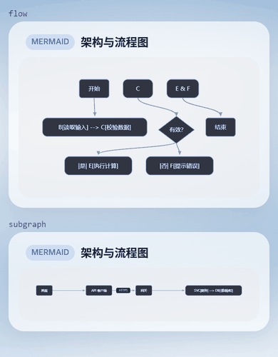 | 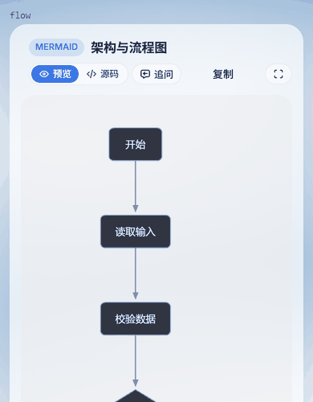 |

改后手机全屏放大到 225%（缩放时保持视野中心）：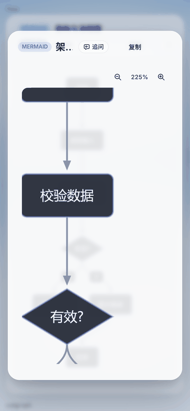　认不出的 gantt 和流式中没写完的图显示原文代码：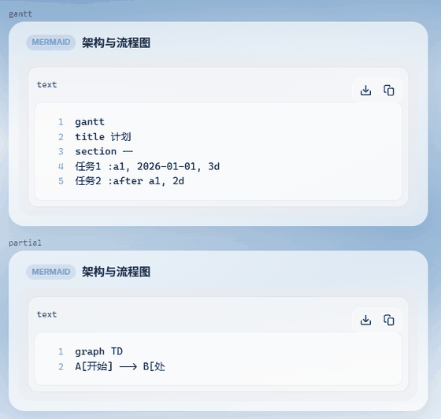

实测：改前手机上卡片头按钮 `opacity: 0; pointer-events: none`，点全屏超时；改后 `opacity: 1; pointer-events: auto`，能打开全屏并放大。

测试（三项各有回归测试）：
- 必修 1：`app/tests/escape-unknown-tags.test.tsx`（9 个，经真实 Streamdown 渲染：泛型不丢、和 HTML 同名的小写泛型不丢字 / 不变链接 / 不变斜体、代码不动、缩进代码块（含列表里的、制表符）不动、段落续行和列表第二段照常转义、自动链接不动、标准 HTML 照旧、危险 HTML 仍被清洗）。把实现换回改前版本，新增的两个用例失败。
- 必修 2：`app/tests/mermaid-lite.test.ts`（29 个：连线标签、链、`&`、分号、各种连线、subgraph 框包住成员、形状、带 `-` / `.` 的 id、长标签折行不溢出、连线标签不压节点、`<br>`、环、500 节点性能和超过上限回退、10 万空格长输入不卡、12 种认不出 / 没写完的图返回空串、状态图、流式未闭合标记）。
- 必修 3：`app/tests/chat-card-touch.test.tsx`（8 个：`@media (hover: none)` 里按钮组 `opacity: 1` / `pointer-events: auto` / `position: static`，且排在默认隐藏规则之后、之后没有规则再藏起来、没有新增 backdrop-filter；卡片头里有全屏按钮；别的测试留下没有 `location` 的 `window` 时卡片照样渲染；`DiagramZoom` 的缩放条、画布宽度、缩放范围）。
返修（小爱审 d7697b34 后）：
- 全量 `test:app` 里 `chat-card-touch.test.tsx` 失败、单跑通过：前面的测试文件留下一个没有 `location` 的 `window`，`SmoothStreamdown` 读 `window.location.origin` 抛错。改成 `window.location?.origin ?? ""`，并加了对应用例（去掉修复时这个用例失败）。
- 上面第 1、2 项里的同名小写泛型、缩进代码块、状态转移二次复杂度、节点上限、意外异常回退。
- Biome：`escape-unknown-tags.ts`、`mermaid-lite.ts` 饼图解析里的非空断言改成 `?? ""` 和显式判断，删掉 `bot-bubbles.tsx` 弹窗分支里没用上的 `biome-ignore`。

原有 `svg-card-sanitize.test.ts`（含 Mermaid 标签注入用例）、`chat-bubbles.test.ts` 照常通过。为了让节点标签里的空格在折行后不丢（`<text>` 的文字内容和原文一致），折行处行尾保留一个空格，量宽度时去掉。

## Unreleased — 推荐类回答落在搜索结果上（分支 fix/reco-search-grounding，叠在 #416 上）

来源：0.1.108 验收 #8。

**动机**

「上海有什么好的咖啡店」线上搜了 4 次，最后答「基于常见门店印象，未核实」，没有地址、人均、来源和链接卡。原因有两层：① 搜索工具只把标题 + 摘要原样交给模型，摘要里其实常有「地址：…」「人均 ¥25」，没有任何提示让模型用它们；旧提示词还写着「不要因为没查到完美的来源就不推荐」，模型就把「没有完美来源」理解成可以凭印象推荐。② 一轮里搜索次数没有上限，拿到结果仍会换词重搜。搜索源本身返回无关结果、空结果的问题由 #407（相关性过滤、`NO_SEARCH_HITS`、每轮 2 次未命中上限，已在 main）解决，这里不重复实现。

**改动**

- `server/src/web/search-grounding.ts`：`hitFacts` 从标题 / 摘要抽地址、人均、价格（抽不到就空，不猜）；`formatSearchHits` 在每条结果下加一行「地址：… ｜ 人均：¥…」；`SEARCH_GROUNDING_NOTE` 放在 untrusted 信封外，要求推荐用结果里的事实和网址；`takeSearchSlot` 按轮（取消信号 / 确认上下文）计数，`SEARCH_TURN_LIMIT = 2`，超出返回 `SEARCH_TURN_ENOUGH`，不联网。
- `server/src/web/tools.ts`：web_search 用上面三样；描述从「一般搜 1–3 次」改成「同一个问题最多搜 2 次（能并行就并行），搜到够用就停」。
- `shared/bot-prompt.ts`：推荐类那条改成「答案要落在搜索结果上」：名字 + 地址或人均 / 价格 + 来源；摘要缺地址时 web_fetch 一条最相关的结果；已有结果不写「凭印象 / 未核实」；一条都没搜到才凭知识推荐并带半句「以大众点评 / 官网为准」。
- 与 #407 合并时：`execute` 里 `takeSearchSlot` 放在 #407 的 `searchTurnState` 检查之后、真正联网之前；`searchResultText` 的命中分支改用 `formatSearchHits` + `SEARCH_GROUNDING_NOTE`。

**测试**

- `server/tests/reco-search-grounding.test.ts`：模拟「上海咖啡店」搜索结果，工具输出里带结果里的地址、人均和网址，提醒在信封外；并行两次 + 第 3、4 次被挡、只真正联网 2 次、下一轮重新计数；提示词断言。`reply-style.test.ts` 跟着改上限文案。
- 部署后待验：线上用真实 Bing 问「上海有什么好的咖啡店」，看搜索 ≤ 2 次、回答带地址 / 人均和来源链接。

## Unreleased — 回复质量 PR1（分支 fix/reply-quality）

来源：模块 8（AI 回复质量与搜索）审查报告，第 1、3、5 条和顺手的第 7–11 条。第 2、4 条（Hermes 下备用模型 / 输出上限不生效、历史不裁剪）另出方案，第 6 条（卡片表格截断）归前端。

**动机**

1. 时区：`currentDateContext` 用的是服务器进程的时区，线上容器是 UTC；长期记忆写的是「今天是 2026-10-30，Asia/Shanghai」。北京时间 0–8 点，模型手里同时有两个差一天的「今天」。审查那天实测在 18 点，没撞上，但这是确定会发生的。
2. 出错分类：Hermes 适配器的 `except Exception` 把所有异常都换成同一句英文，网页 `friendly-error.ts` 靠关键词匹配「429 / context length / timeout」，一条也匹配不上。读 Hermes（适配器钉住的提交 40cc1808）源码后还发现：Hermes 自己重试 / 换模型都失败时，多半不抛异常，而是返回 `failed: True`、`failure_reason` 和一段英文 `final_response`，适配器把这段英文当普通回复发给用户。两条路径都改成透传一个固定的分类句子。
3. 来源：`LINK_CARD_GUIDANCE` 说来源「写在句子里」，`WORK_STYLE_GUIDANCE` 说「最后放一张链接卡或一行来源」。实机 q13 三条新闻各写一遍「来源：TechCrunch」，最后又单独一个气泡，共四遍。

**改动**

- `server/src/agents/current-date.ts`：`USER_TIME_ZONE`（= 定时任务的默认时区 Asia/Shanghai）和 `currentDateContext(now, timeZone)`，写中文日期 + 「北京时间，时区 Asia/Shanghai，UTC+08:00；本地 ISO：…+08:00」。`index.ts` 用它，并让 `createMemoryNotes` 显式用同一个时区。还没有按人设置的时区，以后有了只改这一处。
- `examples/hermes-agent/chisabot_protocol.py`：`failure_category(reason, error)` 把 Hermes 的 `FailoverReason` 或异常链（`status_code`、类名、`code`）归成 9 类，`failure_message` 给每类一句固定英文，措辞专门对上 `friendly-error.ts` 的规则；认不出的仍是原来那句。`chisabot_acp.py` 在 `except` 和 `failed` 结果两处用它，不再把 Hermes 的英文警告当回复。
- `shared/bot-prompt.ts`：来源规则合成一条（末尾一次，同站点一次）；卡片收尾写结论；公式加括号；拒绝给替代；`botIdentityGuidance(name, modelId)` 带上当前模型 id；不再用英文标题指 PROVENANCE。`memory-notes/service.ts` 的 MEMORY_GUIDANCE 写明记忆笔记不算要标来源的资料。
- 没改：`PROVENANCE_GUIDANCE`、`COMPUTER_GUIDANCE`、`UNTRUSTED_GUIDANCE`、`NO_ANSWER_CAME`（#381 用 sha256 钉住，第 11 条「语言统一」只做了不在钉住范围内的部分）；样式；版本号。

**测试**

- `server/tests/reply-quality.test.ts`：跨午夜（UTC 16:00 = 北京 10-30 00:00、15:59、23:00）和记忆 `dayIn` 同一天；别的时区不冒充北京时间；来源规则只剩一种；说话方式段没有英文句子；记忆与出处的优先级；收尾 / 括号 / 拒绝 / 模型名。
- `examples/hermes-agent/tests/`：失败结果变成分类错误且不发那段英文；异常只留分类不留原文；`FailoverReason` 与状态码映射表（Python 50 个全过）。
- `app/tests/hermes-error-categories.test.ts`：从 Python 源码读出每个分类句子，逐个过 `friendlyError`，标题都对；两边措辞漂移就会失败。

**返修（#416 审查，2026-10-29）**

- 必修：`_HINTS` 按异常文字匹配，把非模型错误认错了——工具的 `FileNotFoundError` 成了「模型不存在」，`PermissionError("Permission denied")` 成了「密钥无效」，工具自己的「timed out」成了「模型响应超时」。现在 `failure_category` 跳过内置异常（`OSError` 及其子类、`builtins` 里的 `RuntimeError` / `TimeoutError` 等），只认 HTTP 状态码（`status_code` / `status`）和模型 SDK（openai、anthropic、litellm、google、groq、mistralai、cohere 模块里的）异常类型；4xx 的 body / `code` 只在这类错误上看。其他一律走通用句子。内置异常包着的真模型错误（`__cause__`）照样认得出。
- 应修：403 不再直接算「密钥无效」。先看 body / `code`：地区限制（`unsupported_country_region_territory`、「region … not supported」）→ 新分类 `region`（网页「模型服务商不支持服务器所在地区」，不可重试）；内容拦截（content filter / policy、moderation、policy_violation）→ `content_filter`；明确说 API key / unauthorized → `auth`；分不清（如只有「Forbidden」）→ 通用句子。
- 测试：`test_protocol.py` 加这三个例子 + 403 各情况；`test_adapter.py` 加工具 `FileNotFoundError` 整轮只出通用句子、不带路径；`app/tests/hermes-error-categories.test.ts` 加 `region`，`friendly-error.ts` 加对应规则。
- 复审应修：分类函数自己可能抛异常——`_error_body` 里 `json.dumps` 遇到不可序列化的 body（如含 bytes）抛 TypeError，属性 getter 也可能抛别的异常；它在 `chisabot_acp.py` 的 `except` 里调用，一抛就跳过 `run.fail`，这一轮卡住。现在 `json.dumps(default=str)`，逐个属性 try，整体 try 失败退回 `str(error)`、再失败退回类名；bytes body 用 `errors=replace` 解码后再匹配；整段截到 64KB 再跑正则。适配器那层再包一层兜底，分类出错时用通用句子照样 `run.fail`。测试：不可序列化 body、getter / `__str__` 都抛、bytes body、超长 body 截断、分类函数抛异常时整轮仍结束。
## 链接卡组：流式骨架、悬停长任务、用户消息链接卡、审查模块 6（fix/linkstack-streaming，依赖 #397）

**悬停长任务的原因**：在 Ayase 的真 Chrome 上用带侧栏 / 顶栏外壳的测试页（150 条填充消息）录 trace，悬停换主位时每次都有一次约 3581 个元素的整页 `UpdateLayoutTree`（占长任务约 95%）。卡片换主位时改的是 `data-slot` 属性；styles.css 里有 `.glass-shell:has([data-slot=…])`（3864 行、8903–8910 行）这类规则，Chromium 的 `:has()` 失效集合按属性名建，任何元素的 `data-slot` 变了都会让 `.glass-shell` 整棵子树重算样式。按规定不动 styles.css，把卡组用的属性改名为 `data-stack-slot`（CSS 和测试同步改）。

**实测（Ayase 真 Chrome，21 次悬停）**：
- CPU 1×：改前最长任务 53 ms；改后没有超过 50 ms 的任务，样式重算不超过 10 ms、不超过 42 个元素。
- CPU 4× 降速：改前 21 次里 6 个长帧，单个任务 160–479 ms；改后单个主线程任务 39–51 ms（4 轮里只有一次 51 ms），样式重算不超过 36 ms。

**用户消息链接卡**：用户气泡里的链接抽出来交给同一个 `LinkCardStack`，放在气泡下面、靠右对齐（和用户气泡同侧）；气泡里的原文照旧保留。

**审查模块 6**：
1. 「追问」按钮原来嵌在 `<a>` 里，触屏上透明但能点，点卡片左上角会变成引用。现在卡片结构是外层 `.lc-item`（位置、槽位 transform、悬停抬起）里放 `<a class="lc-card">` 和同级的 `<button class="lc-followup">`，不再嵌套交互元素。外层 `.lc-item` 不接点击（`pointer-events: none`），只有卡面和按钮接。选「触屏上明确显示」：单张卡和宽容器里一叠的主位卡常显；窄容器（≤420px，手机）的一叠里直接去掉；隐藏的按钮一律 `pointer-events: none`。悬停显示只在 `(hover: hover) and (pointer: fine)` 下生效，因为触屏点一下会先触发悬停再做命中测试，靠悬停显示的按钮会在同一下里冒出来接住点击。注意 Windows 上带触控设备的电脑 Chrome 也报 `any-pointer: coarse`（Ayase 就是），这类电脑上按钮也常显。手机尺寸 + 触屏模拟复测：一叠里第一下点击把卡移到主位（不打开），第二下才打开。
2. 小图（宽 < 280px，如 172×178、240×126）用 `object-fit: contain`、不超过原始尺寸、居中放在主题色衬底上，不再放大裁切。
3. 刷新跳动：预览结果存 sessionStorage（`chisabot.link-previews.v1`，6 小时、最多 80 条），刷新后用作 `initialData`，卡片直接按最终高度出现。测试页 CLS：改前每次访问 0.0007；改后首访 0.0007、三次刷新都是 0。
4. favicon：`loading="lazy" decoding="async"`，宽高 28。
5. 卡片和用户气泡关掉 Inter 的 `calt`，「411x7」不再画成「411×7」。
6. 预览可选 `kind: "video"` 和 `thumbnail`（服务端由另一个 PR 加，这里没改服务端）：是 video 时图上叠一个播放角标，不用 blur，`pointer-events: none`。

**截图**：`docs/images/linkstack-fix/`（左改前、右改后）。顶栏一项因 #374 未合并跳过。没有升版本号。
## Unreleased — 新话题页带附件（A1）+ 用户消息图片稳定显示

### 动机

在新话题页上给机器人发图片时，图片发不出去或者显示不出来，用户消息里只剩文字。要做到：新话题和已有对话里，发送中、发送后、刷新后都能看到图片；多张图正常成组；点开能看大图。

### 根因

1. **新话题页不支持附件。** `/channel/new` 还没有对话，附件没有地方上传（上传接口是 `/api/channels/:id/attachments`），所以这个页面的输入框根本没开附件：没有「附加文件」，粘贴 / 拖入的文件被丢掉，只有文字发出去。
2. **测试脚本选中了隐藏的输入框。** `KeepAliveStage` 会把上一段对话页留着、只是藏起来，所以页面上同时有两个输入框。测试脚本（cb-run.js）按选择器取第一个，拿到的是藏着的那一个，文件塞进了看不见的对话里，看起来就像「图片没发出去」。脚本由小爱自己修，本 PR 不改。

已有对话里，接口返回的图片部分（`readThreadMessages`）和渲染（单图、ImagePile）本身是对的，本 PR 补测试锁住，不改气泡外观。

### 返修（小爱审 2c0051c）的根因

1. **无条件删除会删掉真对话。** 第一版 `channel-page.tsx` 卸载时直接 `DELETE /api/channels/:id`，而「这是草稿」只记在这个标签页的 sessionStorage 里。复制标签页（sessionStorage 跟着复制）后在一边发了消息、另一边离开，或者机器人已经主动在里面说了话，这边仍以为是草稿，于是把一段有内容的对话删了，还写了 `channel.deleted` 审计、发了通知。
2. **关掉标签页的草稿永远留在库里。** 没有任何东西回收它们，只是看不见。
3. **发送和建草稿竞态。** `attaching` 是 ref，不进 `pending`：建草稿的 POST 还没回来时回车，`start` 会另建一段普通对话，两段都带着同一份字。
4. **建草稿期间再进来的文件被丢。** 第二次 `attach` 看到 `attaching` 直接 `return`。
5. 文件全被拒（类型不支持、太大）时也先建了草稿再跳过去，那边才说不收；草稿页被藏起来（去设置等）时要等留着的页面 10 分钟超时才回收；没有宽高的图片加载前高度为 0，加载后撑开。

### 二轮复审（02f97d07）的根因

1. **藏起来就回收太激进。** 返修把草稿对话的保活时长一律设成 0，于是在草稿页选好图、去设置看一眼再回来，页面已经卸载、草稿已经删了，图没了（字放回了新话题页，但这时用户不在那里）。真正需要立刻回收的只有「去新话题页」这一种：那边要重新开始，留着一段空草稿没有意义。
2. **回收后用返回键回到它是一张错误卡。** 草稿删了以后浏览器历史里还留着 `/channel/<id>`，返回键回去拿到 404，显示「对话不存在」。`client()` 抛出的错误又不带状态码，页面分不出 404 和别的错误。
3. **按表探测运行模式不可靠。** `drafts.ts` 用 `to_regclass` 看库里有没有 `openbot_local_threads` / `openbot_local_runs` 来决定能不能删。表在不等于消息存在本库：切过运行模式的库表还在，但新消息在 Intelligence 后端，这时判断「线程是空的」是错的。
4. **跳转那一下里加的文件会丢。** 草稿建好、`stashDraftFiles` 已经取走队列，到地址真正换过去之间（路由在加载），新话题页的输入框还在，再选的文件进了 `queued` 但没人再取。

### 改动

- **服务端**（`server/src/channels/routes.ts`）：`POST /api/channels` 接受可选的 `draft: true`，建的对话用 `DRAFT_AGENT_CHANNEL_DESCRIPTION` 做 description 标记。`isHiddenDraft`（标记 + `last_message_at is null`）在对话列表和直达对话查询里过滤掉：第一条消息记进来之前，它不出现在任何人、任何设备的列表里；记进来之后就和普通对话一样。没有表结构变化，不需要迁移。
- **客户端**
  - `app/src/lib/channels/draft-channel.ts`（新）：记着这个标签页刚建、还没发的草稿对话（sessionStorage，刷新后仍记得）。`holdDraftChannel` 在对话页卸载时（StrictMode 的二次挂载不算）还没发过就 `releaseDraftChannel`：立即 `DELETE`，写了一半的字放回新话题页（`new:<agent>`），文件丢掉。发出第一条后 `settleDraftChannel`，以后就是普通对话。
  - `composer.tsx`：新增 `onAttachWithoutChannel`。没有对话时，选择 / 粘贴 / 拖入的文件不上传，而是连同当前文字交给它。
  - `channel/new.tsx` + `start.ts`（`startDraft`）+ `mutations.ts`（`createDraftChannelMutationOptions`）：建草稿对话，`moveTextDraft` 把字挪过去，`stashDraftFiles` 把文件挪过去，`replace` 跳到 `/channel/<id>`（返回键不会回到一个空的新话题页）。不刷新对话列表（反正它不在列表里）。
  - `channel-chat.tsx`：刚建的草稿对话（`freshDraft`）跳过「恢复中」骨架和首次读历史（它还没有消息），直接显示开场介绍，所以跳转不闪；发送时 settle。`channel-page.tsx` 挂 `holdDraftChannel`。
- 用户消息图片：沿用已有的 width/height 预留占位（单张 `.rp-image-single`）和 ImagePile 叠放组；点开是原图。本 PR 不做缩放（B1 另开 PR）。

返修：

- **带条件删除**（`server/src/channels/drafts.ts` 新，`routes.ts`）：`DELETE /api/channels/:id?draft=1` 只在这段对话**仍是空草稿**时软删除：description 是草稿标记、`last_message_at` 为空、未删除，并且它的线程（`intelligence_channel_mappings.thread_id` → `openbot_local_threads`）里没有消息、也没有跑过一轮（`openbot_local_runs`）。否则回 409、什么都不动。这种删除不写 `channel.deleted` 审计、不发通知（草稿从没出现在任何列表里）。非成员照旧 404。客户端 `draft-channel.ts` 的删除改成带 `?draft=1`，不管结果。
- **24 小时清理**（`sweepAbandonedDrafts` + `startDraftSweeps`，在 `server/src/index.ts` 和 `startRetentionSweeps` 一起启动、一起停）：启动 60 秒后跑一次，之后每小时一次，每批最多 500 段，只删同时满足上面全部条件且 `created_at` 早于 24 小时前的。条件写在一条 `UPDATE … WHERE` 里，可以重复执行（删过的不再满足 `deleted_at is null`）。
- **保守处理**：消息不存在本库（只用 Intelligence 后端的部署）时无法确认线程是空的，条件删除和定时清理都**一律不删**（条件删除回 409）。这类部署的草稿只是看不见，不会被回收。二轮复审后改为直接由启动处传 `config.runtime.mode === "local"`（`DraftStorage.localConversations`），不再探测表在不在。
- **发送与建草稿互斥**（`channel/new.tsx`）：`attaching` 改成 state，并进输入框的 `pending`（发送键不可用），`start` 在建草稿时直接返回；反过来第一条消息正在发或已发出时不建草稿。
- **建草稿期间的文件追加**：再进来的文件追加到同一个队列，`startDraft` 在草稿建好之后才取文件（`files` 可以是函数），一起放进 `stashDraftFiles`，跳过去后一起放上。
- **先筛再建**（`composer.tsx` `handOff`）：交出文件之前按 `stageFiles` 同样的规则（`screenPickedFiles`）筛，拒收的说法留在新话题页；一个都不收就不建草稿。
- **藏起来就回收**：`KeepAliveStage` 的 `ttlMs` 可以按留着的那页定，`authed-shell.tsx` 对草稿对话给 0：藏起来立即卸载，走原来的卸载收尾（字放回新话题页、带条件删除）。普通对话照旧留 10 分钟。

二轮复审：

- **只有去新话题页才立即回收**（`draft-channel.ts` `draftKeptTtl`，`authed-shell.tsx`）：时长按「是不是草稿 + 当前地址」定，只有草稿对话且当前地址是 `/channel/new` 时给 0；去设置等别的页面照常留 10 分钟，回来图和上传都在。回调按 `pathname` 记忆（`useCallback`），留着的计时器不会每次渲染重来；先去设置、再从设置去新话题页时那一刻回收。
- **回收过的草稿 404 时静默跳走**：`client.ts` 新增 `ClientError`（带 HTTP 状态码），`client()` 失败时抛它。`releaseDraftChannel` 回收时把「这段属于哪个机器人」记进 sessionStorage（`chisabot-released-drafts:v1`，最多 50 条）。`channel-page.tsx` 读对话失败时用 `releasedDraftRedirect` 判断：是 404 且是本标签页回收过的，就 `replace` 跳到 `/channel/new?agent=…&topic=new`，跳之前按「加载中」显示、不闪错误卡；别的 404 和别的错误照旧。
- **运行模式直接传**（`drafts.ts`、`routes.ts`、`index.ts`）：去掉 `localThreadsPresent` 的表探测，`deleteEmptyDraft` / `sweepAbandonedDrafts` / `startDraftSweeps` / `createChannelStore` 都收 `{ localConversations }`，由 `index.ts` 按 `config.runtime.mode === "local"` 给；不给就当不是本地（不删）。
- **跳转那一下里加的文件追加过去**（`ui-memory.ts` `addDraftFiles` / `listenDraftFiles`，`composer.tsx`，`new.tsx`，`start.ts`）：`startDraft` 返回草稿对话的 id；跳转完成后把 `queued` 里剩下的交给 `addDraftFiles`：那段对话的输入框已经挂着就直接走 `stageFiles` 上传，还没挂着就并进暂存，挂上时一起取。
- **依赖重装**：dev-user-image 里所有工作区的 `node_modules` 删掉后 `bun install --frozen-lockfile` 重装；之前的 44 个 zod 类型错误来自脏的 `node_modules`，重装后 typecheck 0 错误，`bun.lock` 没变。
- **没有宽高的图片先占固定框**（`rich-previews.tsx` `reservedImageBox`）：240px 宽、4:3 的占位框，加载完知道了尺寸换成真比例；加载完仍读不出尺寸就不再限定。有宽高的图片不变。

### 测试

- `server/tests/channel-routes.test.ts`：`draft` 参数解析与透传；草稿对话在有消息之前不进列表、有消息后出现；不作为直达（direct）投递的对话（真实 Postgres）。
- `app/tests/draft-channel.test.ts`：离开即删、字放回、文件清掉；发过不删；StrictMode 不算离开；普通对话不删；删除失败不抛；刷新后仍记得。
- `app/tests/composer-attach-without-channel.test.tsx`：没有对话时选择 / 拖入 / 粘贴都交出文件和文字。
- `app/tests/channel-new-attach.test.tsx`：新话题页选文件 → 建草稿对话 → 替换跳转，文字和附件都在、开始上传。
- `app/tests/user-image-thumbs.test.tsx`：接口返回的图片部分带 width/height；单图占位尺寸；多图叠放顺序；5 张显示 4 张 + 「+1」；点开大图是原图。
- `app/tests/open-at-latest.test.ts`：跟着 `freshDraft` 条件更新正则。
- 返修：
  - `server/tests/channel-routes.test.ts`：`?draft=1` 删除 → 204，不调普通删除、不写审计；不是空草稿 → 409；store 不支持 → 409；非成员 → 404。真实 Postgres：空草稿被条件删除（重复删也是 deleted）；说过话的（`last_message_at`）、线程里已有消息但还没记 activity 的（机器人主动说话）、普通对话都不删；非成员拒绝；清理只删超过 24 小时的空草稿，23 小时的、说过话的、线程有消息的、普通对话都不动，再跑一次结果不变。
  - `app/tests/channel-new-attach.test.tsx`：建草稿的请求挂着时发送键不可用、回车不另建对话；建草稿期间第二次选的文件和第一批一起放上、只建一段；文件全被拒时不建草稿。
  - `app/tests/draft-channel.test.ts`：默认删除请求是 `DELETE /api/channels/:id?draft=1`，回 409 也不抛。
  - `app/tests/draft-channel-hidden.test.tsx`（新）：草稿对话藏起来立即卸载并回收；普通对话照旧留着；外壳接线。
  - `app/tests/user-image-thumbs.test.tsx`、`app/tests/image-dims.test.tsx`：没有宽高的图片先是 240px、4:3 的占位框，加载完换成真比例（`image-dims` 里原来锁「没有样式」的那条跟着改）。
- 二轮复审：
  - `app/tests/draft-channel-hidden.test.tsx`：去新话题页立即卸载并回收、记下机器人；草稿页去设置再回来图还在、没回收；先去设置再去新话题页时才回收；时长规则；外壳接线。
  - `app/tests/draft-channel.test.ts`：回收时记下机器人（sessionStorage），发过的不记；回收过的 404 → 机器人 id，别的 404 / 500 / 断网 → null；对话详情读失败带状态码（`ClientError` 404）；对话页 replace 跳转接线；`addDraftFiles` 挂着时交给输入框、没挂着时并进暂存。
  - `app/tests/channel-new-attach.test.tsx`：草稿建好、跳转还在加载时再选的文件，跳过去后追加到输入框并上传（去掉 `addDraftFiles` 这条测试会失败）。
  - `server/tests/channel-routes.test.ts`：真实 Postgres 的条件删除和清理改为显式传 `{ localConversations: true }`；新增「非本地模式」：不传时条件删除回 kept、清理返回 null，空草稿不被删。

### 截图

`docs/images/user-image-thumbs/`，桌面 1024×640、手机 473×1024，返修时精简为 10 张：桌面是新话题上传中、发送后、刷新后，已有对话多图、大图，没发就离开回到新话题页（字放回来了）；手机是新话题上传中、发送后，已有对话多图，没发就离开。第一版各 16 张的完整场景在 2c0051c 的历史里。用的是组件级 harness（真实的 ChannelNewRoute / ConversationView / Composer / ChatTranscript + mock 接口），不是整个应用外壳。

### 局限

- 草稿对话只在去新话题页时立即回收；去别处藏着超过 10 分钟也会回收。之后在本标签页回到它（返回键、刷新）会静默跳到那个机器人的新话题页，字已经放回那里；在别的标签页或设备打开它的链接仍是「对话不存在」。
- 关掉标签页再也不回来：草稿对话最多留 24 小时（加上最多 1 小时的清理间隔），然后由定时清理软删除。只用 Intelligence 后端（库里没有本地线程表）的部署不清理，也不接受条件删除。
- 刷新草稿对话页后，还没发的文件不保留（文件只在内存里），文字保留。
- 第一条消息的活动记录如果写入失败，这段对话要等回复记进来才出现在列表里。
- 多张图是现有的叠放组，不是网格；草稿对话页不显示「试试这样问」建议。

### 回归返修（`45b1ef7f` → 本次）

**现象**（回归，真 Chrome 5/5）：草稿对话里写了一半的字，没发就去新话题页，字不会立刻回到新话题页的输入框；4 秒后仍空，去设置再回来才出现。和截图 desktop-21 不符——那张是组件 harness 拍的，没有经过外壳的 `KeepAliveStage`。

**根因**：顺序问题，不是计时太慢。去 `/channel/new` 的那次提交里，新话题页（路由层）和它的输入框先挂上，输入框 `useState` 初始化时读一次 `new:<agent>` 的草稿——此时是空的（建草稿时字已挪进草稿对话的键）。藏着的草稿对话页要等 `KeepAliveStage` 的 0ms 计时器才卸载，`holdDraftChannel` 的收尾再推迟一拍才 `releaseDraftChannel`，那时才把字挪回 `new:<agent>`。输入框之后不再读草稿存储，所以一直空着；去设置再回来重新挂载才读到。测试同学怀疑的方向（setTimeout 里挪字时输入框已读过空值）是对的。

**改法**：
- `draft-channel.ts` 新增 `reclaimDraftText(returnKey)`：把本标签页还没发、字要回到这个键的草稿对话里的字同步挪过去（`moveTextDraft`）。
- `channel/new.tsx` 的 `BotChat` 第一个 hook 用 `useState` 的初始化调 `reclaimDraftText("new:<agent>")`：挂载时做一次，比输入框的初始化早，第一帧就有字。之后的回收照旧删对话、丢文件，那边已经没有字，什么都不覆盖。
- 去新话题页时藏着的草稿对话一律立即回收（`draftKeptTtl`），提前挪不会挪错；去的是别的机器人的新话题页时键对不上，不动，回收时照旧回到原来的机器人。没有改输入框，也没有改 `styles.css`。

**测试**：新增 `app/tests/draft-leave-new-topic.test.tsx`，按外壳的结构搭（`KeepAliveStage` + `draftKeptTtl` + 挂 `holdDraftChannel` 的草稿页 + 真正的 `/channel/new` 路由和 Composer），用 MutationObserver 记新话题页输入框第一次出现时的字和那一刻有没有回收：要求第一次出现就有字、且那时还没回收，回收后只有一份；另一条是去别的机器人的新话题页时字不挪过去、回收后回到原来的机器人。修复前第一条失败（第一次出现时是空的，之后也一直空），修复后通过。
## Unreleased — 设置面板卡顿③：关设置回聊天不再重渲染整段聊天，左栏常驻

依赖：叠在 #395（`dev2/settings-perf`）和 #398（`dev2/settings-perf-2`）上（本地合入了这两个分支），合并顺序 #395 → #398 → 本 PR。

### 动机

- 4× 降速下，关闭设置（返回聊天）这一下，main 上 INP 约 540ms，目标 150ms。用 React Profiler 记录 fiber 提交，在 main 上点「关闭设置」一下：同一次点击里整段聊天页**重渲染了两次**，每次约 40 个组件（ChannelBody → ChannelChat → ConversationView → ChatTranscript / Composer…），而聊天页的 props 其实没变，变的只是 keep-alive 的可见性标志。
- 另外关设置时左栏从 SettingsSidebar 换回 LeftRail，要整个卸载 / 挂载一遍，挂载时 react-query 重新拉 channels、bot-lifecycle、agents 等（约 30ms），机器人行和菜单 store 也要重建。

### 根因（哪个组件、哪个值）

1. **第 1 次提交：路由 `pathname` 变了。** `AuthedShell` 用 `useRouterState` 读到 pathname 从 `/settings/…` 变回 `/channel/…`，作为 prop 传给 `ShellFrame` → `ChatStage`。`ChatStage` 重渲染时重建了 `idleVisible` / `renderKept` 闭包，`KeepAliveStage` 跟着重渲染，重新生成 `<ChannelPage …>`。`ChannelPage` **没有 memo**，props 完全相同也会整棵重画。
2. **第 3 次提交：`ChatStage` 的 `useChatAddress` 地址 state 变了。** `KeepAliveStage` 把这一页的 `visible` 从 false 改成 true，`epoch` 变成 1，所以 `ChannelPage` 的 `visible` / `epoch` 变了。`ChannelBody` 也**没有 memo**；`ChannelChat` 里的 `useThreadActivity` 又用 `useContext(KeptVisibleContext)` 读可见性。context 值一变，整段聊天就再重画一遍，其实只是为了让 `useThreadActivity` 知道回到屏幕上了、该补一次 /sync。
3. **左栏：** `ShellFrame` 按 scope 二选一渲染 `LeftRail` 或 `SettingsSidebar` / `AdminSidebar`，进出设置都会卸载 / 重新挂载 `LeftRail`。
- profiling 构建、4× 降速下，main 这次点击的各次提交合计渲染 948 个组件、约 82ms；只做 memo + 可见性订阅后是 717 个、约 48ms。聊天正文的组件 0 次重渲染，只剩 `ChannelPage` 外壳 1.1ms。

### 改动

- `channel-page.tsx`：`ChannelPage`、`ChannelBody` 包上 `memo`。props 都是字符串 / 数字 / 布尔，没有每次新建的对象或函数，浅比较就够。
- `layout/kept-visible.ts` + `layout/keep-alive.tsx`：新增可见性订阅源 `KeptVisibilityContext`（`get` / `subscribe`，对象本身始终不变）。`KeepAliveStage` 照旧提供原来的 `KeptVisibleContext`（布尔值，其他地方的用法不变），另外提供这个订阅源，可见性变化时调用 `set`。
  - 审查意见 c：订阅源跟着 `kept` 在 render 阶段创建（`kept` 变了就在 render 里重建，初值就是当前的 `visible`），新打开的聊天第一次读到的就是「可见」，不会先读到上一个页面留下的隐藏状态、再多补一次 /sync。
- `copilot/thread-activity.ts`：`useThreadActivity` 改为订阅可见性，在回调里补 /sync 或暂停，不再随 context 值变化重渲染整个聊天。行为不变：隐藏时暂停，回到屏幕立刻补一次 /sync。
- 左栏常驻：
  - `layout/authed-shell.tsx`：新增 `ShellSidebar`（memo，只吃 `scope`），`LeftRail` 始终挂载，设置 / 管理页时传 `parked`，旁边再渲染 SettingsSidebar / AdminSidebar。
  - `layout/left-rail.tsx`：`LeftRail` 包上 `memo`；`parked` 时外层 `display:none`（`hidden`），否则 `display:contents`，DOM 结构和原来一样。
  - `ui/sidebar.tsx`：新增 `parked`。停放时不注册返回键关闭、不设置侧栏收起标志、移动端 Sheet 不打开，和原来「没挂载」时的外部表现一致。
  - `layout/rail-sidebar.tsx` + `sidebar-search-field.tsx`：`RailParked` context；在设置里按 Ctrl+K，聚焦请求先挂着，回到聊天、左栏可见后再聚焦，和原来一样。
  - `lib/panels/active-bot.ts`：`isChannel` 在 `useRouterState` 的 select 里算成布尔值，设置里切分类不会让隐藏的左栏和右侧面板重渲染。
  - 副作用：左栏的提醒和 channels 等查询在设置页里也保持活跃（原来是卸载后暂停），回到聊天不再重新拉取。
- 侧栏收起：`styles.css` 里的 `.glass-shell:has([data-slot=sidebar][data-state=collapsed]) .glass-topbar-start` 换成 `body[data-has-collapsed-sidebar] .glass-shell .glass-topbar-start`，样式值不变。这个标志由 `ui/sidebar.tsx` 在桌面侧栏收起时自己设置（`usePresenceFlag` 新增 `on` 参数），这样就去掉了一个每次 DOM 变动都要重新匹配的 `:has()`。
- 审查意见 a：`app-sidebar.tsx` 里给 `ChannelRow` 加的 `layoutDependency={orderKey}` 去掉了（唯一调用方传 `animateOrder={false}`，这个依赖没用），恢复成 #398 的样子。
- #395 / #398 的审查意见：那两个分支还在跑回归，按要求放到本 PR 里处理。
  - `glass-topbar.tsx`、`update-banner.tsx` 只跑了 organizeImports，没有整份重新排版。
  - `no-body-has.test` 的正则也拦截 `:root:has(`。
  - `PresenceItem` 的 `layoutDependency` 加了源码断言。
- 测试（每条都确认过：去掉对应改动后会失败）：
  - `app/tests/kept-chat-real-render.test.tsx`（审查意见 b）：TanStack 内存路由 + `KeepAliveStage` + 真的 `ChannelPage`，用计数器数页面、聊天组件的渲染次数和外壳提交次数。设置里切分类：页面和聊天 0 次重渲染；关闭设置：聊天 0 次重渲染。
  - `app/tests/kept-chat-no-rerender.test.tsx`：keep-alive 隐藏再显示后，聊天组件的渲染次数仍是 1，并且回来时补了一次 /sync；另加审查意见 c 的用例：新打开的聊天第一次读到「可见」，不会多补 /sync。
  - `app/tests/left-rail-kept.test.tsx`：app → 设置 → app → 管理 → app 期间 `LeftRail` 只挂载一次、不卸载，停放时隐藏；设置里外壳重渲染时左栏 0 次渲染；停放时不设置收起标志；Ctrl+K 聚焦请求等回到聊天后生效。
  - `app/tests/settings-close-guards.test.tsx`：侧栏收起标志的开关；CSS 里不再有 `.glass-shell:has(`；PresenceItem 的 layoutDependency 源码断言；`ChannelRow` 仍是 `animateOrder={false}`、不再有 `layoutDependency={orderKey}`。

### 前后 INP（Jun 的电脑，GPU）

- 环境：Jun 的 Windows 电脑，独立的 headless Chrome（临时 profile），`--enable-gpu-rasterization --ignore-gpu-blocklist`，WebGL renderer = `ANGLE (NVIDIA, NVIDIA GeForce RTX 3060 Laptop GPU Direct3D11 vs_5_0 ps_5_0, D3D11)`，GPU 合成生效。1440×900，4× CPU 降速（CDP `Emulation.setCPUThrottlingRate=4`），生产构建。
- 对比：main（63914d8d） vs 完整 #403（#395 + #398 + 本 PR，3826b6be）。后端和数据相同，只换前端 dist（Playwright 路由把非 /api 请求换成本地 dist）。两组交替跑 5 轮，时间 10/29 16:53–17:02（UTC+8）。
- 统计：每次交互取 `PerformanceObserver('event')` 里最长的那次；切分类每轮 11 次先取中位数，再取 5 轮中位数；打开 / 关闭设置取 5 轮中位数。各列分别取中位数，所以三列不一定能相加。

格式：INP / 点击处理（input delay + processing）/ 呈现延迟，单位 ms。

| 交互 | main（63914d8d） | 完整 #403 | INP 变化 |
|---|---|---|---|
| 打开设置 | 280 / 203 / 77 | 128 / 98 / 30 | −54% |
| 关闭设置 | 584 / 486 / 98 | 304 / 179 / 125 | −48% |
| 切分类 | 320 / 123 / 190 | 224 / 87 / 150 | −30% |

- 各轮 INP：打开设置 main 280/304/216/448/264，#403 168/168/128/120/96；关闭设置 main 504/624/584/728/464，#403 296/392/304/312/288。
- 测量时负载：整机 CPU 占用（每秒采样，含被测 Chrome 自身）main 各轮平均 55–64%（均值 61%），#403 各轮 38–63%（均值 54%）。测前确认没有别的 headless Chrome / bun 构建在跑，并放了测量锁文件。
- 结论：关闭设置的点击处理 486 → 179ms，聊天页不再重渲染、左栏不再重挂载。关闭设置还没到 150ms：剩下的是外壳和设置侧栏卸载、呈现延迟约 125ms。

### 旧数据（box，SwiftShader 软件渲染，仅供参考）

格式同上。

| 交互 | main（218dd6ec） | 仅本 PR 的核心改动（叠在 main 上） | #395 + #398 + 本 PR 核心改动 |
|---|---|---|---|
| 打开设置 | 256 / 131 / 125 | 240 / 119 / 120 | 352 / 59 / 300（4 轮） |
| 关闭设置 | 536 / 337 / 189 | 480 / 285 / 176 | 468 / 179 / 275 |
| 切分类 | 220 / 70 / 142 | 220 / 60 / 141 | 224 / 63 / 154 |

- 旧数据在 box 上测，时间 10/29 11:59–12:18（UTC+8），机器上同时有别的 agent 在跑，1 分钟 loadavg 1.19–15，瞬时 CPU 16–81%。用 SwiftShader 软件渲染，玻璃 / blur 合成很慢，呈现延迟偏高、波动大。当时还没有左栏常驻和审查意见 a/b/c 的改动。
- 当时的结论：关闭设置的点击处理时间 main 337 → 本 PR 单独 285 → 三个 PR 叠加 179ms（−47%）。
- 测法同 #395：Playwright + CDP `Emulation.setCPUThrottlingRate=4`，用 `PerformanceObserver('event')` 取最长那次交互；点击处理 = `max(processingEnd) − startTime`，呈现延迟 = `startTime + duration − max(processingEnd)`。
- 没改主题切换、天空重绘和玻璃 / blur 的样式值。

## Unreleased — 设置面板卡顿②：关设置 / 切分类不再在提交中途强制同步布局

### 动机

- 测试剖析（4× 降速）里关闭设置是一个 479ms 的长任务；除了聊天页 React 重渲染，提交阶段还被几处「先改 DOM、再立刻读尺寸」的强制同步布局拖长：`keep-alive.tsx` 的 `useLayoutEffect` 里同步 `getBoundingClientRect`；`section-rail.tsx` 每次切分类在 effect 里读左栏和当前行的矩形；以及（本轮 CPU profile 新发现）侧栏机器人列表的 `PresenceItem`（motion `layout="position"`）每次重渲染都在提交前、提交后各读一次 `document` 滚动位置，4× 下合计约 75ms。

### 改动

- `keep-alive.tsx`：量尺寸改成普通 `useEffect` + `ResizeObserver` 的 `borderBoxSize`（观察回调里拿尺寸，不再在提交阶段同步读矩形；没有 `ResizeObserver` 的环境才退回同步读一次）。
- `lib/scroll-within.ts` + `section-rail.tsx`：新增 `scrollIntoViewWithinAsync`，用 `IntersectionObserver({ root: 左栏 })` 首次回调给的 `rootBounds` / `boundingClientRect` 算出偏移，再 `scrollBy`；读写分离，不在 effect 里读布局。滚动结果和原来的 `scrollIntoViewWithin` 一样（同一个 `scrollDelta` 算法，单测覆盖）。
- `components/ui/presence.tsx`：`PresenceItem` 新增 `layoutKey`（即 motion 的 `layoutDependency`），侧栏机器人列表传列表下标——插入 / 删除 / 换序都会改下标，补位动画照旧；只是换页导致的普通重渲染不再触发测量。
- 测试：`app/tests/scroll-within.test.ts` 加 `scrollDelta` 和异步版本（假 IntersectionObserver）的用例。

### 前后 INP（4× CPU 降速，生产构建，Chrome 1440×900，5 轮取中位数，相对 main）

| 交互 | main | 本改动 | 变化 |
|---|---|---|---|
| 打开设置 | 316ms | 240ms | −24% |
| 切分类（每轮各分类中位数，再取 5 轮中位数） | 250ms | 216ms | −14% |
| 关闭设置 | 548ms | 464ms | −15% |

- 点击「按下到处理完」（`processingEnd − startTime`，INP 去掉呈现延迟的那部分）：打开 135→127ms，切分类 79→64ms，**关闭 348→201ms（−42%）**。
- 和 ①（#395，去掉 `body:has()`）合起来：处理时间 打开 59ms / 切分类 58ms / 关闭 197ms。剩下的 INP 主要是呈现延迟（测量机用 SwiftShader 软件渲染，玻璃 / blur 合成很慢，这部分不在本次范围内），以及关闭时聊天页本身的 React 重渲染（约 190ms，下一步）。
- 测法同 ①：Playwright + CDP `Emulation.setCPUThrottlingRate=4`，`PerformanceObserver('event')`，同一后端和数据，只换前端 dist。

## Unreleased — 设置面板卡顿①：去掉 body:has() / html:has()，藏着的聊天跳过样式计算

### 动机

- 测试剖析（main 9b264c73，4× CPU 降速）：打开设置 INP ≈ 304ms、关闭 ≈ 664ms、切分类也慢。主因之一是 `styles.css` 里报告点名的 7 处 `body:has(...)` / `html:has(...)`（3862 `.desk-strip`、6492/6494 `.install-hint`、6582 `html:has(> body .glass-shell)`、7623/7661 窄屏把手、8903 桌面端 Sheet；连同同类的 `body:not(:has(.glass-composer)) .rail-tab.is-narrow` 共 10 条规则）。Chromium 把所有 `:has()` 的失效集合并在一起，「`:has(…) X *`」这类规则会让 `body` 下任意 `data-slot` 元素增删都判成「后代可能全失效」，整棵树（包括 keep-alive 留着、看不见的聊天页）每次都重算样式，4× 下每次 50–110ms。
- 另外藏着的聊天页还挂着 `.kept-chat[data-visible="false"] *`（通配符，单次重算匹配约 4.2 万次）。

### 改动

- 新增 `app/src/lib/presence-flag.ts`：`presenceRef(name, target)` 返回稳定的 ref 回调，元素挂上时给 `<body>`（或 `<html>`）加 `data-{name}`，卸下时去掉（引用计数，多处同时挂着不会提前去掉）；`usePresenceFlag` 是 hook 版。
- 元素自己拨开关：Sheet 遮罩 `has-sheet`、顶栏 `has-topbar`、更新横幅 `has-update-banner`、接管中的电脑 `has-takeover`、窄屏面板把手 `has-narrow-rail`、输入框 `has-composer`、`glass-shell` → `<html data-has-shell>`。`glass-shell.tsx` / `glass-topbar.tsx` 只加了这一个 ref / hook，没动任何主题或玻璃样式。
- `styles.css`：上述 10 条改成 `body[data-has-…]` / `html[data-has-shell]` 选择器，声明内容一字未改；`.kept-chat[data-visible="false"] *` 换成 `.kept-chat[data-visible="false"] { content-visibility: hidden; overflow-anchor: none }` + 只对滚动容器设 `overflow-anchor: none`（原来通配符要防的就是它）。
- 测试：`app/tests/no-body-has.test.ts`（styles.css 不得再出现 body/html `:has()`，藏着的聊天不得用通配符）、`app/tests/presence-flag.test.tsx`（引用计数、ref 稳定、html 开关）；`ui-align*.test` 跟着换选择器；`DESIGN.md` §82.10 文字同步。

### 前后 INP（4× CPU 降速，生产构建，Chrome 1440×900，5 轮取中位数）

| 交互 | main（6d91044） | 本改动 | 变化 |
|---|---|---|---|
| 打开设置 | 316ms | 184ms | −42% |
| 切分类（每轮各分类 INP 的中位数，再取 5 轮中位数） | 250ms | 200ms | −20% |
| 关闭设置（返回聊天） | 548ms | 464ms | −15% |
| （参考）展开侧栏 | 224ms | 144ms | −36% |

- 补充：点击事件「从按下到处理完」（INP 去掉呈现延迟的那部分，`processingEnd − startTime`，同样 5 轮中位数）：打开设置 135→74ms，切分类 79→73ms，关闭设置 348→270ms。
- 测法：Playwright + CDP `Emulation.setCPUThrottlingRate=4`，`PerformanceObserver('event', durationThreshold 16)` 取每次点击的交互时长；同一后端、同一数据（两个机器人、长对话），只换前端 dist。
- 还没到验收线（打开 <120 / 关闭 <150 / 切分类 <100）。关闭剩下的大头是聊天页 React 重渲染和 keep-alive / section-rail 的强制同步布局，在下一个 PR（`dev2/settings-perf-2`）里处理。

## Unreleased — 壁纸隐私、上传上限、IndexedDB 存储、滑块写入防抖（分支 fix/wallpaper-privacy-upload）

来源：审查报告第 6 项（M5 壁纸 / 天空引擎）和性能报告第 7 项（滑块拖动卡顿）。只修功能和安全，`styles.css` 和视觉外观都没改。

1. **隐私**：`wallpaper_core.html` 的 `hark.ipLocate()` 原来会请求 `https://ipapi.co/json/`，把用户 IP 发给第三方。现在改用 `Intl.DateTimeFormat().resolvedOptions().timeZone`，在内置城市表里取第一个同时区的城市，给出粗略位置和正确的本地时间；找不到同时区的城市就沿用原来的“无法确定位置”提示。城市搜索、GPS 定位、手动选城市都不受影响。`sky-background.tsx` 的 fetch 拦截层也兜底拦掉 `ipapi.co`（返回 403）。
2. **上传**：新增 `validateWallpaperFile`，只放行 `accept` 列出的五种类型，原图不超过 20 MB，超限的文件不会被 FileReader 读进内存。压缩后的 Data URL 超过约 6 MB 时报错，原来 JPEG 兜底分支不查大小。新增 `saveUploadedWallpaper`：先写进 IndexedDB，成功了才应用；写入失败抛出“壁纸保存失败，可能是浏览器存储空间不足”，由现有 toast.error 显示，不再出现“已上传并应用、刷新就没了”。壁纸只保存在本机，没有服务端上传接口，所以没有服务端校验可加。
3. **lint**：`appearance-preferences.tsx` 现在实测是 6 个 error（审查时记的是 7 个）。三处自绘 ARIA 单选按钮和拖放区（里面嵌了按钮，外层不能是 `<button>`）按仓库惯例加了带理由的 `biome-ignore`。“操作区 div 上只拦冒泡的 onClick”改成在两个按钮自己的 onClick 里 `stopPropagation`。DOM 结构和 class 都不变。该文件 lint 错误从 6 降到 0；剩下的 format 提示 main 上本来就有，这次没有整文件重排。
4. **滑块**：透明度、模糊度、压暗度三个键改成防抖写入（`SLIDER_WRITE_DELAY_MS = 200`，停手后写一次；`pagehide` 时立即 `flushAppearanceWrites`）。状态、CSS 变量、订阅者仍然每一步同步更新。其它键照旧立即写，并且只写改动过的键。
5. **存储**：新增 `lib/wallpaper-store.ts`，用 IndexedDB 存储（库 `chisabot-appearance`，表 `wallpaper`，键 `custom`），后端可注入。localStorage 的 `chisabot-wallpaper-custom-url` 只存占位标记 `idb:custom-wallpaper`；普通网址仍按原样存。启动时：
   - 读到占位标记：先按“没有壁纸”渲染，异步从 IndexedDB 读回后补上。
   - 读到旧版本的 `data:`：照常显示，随后迁移进 IndexedDB，成功后把 localStorage 里的值换成标记；迁移失败就保留旧数据，壁纸不丢。
   - 移除壁纸时同时删掉 IndexedDB 里的记录。

测试：`app/tests/wallpaper-privacy-storage.test.ts` 共 15 个用例，覆盖 1–5：
- 源码里没有 ipapi 请求，ipLocate 改用时区；拦截层兜底；
- 类型 / 大小校验，超限文件在读入前被拒；压缩后超限报错；保存失败时抛错且状态不变；CSS 转义；
- 滑块拖动过程中不写 localStorage，停手后写最终值；flush 立即写出；
- 上传后只有占位标记，刷新后能读回；旧数据迁移和迁移失败的情况；移除时清掉 IndexedDB；直接设置 Data URL 也走 IndexedDB。

原有的 `appearance-preferences.test.ts` 4 个用例照常通过。

### 追加（返修）：刷新时不再先闪天空

问题：localStorage 里只有占位标记时，启动先按“没有壁纸”渲染，等 IndexedDB 读回才补上壁纸，中间会先把天空挂出来闪一下。

做法：
- `appearance.ts` 增加“壁纸读取中”状态：启动时读到占位标记且 `wallpaperId === "custom"` 就进入（`isWallpaperLoading()` / `useWallpaperLoading()`）。IndexedDB 读回成功时，先填上壁纸再结束读取中，两步合成一次通知，中间不会出现“没壁纸、也不在读取中”的状态。读取失败、没有记录或超过 `WALLPAPER_LOAD_TIMEOUT_MS = 1500` 就结束读取中，退回天空。
- 超时后 IndexedDB 才读回的，照样补上壁纸，只是晚一点，不会丢。读取中用户改选了别的壁纸，就立即结束读取中，迟到的结果不覆盖用户的选择（只在仍是自定义壁纸且没有地址时才填）。
- `sky-background.tsx`：读取中只渲染一个 `#sky-root[data-wallpaper-loading]`，内联 `background: var(--sky-2)`。不挂 `#skyph`、WebGL 画布和光斑，也不加载天空引擎（`resolveSkyMode` 把读取中当作有壁纸，`html[data-sky-off]`）。`--sky-2` 就是 body 自己的 `background-color`，会跟随深浅色、时段和主题色。这一处用内联样式实现，`styles.css` 没改。
- 没改的：JS 加载前 `index.html` 的启动壳本身就画着天空渐变，这次不动。

测试：新增 `app/tests/wallpaper-loading.test.tsx`（6 个用例），渲染真实的 `<ThemeProvider><SkyBackground/></ThemeProvider>`，fetch 打桩成 404。用 MutationObserver 检查每一次 DOM 变化，用 subscribeAppearance 检查每一次状态变化：只要“挂着天空却没有壁纸盖住”出现过一次，就判失败。
- 读回成功：读取中只有纯色，读回后直接显示壁纸，天空一次都没露出来；
- 读取失败、没有记录：退回天空；
- 永远不返回：200ms 时仍是纯色，约 1.5s 后退回天空；
- 边界：超时后才读回照样补上；读取中改选别的壁纸立即结束，迟到的结果不覆盖。
把 `sky-background.tsx` 换回改动前的版本，这 4 个主用例全部失败。

## Unreleased — 语音输入：重试重新录音 / 断网提示（审查模块 4，分支 dev3/dictation-audit）

### 动机
审查报告 `04-composer.md`（语音部分）：
- 浏览器识别返回的是一段文本 Blob，结果为空就报「未检测到语音」。之后点「重试」，`session.retry` 拿来重新「转写」的还是这段空文本，所以一定再失败（`recording.ts:209-215`、`session.ts:121-124`）。
- 断网时浏览器识别会以空结果结束，用户看到的是「未检测到语音」，而不是没网。`onerror` 的 `network` 被归到「语音速记中断」（`recording.ts:88-93`）。
- 麦克风被拒时只说「浏览器未授予麦克风权限」，没告诉用户去哪里打开；功能叫法也不统一（口述、听写、速记、转录）。

### 改动
1. **重试走对路径**：新增 `DictationError(message, rerecord)`。
   - 「没听到声音」「录音为空」「浏览器识别结果为空」这几种情况 `rerecord = true`：session 丢掉手里的音频，`canRetry = false`，按钮走 `start()` 重新录音。`session.retry()` 在没有可复用的音频时也改成重新录音，不再什么都不做。
   - 上传断网、网络错误、服务端报错仍然 `canRetry = true`，用同一段录音重新上传。
2. **断网**：
   - 浏览器识别 `onerror` 是 `network`，或者 `navigator.onLine === false` 时结果为空，都显示「没有网络连接，语音输入用不了。联网后点「重新录音」。」。
   - 服务端识别在离线时不再发请求，直接提示「没有网络连接，没能把录音传上去。联网后点「重试」。」。`fetch` 抛网络错误时显示「网络出错，没能把录音传上去。请点「重试」。」，不再出现英文 `Failed to fetch`。
3. **麦克风被拒**：按运行环境分三句（`micDeniedMessage()`），浏览器识别的 `not-allowed` / `service-not-allowed` 和 MediaRecorder 的 `NotAllowedError` 共用。
   - 浏览器：点地址栏左边的锁形图标，把「麦克风」改成「允许」；手机上到系统设置里允许浏览器用麦克风。
   - PC 客户端（没有地址栏）：到 Windows「设置 → 隐私和安全性 → 麦克风」里打开「允许桌面应用访问麦克风」。
   - 安卓 App：直接说「安卓 App 暂时还不支持语音输入」，请改用 PC 客户端或浏览器。安卓的 WebView 没实现 `onPermissionRequest`，清单里也没有 `RECORD_AUDIO`，Chrome 网站设置和应用权限都打不开麦克风，所以不再让用户去那里找。真正的支持另开安卓小 PR（dev3/android-mic-permission），随下一个客户端版本和 #400 一起发；那个合并后再把这句换成真正的操作说明。
4. **叫法**：这两个文件里剩下的「口述」「语音速记」「转录」统一成「语音输入」「识别」。按钮文案在输入框 PR（dev3/composer-audit）里改，这个 PR 不碰 `dictation-controls.tsx`，两个 PR 互不冲突。

### 测试
- 新增 `app/tests/dictation-audit-m4.test.ts`，8 个用例在 main 上全部失败：
  - 浏览器识别为空后重试会重新录音，并且能录成功；
  - 服务端没听到声音时重试是重新录音；
  - 上传断网后重试用同一段音频重新上传；
  - 离线时空结果提示没网；
  - 离线上传不发请求；
  - `fetch` 网络错误显示中文提示；
  - `onerror: network` 提示没网；
  - 麦克风被拒的提示按浏览器 / PC / 安卓分开：PC 指到「允许桌面应用访问麦克风」，安卓说暂不支持语音输入。
- `dictation-session.test.ts` 里麦克风被拒的断言改用 `MIC_DENIED_MESSAGE`。

## Unreleased — 工具步骤失败后整轮没有回答 / web_fetch 稳定性（Hark 对比 A4）

### 动机

- Hark 对比第 12 条「帮我总结这个网页 https://en.wikipedia.org/wiki/Liquid_glass」第一次整轮失败：开场白「我先读一下网页内容。」之后工作卡「1 步失败」（web_fetch），没有任何回答，界面显示「这一轮没有收到回答」；重试才正常。总耗时 21.6 秒，和 web_fetch 原来 20 秒超时吻合。
- 复现：在 Jun 电脑上直接调 `webFetch(维基)` 连续 3 次都是 `请求超时`（20.0 秒），之后网络好了又能读到——读维基本身就是间歇性失败，而 web_fetch 不重试、不降级。
- 运行链路（`server/src/copilot.ts` → `BuiltInAgent`）对「工具失败之后模型不再说话」没有任何兜底：只要第二步模型返回空内容，这一轮照样 `RUN_FINISHED`，就是空回复。用 aimock 模拟（web_fetch 返回 `Refused. 读取失败：请求超时`，第二步空内容）在 origin/main 上稳定复现：最后一个工具结果之后没有一个字。
- 另外，web_fetch 以前把报错里带 `abort` 的错误（连接被对方中途掐断的 `aborted`、超时的 AbortError）一律说成「用户已停止这一轮」，模型会以为是人让它停的。

### 改动

- `server/src/web/tools.ts`（web_fetch）：
  - 第一次 12 秒超时；超时 / 断线这类临时错误再试一次（8 秒）。
  - 两次都失败：降级成搜索（维基用条目名，其余用域名 + 路径，每个搜索引擎 8 秒），把结果摘要交给模型，并要求说明是根据摘要整理的；这一步不再算失败。整个工具最坏约 36 秒，在卡死看门狗（60 秒）之内。
  - 搜索也没有结果：仍返回 `Refused. 读取失败：<原因>`，并让模型直接告诉用户读不到和原因、不要反复读同一网址。
  - 只有这一轮真的被停了（signal.aborted）才说「用户已停止」。
  - `webTools(io)` 可注入网络层，方便测试；`webSearch` / `webFetch` 增加可选超时参数，默认不变。
- `server/src/agents/final-answer-guard.ts` + `copilot.ts`：内置机器人的每次运行套一层 `guaranteeFinalAnswer`。这一轮最后一个工具结果是失败（`Refused.` / `Error:`，不含用户按停止），之后没有任何回答文字就要结束时，在 `RUN_FINISHED` 前补一条说清原因的回答（例：「抱歉，这一轮没能给出回答：「读取网页」这一步失败了（读取失败：请求超时）。可能是网站暂时连不上。再发一次试试，或者把网页内容直接贴给我。」）。这句是一条普通回答，界面上不会出现「重试」按钮（那个按钮只在「这一轮没有收到回答」的错误卡上），所以不写「点重试」。模型自己解释了、成功工具后不说话的后台回合、等审批 / 交给浏览器的工具都不动。
- 没动链接卡、链接预览和 `WORK_STYLE_GUIDANCE`。

### 测试

- `server/tests/turn-failure-final-answer.test.ts`：aimock 模型 + 失败的 web_fetch，断言最后有回答（origin/main 上失败：`Expected: not ""`）；模型已解释时不重复补话；用户停止时不补话；web_fetch 重试一次成功、两次超时降级为搜索摘要、`aborted` 不再说成用户停止、搜索词生成。

### 线上验证

- 用 cbtest 跑第 12 条 3 次，由测试同学在发版后到线上验证。

## 回复来源结构化（feat/reply-sources-stability）

**动机**：Hark 把来源画成回复下方一组叠起来的链接卡；ChisaBot 让模型在正文最后写「来源：[站点](网址)」（#5、#12 对比），来源和正文混在一起，也没法统一排版。要先把数据格式定下来，前端再画。

**为什么不新增存储 / 事件 / 工具**：会话历史在 Intelligence 网关里，不在我们的库里；而 web_fetch 的调用和结果本来就随消息流式下发、也在历史里。从它们读来源，实时和翻历史一致，旧会话也有来源。让模型调一个「cite_sources」工具也考虑过：模型在工具之后不再说话时，客户端会把这一轮判成「做完…之后没有接着做」（stopped-turn.ts），风险大。

**格式**：见 shared/reply-sources.ts（ReplySource / ReplySources / replySourcesByMessage）。只算 2xx 的 web_fetch，web_search 的结果不算；按网址去重，最多 5 个；只放行 http(s)；标题是不可信文本，只能当纯文字显示。

**开关**：CHISABOT_REPLY_SOURCES 默认关。打开后随 render_ui 工具把一段来源规则带进提示词（只有网页聊天有 render_ui，IM 照旧写来源行），覆盖通用规则里的「来源：」行。前端画好卡片之前不要打开。

**未做**：web_fetch 重试 / 兜底和 #12 首次无回复的根因按分工转给开发3。

## Unreleased — 附件缩略图 `?w=`（B1）

### 动机

- 对话里用户发的图，单张最宽画 320 CSS 像素、一摞里的卡片 220 像素，`` 却直接指向 `/api/attachments/:id` 的原图。手机照片常见 1–3 MB、4032×3024，打开一个有几张图的对话就要下几 MB、解码几千万像素，手机上尤其慢，滚动也卡。
- 实测（同一对话：1 张单图 + 一摞 3 张，3 张 4032×3024 级 JPEG + 1 张 1280×800 PNG 截图）：打开时图片附件传输 5.30 MB。

### 根因

- 服务器只有一种表示：附件原样字节。前端没有别的地址可用，只能拿原图画小图（`rich-previews.tsx` 的 `ImagePile` 单张 / 一摞都是 `src={image.src}`）。

### 改动

- `shared/attachments.ts`：档位 `ATTACHMENT_THUMB_WIDTHS = [240, 480, 960]`，`parseAttachmentThumbWidth`（只认原样写法）、`attachmentThumbUrl`、`pickAttachmentThumbWidth(cssWidth, dpr)`（够清楚的最小一档，都不够取最大）。不用 `srcset`：原图更窄时服务器回原图，`w` 描述会不准。
- `server/src/channels/attachment-thumbs.ts`（新）：`createThumbnailer`，sharp 懒加载（动态 `import("sharp")`，`sharp.cache(false)`）。
  - 只缩 PNG / JPEG / WebP；GIF 和多帧图（`pages > 1`）不缩（缩成一帧会丢动画）。原图不比这一档宽、转出来的 WebP 反而比原图大，都回原图。
  - `limitInputPixels` 4000 万、`failOn: "error"`、`rotate()`（按 EXIF 摆正）、`resize({ width, withoutEnlargement })`、10 秒超时、`webp({ quality: 80 })`。
  - 失败（sharp 装不上、解不开、超时）从不抛错，回原图。
- **并发上限（复审返修）**：原来没命中缓存的请求各自直接进 sharp，一个对话同时打开十几张大图、或几个人同时刷新，就会有十几个解码同时跑，每个都占几十 MB 内存和 libvips 的多个线程，小机器上会把 CPU 和内存一起打满、拖慢别的请求。现在 `createThumbnailer` 里有一个进程内信号量，同时最多 `DEFAULT_MAX_CONCURRENT = 2` 个缩图在算，多出来的按先来后到排队；加载 sharp 时设 `sharp.concurrency(1)`（每个缩图只用一个 libvips 线程），所以缩图最多占 2 个核。缓存命中、同一项并发去重、非图片 / GIF 回原图这些不进 sharp 的路径不排队；缩图失败 / 超时也会把名额还回去。
- **sharp 加载失败的日志（复审返修）**：原实现加载失败时已经只 `console.warn` 一次（加载 Promise 被记住），但文案只是笼统一句、没有测试，从日志看不出缩图整体关了。现在 `loadSharp` 导出、可注入，第一次用到缩图时若加载失败打一条固定的 `SHARP_LOAD_FAILED_WARNING`：「sharp could not be loaded, so image thumbnails (?w=) are OFF: every image is served at its original size. Check that sharp's native binary for this platform (@img/sharp-<os>-<arch>) is installed.」后面跟原始错误信息；之后同一进程不再重试、不再打印。
- **缓存策略和上限**：进程内存 LRU（`Map` 插入顺序），键 = 附件 id + 档位。附件字节写入后不变，所以不需要过期。总上限 64 MiB、最多 2000 项，超出先丢最久没用的；单项 > 2 MiB 不进缓存；「回原图」也记一个很小的标记（按 64 字节计），避免对同一张反复重算。同一项并发请求共享一个 Promise。进程重启即清空，多进程各一份，不落盘（不占磁盘、不用清理任务）。**缓存只存字节、不存权限**。
- `server/src/channels/attachments.ts`（`GET /api/attachments/:id`）：
  - `?w=` 不是档位 → 400（不读任何数据，不泄露附件是否存在）。ETag 带档位（`"id-w480"`），304 照旧先答。
  - 缓存命中：仍用 `visibleToActor` 查一遍可见性（只选 name / mimeType，不读 `bytes`），能看才回缓存里的 WebP。
  - 没命中：照原来的路径读原图、做完原来的全部检查，图片再交给 thumbnailer；回 WebP 或原图。
  - 带 `?w=` 的 HEAD 走完整路径（缩略图多大不缩不知道）；不带 `?w=` 的行为一字未变。
- 前端：`LightboxImage` 加可选 `thumb`；`ImagePile` 的单张和一摞卡片画 `image.thumb ?? image.src`，看大图 / 失败记录仍按 `src`（原图地址）；尺寸记忆见下面「复审返修（二）」，改成按实际加载的地址。`chat-transcript.tsx` 的 `AttachmentTiles` 按单张 320 / 一摞 220 × `devicePixelRatio` 选档位。不动链接卡、不改样式。

### 复审返修（二）

- **排队上限**：信号量的等待队列原来没有上限。一个对话里几十张大图第一次打开、或很多人同时刷新，等待的请求会一直堆着，每个都握着已经读进内存的原图字节和一个挂着的 HTTP 响应，排在最后的要等前面全部算完才有回应，比直接给原图还慢。现在超过 `DEFAULT_MAX_QUEUED = 8` 个在等时，新请求立刻回原图（和改动前的行为一样，不会坏）。这个「回原图」**不进缓存**：它只是一时忙，不代表这张图缩不了，下次请求照常缩。同一项在排队时再来请求仍共享那一个 Promise，不额外占队列位置。
- **测试标题**：`attachment-thumbs.test.ts` 原来那条「缓存命中不排队」实际只测了 GIF 不排队，标题改成如实描述；另补真正的缓存命中（`maxConcurrent 1`、`maxQueued 0`、名额被占时缓存命中仍立即回）、`toBuffer` 异步 reject 后名额归还、排队中同一项去重、超过 8 个在等时回原图且不缓存（空闲后重试能缩）四条测试。
- **尺寸记忆的键**：`rich-previews.tsx` 的 `rememberImageSize` 在缩略图 `onLoad` 时记下的是缩略图的自然尺寸（比如 480×360），却存在原图地址名下；同一原图地址在别处（看大图、Markdown 图片）再画时会拿到缩略图尺寸去预留位置。可选两种修法：按实际加载的地址记，或只记宽高比。选了**按实际加载的地址（`image.thumb ?? image.src`）记**：
  - 只记宽高比会丢掉自然尺寸，`reservedImageBox` 就不知道图本来多大，小图会被放大到上限宽度去预留，反而引入新的跳动；
  - 服务器对 `?w=` 回原图（窄图、GIF、sharp 不可用、队列满）时，记在缩略图地址下的就是原图的真实尺寸，同样正确，不需要区分；
  - 原图地址名下只有原图（或调用方给出的 `width` / `height`）的尺寸，不再被缩略图污染。
  消息里已带的 `width` / `height` 仍记在原图地址下（那是原图的真实尺寸）。

### sharp 在各部署下的可用性

- 依赖 `sharp@^0.34.5` 加在 `server/package.json`；`bun.lock` 里带了全部平台的预编译包（`@img/sharp-win32-x64`、`@img/sharp-linux-x64` / `arm64`、`linuxmusl-*`、`darwin-*` 及对应 `@img/sharp-libvips-*`），按 `os` / `cpu` 只装本机那一份，**不需要编译、不需要系统装 libvips**。
- Windows：在 Windows 机器（win32-x64，Bun）上 `bun install --frozen-lockfile` 后实际缩放成功。
- Linux：在 Linux x64（glibc，Bun）上跑通测试，libvips 8.17.3。
- Docker：`Dockerfile` 是 `ubuntu:24.04`（glibc）+ `bun install --frozen-lockfile --production --linker hoisted`，sharp 是 server 的生产依赖。**已实测**：在一台 Linux x64 机器上用本分支代码本地 `docker buildx build --target runtime`（没推镜像、没用任何生产密钥、没碰 Haupt），镜像里是 Ubuntu 24.04.5，`/app/node_modules/@img/` 下有 `sharp-linux-x64` 和 `sharp-libvips-linux-x64`；在 `/app/server` 里用 bun 1.3.14 和 node 24.18.1 分别 `require('sharp')` 都成功（sharp 0.34.5、libvips 8.17.3，解析到 `/app/node_modules/sharp`），把 1200×900 PNG 缩成 480×360 WebP 也成功。`deploy/Dockerfile.zh` 同样是 `--production --linker hoisted`，没单独构建。本 PR 没改任何部署文件。
- 万一 sharp 装不上（例如冷门平台、离线装依赖跳过了 optional 包）：服务照常启动，`?w=` 回原图，第一次用到时打一条上面那句明确的警告（只打一次）——功能退回到改动前的样子，不会坏。

### 测试

- `server/tests/attachment-thumbs.test.ts`：档位 / 选档 / 地址；真 sharp 缩到 480×360 WebP；窄图、GIF、文本不缩；sharp 缺失 / 坏数据回原图；缓存命中与并发去重；LRU 淘汰；单项上限；并发上限（同时只有 2 个在算、第 3 个排队直到前一个结束，峰值 2；失败也还名额；GIF 不排队）；加载 sharp 时调 `cache(false)` + `concurrency(1)`，真 sharp 加载后 `sharp.concurrency() === 1`；加载失败时 3 次缩图只 import 一次、只打一次指定文案的警告，结果都是原图。
- `server/tests/attachment-thumb-route.test.ts`（真 Postgres）：`?w=` 回 WebP + 带档位 ETag；非法档位 400（不读任何行）；非成员带不带 `w` 都是同样的 404；缓存命中不读 `bytes` 但仍查成员；带档位 ETag 的 304；非图片 / 窄图 / sharp 缺失回原文件；带 `w` 的 HEAD 与 GET 一致。
- `app/tests/image-dims.test.tsx`：缩略图加载后尺寸记在缩略图地址名下、不记在原图地址下，重画时按缩略图地址预留 318px、宽高比 480/360；普通原图仍记在原图地址下；消息给的尺寸仍在原图地址下。
- `app/tests/transcript-attachments.test.tsx`：单张图画缩略图地址、一摞卡片画 240 档、点开大图仍是原图地址（原有用例改断言为缩略图地址）。

### 截图（`docs/images/attachment-resize/`）

- `bytes-before-after.webp`：打开同一对话的图片传输字节数，之前 5.30 MB → 之后 53.6 KB（桌面 1280×800 @1x，−99.0%）/ 203.6 KB（手机 390×844 @2x，−96.2%）；点开大图仍请求原图（1089.6 KB）。
- `desktop|mobile-before|after-conversation.webp`：前后外观一致；`desktop|mobile-after-lightbox.webp`：大图是原图。
- 前端是真实 `ConversationView` / `ChatTranscript`，接口由 Playwright 拦截，`?w=` 用真实 `attachment-thumbs.ts` + sharp 生成。

### 没覆盖到 / 限制

- 缓存在进程内存里，重启后第一次打开要重新缩（一张 4032×3024 JPEG 约百毫秒级）；多实例各缓存一份。
- 只有用户消息里的附件图（`ImagePile`）用缩略图；composer 里还没发出的预览（本地 blob）、`SentAttachmentTile` 的非站内图、Markdown 里的图片、链接卡都不变。
- 选档在渲染时按当时的 `devicePixelRatio` 定，之后缩放浏览器不会换档。
- 截图来自组件级夹具 + mock，不是完整应用壳。Docker 镜像只验证了 sharp 能加载和缩放，没在镜像里起整个服务。
- 并发上限是每个进程一份；多实例时总并发 = 2 × 实例数。排队没有长度上限（每个排队项只是一个等待中的 Promise，原图字节此时已在内存里）。


## 回复风格对齐 Hark（feat/reply-style-hark）

**动机**：同一组 12 条消息分别发给 Hark 和 ChisaBot（v0.1.105，GPT-6-Luna）对比，ChisaBot 的问题集中在“说话方式”：
- 回答总是套「短导语 → 卡片 → 下一步建议」三段式，简单问题也被拉长成 3 个气泡；Hark 默认一个气泡、结论先行。原因就是 WORK_STYLE_GUIDANCE 里那条“必须采用三段式”。
- #5（参数对比表）：render_ui 画了表格卡，后面又用 Markdown 把同一张表写了一遍。
- #11（500 元以内降噪耳机）：搜了 8 次，一个型号都没给，最后反问“入耳还是头戴”。步数提醒要到第 10 次工具调用才出现，太晚；提示词里也没有“推荐题要收敛”的说法。
- #9（解方程）：输出 LaTeX（\[ … \]、\boxed），前端早已把 katex 换成空壳，所以原样显示成乱码。前端不恢复 katex（体积），改成让模型用 Unicode。

**改法**：
- shared/bot-prompt.ts：WORK_STYLE_GUIDANCE 改长度规则（默认 1 个气泡 1–4 句），删三段式那条，换成“长内容才用 doc 卡 / 文件，下一步建议有用才写”；render_ui 那条加“画过表格就不再写 Markdown 表格”；新增“推荐题”和“数学”两条。
- server/src/generative-ui/render-ui.ts：成功结果里加一句“画了表格就不要再写一份 Markdown 表格”。服务端不去删流式正文里的表格：文字已经流到浏览器，事后删会让界面和历史不一致，不安全。
- server/src/web/tools.ts：web_search 的工具描述写明一般搜 1–3 次、推荐题拿到候选就停。按分工 PR-A 只改提示词和工具描述，不加服务端搜索次数硬上限（最初版本有 withSearchBudget，已撤掉）。
- 安全相关（UNTRUSTED_GUIDANCE、PROVENANCE_GUIDANCE、COMPUTER_GUIDANCE、NO_ANSWER_CAME）一字未动；server/tests/reply-style.test.ts 按改动前的 sha256 钉住，并检查内置机器人的提示词里仍有它们。

## Hark 式链接卡 + GitHub 预览图（feat/hark-linkcard）

**动机**：对比反馈截图（2026-10-29，ChisaBot 与 Hark 各一张），我们的 GitHub 链接卡只有「图标 + 域名 + 标题 + 一行说明」，没有预览图；Hark 是上半 og:image 大图、下面两行标题和「GitHub · v0.1.13」。另外同一个「链接卡」有两份实现：正文链接卡（`rich-previews.tsx` 的 `LinkCard`，会取 `/api/link-preview`）和 json-render 的 `Link`（`rich.tsx` 的 `LinkCard`，只画模型写的字段），长得不一样，修一处另一处不跟着变。

**GitHub 的 og:image 为什么没显示（结论）**：
- 截图里的两张 GitHub 卡都是 json-render 的 `Link`（`.jr-link`），不是正文链接卡。旧组件只用模型写的 `url / title / description / image / meta`，从不调 `/api/link-preview`；模型几乎不会给 `image`（GitHub 的 og 图地址是现算的哈希，模型也写不出来），所以永远没有图。这是根因，本次修掉：缺的图、标题、站点名一律用预览补。
- 逐项排除的其它可能：
  - 服务端解析：在 box 上用 `guardedFetch` + `parsePage` 实跑 `https://github.com/ChisaAlter/ChisaBot`：200，`og:image` = `https://opengraph.githubassets.com/<hash>/ChisaAlter/ChisaBot`（1200×600），站点名 GitHub；这张图连下两次都是 200 `image/png`（约 114 KB）。github.com 首页、release 页同样解析得出图。解析没问题。
  - 相对 URL：GitHub 给的是绝对地址；`parse.ts` 本来就按 `<base href>` / 页面地址补全相对地址。
  - CSP：主应用的 CSP 是 Report-Only，`img-src 'self' data: blob: https:`；预览图走本站 `/api/link-preview/asset/…`（`'self'`），不会被拦。网关的强制 CSP 只挂在 `/login`。
  - egress 白名单：链接预览在 server 进程里用 `shared/net/guarded-fetch.ts` 直连公网，不走 agent-computer 的出口过滤代理，不受 Bot 放行名单影响。
- 一个要留意、但这次没改的点：`shared/net/ssrf.ts` 把 `198.18.0.0/15`（基准测试网段）当内网拒绝。box 的 DNS 是 fake-IP（`github.com` → `198.18.0.1`），在 box 上不放行时所有预览都是 `BlockedUrlError` → 422。如果 Haupt 的 DNS 也走 Clash 一类 fake-ip 代理，链接预览会全部退成兜底卡。按规定没有登 Haupt 核实；需要时在 Haupt 上 `getent ahosts github.com` 看一眼即可。SSRF 名单属于安全边界，不在这次改。

**改法**：
- 新组件 `app/src/components/rich-previews/link-card.tsx`，正文链接卡和 json-render `Link` 共用。字段合并是纯函数 `app/src/lib/rich-previews/link-fields.ts`（`mergeLinkFields`）：给的优先（模型的 title / image / meta，正文链接的 `[标签](网址)`），缺的用预览补；模型给的 https 图先用，加载失败换预览的转存图；标题、图、站点名都给全了才不去问预览。
- 版式：固定宽约 280px（`min(280px, 100%)`）；有图时上半 40:21 的预留框放 og:image（cover，上方两角跟卡片圆角），下面两行粗体标题（固定两行高）、一行浅色「站点 · 补充信息」；没有图时同宽紧凑横卡。半透明底 + 内侧高光边（inset box-shadow），不用 backdrop-filter（聊天里卡多，模糊贵，也和 #363 的性能预算一致）。
- 不跳动：取预览时的骨架和有图的卡用同一套类、同一个预留比例、标题同样固定两行高；图片 `loading="lazy"`，`width` / `height` 用服务器量好的尺寸（没有就按 1200×630）。只有「最后确实没有图」时会收成紧凑横卡；给了标题的 json-render 卡在骨架里先把标题写上。
- 预览查询（类型、缓存、`previewQuery`）从 `rich-previews.tsx` 拆到 `link-preview-query.ts`，两处共用同一个查询缓存，不需要外层 Provider。
- 样式全在组件自己的 `link-card.css`，只有 `lc-` 开头的新类（多卡扇形叠放挂在已有的 `.rp-links[data-deck]` 容器下）；styles.css 一行没改。旧的 `.rp-link*` / `.jr-link*` 规则现在没人用了，按「不动已有样式」留着，等前端改版时一起清。

**测试**：`app/tests/link-card-unified.test.tsx`（字段合并优先级、有图 / 无图两种卡、骨架和卡片同尺寸、全给了不发请求）；`link-cards.test.tsx`、`json-render-rich.test.tsx` 按新类名更新断言。

**审查后修改（小爱对照 Hark 截图审 #380，2026-10-29）**：
- 范围：前端会把链接卡视觉重做成 Hark 那种错落叠放的卡片，所以 #380 只做数据侧和「不留空白」，图片内缩、圆角、字重、颜色这类视觉细节不在这里改（link-card.css 里只动了高度，styles.css 没动）。
- 动机：①模型写的标题常常只是「GitHub」「ChisaBot」，比 og:title 信息少，却因为「给了的优先」盖掉了 og:title；②有图的卡标题固定两行高、站点行固定一行高，一行标题时下面空出一大块。
- ① 标题选择（`link-fields.ts` 的 `isWeakLinkTitle`）：给的标题等于站点名、域名（带不带 `www.`、只写主名如 `github` 都算），或者整个被 og:title 包含，就改用 og:title；比较忽略大小写和首尾空白。没有 og:title 或预览降级时不换。
- 「站点 · 补充信息」所需字段：`mergeLinkFields` 对每个链接给出 `image`（+ `imageFallback`、宽高）、`site`（给的站点名 → og:site_name → 域名）、`extra`（给的 meta / 标签 → 模型写的一句话 description；和站点名或标题重复的不给），所以底下一行是 Hark 那样的「GitHub · v0.1.13」。
- ② 去掉真卡上标题 `height: 40px` 和站点行 `height: 18px`，高度跟着内容走；只有骨架（`.lc-skel`）里预留两行标题、一行站点。图区仍和骨架同一个预留比例，图到了不跳；文字区可能比骨架矮一行，这是允许的。
- 测试：字段合并挪到新的 `app/tests/link-fields.test.ts`，补了站点名 / 域名 / 被包含 / 不该换 / 降级不换和「站点 · 补充信息」的用例；`link-card-unified.test.tsx` 改成断言真卡文字区不定高、只有骨架定高。
- json-render-rich：见 PR 描述里的连跑结果。之前那一次 5 s 超时出现在改完大量文件后的第一次冷启动（`await import` 整个注册表要现转译）；这个用例里的链接卡不等 `/api/link-preview`（断言只要 `.lc-card`，骨架也带这个类），不是链接卡引起的。

## Unreleased — 对话记录增量同步 + 卡片共享时钟（性能清单第 5 项）

### 动机

- `use-thread-inbox.ts` 在服务器自己跑一轮时每 1.2 秒拉一次**整份**对话记录，再把本地和服务器的两份 `[id, content]` 各转成一整串 JSON 比较；长对话下每次轮询都传几百 KB 到 MB 级、在主线程上解析 + 两次全量 stringify，大多数时候内容其实没变。
- `work-card` / `worker-card` / `local-agent-card` 各自开一个 1 秒 `setInterval`，页面上同时有几张在跑的卡片就是几个计时器、几次独立的重画。

### 改动

- 服务器 `server/src/thread-messages-delta.ts` + `app.ts` 在 `/api/copilotkit/*` 上加一层中间件（本地后端和 Intelligence 两条路都会经过）：`GET …/threads/:id/messages` **带 `since` / `cursor` 参数时**改写响应：
  - `version` = 条数 + 逐条前缀哈希（按消息内容算，不依赖 `updated_at`，因为并非每个写入点都会更新它）；`since` 等于当前 version → 只回 `{ unchanged: true, version, cursor }`。
  - `cursor` 指向「除最后一条外」的前缀（最后一条可能还在流式增长）；带回来的 cursor 前缀仍吻合 → 只回 `{ start, messages: 尾部 }`；中间有编辑 / 删除 / 插入对不上 → 回整份（`start: 0`）。
  - 原始响应体哈希 → 前缀指纹做了 64 条的小缓存（只存哈希不存内容），「没变」的轮询不用再解析、逐条哈希。
  - **不带参数的旧客户端响应完全不变。**
- 客户端 `app/src/lib/copilot/thread-sync.ts`（纯函数）+ `use-thread-inbox.ts`：
  - 记下上次同步时服务器给的 version / cursor 和当时放进 agent 的那组消息对象；本地消息仍是同一组对象（逐个引用相同）时才带参数去问，否则（流式、发送、别的同步改过）拿整份。
  - unchanged → 什么都不做（不 setMessages、不重画）；尾部 → 前缀原样保留（同一批对象）拼上尾部，只比较尾部的 id + content，变了才 setMessages。
  - 回答对不上当前本地（请求途中本地被改过、start 越界、格式不对）就丢掉基准，下次拿整份重新对。旧服务器（没有 version）照旧整份比较。
- `app/src/lib/use-now.ts`：模块级共享时钟，第一个订阅者来时开一个 1 秒 interval、最后一个走时停；`useNow(active)` 用 `useSyncExternalStore` 订阅，不 active 时不订阅、停在最后看到的时间。三张卡片删掉各自的计时器改用它。
- 没改样式（`styles.css` 未动）、没升版本号。

### 局限

- AG-UI 的 `setMessages` 会 structuredClone 整份消息，所以**确实有变化**时 agent 里的对象引用仍会整体换新、该重画的照样重画；省下的是「没变化」的那些轮询（不传、不解析、不比、不 setMessages）和变化时的传输 / 比较量。
- 服务器端每次带参数的请求多一次响应体哈希；内容变了时还要解析 + 逐条哈希（2000 条约 6 ms），在服务器上做，不占浏览器主线程。

### 性能（本机 Bun 1.3.14 微基准，经真实中间件；客户端只算解析 + 比较）

| 场景 | 每次轮询传输 | 服务器 | 客户端 |
| --- | --- | --- | --- |
| 600 条 / 415 KiB，没变化：旧 → 新 | 425 KB → 83 B | 0.18 → 0.85 ms | 0.87 → 0.004 ms |
| 600 条，最后一条流式增长：旧 → 新 | 425 KB → 1.3 KB | 0.19 → 2.37 ms | 1.59 → 0.008 ms |
| 2000 条 / 1.4 MiB，没变化：旧 → 新 | 1.42 MB → 85 B | 0.88 → 6.09 ms | 6.24 → 0.011 ms |
| 2000 条，流式增长：旧 → 新 | 1.42 MB → 1.3 KB | 1.11 → 6.39 ms | 5.54 → 0.012 ms |

- 轮询路径的 React 更新次数：旧实现在内容没变时也不调 setMessages，所以两边一样（没变 0 次、变了 1 次）；测试锁住「没变化不触发更新」。
- 卡片计时器：N 张在跑的卡片从 N 个 interval（N 次独立提交）变成 1 个 interval（同一 tick 里一起更新）。

### 测试

- `server/tests/thread-messages-delta.test.ts`：首次读、unchanged、流式尾部、编辑 / 删除 / 截断回退整份、垃圾 token、旧客户端原样、缓存命中时旧 since 仍拿尾部。
- `app/tests/thread-sync.test.ts`：增量合并保留前缀引用、编辑 / 删除、没变化不更新、基准失效拒绝、旧格式兼容、结构化 content 按值比较。
- `app/tests/thread-inbox-incremental.test.tsx`：真 hook + 真轮询：首次整份、之后带 since/cursor、unchanged 时 `setMessages` 次数不变且 `agent.messages` 引用不变、尾部合并、本地改动后退回整份。
- `app/tests/shared-clock.test.tsx`：多张卡片只开 1 个 interval、不 active 的不重画、最后一个订阅者走后停、再来重新开。

### 返修（测试反馈）：界面实际路径接增量 + 共享时钟测试隔离

- **问题**：上面改的 `useThreadInbox` 服务器轮询在界面里没启用——唯一调用处 `channel-chat.tsx` 传 `pullServerTurns: false`，测试实测浏览器只发不带 since 的整份请求（600 条对话整份 484 KB）。
- **界面实际读对话记录的路径**（变化检测本身是 `useBotThread` 每 2 秒轮询很小的 `/api/bot-threads/…/sync` 变化戳，有变化就走 `connectAgent` 回放；整份记录只在下面这些地方读）：
  1. `readThreadMessages`（`lib/copilot/thread-messages.ts`，`…/messages?agentId=`）：`channel-chat.tsx` 的挂载预读 / 恢复、历史重试（1.5s/4s/10s）、远端一轮结束后补尾巴、「Bot 在别处说了话」时的拉取（0/750/1500ms 三次）、发送看门狗、断线补齐，以及 `transcript-cache.ts`。
  2. `useConversationSync` 每轮结束 800ms 后的对话顺序核对（同一 URL，不带 agentId，`fetch` + `credentials: include`）。
- **接法**：两条都改走新的 `readStoredRows`（`thread-messages.ts`）：
  - 每条对话（agentId + threadId 为键，最多 8 条）在内存里记下服务器上次发来的原始行和 version / cursor，下次带 `since` / `cursor`；第一次 `since=`（空），服务器回整份 + version / cursor。
  - `unchanged` → 直接复用上次那份原始行数组；`readThreadMessages` 按数组缓存解析结果，返回**同一个 `StoredThread` 对象**，`mergeStoredMessages` / `withStoredTail` 原样返回本地数组，调用方不 `setMessages`。
  - 尾部 → 前缀拼尾部（纯函数 `applyStoredAnswer`，`thread-sync.ts`）；回答对不上基准（start 越界、格式不对）→ 丢掉基准、再整份读一次。
  - 非 2xx（401 / 5xx）→ 清掉基准，返回值和以前一样（`readThreadMessages` 给 unavailable，顺序核对直接返回）；请求超时被 abort 的不更新基准。
  - 服务器不回 version（旧服务器）→ 不存基准，每次照旧整份。编辑 / 删除由服务器前缀对不上回整份，调用方拿到的始终是整份，合并 / 重建逻辑一行没改；流式仍走 connect / run 的事件流，不经过这里。
- **请求大小**（本机，真实 `readThreadMessages` + 真实服务器中间件，600 条对话）：

| 步骤 | 旧（整份） | 新 |
| --- | --- | --- |
| 挂载首读 | 532.6 KiB | 532.7 KiB（`since=`） |
| 之后没变化的每次读 | 532.6 KiB | 83 B（返回同一对象，不 setMessages） |
| Bot 新增一条回复 | 532.6 KiB | 3.2 KiB |
| 最后一条变长 | 532.6 KiB | 1.6 KiB |
| 较早消息被编辑 / 删除 | 532.6 KiB | 约 534 KiB（整份） |

- **共享时钟测试**：`shared-clock.test.tsx` 单跑能过、在 `bun run test:app` 共享进程里挂（前面文件留下的 `jest.useFakeTimers` 和没卸载、仍订阅着模块级时钟的卡片）。`use-now.ts` 加仅测试用的 `resetClockForTests()`，测试每个用例前后 `jest.useRealTimers()` + 卸载 + 还原时钟；共享进程里已通过，不需要加进 ISOLATED。
- **新测试**：`app/tests/stored-thread-sync.test.ts`（since → since+cursor、unchanged 返回同一对象、尾部、编辑 / 删除整份、对不上重读、401 清基准、旧服务器、顺序核对不带 agentId）；`app/tests/channel-history-incremental.test.tsx`（真 `ChannelChat` + 按协议回答的假服务器：挂载发 `since=`，Bot 在别处说话后的拉取都带 since+cursor、只拿到 unchanged、`setMessages` 0 次；存储新增一条后只传尾部、界面补上新回复且不重复）。

## SW 导致登录 state_mismatch（fix/sw-auth-navigation）

**现象**：开着 Service Worker 时，Chrome 登录最后落到 `/api/auth/error?error=state_mismatch`，但会话其实已经写入；屏蔽 SW 后正常，main 上也能复现。

**根因**：`app/public/sw.js` 在 activate 里 `navigationPreload.enable()`。preload 是浏览器对**每个**导航先发的请求，并不只限于 SW 要拦的那些，所以 `/api/auth/callback` 也会先被预请求一次。这个请求到达服务器，写好会话并消费掉 state。而 sw.js 对 `/api|/auth|/sign-in…`（`SKIP_NAV`）的导航不调 `respondWith`，此时 Chrome 会丢弃 preload 的响应，回退成普通网络请求再发一次；第二次 state 已经没了，于是 state_mismatch。

注意：「丢弃 preload 响应再发一次」是按 Chrome 的行为推断的，没有在真实浏览器里复现，需要测试 bot 在 Chrome 里确认 callback 只发一次。

**改法**：
- activate 改成 `navigationPreload.disable()`。preload 的开关存在 registration 上，换了 sw.js 也不会自己关，所以要显式关。
- `SW_VERSION` 从 2 改成 3。sw.js 内容变了，浏览器本来就会更新；资产缓存名不变，没有必要清缓存。
- 普通页面导航照旧在 SW 里 `fetch` 一次。如果激活前那一刻还有 preload 响应，就直接用它，不再发第二次。
- `SKIP_NAV` 路径照旧不 `respondWith`，由浏览器自己发一次。

**为什么不选「对跳过的路径 respondWith(preloadResponse)」**：那样认证回调就要经过 SW 转交，违背「/api 一律不拦」的原则。关掉 preload 的代价只是普通页面导航多等一次 SW 启动（几十毫秒），可以接受。

**测试**（`app/tests/sw-navigation.test.ts`）：
- `/api/auth/callback` 等路径的导航不 respondWith、SW 不 fetch；
- 激活时只调用 disable；
- 普通导航只 fetch 一次；
- 有 preload 响应时用它、不再 fetch。

## 审计 #5：nginx 真实 IP + 网关身份头防重放（fix/nginx-realip-gateway-replay）

**真实 IP。** 公网入口是 Cloudflare → nginx，`$remote_addr` 原来是 Cloudflare 边缘节点：`limit_req` 按边缘 IP 限流（一个节点后面的所有人共用额度、单个攻击者换节点就绕过），`X-ChisaBot-Client` / `X-Forwarded-For` 给应用的也是边缘 IP。现在 http 块里 `real_ip_header CF-Connecting-IP`，`set_real_ip_from` 只列 Cloudflare 官方 v4/v6 网段（https://www.cloudflare.com/ips/ ，2026-10-29 取）。不是从这些网段来的连接带的 `CF-Connecting-IP` 不被采信，所以绕过 Cloudflare 直连源站也伪造不了 IP。没有加 `real_ip_recursive`，CF 只给一跳。`scripts/ops/check-trust-boundary.sh` 和 `server/tests/trust-boundary-redline.test.ts` 检查指令与每个网段都在、且没有 `0.0.0.0/0` / `::/0`。Cloudflare 改网段时要同步改这三处。

**真实 IP（补充：别让客户端自带的头漏到应用）。** realip 只改 `$remote_addr`，nginx 默认仍把客户端发来的 `CF-Connecting-IP` 原样转给上游。绕过 Cloudflare 直连源站的人可以随便填这个头；应用如果读它，就能伪造 IP。IM OneBot 反向连接的失败限速原来就先读 `cf-connecting-ip`，换着填就能无限试 token。

- nginx：每个转发 location（14 个，含 Magpie 那个 server）都 `proxy_set_header CF-Connecting-IP ""` 清掉它，并 `proxy_set_header X-Real-IP $remote_addr`（realip 处理后的真实 IP）。nginx 的 `proxy_set_header` 不从外层继承（location 里只要写了一条就全不继承），所以逐个 location 写，不放在 server 级。
- 应用：新增 `gatewayClientIp`（`server/src/auth/gateway-identity.ts`）：X-Real-IP 优先，其次 X-Forwarded-For 第一段，从不读 CF-Connecting-IP；直连（不经网关）为 null。设备令牌限速（原 `devices/routes.ts` 自己的 `clientIp`）和 IM OneBot 失败限速都改用它，不再各写一份。
- 检查：`check-trust-boundary.sh` 用 awk 逐个 location 检查「有 proxy_pass 就必须两条都有」；`trust-boundary-redline` 测试用 `nginxPinsClientIpHeaders`（`shared/trust-boundary.ts`）做同样的检查，另有一条反例。
- 测试：`server/tests/im-onebot-rate-limit.test.ts`：换着伪造 `CF-Connecting-IP` 绕不过限速，伪造别人的 IP 也不会把别人拖进限速，计数键始终是网关给的真实 IP。
**防重放。** 身份头本来只靠 ±2 分钟时间窗：窗内截获的头（日志、代理、调试抓包）可以原样重放。

- 网关（`deploy/public/auth/server.ts` 的 `signIdentity`）和应用里的 `signGatewayIdentity` 在 payload 里加 `j`（16 字节随机数，base64url）。没有它的话，同一用户同一毫秒的两个并发请求会签出完全相同的头，按签名去重就会误拒正常请求。
- `GatewayReplayCache`：键 = 整个头的 SHA-256，过期 = 签发时间 + 2 分钟（之后 verify 本身就拒绝），上限 10 万条。满了先清过期的，仍满就丢最早的：宁可极端洪峰下少记几条，也不让内存无限涨或误拒正常用户。
- **在哪里消费**：只在 `serve()` 的 `fetch` 入口每个 HTTP 请求消费一次（含 WebSocket 升级）。应用内同一个请求会被 resolve 好几次（守卫中间件、CopilotKit 的身份和权限各一次、WebSocket 手动守卫），如果在 `resolveGatewayRequest` 里消费，第二次就会把自己当重放。`resolveGatewayRequest` 保持无状态。
- **兼容**：网关每个请求都是现签的（nginx `auth_request` 每个请求一次），正常请求不会出现同一个头两次。不带 `j` 的旧格式（升级前的网关签的）照旧放行、不去重，滚动升级不会断；网关升级后旧头最多 2 分钟就全部过期。
- **窗口没缩短**：有了一次性检查，窗口长短只影响缓存大小，不再决定重放面；网关和应用在同一台机器上，2 分钟留给时钟漂移和慢请求足够也不算多，缩短反而可能误拒长排队的请求。
- **防重放的边界（运维须知）**：
  - **只在内存里**：去重记录在应用进程内存里，不落盘。应用重启后清空：重启前签发、还没过期的头（最长 2 分钟）重启后可以再被用一次（前提是已经被截获）。
  - **多实例各记各的**：几个应用实例之间不共享，同一个头可以在每个实例上各用一次。现在只有一个应用进程；以后若横向扩容，要么把去重挪到共享存储（同样的 TTL），要么让 nginx 把同一会话固定到同一实例。
  - **上限 10 万条**：每个请求一条、TTL 2 分钟，大约对应持续 800 req/s。满了先清过期的，仍满就丢最早的：极端洪峰下可能漏记几条，换来内存有界、不误拒。
  - **旧格式过渡**：不带 `j` 的旧格式现在照旧放行，为了滚动升级不断。过渡期结束（确认网关都已升级）后会加一个开关，拒绝不带 `j` 的头，届时旧格式直接 401。

## Unreleased — CI：Biome 只拦新增、完整 test:app、pc/ 安装构建（审查清单第 3 项）

### 动机

- 全仓 Biome 有上千个存量 error，CI 里一直没跑 Biome，新代码的问题也没人拦；一次改全仓风险太大。
- CI 只跑挑出来的 app 测试子集，其余 app/tests 文件改坏了没人发现。
- pc/ 是独立 npm 项目，平时 CI 只跑它的 node 测试；chisabot-node 无头包只在 app 构建里顺带打，失败时仅打印警告（默认 isolated linker 下 `ws` 解析不到会静默跳过）。

### 改动

- `scripts/biome-new-issues.ts`：取基线（默认 origin/main 的 merge-base）与当前工作区之间新增/修改/改名的文件和未跟踪文件，把基线版本连同基线的 biome 配置写进临时目录，两边各跑一次 `biome check --reporter=json`，按「文件 + 规则」比较 error/warning 数，变多就退出 1 并列出新增诊断（在 GitHub Actions 里输出 `::error` 注释）。存量问题不拦，顺手修掉的只会让数变少。
  - 局限：同一文件同一规则里「修一个、新增一个」数不变，拦不住；格式问题 Biome 每个文件只报一条。
- `.github/workflows/chisabot.yml` 新增三个 job：
  - `biome`：`fetch-depth: 0`，PR 以目标分支 base sha、push 以 `github.event.before` 为基线（没有基线时退回 HEAD^1）。
  - `app-tests`：hoisted 安装后跑 `bun run test:app`。web-and-models 里原有的子集保留不动。
  - `pc-build`：在 pc/ 里 `npm ci`（跳过 Electron 二进制下载），用和 `app/vite.config.ts` 里 chisabotNodeBundle 相同的 esbuild 参数打包 `src/headless.js`，`node --check` 并比对 `--version` 与 pc/package.json。pc/ 保持独立，不进 workspaces / 主构建；带 Electron 的 Windows 安装包仍由 release.yml 打。
- 不改任何版本号。

### 已知情况

- `test:app` 目前在 main 上会红：共享进程里有测试互相干扰，另有几个文件单独跑也失败。根因修复在 `fix/test-isolation` 分支，合入后这个 job 才会绿。

**回归后加固（小爱复查）**：
- 放行漏洞：原来 Biome 没输出 JSON（例如 biome.json 写坏、二进制出错）时，脚本直接 `continue`，最后算出「没有新增」、退出 0。现在只要退出码非 0、又解析不到 `diagnostics` 数组，就退出 2。
- 原来在 `try` 里调 `process.exit`，`finally` 不执行，`/tmp/biome-base-*` 会残留（本机临时目录里找到 10 个旧目录，已清掉）。现在整段包成 `run()`，返回退出码；入口只设 `process.exitCode`，所以临时目录总会被清理。
- 用法注释里原来写「CI 用 HEAD^1」，实际 workflow 传的是 PR base sha / push before，两者都没有才退回 HEAD^1。注释已改成一致。
- 测试 `scripts/biome-new-issues.test.ts`：在临时 git 仓库里覆盖五种情况，每个用例都断言临时目录被清理：
  - 正常改动、没有新增 → 0；
  - 加 debugger → 1；
  - biome.json 写坏 → 非 0；
  - 假 Biome 退出 3 且不输出 → 2；
  - 二进制不存在 → 失败。
- 实测：
  - 在本仓库跑一遍：没有新增，退出 0；
  - 临时写坏 biome.json：parse / deserialize 诊断变多，失败（之后已还原）；
  - 临时加 debugger：`noDebugger` 0 → 1，失败。
- 追加（复查）：
  - **默认 `error` 自递归**：`const error = options.error ?? ((line) => error(line))`，箭头函数里的 `error` 指向它自己。没传回调时（CI 和命令行入口都不传），一旦要输出错误（有新增问题、Biome 出错、git 出错），就无限调用自己。JSC 对严格模式的尾调用不加栈，所以不是爆栈而是卡死：旧脚本在子进程里 60 秒超时也没退出。之前的测试都传了 `log` / `error` 回调，所以没测出来。默认值改为 `console.error`；`log` 默认是 `console.log`，没有这个问题。
  - **找不到可执行文件**：`Bun.spawnSync` 遇到不存在的可执行文件直接抛错（ENOENT），不返回退出码，原来一路抛到入口、退出 1，和注释写的 2 不一致。现在 git 和 Biome 的启动都包一层，抛错转成内部失败、退出 2，报「启动不了 Biome / git」。
  - **测试**：新增 3 个子进程用例：`bun -e` 导入脚本、调用 `run()` 时不传回调，超时 60 秒，TMPDIR / TMP / TEMP 指到独立目录：
    - 有新增问题 → 退出 1，stderr 列出文件和 `noDebugger`；
    - 假 Biome 出错 → 退出 2，stderr 带原因；
    - 找不到 Biome → 退出 2。
    三个用例都断言没有残留的 `biome-base-*`。原「二进制不存在」用例改为断言 2。用旧脚本跑：前两个超时（退出码 null），后两个退出码 1；新脚本 8 个全过。

## Unreleased — test:app 测试干扰与过时测试（审查清单第 3 项第二部分）

### 动机

审查时记录 test:app 共享进程有 319 个失败。现在 main 上实测（Windows）：共享进程 1644 pass / 7 fail（212 个文件），隔离名单里 startup-resilience 1 fail；另有 5 个 server 测试单独跑也失败。

### 根因和改动

- **control-poll-single-source（干扰，2 个）**：`use-control.ts` 的 `listenForWake` 用模块级布尔值，只给第一个页面挂 focus/online/pagehide/pageshow 监听。GlobalRegistrator 每个文件换一个 happy-dom 窗口，并把新窗口的成员拷到同一个 globalThis 上，所以 `window` 看起来没变，`addEventListener` 和 `document` 却已经是新窗口的。监听永远挂在旧窗口上，后面的文件派发 focus 叫不醒 store。改为记住接监听时的 `window.document`，换了就重新挂；浏览器里页面不换，行为不变。
- **self-host-banner（app，干扰，1 个）**：`schedule-runs-query.test.ts` 用 `mock.module("@/lib/client")` 把 client 整个换成「永远返回一个日程」。Bun 的 mock.module 是进程级的，而且换不回来，排在后面的 self-host-banner 点关闭后，偏好被这个返回值覆盖，横幅又冒出来。改为在该测试里给 fetch 打桩并在 afterEach 还原。
- **gateway-account-control（单独跑也失败，4 个）**：happy-dom 20+ 默认禁用 JS 求值，Bun 下 VM 上下文里也没有 `eval`。改为 `new Function("window", "document", script)` 执行登录网关脚本，并在 afterEach 关闭窗口（脚本起了 45 秒的 setInterval）。
- **startup-resilience（单独跑也失败，1 个）**：v0.1.102 起根组件还会请求 `/wallpaper_core.html`，覆盖了测试里挂起的 `/api/me` 回调。测试只挂起 `/api/me`，其余请求返回 404。
- **server 测试（与现行行为不符）**：
  - guards：`/api/me` 多了 `profileNeedsSetup`（bd06cf50）。
  - user-preferences-routes：默认偏好多了 `mainBotId` / `brandAccent` / `brandRest`（79f6bf71）。
  - approvals-frontend：报错文案已改成中文「活跃会话」。
  - self-host-banner：横幅不再是 createApp 的最后一个参数，改为按参数名找位置。
  - bot-lifecycle-audit：**测试过时，不是代码 bug**。a1b235fd 起机器人一律私有（`server/src/agents/routes.ts` 固定 `visibility = "private"`，DESIGN.md「所有的机器人都是私有」），审计记录存下来的值 private 是对的。
- **server/package.json**：`local-conversations-inbox.integration.test.ts` 直接 import `@copilotkit/core`，补成 devDependency，版本取 lock 里已有的 1.77.0。
- **app/vite.config.ts**：chisabot-node 打包失败时，在 CI（环境变量 CI 非空）里直接让构建失败，其他地方照旧只告警。默认 isolated linker 下 `ws` 解析不到会静默跳过；CI 与镜像一样用 hoisted，在这里失败就说明镜像也会缺文件。本机和 Docker 构建行为不变。
- db-client-address 需要真实数据库，按要求跳过。

- 追加（小爱复查）：Linux 共享进程里 `agent-roster-error.test.tsx`「each Bot on /bots links to its profile and to its chat」挂，原因是 `schedule-fired.test.tsx` 把 `@tanstack/react-router` 的 `Link` 进程级地 mock 成丢掉 aria-label 的 `<span>`。已把它加进 `scripts/run-app-tests.ts` 的隔离名单，并把替身改成把所有 props 透传给 `<a>`（href = href ?? to）。两份文件同进程两种顺序都过，全量 `test:app` 通过。
- 追加（第二次复查）：
  - **schedule-fired 的 Link 替身**：上一版替身直接把 `to` 当 href，没用 params 填 `$agentId`；能过只是因为进了隔离名单。用 `bun test A B` 实测，bun 按命令行给的顺序跑文件：schedule-fired 在前时，agent-roster-error 期望 `/bots/mine-1`，实际拿到 `/bots/$agentId`。现在替身先 `useRouter({ warn: false })`：有 RouterProvider 就直接渲染真 `Link`（mock.module 会原地改写模块命名空间，所以 mock 之前先存住真的 `Link` / `useRouter`）；没有路由（本文件就是）才渲染 `<a>`，props 透传，href 用 params 填路径参数。已从隔离名单移出，两种顺序同进程都过。
  - **avatar-picker-shape 的 2 个 Unhandled error**：报错其实是 `window is not defined`（react-dom 在被动 effect 回调里读 `window.event` 时 window 已经没了），不是 window.event 的定义问题。最后一个用例被 cleanup 卸载时，React 已经往调度器排了被动 effect 回调（bun 下是 setImmediate）；`afterAll` 紧接着 `GlobalRegistrator.unregister()` 删掉了 window，回调晚一拍才跑。其他 React 测试文件都在 unregister 前 `await settleReactWork()`，这份漏了。补上后错误消失，没有屏蔽任何错误。
  - 验收：`bun run test:app` 和 `CI=1 bun run test:app` 都 0 失败、退出码 0。

## 2026-10-29 修复干净安装：补声明 @json-render/* 等缺失依赖（分支 fix/json-render-deps）

### 动机

- main 干净安装时是坏的：全新克隆后执行默认 `bun install`（Bun 1.3 对 workspaces 默认使用隔离 linker），`bun run typecheck` 在 server 阶段即失败：
  `shared/json-render/catalog.ts: Cannot find module '@json-render/core'`、`'@json-render/react/schema'`，`empty-sections.ts`、`panel-title.ts` 同样报错。
- 原因：`shared/` 不是 workspace，由 app 与 server 以相对路径引入。隔离 linker 下其中的裸导入只会沿目录向上解析到根 `node_modules`，而 `@json-render/*` 只在 app/server 的 package.json 中声明，根没有。hoisted linker 会把它们提升到根，所以此前只有 `--linker hoisted` 能跑通。
- 修好 server 之后，app typecheck 在隔离 linker 下暴露了同类问题：`app/tests/*` 直接 import `@ag-ui/client`、`rxjs`，`app/vite.config.ts` 构建时动态 `import("esbuild")`，但 app 都没声明它们（以前靠 hoisted 从别的包间接拿到）。esbuild 这一步包在 try/catch 里，解析失败时会被静默跳过，构建产物会缺少 pc headless 脚本。

### 改动

- 根 `package.json` 的 `dependencies` 增加 `@json-render/core`、`@json-render/react`，版本 `0.21.0`，与 app/server 及 lockfile 中已解析的版本一致。
- 这沿用仓库已有约定：`shared/` 用到的第三方包（`css-tree`、`parse5`、`zod`）本来就声明在根 `package.json`。没有把 `shared` 改成独立 workspace 包，以免改动所有相对导入路径和 workspace 配置。
- `app/package.json` 的 devDependencies 增加 `@ag-ui/client` 1.0.1、`rxjs` 7.8.1、`esbuild` 0.28.2，均为 lockfile 中已解析的版本：前两者与 server 的声明一致，esbuild 与 vite 实际使用的一致。只有测试和构建配置用到它们，所以放在 devDependencies。
- `bun.lock` 只在 workspace 声明区增加上述条目，没有新增或变更任何包解析结果，`bun install --frozen-lockfile` 可以通过。
- 未修改任何版本号。

### 验证

- 全新克隆、不复制 node_modules，用默认 `bun install` 与 `bun install --frozen-lockfile` 安装后，`bun run typecheck`、server build、app build 全部通过。
- 已知遗留（不在本 PR 范围）：`pc/` 是独立的 npm 项目（自带 package-lock，不在 Bun workspaces 内）。如果没有单独在 `pc/` 执行安装，app build 中 best-effort 的 chisabot-node 打包步骤会因解析不到 `ws` 而打出 warning 并跳过，但 app build 本身仍然成功。本 PR 修复后，这一步至少能加载 esbuild，并给出明确的跳过原因。

## 2026-10-29 出口过滤代理按 Bot 独立鉴权（分支 `fix/egress-auth-hardening`）

### 动机

审计（2026-10-28）H1 / L1：

- 出口过滤代理（agent-computer 内 127.0.0.1 上的 HTTP 代理）所有 Bot 共用同一个密钥，且 `botFromProxyAuthorization` 在密码为空时直接放行：任何进程写 `http://<别的botId>:@127.0.0.1:<port>` 就能按别的 Bot 的放行名单出网（v0.1.93 起 shell 本身就是这么发的）。
- 无凭据连接按「本机所有 Bot 策略」判定，单 Bot 电脑上等于按那个 Bot 判定。
- `0.0.0.0/8`、`100.64.0.0/10` 不在硬拒绝网段内。
- 服务器发往电脑 `/exec` 的 body 一直不带 botId，服务器发起的命令实际都走无凭据路径。

### 改动

- `agent-computer/src/egress.ts`
  - `botProxyKey`：HMAC-SHA256(进程内随机主密钥, `chisabot-egress-proxy:v1:` + botId)；`egressFor`（浏览器）与 `egressShellEnvironmentForBot`（shell）都用它。
  - `proxyCallerFrom`：凭据三态。无头 → anonymous；正确派生密钥 → bot；其余（非 Basic、无 botId、空密码、错误密码、A 冒充 B）→ rejected，直接 403，不降级。
  - `anonymousPolicies` / `ANONYMOUS_EGRESS_POLICY`：无凭据的独立兜底，只放行 `DEFAULT_EGRESS_DESTINATIONS`；只读各 Bot 的 mode 做上限（任一 `allowlist_only` / `deny_all` 即拒绝），从不读任何 Bot 的 rules，不用 Bot 的上游代理。集中在一个函数里，方便以后改成直接拒绝。
  - `noteAnonymousEgress`：节流日志 `EGRESS_ANONYMOUS`（每 60 秒逐条最多 5 条，其余计数），只记来源 socket 与目标 host:port，不记凭据。
  - `ALWAYS_DENIED` 新增 `0.0.0.0/8`、`100.64.0.0/10`。
- `agent-computer/src/index.ts`：`/exec` 在 body / query 无 botId 时回退到 `x-chisabot-bot-id` / `x-openbot-bot-id` 头，不回退到 `DEFAULT_BOT_ID`。
- `server/src/computer/gateway.ts`：`runCommand` 发往 `/exec` 的 body 带上网关自己的 `botId`。
- 测试：新增 `agent-computer/tests/egress-auth.test.ts`；更新 `egress-policy.test.ts`、`server/tests/command-timeout.test.ts`。

### 兼容

- 不新增环境变量；主密钥每次进程启动随机生成、只在内存。电脑重启后旧代理凭据失效。
- 不升版本号。

## 2026-10-29 — 安装版 `/api` 代理的 Content-Encoding

**动机**：性能实测（`chisabot-perf-2026-10-28`）发现，本地用 `bun serve.ts` 时 `/api/me` 直接失败，浏览器报 `ERR_CONTENT_DECODING_FAILED`。原因是 Bun 的 `fetch` 会自动解压上游 gzip 响应，而 `app/serve.ts` 把上游 `Response` 原样返回，保留了 `Content-Encoding: gzip` 和压缩后的 `Content-Length`。安装版 PC 客户端走的就是 `serve.ts`。

**改动**：

- 新增 `proxiedResponseHeaders()`：复制上游响应头，删掉 `content-encoding`、`content-length`，以及逐跳头 `transfer-encoding`、`connection`（及其列出的头）、`keep-alive`、`proxy-connection`、`trailer`、`upgrade`；`Set-Cookie` 用 `getSetCookie()` 逐条追加，多值不合并。
- `/api` 转发改为用上游的 body / status / statusText 和上述头重新构造 `Response`，body 仍是流式，不缓冲。
- `app/tests/serve.test.ts` 新增两条测试：头过滤单测；起一个返回 gzip 的上游假服务器，经真实 `serve.ts` 进程代理后，客户端能解析 JSON、无 gzip 编码头（含关闭自动解压直接读原始字节）、两条 `Set-Cookie` 都在。

**未改**：WebSocket 转发、静态文件、版本号。

## 2026-10-29 发版 0.1.104

**合并的 PR**（按顺序，全部为 merge commit，未 rebase）：

- #365 `fix/json-render-deps` → `1c82f69`：干净安装（Bun 默认隔离 linker）下 `shared/json-render` 解析不到 `@json-render/*`，app 测试 / `vite.config.ts` 用到的 `@ag-ui/client`、`rxjs`、`esbuild` 也没声明，typecheck / build 只能靠 hoisted linker 才过；补声明，lockfile 解析结果不变。
- #364 `fix/egress-auth-hardening` → `6b155c8`：审计 H1 / L1——出口过滤代理原来所有 Bot 共用凭据，空 / 错密码会降级放行；改为 HMAC 派生的每 Bot 密钥，伪造一律 403，无凭据连接走不含 Bot 放行名单的兜底策略，硬拒绝补 `0.0.0.0/8`、`100.64.0.0/10`。
- #363 `perf/ui-render-budget` → `079c3aa`：性能审计发现卡顿主要来自同屏 14 层毛玻璃、空闲时也满帧重画的 WebGL 天空、驱动 layout / paint 的无限动画；收到渲染预算内（桌面同屏模糊层 14 → 4），不改布局和配色。
- #367 `fix/serve-proxy-content-encoding` → `0f0e356`：安装版 `app/serve.ts` 把 Bun 已解压的响应仍带着 `Content-Encoding: gzip` 转发，`/api/me` 报 `ERR_CONTENT_DECODING_FAILED`；转发前去掉编码 / 长度和逐跳头。
- #369 `feat/hark-tokens` → `8a93056`：Hark 改版第 1 步，只落令牌（深 / 浅两套、Inter Variable、唯一玻璃材质 `.glass`），玻璃参数沿用 #363 的预算。原 base 为 `perf/ui-render-budget`，#363 合入后改 base 为 main，diff 只有本 PR 的两个提交。

**冲突**：#364、#363、#367、#369 与 main 只在 `CHANGELOG.md`、`docs/CHANGELOG.md`（及 #364 / #367 的 `docs/DEVLOG.md`）冲突，均在 merge commit 里保留双方条目；DEVLOG 去掉了 #367 带来的重复一级标题。没有代码文件冲突。

**验证**：合并后的 main 上干净安装（`bun install --frozen-lockfile`）后 `bun run typecheck` 通过；相关测试（render-budget、sky-window、serve、egress-auth、egress-policy、command-timeout）109 pass / 0 fail。

**版本**：根、`app`、`server` 升到 `0.1.104`；PC / Android 不变（五个 PR 均未改 `pc/`、`android/`）。不打 tag、不发 Release。

**部署**（2026-10-29 04:10–04:22 北京时间）：部署前手动跑 `backup.sh`（`daily/20261029.dump`，767 条目）；`deploy-serial.sh ed93b05` 全量构建，镜像 `local/chisabot:auto-202610282010-ed93b05`，`/api/version` 为 `0.1.104` / `ed93b05`。`health.sh` 通过（容器 healthy、本机 `/health` 200、公网 `/login` 200），`request.sh smoke` PASSED（admin 模型自检 `ok:true persisted:false`），sidecar 隔离 ALL GREEN，未回滚。回滚目标 `auto-202610281801-d6cd2ec`；保留镜像：当前（即 BASE_IMAGE）ed93b05、上一版 d6cd2ec、`keep-628d527`，48edb21 已被 updater 按 `KEEP_IMAGES=1` 清理。

## 2026-10-29 发版 0.1.105

**合并的 PR**（按小爱给的顺序，全部为 merge commit，未 rebase、未强推；合并前核对 head 与审查时一致）：

- #368 `fix/test-isolation`（head `9c86a88`）→ `bcae53b`：修 `test:app` 共享进程里的测试互相干扰和 5 个过时的 server 测试，`test:app` 退出码恢复 0。与 main 无冲突，直接合并。
- #366 `fix/ci-biome-tests`（head `76c36bc` → `7f4f213`）→ `eaad514`：CI 新增 Biome「只拦新增问题」、完整 `test:app`、pc/ 独立安装 + chisabot-node 打包三道检查。
- #372 `fix/nginx-realip-gateway-replay`（head `5b2a2ae` → `f654611`）→ `7abf37f`：审计 #5——公网 nginx 只信任 Cloudflare 网段给的 `CF-Connecting-IP`，每个转发清掉客户端自带的 `CF-Connecting-IP` 并设 `X-Real-IP`；网关身份头加一次性随机数防重放。
- #373 `fix/sw-auth-navigation`（head `0ab4fb9` → `4114b19`）→ `d2387db`：sw.js 关掉 navigation preload（`SW_VERSION` 3），修 Chrome 登录回调被发两次导致的 `state_mismatch`。

**冲突**：#366、#372、#373 与 main 只在 `CHANGELOG.md`、`docs/CHANGELOG.md`、`docs/DEVLOG.md` 冲突。按要求把 origin/main merge 进 PR 分支、两边条目都保留、普通 push 到 PR 分支后再合并，所以这三个 PR 的 head 多了一个合并提交（见上）。没有代码文件冲突。

**验证**：合并后的 main 上 `bun install --frozen-lockfile`、`bun run typecheck`、`bun run build` 通过；本次改动相关测试（gateway-identity、im-onebot-rate-limit、trust-boundary-redline、guards、self-host-banner、user-preferences-routes、approvals-frontend、bot-lifecycle-audit、auth accounts、biome-new-issues、sw-navigation）142 pass / 0 fail。`bun run test:app` 在 Windows 本机负载较高时有 2 个用例超 5 秒默认超时（brokered-account-row、form-submit-controls，这一版都没改到），单独以 60 秒超时重跑 43 pass / 0 fail。

**版本**：根、`app`、`server` 升到 `0.1.105`；PC / Android 不变（四个 PR 均未改 `pc/`、`android/`）。不打 tag、不发 Release。

## 2026-10-29 — 手机尺寸左栏抽屉改成 Hark 的一层面板

**动机**：0.1.104 的 PC 小窗（420×860）反馈截图里，抽屉是「半透明白色外板 + 里面一张圆角卡片」，两层边缘都看得见；里面的卡片不到底，账号卡单独漂在下面、中间有缝；右侧没有压暗；关闭按钮单独浮在右上角，上面空一大块。目标是 Hark 手机端的样子：一层面板、一排顶栏、底部账号、右侧压暗。

**改动**：

- `ui/sidebar.tsx`：手机抽屉宽度变量改成 `min(85vw, 320px)`；抽屉元素加 `glass hk-drawer`（`.glass` 是唯一的玻璃层），遮罩加 `hk-drawer-overlay`。`ui/sheet.tsx` 的 `SheetContent` 新增可选的 `overlayClassName`，只加在这块抽屉自己的遮罩上。
- `styles.css`：删掉两条旧的抽屉玻璃规则（各自写了 `rgba(…, 0.72 / 0.86)` 底 + `backdrop-filter` + 16px 内边距）、手机安全区内边距和 PC 下 `top: 40px` 的规则，在原位置（文件中段，不在 #374 追加的文件末尾）新增「手机尺寸左栏抽屉」一节：
  - 面板全高、贴左、`border-radius: 0 20px 20px 0`、内边距 0；里面的 `.glass-side-card` / `.acct-card` 把旧三档玻璃层读的 `--lg-surface` / `--lg-blur` / `--lg-shadow` 设成透明 / none（不加 `!important`），不再是第二层。
  - 顶部一行：关闭按钮绝对定位到搜索行右端（搜索行右侧留出按钮宽度），行的中线 = 顶栏按钮的中线（`--safe-t + (--glass-top − 44px) / 2`）；PC 客户端里这一行从 44px 开始，让开 40px 高的窗口按钮 / 拖动条。设置页的 `.rail-title` 同样处理。
  - 账号卡：同一块面板最下面，用内投影画 1px 分隔线（旧玻璃层把 `border` 锁成 0），底部 `8px + 安全区`。
  - 遮罩：`rgba(0,0,0,.32)`（深色 `.5`），`backdrop-filter: none`。
  - 动画：`transition-property: transform`、200ms，开始 / 结束态 `transform: translateX(-100%)`、`opacity: 1`；`prefers-reduced-motion` 下 `transition: none`。
  - 性能模式 / 减少透明度：面板 `rgb(246,247,250)` / `rgb(29,31,36)`，与 #375 `perf-noblur.css` 的 `--glass-bg-opaque` 同色，`backdrop-filter: none`。
- 没有新增 `:has()`，没有 `!important`。

**实测**（Chrome，真手机 390×844 触屏 2x、PC 小窗 420×860 带窗口按钮，本地假数据）：

| | 改前 | 改后 |
|---|---|---|
| 面板 | 0,0,288×844（PC 0,40,288×820），直角，内边距 12 / 16px | 0,0,320×844（PC 320×860），右侧 20px 圆角，内边距 0 |
| 模糊层 | 3（抽屉、列表卡、账号卡） | 1（抽屉 `.glass`） |
| 遮罩 | `rgba(40,60,90,.16)` + `blur(4px)` | `rgba(0,0,0,.32)` / 深色 `.5`，无模糊 |
| 顶部一行 | 关闭按钮单独一行（y=6 / PC 50），搜索在 y=84 / PC 120 | 搜索 + 新建 + 关闭同一行，手机 y=6（与菜单按钮同一条中线），PC y=44（窗口按钮下面） |
| 账号 | 浮在卡片下面（12,776,263×56） | 面板底部整宽（0,784,320×60），上方分隔线 |
| 性能模式 / 减少透明度 | — | 不透明底，0 层模糊 |

点遮罩关闭：手机（减少动态效果）和 PC 小窗都关上了。

截图（`docs/images/mobile-drawer/`）：

| | 改前 | 改后 |
|---|---|---|
| 手机 浅色 | 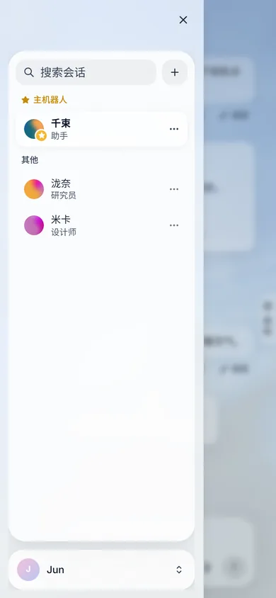 | 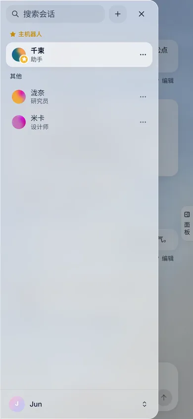 |
| 手机 深色 | 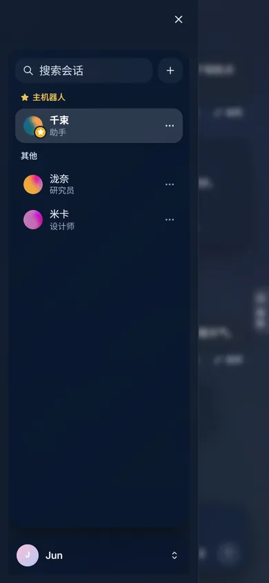 | 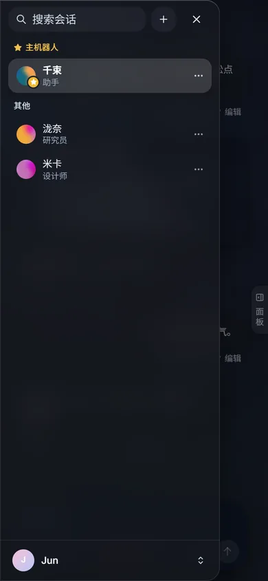 |
| PC 小窗 浅色 | 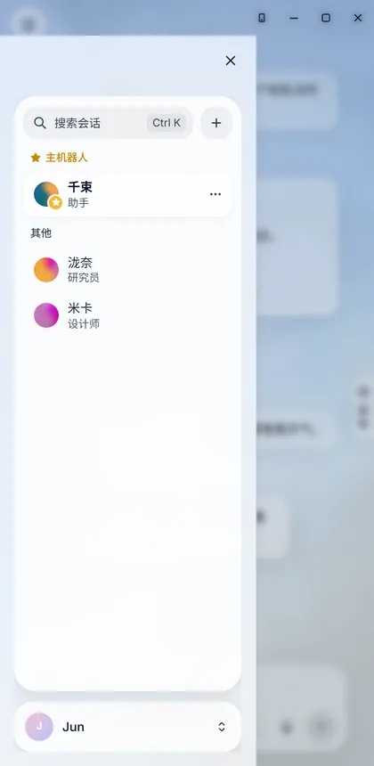 | 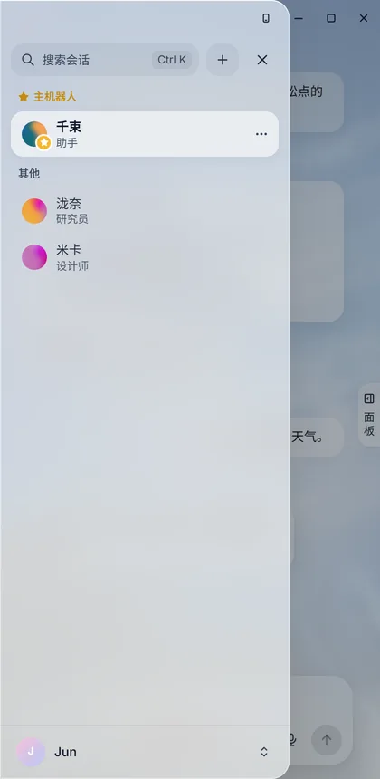 |
| PC 小窗 深色 | 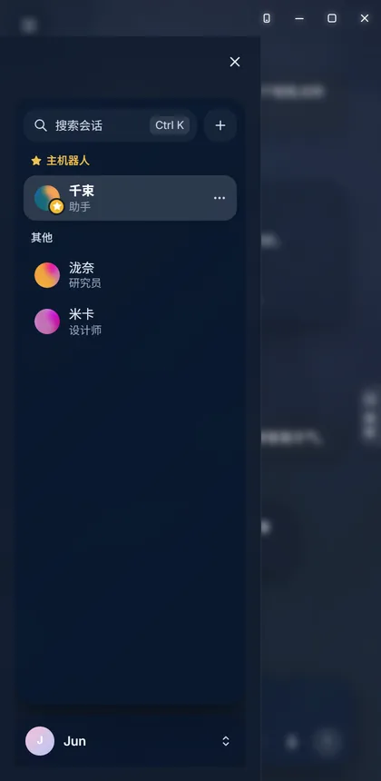 | 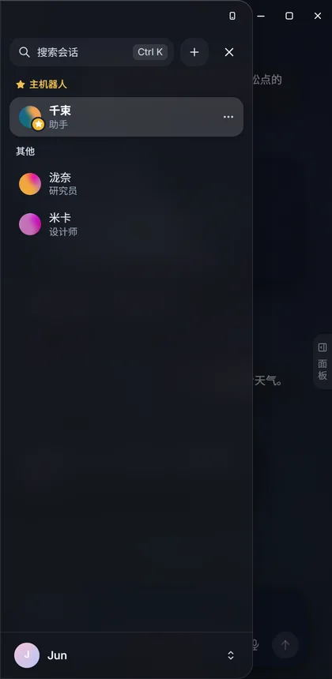 |

**测试**：新增 `app/tests/mobile-drawer.test.tsx`（面板只有一层 `.glass`、遮罩存在、点遮罩关抽屉、抽屉规则不写模糊 / 里面卡片关掉旧玻璃层 / 遮罩不模糊、只动 transform 200ms、减少动态效果无动画、性能模式和减少透明度不透明）；`render-budget.test.ts` 的模糊名单删掉两条已经不模糊的旧抽屉选择器。

**未改**：桌面宽窗口的左栏、#374 改过的顶栏 / 左栏文件、#375 的 perf-noblur.css、版本号。

**部署**（2026-10-29 08:45–08:58 北京时间）：部署前在 Haupt 另做数据库备份 `/opt/chisabot-backups/pre-release/v0.1.105-20261029T002243Z.dump`（`pg_restore -l` 767 条目），备份网关 `nginx.conf`（`nginx.conf.bak-pre-v0.1.105-20261029T002243Z`），给 d6cd2ec 打 `local/chisabot:keep-d6cd2ec` 防清理。`deploy-serial.sh 3856d36` 全量构建（依赖有变），镜像 `local/chisabot:auto-202610290045-3856d36`（同时成为 BASE_IMAGE），`/api/version` 为 `0.1.105` / `3856d36`。

**网关 nginx（#372）**：deploy-serial 只做 `sync-nginx --check`，不会套用新模板，所以手动把仓库 `deploy/public/nginx.conf` 按线上域名 / 端口渲染（与渲染旧模板得到的线上配置逐字节一致，只多出 #372 的 59 行），写入挂载进 `chisabot-public-gateway` 的 `/opt/chisabot-zh/public/nginx.conf`，容器内 `nginx -t` 通过后 `nginx -s reload`（容器未重建）。`nginx -T` 与渲染结果 md5 一致：22 条 `set_real_ip_from`、`real_ip_header CF-Connecting-IP`、14 个转发都清 `CF-Connecting-IP` 并设 `X-Real-IP`。宿主机 `/opt/chisabot-ops/deploy/public/nginx.conf` 模板同步为 main 版（已备份）。

**检查**：`request.sh smoke` PASSED（admin 模型自检 `ok:true persisted:false`），`health.sh` 通过，公网 `/login` 200，sidecar 隔离 ALL GREEN，未回滚。reload 后 access log 里经 Cloudflare 进来的请求记的是真实客户端 IP（从 Ayase 经 Cloudflare 发的请求带 CF-RAY，日志里是客户端公网 IP），reload 前同类请求是 172.71.x / 104.22.x / 162.158.x 等 Cloudflare 节点；reload 后唯一一条 Cloudflare 地址是 reload 前建立、reload 后才关闭的 WebSocket。线上 `sw.js` 的 `SW_VERSION` 为 `"3"`（公网 `/sw.js` 需要登录，未登录 401；应用容器内和 :3001 取到的都是 3，网关对已登录客户端返回 200）。

**镜像**：当前（BASE_IMAGE）3856d36、上一版回滚目标 `auto-202610282010-ed93b05`、`keep-d6cd2ec`、`keep-628d527`。

**待办**：`deploy/public/auth/server.ts`（网关签身份头时加 `j`）属于登录服务，不随一键更新，这次没有手工部署 `chisabot-web-auth`；在它更新前，网关签的仍是不带 `j` 的旧格式，应用照旧放行，防重放实际上还没生效。另外宿主机 `/opt/chisabot-ops/scripts/ops/sync-nginx.sh` 是旧版（要求 `/_openbot/auth-check` 标记），`--check` 读的是 10-18 生成、未挂载的 `nginx.generated.conf`，没有反映线上真实配置，建议之后把宿主机 ops 脚本同步成 main 版。

## 2026-10-29 发版 0.1.106

- #370 `perf/thread-inbox-incremental`（head `47ea175` → `d554c24`）→ `6d91044`：对话记录 `…/threads/:id/messages` 支持 `since` / `cursor` 增量读，频道聊天页读历史和每轮结束后的顺序核对都改成增量；三张卡片的每秒计时器合并为共享时钟。

**冲突**：与 main 只在 `CHANGELOG.md`、`docs/CHANGELOG.md`、`docs/DEVLOG.md` 冲突，把 origin/main merge 进 PR 分支、两边都保留、普通 push 后再合并。没有代码文件冲突。

**版本**：根、`app`、`server` 升到 `0.1.106`；PC / Android 不变。不打 tag、不发 Release。

**0.1.106 部署**（2026-10-29 10:03–10:16 北京时间）：部署前在 Haupt 另做数据库备份 `/opt/chisabot-backups/pre-release/v0.1.106-20261029T020328Z.dump`（`pg_restore -l` 767 条目）。`deploy-serial.sh 0ba9676` 镜像 `local/chisabot:auto-202610290203-0ba9676`（同时成为 BASE_IMAGE），`/api/version` 为 `0.1.106` / `0ba9676`。`request.sh smoke` PASSED（admin 模型自检 `ok:true persisted:false`），`health.sh` 通过，公网 `/login` 200，容器 healthy、无重启，sidecar 隔离 ALL GREEN，未回滚。网关 nginx 配置未变（md5 与部署前备份一致），`nginx -T` 仍有 22 条 `set_real_ip_from`、`real_ip_header CF-Connecting-IP`。镜像清理：更新器已自动删除 `auto-202610282010-ed93b05`，手动删除 `keep-d6cd2ec`；保留当前（BASE）0ba9676、上一版 3856d36、`keep-628d527`。

## 2026-10-29 主题系统提案 + 账号卡 RFC（文档 PR，待小爱批准）

**内容**：只改文档，不改代码，不升版本。

- 新增 `docs/design-system.md`：
  - 去掉 6 个色板、3 档玻璃材质和雾度滑块，换成 6 套完整主题（sky / mist / ocean / dusk / aurora / sakura，各有浅色和深色；默认模式下 dusk 和 aurora 是深色）。
  - 内容包括颜色表、玻璃参数（取自 Hark 的 CSS）、backdrop-filter 去留表、设置页卡顿实测、性能模式、token 命名和存储迁移。
- `docs/rfc/hark-redesign.md` 从 `feat/hark-redesign` 带过来：
  - 更新 PR 状态：#363、#369 已合并，#374、#375、#378 已开。
  - 「下一步」写了桌面去掉账号卡的方案。
- `DESIGN.md` 末尾加 §119，只放这两份文档的链接。

**backdrop-filter 统计**（main `3856d360`）：
- `app/src/styles.css` 里出现 76 次（加上组件里的 Tailwind 写法共 80 处），声明 70 条。
- 删掉三档层和性能模式里的 21 条以后，剩 49 条：35 条会模糊，14 条是 `none`。
- 提案改完以后只留 4 条会模糊的规则和 5 条 `none`。

**设置页卡顿实测**（Playwright + CDP trace，main 的生产构建，桌面 1440×900，从聊天页打开设置）：
- 1x CPU，第一次打开：DOM 出现 110–137ms，画面出来 201–238ms，有 2–3 个 54–95ms 的长任务。
  - 时间主要花在主线程：脚本 64–80ms，样式计算 51–67ms，布局 72–80ms。
- 4x CPU 降速：1.8–4.6s。
- 全局关掉模糊：228–240ms，所以卡顿不是模糊造成的。
- 第二次打开：108–113ms，布局降到 5–6ms，样式计算仍有约 50ms。

**效果图**：
- 旧主题 1 张，6 套新主题按默认模式和反向模式各 1 张，加一张模糊半径对比，都在 `docs/images/theme-proposal/`。
- 原始截图和 trace 在 `/workspace/hark-redesign/shots/theme-proposal/`。
- 原型 CSS 和 SVG 壁纸没有提交。

**依赖**：代码 PR 等 #376（`efa5abe9`）合并后，再从 main 拉分支，顺序见 design-system.md §10。天空小修排在这个 PR 之后。

**第二版（小爱审阅后）**：方向已通过，细节仍待小爱批准。
- 已定：模糊半径 24px；手机端红点放在抽屉按钮上；§36.1 窗口按钮放最右，头像在它左边。DESIGN.md §36.1 已改；「顶栏」那一节等账号卡 PR 再改（main 现在还没有头像，和 #374 不冲突）。
- 面板底色透明度从 0.40 降到浅色 0.25、深色 0.32。只降透明度时，最差的文字对比只有 3.01，过不了 AA。所以在同一条 backdrop-filter 里加了压背景：浅色 `contrast(0.65) brightness(1.35)`，深色 `brightness(0.7)`。次要文字改成不透明混色（浅色 88%，深色 85%）。
- AA 实测：12 张主题壁纸上铺满面板，取每块面板最差的 8×8 区域。主要文字最差 6.38，次要文字最差 4.69（sky 深色，月亮处），都过 AA。各主题的数字见 design-system.md §3.1。
- 效果图重拍了。新增 `5-sidebar-see-through.webp`：侧栏放在樱花和极光壁纸上，对比 0.40 和第二版。
- 代码 PR 顺序改为：① 主题数据和切换，同时删掉旧色板、玻璃材质和雾度滑块；② 砍 backdrop-filter；③ 存储；④ 账号卡。都等 #376 合并后再开。
- 返修（同日）：效果图按第二版参数重拍，2、3、4 替换，新增 5（三列：0.40 / 只降底色 / 第二版），图片目录约 380KB；透光对比发现压背景会把面板洗白 / 压灰，透光不如只降底色，已在 design-system.md §11 照实写明并请小爱取舍；另加了 tid 参考图的用途（06、04 输入框，08 底部面板，05 空状态和加载）。
- 第三版（小爱选方案 ③）：基线改回只降底色（浅 0.25 / 深 0.32，不压背景），只给过不了 AA 的预设单独补偿：sky 浅、sakura 深用轻压背景 `contrast(0.8)` + 亮度 1.15 / 0.85；aurora 深再把底色提到 0.36；sky 深、mist 浅、ocean 浅、dusk 浅、dusk 深再给列表项加 0.13–0.25 的淡衬底。12 张壁纸主文字最差 6.32、次文字最差 4.52，都过 AA；侧栏对比图换成基线和第三版并排，2–5 号图按第三版重拍。
- 第四版（小爱复审第三版后）：补偿顺序反过来，先加局部衬底，压背景和提底色放到最后。12 套面板都回到基线（0.25 / 0.32，不压背景），aurora 深的 0.36 和所有 t2 都去掉；8 套只给文字所在的列表项 / 卡片加主题实色半透明衬底 + 细描边和高光边（0.18–0.45，上限 0.48）。12 张壁纸主文字最差 6.32、次文字最差 4.56，没有一套还需要 t2；5 号图右列和 2–4 号图按第四版重拍。
## 2026-10-29 链接卡组照 Hark 错落叠放（feat/hark-linkstack，依赖 #380）

**做了什么**：`LinkCardStack` 把一条回复里最多 3 个链接放进同一个网格格子，位置全靠 transform（槽位写成 `--lc-sx / --lc-sy / --lc-rot / --lc-sc` 变量），主位居中抬高、左右两张倾斜约 -4° / 3.5°、缩到 0.94。卡宽 `min(208px, (100cqw − 16px) / (1 + 0.72 × 侧边张数))`，左右两张各错开 0.72 卡宽，所以 390 宽的手机上整叠也不出屏。单个链接是不倾斜的单卡（宽 min(280px, 100%)）。

**交互**：鼠标移到哪张、键盘 `:focus-visible` 到哪张，那张就挪到主位；换位后锁 250ms（不短于 220ms 的过渡），挪完时指针下面换成的那张要等指针离开再进来才换，免得静止的指针下卡片来回跳。指针离开整叠后**保持最后一张在主位**，不复位（复位会让刚看的那张又被盖住，读起来更乱）。触屏第一次点只挪到主位（preventDefault），点主位的卡才打开；鼠标点击直接打开。`prefers-reduced-motion: reduce` 时没有过渡。

**宽图**：`linkMediaRatio` 有 og:image:width/height 就用实际比例（夹在 4:3 和 2.4:1 之间），没有就 GitHub 2:1、其它 1.91:1 占位；骨架用同一个比例，图片到了不跳。GitHub 链接的底行用 `shortLinkLabel` 从地址取短标签（release → 版本号，issue / PR → #号，仓库首页 → owner/repo），和站点名、标题重复的补充信息不显示。

**和 Hark 不同的地方（按 docs/design-system.md 改）**：

- Hark 的卡永远是深色半透明。我们的规范是气泡、卡片不模糊、用主题实色，所以卡片底用 `--glass-bg-solid`（亮色主题白、暗色主题深灰，都是 .96），高光边 `--glass-highlight`、阴影 `--shadow-2`，文字 `--text`，灰字 `--text-secondary`；没有任何 `.dark .lc-*` 的单独配色。
- 圆角：Hark 约 18px / 图 12px、内缩 6px。我们按 DESIGN.md §10.3 卡片用 `--r-lg`（20），内缩 `--sp-2`（8），图片圆角按同心规则写成 `calc(var(--lc-radius) − var(--lc-inset))` = 12。
- 间距：文字区、叠放留白都换成 4pt 刻度的 `--sp-*`。
- 动效：要求约 250ms ease-out，规范里最接近的是 `--dur-2`（220ms，状态切换）+ `--ease-out`，用令牌，不另写一个 250ms。
- 图片上的 ↗ 和「追问」按钮仍是深色小胶囊：它们压在照片上，跟主题走在浅色照片上会看不清。

**标题纯文本**：标题、站点行都是 React 文本节点，没有 innerHTML / markdown；测试里给 `<b>`、`**…**`、`[…](…)` 标题，确认原样显示、不生成标签。

**和 #391 的来源格式对齐**：`LinkSourceFields = { url, title?, site?, toolCallId? }`，`LinkCard` 和 `LinkStackItem` 都直接接受（`site` 映射到 siteName，`toolCallId` 写进 `data-tool-call`），以后来源卡组可以 `<LinkCardStack items={replySources.sources} />`。本 PR 没有接入 `capabilities.replySources`。

**没碰**：styles.css、wallpaper_core.html、bot-bubbles.tsx 的 SVG 净化、appearance 相关文件；没有 blur、`:has`、`!important`；未升级版本号。截图和录屏在 docs/images/linkstack/（只留 stack.webm 和 5 张关键截图：3 张前后对比、换位序列、触屏点击）。

**评审后修改（#397）**：主位在用户悬停 / 聚焦 / 点过之前按当前张数重算（流式 1 → 3 张时换到中间那张），选过之后不再动；流式中第 3 张照样出来，不满 3 张才放骨架；`key` 带上序号，同一网址出现两次也不撞；「追问」自己 `:focus-visible` 时显示，叠放时不在主位的卡上 `visibility: hidden` + `pointer-events: none`，触屏单卡上一直显示；侧卡错开从 0.62 改成 0.72 卡宽，侧卡露出的标题更完整。

## 2026-10-29 发版 0.1.107

- #378 `fix/mobile-drawer-hark`（head `c25464a` → `274ed1a`）→ `adbe51f`：手机尺寸左栏抽屉改成 Hark 手机端的一层全高面板。
- #380 `feat/hark-linkcard`（head `8975949` → `8747ef7`）→ `c5dcb0a`：链接卡照 Hark 改版，数据侧修正标题 / 预览图（GitHub 预览图）。

**流程**：先在临时 worktree 里本地试合并（PR 分支各自 merge 最新 main、再 `--no-ff` 合进 main，顺序 #378 → #380），`bun install --frozen-lockfile`、`typecheck`、`build`、`test:app`（222 个文件 1722 pass / 0 fail，退出码 0）全部通过后，才把 PR 分支普通 push、main 快进到本地验证过的合并提交，线上 main 树与验证结果一致。

**冲突**：两个 PR 与 main 都只在 `CHANGELOG.md`、`docs/CHANGELOG.md`、`docs/DEVLOG.md` 冲突，两边都保留；没有代码、package.json 或锁文件冲突。发版时去掉了从旧 PR 分支带回 Unreleased 的 #373 重复条目（它已在 0.1.105 发布）。

**版本**：根、`app`、`server` 升到 `0.1.107`；PC / Android 不变。不打 tag、不发 Release。

**0.1.107 部署**（2026-10-29 12:07 北京时间开始）：部署前在 Haupt 另做数据库备份 `/opt/chisabot-backups/pre-release/v0.1.107-20261029T040728Z.dump`（`pg_restore -l` 767 条目）。`deploy-serial.sh 6790ef7` 镜像 `local/chisabot:auto-202610290407-6790ef7`（同时成为 BASE_IMAGE），`request.sh smoke` PASSED（admin 模型自检 `ok:true persisted:false`），`health.sh` 通过，公网 `/login` 200，容器 healthy、无重启、日志无错误，sidecar 隔离 ALL GREEN，未回滚。网关 nginx 配置未变（22 条 `set_real_ip_from`、`real_ip_header CF-Connecting-IP`）。镜像：更新器已自动删除 3856d36；保留当前（BASE）6790ef7、上一版 0ba9676、`keep-628d527`。

## 2026-10-29 发版 0.1.108

- #381 `feat/reply-style-hark`（head `bad6187` → `94bab32`）→ `1bd5416`：回复风格对齐 Hark（提示词 + 服务端），去掉固定三段式，默认一个气泡、结论先行。

**流程**：先在临时 worktree 本地试合并（PR 分支 merge 最新 main，再 `--no-ff` 合进 main），`bun install --frozen-lockfile`、`typecheck`、`build` 通过；`test:app` 1722 个用例里只有 `form-submit-controls` 超 5 秒默认超时（扫描全部表单，单独跑 3.6–5.0 秒，在 origin/main 上同样贴着 5 秒线，本 PR 未改 app 代码），单独以 60 秒超时重跑通过，按既有的计时抖动处理。验证通过后 PR 分支普通 push、main 快进到本地验证过的合并提交。

**冲突**：只在 `CHANGELOG.md`、`docs/CHANGELOG.md`、`docs/DEVLOG.md` 冲突，两边都保留，没有重复的已发布条目；没有代码、package.json 或锁文件冲突。

**版本**：根、`app`、`server` 升到 `0.1.108`；PC / Android 不变。不打 tag、不发 Release。

**0.1.108 部署**（2026-10-29 14:51 北京时间开始）：部署前在 Haupt 另做数据库备份 `/opt/chisabot-backups/pre-release/v0.1.108-20261029T065111Z.dump`（`pg_restore -l` 767 条目）。`deploy-serial.sh 9e9ca0d` 镜像 `local/chisabot:auto-202610290651-9e9ca0d`（同时成为 BASE_IMAGE），`/api/version` 为 `0.1.108` / `9e9ca0d`；`request.sh smoke` PASSED（admin 模型自检 `ok:true persisted:false`），`health.sh` 通过，公网 `/login` 200，容器 healthy、无重启、日志无错误，sidecar 隔离 ALL GREEN，未回滚。网关 nginx 配置未变（22 条 `set_real_ip_from`、`real_ip_header CF-Connecting-IP`）。镜像：更新器已自动删除 0ba9676；保留当前（BASE）9e9ca0d、上一版 6790ef7、`keep-628d527`。

## 2026-10-29 发版 0.1.109

- #391 `feat/reply-sources-stability`（head `2a6a2ab` → `f9926e6`）→ `5319bc0`：回复来源结构化（数据格式先行），生产环境 `CHISABOT_REPLY_SOURCES` 保持关闭。
- #392 `fix/turn-failure-web-fetch`（head `a6fbe90` → `2b57e1a`）→ `d27cce0`：web_fetch 重试 + 搜索摘要降级，工具失败后这一轮一定有回答（Hark A4）。
- #376 `fix/wallpaper-privacy-upload`（head `efa5abe` → `434b323`）→ `3ae5e59`：壁纸与外观收尾（IndexedDB，只改 app）。

**流程**：先在临时 worktree 本地试合并（每个 PR 分支先 merge 当时的 main，再按 #391 → #392 → #376 `--no-ff` 合进 main），`bun install --frozen-lockfile`、`typecheck`、`build` 通过；`test:app` 224 个文件 1743 个用例里只有 `form-submit-controls` 超 5 秒默认超时（已知的计时抖动），单独重跑 1.9 秒通过。验证通过后 PR 分支普通 push、main 快进到本地验证过的合并提交。

**冲突**：只在 `CHANGELOG.md`、`docs/CHANGELOG.md`、`docs/DEVLOG.md` 冲突，两边都保留，没有重复的已发布条目；没有代码、package.json 或锁文件冲突。#392 没写 CHANGELOG 条目，发版时补上。

**版本**：根、`app`、`server` 升到 `0.1.109`；PC / Android 不变。不打 tag、不发 Release。

**0.1.109 部署**（2026-10-29 16:07 北京时间开始）：部署前确认 Haupt 上 `chisabot-zh` 的容器环境、s6 环境和配置文件里都没有设置 `CHISABOT_REPLY_SOURCES`（代码默认关）；另做数据库备份 `/opt/chisabot-backups/pre-release/v0.1.109-20261029T080656Z.dump`（`pg_restore -l` 767 条目）。`deploy-serial.sh 63914d8` 镜像 `local/chisabot:auto-202610290807-63914d8`（同时成为 BASE_IMAGE），`/api/version` 为 `0.1.109` / `63914d8`；`request.sh smoke` PASSED，`POST /api/admin/smoke` 模型自检 `ok:true persisted:false`，`health.sh` 通过，公网 `/login` 200，容器 healthy、无重启、日志无错误，sidecar 隔离 ALL GREEN，未回滚；部署后运行中的容器仍未设置 `CHISABOT_REPLY_SOURCES`（关）。网关 nginx 配置未变（22 条 `set_real_ip_from`、`real_ip_header CF-Connecting-IP`）。镜像：更新器已自动删除 6790ef7；保留当前（BASE）63914d8、上一版 9e9ca0d、`keep-628d527`。

## 2026-10-29 回复过程照 Hark 改（feat/hark-reply-steps）

- 对照 `/workspace/hark-compare`（REPORT 第「工具过程」「等待态」两行、P0 / P1 两项）和反馈图 `tid/02.png`：Hark 等待时只有一行状态，做完不留痕迹；ChisaBot 原来有「思考中」气泡、做完还留着干活卡、还会冒出只有「---」的步骤。
- 新增 `StatusCapsule` / `PausedCapsule`（`app/src/components/chat/status-capsule.tsx` + `.css`）：转圈 + 当前动作 + 「N 秒」，不到 1 秒不显示秒数；运行中的 `WorkRow` 画成同一个胶囊（还能点开看步骤），`Thinking` 和停顿占位也换成胶囊，原来的三点气泡、`PauseDots` 删掉。秒数从这一轮开始算（`liveSince`），思考 → 干活不会归零。
- `WorkRow`：从运行变成完成时自动收起并记住；历史里完成的行一律收起。
- `isBlankNote`（`lib/chat/work-steps.ts`）：去掉 markdown 后没有字母、数字、emoji 的过程话（「---」「…」）不进步骤列表，`compactTurns` 也把这种助手正文当作隐藏。
- 规则：只用现有 token；胶囊不用 blur，动画只动 transform / opacity；`prefers-reduced-motion` 关动画，`prefers-reduced-transparency` 和 `html[data-perf="on"]` 用不透明底色（与抽屉同色）；没有 `:has()`、没有 `!important`；styles.css 和禁区文件都没动。
- 已知：做完的干活行在本页亲眼看着收起时，按 §82.9 仍以 0 高、`aria-hidden` + `inert` 的折叠行留在 DOM 里（重新打开对话时不画）；工具过程默认隐藏后只剩空 div 的工具行由 styles.css 已有规则 `display: none`，不占位。

## 2026-10-29 回复过程审查修正（feat/hark-reply-steps，#404 退回）

- 只有代码块的回复整段消失：`isBlankNote` 以前先过 `plainNote`，它把 ``` 代码块整段去掉，`compactTurns` 就把这段当空段藏了（流式时代码块一闭合就没了）。改成只认整段都是分隔符（`-`、`*`、`_`、`=`、`~`、`.`、`·`、`…`、`。`、破折号、制表线，可以夹空白）；代码块、表格、链接都不算空。
- 工具失败、后面没有文字时一片空白：`HIDE_FINISHED_WORK_SUMMARY` 让做完的干活行一律收起，`ChatTranscript` 里又写死了 `hasFinal: true`。现在 `compactTurns` 给每轮算 `answered`（结果气泡 / render_ui 卡片 / 留着的气泡），`isQuietWork` 在没有回答时不收（被停掉的照旧收，另有「已停止」）；新增 `noAnswerAfter`，最后一个看得见的行后面挂 `NoAnswerRow`「这一轮没有回答」，最后一轮带重试（用现有的 `onRetryUnanswered`，和重新生成同一条路；错误卡已经在的时候不重复挂）。只回了 `---` 的一轮同样处理。
- 读屏：干活卡按钮的 `aria-label` 改成「当前动作（，N 步失败），展开 / 收起步骤」；对话末尾一个一直挂着的 `role="status"`（`transcript-live-status`），「思考中」→ 当前步骤在同一个节点里换字，胶囊和干活卡自己不再带 `role="status"`。
- 焦点：干活行在这一轮结束时跟着收成 inert 的折叠行时，`WorkRow` 在 layout effect 里把焦点移到后面第一条看得见的行（没有就往上找，必要时给 `tabIndex=-1`），不掉到 body；行没收起（没有回答）时焦点留在按钮上。
- 跳动：停顿时的胶囊（`data-variant="pause"`）上下内边距 1px，高 22px，和以前停顿的占位一样，来新字时不多跳 16px。
- 秒数：胶囊的开始时间改用 `work-card.tsx` 的 `turnStartedAt(turnKey)`（模块里按这一轮的 key 记），切换频道回来不归零，和干活卡同一个数。
- 胶囊换成干活卡不再播进场淡入（`.chat-work-card.rs-capsule { animation: none }`）；深色不再写死 `--rs-solid`，用 `--glass-bg-solid`。
- 测试：`reply-steps.test.tsx` 补了只有代码块、工具失败没有文字、只回 `---`、秒数重挂不归零、`PausedCapsule`、焦点、aria-label、CSS 规则；`quiet-turn.test.ts` 里「没回答也收起」的断言按新规则改了。
- 已知遗留：收起的行仍作为 0 高折叠行留在 DOM 里，长对话里会累积；`PausedCapsule` 出现 / 消失没有给读屏做防抖。

## 2026-10-29 回复过程第二轮审查修正（feat/hark-reply-steps，#404 复审 7d064048）

- 「这一轮没有回答」以前只认文字和 `render_ui`：以 `image_generate`、`file_share`、`ask_person`、`github_create_issue`（确认卡）这类卡片收尾的一轮会被挂重试，点了会重新生成图片、重新建 issue。现在 `compactTurns` 多一个 `drawsCard` 参数，`ChatTranscript` 传 `toolDrawsCard`：读 CopilotKit 注册的渲染器（新文件 `lib/copilot/tool-renderers.ts`，挑法和 `useRenderToolCall` 一样；不在 Provider 里返回空，不抛错），有渲染器就算卡片，注册时标了 `lineOnly`（计算机工具那些只画一行过程 / 什么都不画的，经 `approval-tools.tsx` 的 `useFrontendTool` 打标）的不算；没有渲染器时只有宿主被拒（`isHostAccessRefusal`，和 `ServerToolLine` 共用）算；确认卡（`useThreadConfirmations`）和行内审批卡（审批收件箱）挂着的工具也算，两份列表都和卡片共用缓存，还没读到时先当有卡片；有渲染器的活动消息也算。
- 窄屏：`styles.css` 在 ≤ 560px 把做完的干活行的 `.chat-work-meta` 藏了，手机上看不到「N 步失败」。`WorkRow` 多一个 `unanswered`，没有回答的那一行带 `data-unanswered`，`status-capsule.css` 用属性选择器（多一级优先级）在窄屏重新显示；没改 `styles.css`，那条规则也不在 #376 的范围里。
- 计时：`turnStartedAt` 以前按这一轮的 key 只记一次，同一轮重新跑时接着上一次算。现在 `ChatTranscript`（和 `WorkRow`）在这一页亲眼看着这一轮从「跑着」变成「停了」时 `markTurnRunEnded`，下次 `turnStartedAt` 清掉开始时间、结束时间和记下的用时，从 0 算；切频道回来重挂时还在跑、没经过「停了」，秒数照旧接着算。
- 测试（`reply-steps.test.tsx`）：图片 / 文件 / 问人 / 等确认 / 宿主提示 / 活动卡收尾都不挂；只画一行过程的渲染器和普通工具失败照常挂；末尾已有错误卡时不重复挂重试（挂载 `ChatTranscript` 对照）；重跑归零、重挂不归零；`data-unanswered` 和窄屏 CSS 规则。合了 main 0.1.109（merge commit）。

## 2026-10-29 回复过程第三轮审查修正（feat/hark-reply-steps，#404 复审 cc398fc0）

- `toolDrawsCard` 以前把不是 `lineOnly` 的渲染器都当画了卡片，但图片 / 文件工具没拿到文件、`schedule_create` 被拒或报错、`render_ui` 的规范画不出东西（或被拒、格式有误只画一行）时渲染器什么都不画，这一轮被算成有回答，屏幕上却空着、也没法重试。现在渲染器模块自己导出判断（`imageToolDrawsCard` / `fileToolDrawsCard` / `scheduleDrawsCard` / `renderUiDrawsCard`，渲染时用同一个函数决定返回不返回 null），按工具名登记到 `tool-renderers.ts` 的 `registerCardCheck`（`useRenderTool` 会把 `render` 再包一层，没法像 `lineOnlyRender` 那样给函数打标）；`toolDrawsCard` 在工具有了结果之后问它，还没结果（骨架）照旧算卡片。`render_ui` 写完后的判断抽成 `renderUiFinal`，组件和判断共用。测试：每种返回 null 的情况都挂「这一轮没有回答」，成功的不挂，原来用 `card = () => null` 加假结果的用例改成真实结果。

## 2026-10-29 回复过程第四轮审查修正（feat/hark-reply-steps，#404 复审 3d65ef4c）

- **必改**：`device_agent_run` 被拒时 `taskIdOf` 返回 null、渲染器画 `<></>`，但没登记判断，这一轮被算成有回答。`local-agent-tool.tsx` 导出 `localAgentDrawsCard`（`taskIdOf(result) !== null`，和渲染器同一个函数）并 `registerCardCheck(["device_agent_run"])`。
- **应改**：还没有结果时骨架一直算卡片——这一轮结束了、没按停止、工具一直没回，就永远算有回答，骨架也一直转。现在 `compactTurns` 把每一轮的 `live` 传给 `drawsCard(item, live)`，`toolDrawsCard` 新增 `live` 选项：登记过判断的渲染器在 `result === undefined` 时只有这一轮还在跑才算卡片。`compactTurns` 另外返回 `liveTools`（正在跑的那一轮里的调用）；`TranscriptToolCall` 对不在里面、没有结果、登记过判断的调用不再画骨架，换成一句不动的「画图没有完成」「生成界面没有完成」（`UnfinishedTool`），和下面的「这一轮没有回答」+ 重试一致。没登记判断的渲染器（问人这类等用户的、确认卡）照旧，按了停止的一轮也照旧不挂「没有回答」。
- **可选（都做了）**：
  - `delegate_task` 被拒时 `workerIdOf` 以前返回 undefined，`WorkerCard` 一直显示「正在交给后台…」的等待卡。现在有结果但没有 workerId 返回 null，渲染器画空（同 `device_agent_run`），并登记 `workerDrawsCard`。
  - `render_ui` 格式有误那一行：这一轮还在跑时照旧写「格式有误，机器人会修正后重新生成」；这一轮结束了（下面挂着重试）写「界面格式有误，没能显示」（`renderUiFailedDetail`，由 `TranscriptToolCall` 提供的 `ToolTurnEndedContext` 决定）。
  - `reply-steps.test.tsx` 的 `live ? false : true` 改成 `!live`。
- 测试都加在 `app/tests/reply-steps.test.tsx`（「复审 #404 第四轮」一组）：被拒 / 拿到 id 的 `device_agent_run` 和 `delegate_task`、结束后没有结果的六种骨架工具（还在跑时照旧算卡片）、`UnfinishedTool` 的文字、没登记判断的渲染器、按了停止的一轮、`render_ui` 两种说法；登记表测试加上两个新判断。原来「工具还没有结果：照旧算卡片」那条改成只在这一轮还在跑时成立。
- 顺手：`PausedCapsule` 的测试以前要求正好「4 秒」，机器忙时 0.95 秒的等待拖过 1 秒就变成 5 秒（改前的 3d65ef4c 上也会这样失败），改成 4 ≤ 秒数 < 10。

## 2026-10-29 性能模式 / 减少透明度：全局不模糊（分支 `perf/global-no-backdrop`）

### 动机

流畅优先。#363 给毛玻璃定了预算，性能模式下大部分面板也已经不模糊，但它是一个个选择器去关的：新加的、第三方的、Tailwind 写的模糊就会漏。实测 main 上开着性能模式，桌面聊天页还有 1 层（streamdown 代码块右上角的操作条 `div.pointer-events-auto.flex.shrink-0`，`backdrop-blur` 8px），设置页 14 层（外观设置的玻璃预览和色板的勾），手机抽屉 2 层（代码块操作条 + 遮罩）。系统「减少透明度」也一样。

### 改动

- **`app/src/perf-noblur.css`（新文件，`main.tsx` 里紧跟 `styles.css` 引入）**：
  - `html[data-perf="on"]:not(#chisabot-no-blur) *, …::before, …::after { --lg-blur: none; backdrop-filter: none }`，`@media (prefers-reduced-transparency: reduce)` 里同一套（前缀 `html:not(#chisabot-no-blur)`）。
  - 不用 `!important`：`:not(#id)` 给选择器加一个 id 的优先级，压过所有类 / 属性规则，引入顺序也不要紧；旧「三档玻璃」层的 `backdrop-filter: var(--lg-blur) !important` 不去比，直接把 `--lg-blur` 设成 `none`。
  - 不透明底色 `--glass-bg-opaque`（浅 `rgb(246 247 250)`、深 `rgb(29 31 36)`）：原来模糊的元素（左右栏、账号卡、输入框、顶栏搜索、菜单 / 选择框 / 浮层 / 对话框 / 抽屉、手机侧栏、提示条、代码块 / 图表操作条、外观设置的玻璃预览）都换成它；旧玻璃层改 `--lg-surface`。色板上的勾用实心深色。
  - 全屏遮罩、agent-orb 点阵层、电脑画面上的小标签只去掉模糊，保留自己的半透明底（压暗 / 装饰，不该变成不透明）。
- **审计**：`styles.css` 里所有会模糊的规则、Tailwind 的 `backdrop-blur-*`（dialog / sheet 遮罩、avatar-picker、chat-transcript、computer-view）、内联样式（无）、组件内嵌 `<style>`（agent-orb）、第三方样式（streamdown 2.6.0 的代码块 / 图表操作条和缩放按钮；copilotkit、prompt-area、tw-animate、shadcn 没有 `backdrop-filter`）。`agent-computer/`、`server/` 的页面不在 app 里，不受影响。
- **`app/tests/no-backdrop.test.ts`（新）**：引入顺序；两种开关都覆盖 `*` / `::before` / `::after` 且设了 `--lg-blur: none`；`perf-noblur.css` 不含 `!important`、页面上没有 `chisabot-no-blur` 这个 id；`app/src` 里不许内联 `backdropFilter`、Tailwind important 模糊类、新的 `backdrop-filter … !important`；两种开关的不透明名单一致；`styles.css` 里每条会模糊的规则都在不透明名单里，或者在豁免名单里写了原因（桌面左栏外层、平常就不模糊的小按钮 / 气泡 / 对话里的卡片 / 设置页卡片）。
- **`DESIGN.md` §10.3.1** 写下这条规则。
- 没改 `styles.css` 和 #374 改过的代码文件；没改版本号。

### 验证

浏览器审计（`noblur.mjs`，和之前一样数可见且 computed `backdrop-filter` 不为 none 的元素，含伪元素；减少透明度用 CDP `Emulation.setEmulatedMedia` 模拟）：

| 场景 | 普通（main） | 普通（本分支） | 性能模式（main → 本分支） | 减少透明度（main → 本分支） |
| --- | --- | --- | --- | --- |
| 桌面 聊天 / 代码块 / 账号菜单 | 5 | 5 | 1 → 0 | 1 → 0 |
| 桌面 设置页 | 16 | 16 | 14 → 0 | 14 → 0 |
| 手机 聊天 / 代码块 / 菜单 | 2 | 2 | 1 → 0 | 1 → 0 |
| 手机 设置页 | 1 | 1 | 1 → 0 | 1 → 0 |
| 手机 抽屉 | 6 | 6 | 2 → 0 | 2 → 0 |

深浅色结果相同。性能模式下原来模糊的元素底色 alpha 都是 1（遮罩除外，见上）。

截图（`docs/images/perf-noblur/`）：

- 性能模式代码块：`after-perf-code-desk-light.webp`、`after-perf-code-desk-dark.webp`（手机：`after-perf-code-phone-*.webp`）
- 性能模式面板：`after-perf-chat-desk-light.webp`、`after-perf-chat-desk-dark.webp`、`after-perf-settings-desk-*.webp`、手机抽屉 `after-perf-drawer-phone-*.webp`
- 普通模式前后：`before-normal-chat-desk-*.webp` / `after-normal-chat-desk-*.webp`，手机 `before-normal-chat-phone-*.webp` / `after-normal-chat-phone-*.webp`

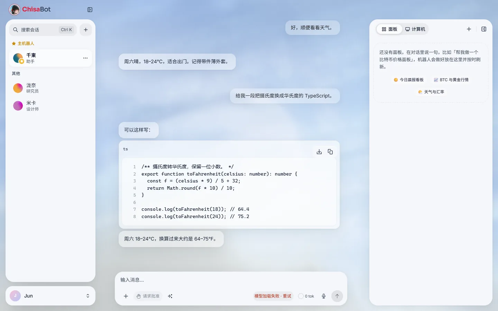
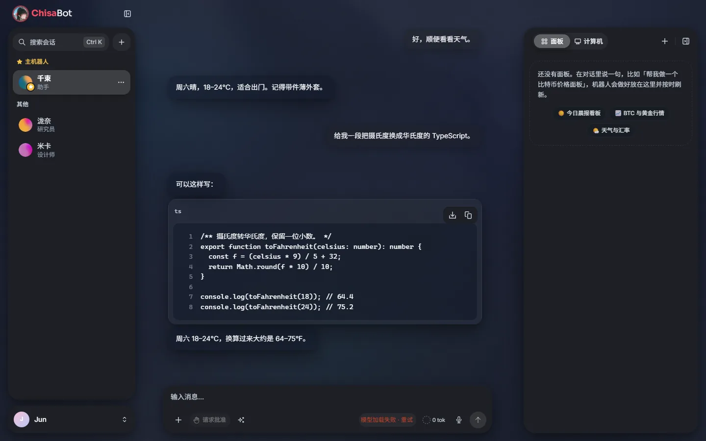
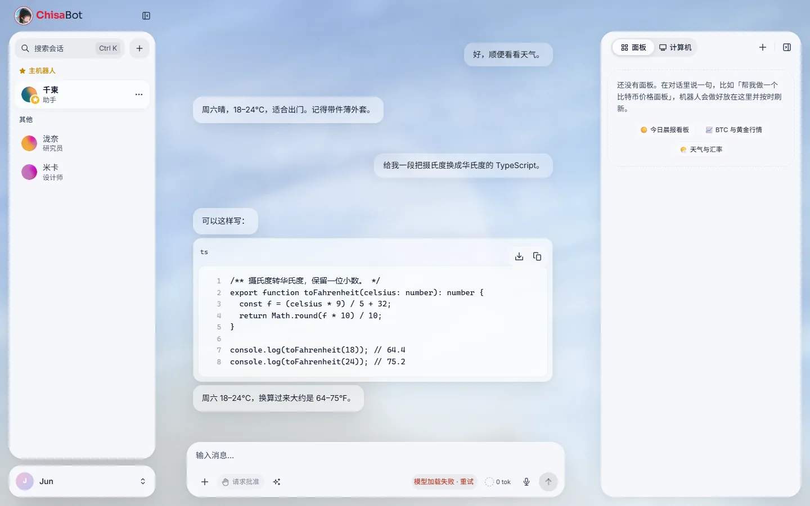
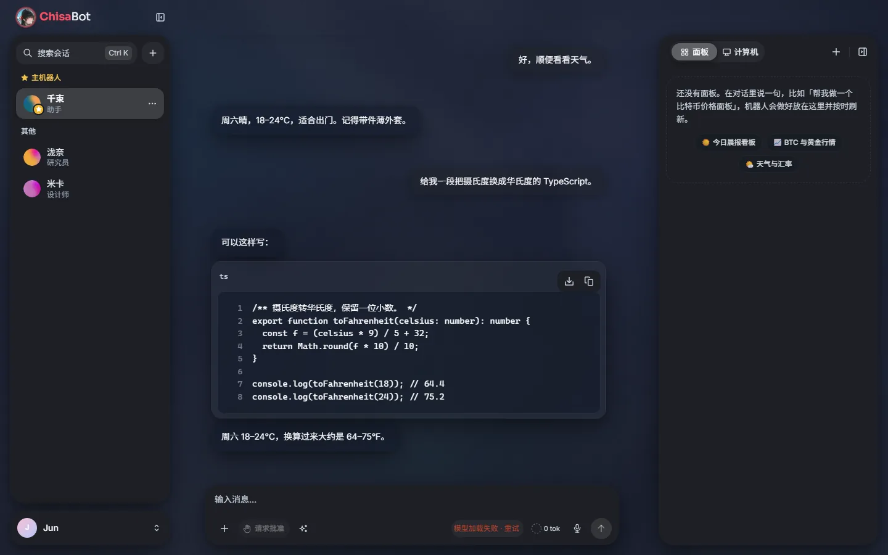

## 2026-10-29 Hark 顶栏外壳（Hark 改版第 2 步，分支 `feat/hark-topbar`）

### 动机

- Hark 改版 RFC（`docs/rfc/hark-redesign.md`，在 `feat/hark-redesign` 分支）的第 2 步是换顶栏：左上角放主页入口，右上角放搜索和账号，中间不再放分段切换，主界面只保留「聊天」一个视图。`feat/hark-redesign` 的 28154958 已经做出了效果，但那里和其它改版改动混在一起，而且有两条测试是失败的（搜索历史、组字时按 Esc）。这次只把顶栏单独搬过来，可以单独审查。
- 第 1 步（#369）把 Hark 令牌放进了 `html:root` / `html.dark`。`--font`、`--glass-shadow`、`--text-secondary`、`--stroke-primary` 和旧的深色层同名，而 `html:root` 的优先级高于旧的 `.dark`，所以只要漏写深色值，深色模式就会被浅色值盖掉。这条规则需要写进设计规范，并用测试守住。

### 改动

- `glass-topbar.tsx`：左上是圆形主页按钮（品牌头像）+ 品牌名 + 左栏开关；右上是搜索胶囊 + 圆形头像（账号菜单向下弹出）；PC 窗口按钮 `.win-ctrls` 仍在最右。
- `sidebar-search-field.tsx` 新增 `variant="topbar"`，和左栏共用同一份搜索状态，结果仍显示在左栏里。电脑上左栏不再放搜索框，手机抽屉里保留。
- 玻璃：只有搜索胶囊用 `.glass`（`--glass-filter`，20px），而且不加过渡；圆钮用 `.glass.is-flat`，不模糊。同屏模糊层：桌面从 4 层变成 5 层（开一个弹层时 6 层），手机仍是 1 层。
- 测试：`channel-pagination.test.tsx` 把顶栏搜索框和左栏一起渲染，修好了上面那两条测试；新增 `hark-token-dark.test.ts`，检查同名令牌在 `html.dark` 里都有深色值。
- 设计规范：DESIGN.md 新增 §10.5「Hark 令牌与同名旧令牌」。
- PC 窗口：客户端支持「小窗模式」时标题按钮有 4 个，原来顶栏右边只按 3 个（`46px * 3 + 12px`）让位，头像压在了小窗按钮上（改前头像不在顶栏，所以看不出来）。现在 4 个按钮时让出 `46px * 4 + 12px`，窄窗口仍走 36px 的规则。`after-pcwin-*` 截图已重拍。
- 不再用挂在大容器上的 `:has()`：左栏收起和标题按钮个数改由 `GlassTopBar` 直接输出 `data-sidebar` / `data-winctrls`，样式写成 `.glass-topbar[data-sidebar="collapsed"]` / `.glass-topbar[data-winctrls="4"]`，免得流式输出时整个外壳反复重算样式；`app/tests/no-container-has.test.ts` 冻结 main 上已有的 9 条大容器 `:has()`，新增一条就失败。
- 没有新增 `!important`，没有升版本号，禁区（`bot-bubbles.tsx`、`wallpaper_core.html`、壁纸上传、外观设置样式）都没碰。

### 截图

改前是 `main`，改后是本分支。截图用本地静态服务和 mock 的 `/api` 生成，没有连后端。

| | 改前 | 改后 |
|---|---|---|
| 桌面 深 | 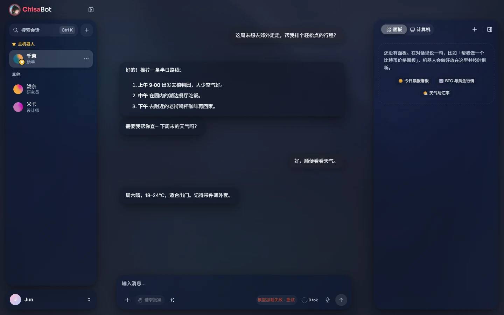 | 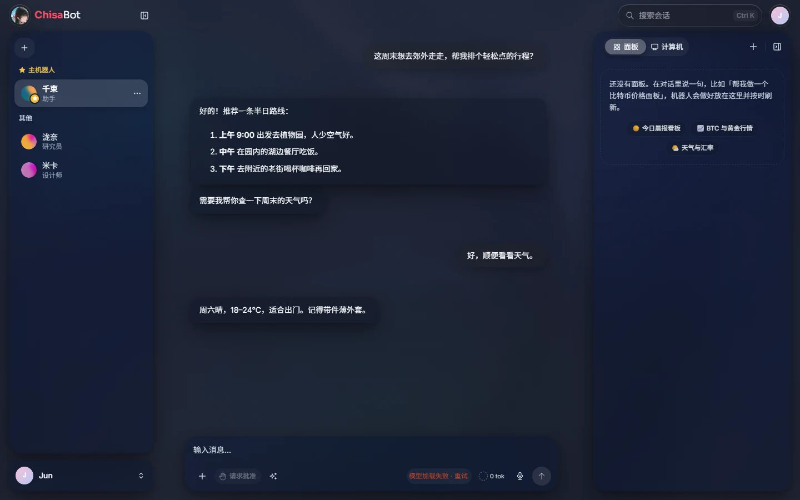 |
| 桌面 浅 | 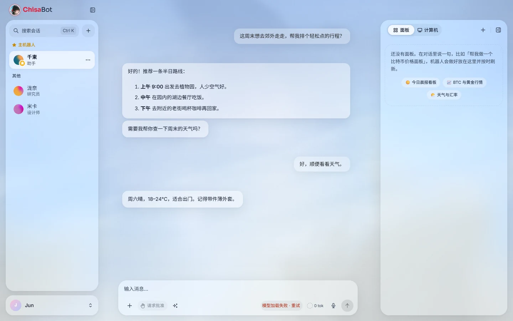 | 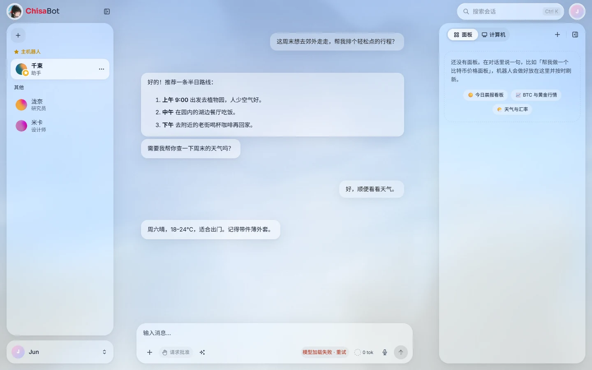 |
| 手机 深 | 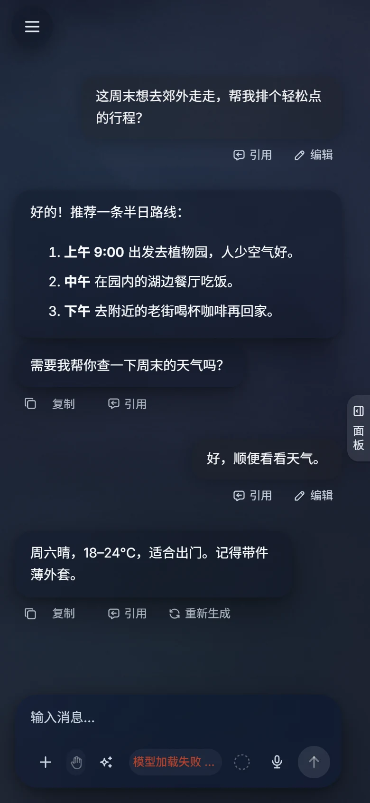 | 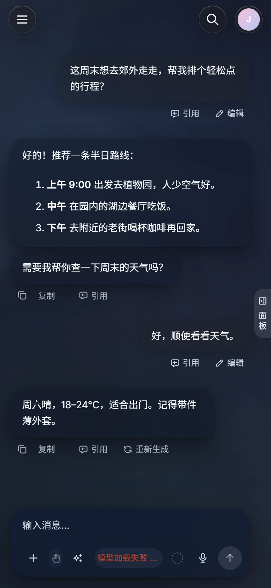 |
| 手机 浅 | 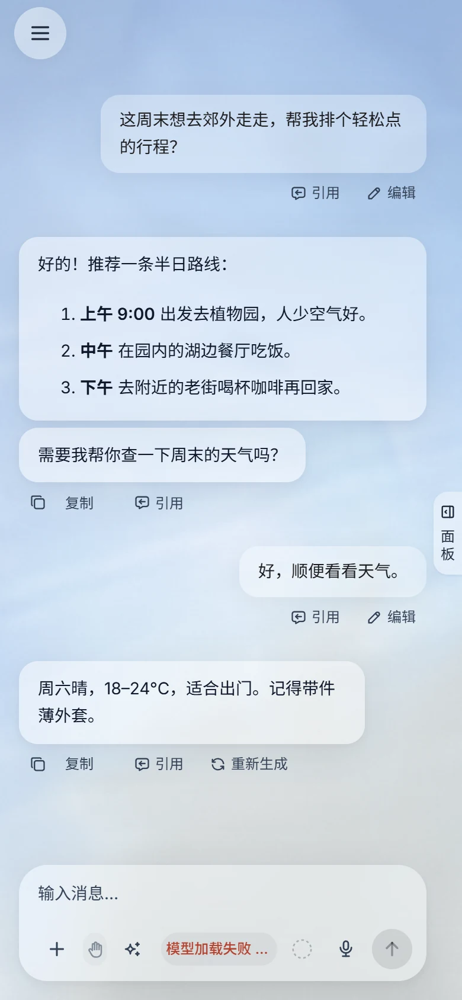 | 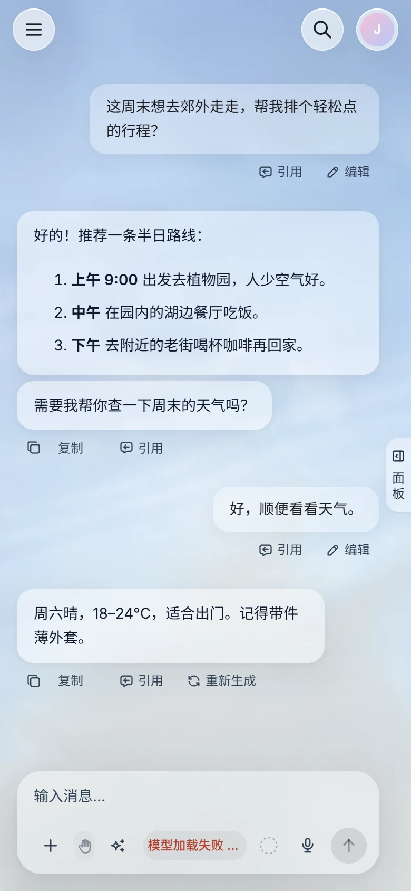 |

PC 窗口（深 / 浅）的截图也在 `docs/images/hark-topbar/`，文件名是 `*-pcwin-*.webp`。

## 2026-10-29 发版 0.1.110

- #375 `perf/global-no-backdrop`（head `83a29e3`）→ `e35a9cb`：性能模式 / 减少透明度下全局关掉毛玻璃，原来模糊的面板换成不透明底色。
- #374 `feat/hark-topbar`（head `f601ab3`）→ `f05beca`：Hark 顶栏外壳（圆形主页按钮、右上搜索胶囊 + 头像）。
- #394 `dev3/fix-open-double-history-read`（head `a35cfb7`）→ `875ae8f`：打开对话时只读一次历史。
- #396 `dev3/fix-reconnect-backfill`（head `710e31a`）→ `a14669d`：断线重连后补齐漏掉的消息。

**流程**：先在临时 worktree 本地按 #375 → #374 → #394 → #396 `--no-ff` 合进 origin/main（PR head 合并前核对未变），`bun install --frozen-lockfile`、`typecheck`、`build` 通过，`test:app` 229 个文件 1759 pass / 0 fail（退出码 0，form-submit-controls 这次没超时）。验证通过后 main 快进到本地验证过的合并提交。

**冲突**：只在 `CHANGELOG.md`、`docs/CHANGELOG.md`、`docs/DEVLOG.md` 冲突，两边都保留，没有重复的已发布条目；没有代码、package.json 或锁文件冲突。

**版本**：根、`app`、`server` 升到 `0.1.110`；PC / Android 不变。不打 tag、不建 Release。

**0.1.110 部署**（2026-10-29 18:06 北京时间开始）：部署前在 Haupt 另做数据库备份 `/opt/chisabot-backups/pre-release/v0.1.110-20261029T100654Z.dump`（`pg_restore -l` 767 条目），备份网关 `nginx.conf`（`nginx.conf.bak-pre-v0.1.110-20261029T100654Z`）。`deploy-serial.sh 249aefa` 镜像 `local/chisabot:auto-202610291007-249aefa`（同时成为 BASE_IMAGE），`/api/version` 为 `0.1.110` / `249aefa`；`request.sh smoke` PASSED，`POST /api/admin/smoke` 模型自检 `ok:true persisted:false`，`health.sh` 通过（容器 healthy、无重启、本机 `/health` 200、公网 `/login` 200），sidecar 隔离 ALL GREEN，未回滚。网关 nginx 配置未变（22 条 `set_real_ip_from`、`real_ip_header CF-Connecting-IP`）。镜像：更新器已自动删除 9e9ca0d；保留当前（BASE）249aefa、上一版 63914d8、`keep-628d527`。

## 2026-10-29 天空换场景渐变小修（fix/sky-crossfade）

**问题**：天空背景只在「醒着」的窗口里画（快照模式，约 15fps）。主线程有长任务时，引擎某一拍会跳过不画（这一拍画了 0 层），旧代码按「这拍没在渐变」算，醒着的窗口就到期了，渐变停在 0.76～0.98，等下一次唤醒才跳完。另一处：天气数据的响应头到了就算完，body 晚到时引擎改了天空却没人叫醒画面，这次天气渐变一帧都不画。

**改法**：新文件 `app/src/lib/sky-fade.ts`。`noteSkyFrame` 记录渐变开始时间，渐变中（最多 `SKY_FADE_HOLD_MS` = 8 秒）每拍都把醒着的窗口往后延 3 帧，画了 0 层的那拍也延；画回 1 层就清掉。`wakeSkyOnWeather` 包住天气请求，响应到了叫醒一次，body 读完（或读失败）再叫醒一次，返回新的 Response（204/205/304 原样返回）。`sky-background.tsx` 改用这两个函数；`wallpaper_core.html` 没动。测试 `app/tests/sky-fade.test.ts`。

**实测**（Ayase 真 GPU Chrome，分别构建改前/改后的 dist；JANK=1 是每 0.9 秒插一个 120～360ms 的长任务；「停顿」= 渐变中的一帧之后 ≥400ms 没有下一帧）：
- 卡顿，连续换场景 12 次 × 2 轮：改前有一轮 12 次里 10 次停在半路，共 43 次停顿（例如停在 0.76、0.81、0.93，各停 1～4 秒），帧间隔中位数 1001ms；改后 2 轮 24 次只出现 1 次 402ms（在 0.17，刚过门槛），每次都画到 1，35～38 帧，帧间隔约 62ms。
- 卡顿，加载后 4～12 秒第一次换场景（12 个时间点）：改前启动渐变停顿 4 次，换场景后停在半路 3 次（0.76 停 3.8 秒、0.91 停 3.2 秒、0.99 停 1.8 秒）；改后都是 0。第 3 轮复测记录完整帧序列：改前停在 0.98 后 3.2 秒没有新帧，改后 12 次都画到 1。
- 天气 body 晚 3.5 秒（BODYDELAY=3500），连续换场景 12 次：改前每次只画出 38～40 帧（场景渐变），天气那次渐变一帧都没画；改后第 1 轮 77～80 帧（场景和天气两段都画）。点下一次时接着正在进行的渐变走（0.05→0.08、0.39→0.44），不跳。
- 性能规矩没变：活动时约 16fps，空闲、失焦、隐藏（包括渐变中隐藏）4 秒内都是 0 次绘制。
- 天气请求失败数是网络噪声（卡顿那组改前 28/128、改后 0；第 3 轮 5/72 对 9/72），和改动无关。

对比图：`docs/images/sky-crossfade/sky-crossfade-before-after.png`。未升级版本号。

## 2026-10-29 发版 0.1.111

- #393 `dev3/fix-multi-message-display`（head `785ee59`）→ `89c14fb`：机器人连发多条消息全部显示。
- #401 `feat/attachment-resize`（head `9693f9f`）→ `e305830`：附件缩略图（server 新增依赖 `sharp@^0.34.5`，bun.lock 随 PR）。
- #402 `fix/sky-crossfade`（head `851035e`）→ `67f2683`：天空换场景渐变不再停在半路。
- #405 `dev3/perf-form-submit-test`（head `7f6b55c`）→ `1190828`：form-submit-controls 测试只解析写了 onSubmit 的文件。
- #407 `fix/hark-search-quality`（head `424635b`）→ `46e9d4b`：联网搜索质量。
- #408 `dev2/stream-composer`（head `6139521`）→ `dff0cd3`：流式回复时打字不再乱序、不再残留。
- #411 `dev3/fix-reconnect-backfill-empty`（head `84a07bf`）→ `c6ea5b1`：空对话第一轮从本机发出后断线重连也补齐（PR 的 base 是 `dev3/fix-reconnect-backfill`，不会自动关闭，发版后手动关闭）。
- #413 `perf/first-text`（head `05df45c`）→ `718025a`：新话题首字延迟。
- 不合：#406 `dev3/feat-avatar-morph`（head `644be13`）。`app/src/styles.css` 末尾冲突，要求和测试的合并结果 0681d692 核对，但本地和 GitHub 都找不到这个对象；而且两边原样保留会让 HEAD 一侧末尾的 `@media (max-width: 767px)` 少一个 `}`。#403（含 #395、#398）按要求不进这一版。

**流程**：在临时 worktree 从 origin/main（`b975b1c`）按上面顺序 `--no-ff` 合并，合并前核对 PR head 未变。`bun install --frozen-lockfile`、`typecheck`、`build` 通过，`test:app` 234 个文件：共享进程 1790 pass / 0 fail；独立进程的 message-scroll-reduced-motion 在整跑时 beforeAll 超时（5s），单跑在发版分支和 main 上都通过，算负载导致；第一次整跑（机器上同时有其他构建，CPU 90%+）23 个超时失败，单跑全部通过（build-cache 在 main 和发版分支安静时都 13/13）。验证通过后 main 快进到本地验证过的提交。

**冲突**：只在 `CHANGELOG.md`、`docs/CHANGELOG.md`、`docs/DEVLOG.md` 冲突（两边都保留）；没有代码、package.json 或锁文件冲突。#411 的 CHANGELOG 条目原本自动并进了 0.1.110 段，发版时挪到 0.1.111。

**版本**：根、`app`、`server` 升到 `0.1.111`；PC / Android 不变。不打 tag、不建 Release。

**0.1.111 部署**（2026-10-29 21:48 北京时间开始）：部署前在 Haupt 另做数据库备份 `/opt/chisabot-backups/pre-release/v0.1.111-20261029T134745Z.dump`（`pg_restore -l` 767 条目），备份网关 `nginx.conf`（`nginx.conf.bak-pre-v0.1.111-20261029T134745Z`）。`deploy-serial.sh a4fce00` 因为 server 新增依赖 `sharp` 走了完整构建（609 秒），镜像 `local/chisabot:auto-202610291348-a4fce00`（同时成为 BASE_IMAGE），`/api/version` 为 `0.1.111` / `a4fce00`；`request.sh smoke` PASSED，`POST /api/admin/smoke` 模型自检 `ok:true persisted:false`，`health.sh` 通过（容器 healthy、无重启、本机 `/health` 200、公网 `/login` 200），sidecar 隔离 ALL GREEN，未回滚。网关 nginx 配置未变（22 条 `set_real_ip_from`、`real_ip_header CF-Connecting-IP`）。镜像：更新器已自动删除 63914d8；保留当前（BASE）a4fce00、上一版 249aefa 作回滚。#411 的 base 不是 main，已在 GitHub 上手动关闭并留言。

## 2026-10-29 发版 0.1.112

- #412 `dev3/link-preview`（head `e2b9cde`）→ `d8c8f19`：链接预览服务端（GitHub 预览图回退、视频 / 百科卡片、反爬降级）。
- #421 `dev3/fix-open-read-and-backfill-dup`（head `5bb67cf`，相对已审的 `a7ccfc3` 只多一行 CHANGELOG）→ `69a96fc`：冷打开只读一次完整历史，重连回填和刷新一致。
- 不合：#395 `dev2/settings-perf`（head `72326cf`）、#398 `dev2/settings-perf-2`（head `77a7f71`）、#403 `dev2/settings-perf-3`（head `e2bcc03`）三个叠在一起，一起放弃：#395 合到 `e0e79a0` 时 `app/src/components/layout/glass-shell.tsx`、`glass-topbar.tsx` 代码冲突（main 上 `f601ab3` perf(topbar) 和 `5cd6e8c` hark 顶栏改过同一处）。需要作者基于新 main 重新整理。

**流程**：在临时 worktree 从 origin/main（`e0e79a0`）按顺序 `--no-ff` 合并，合并前核对 PR head 未变、都没有改版本号。`bun install --frozen-lockfile`、`typecheck`、`build`、`test:app` 在发版提交 `0c06ef7` 上全过（bun 1.3.14）：test:app 1850 pass / 0 fail（245 个文件）。

**冲突**：#412 只在 `docs/DEVLOG.md`、#421 只在 `CHANGELOG.md` 冲突（两边都保留）；没有代码、package.json 或锁文件冲突。#421 的 CHANGELOG 条目原本并进了文件下方旧的 `## Unreleased` 段，发版时挪到 0.1.112。去掉 #408 留下的 `## Unreleased` 标题前缀（那段已随 0.1.111 发布）。

**网关**：#412 改了 `deploy/public/nginx.conf`、`cache-no-store.conf`、`security-headers.conf`。线上网关 `chisabot-public-gateway` 的 2053 端口还反代 Magpie（`127.0.0.1:3430`，`ghcr.io/yetone/magpie`），不是只服务 ChisaBot，按规则这次只部署应用、不动网关，仓库模板和线上 nginx 会暂时不一致（需要另行决定）。

**版本**：根、`app`、`server` 升到 `0.1.112`；PC / Android 不变。不打 tag、不建 Release。

**0.1.112 部署**：22:41（北京时间）先备份数据库 `pre-release/v0.1.112-20261029T144123Z.dump`（`pg_restore -l` 767 项）和网关 `nginx.conf`、`security-headers.conf`、`magpie-private.conf`，再 `deploy-serial.sh 0c06ef7 jun-grokbot`。依赖有变化走完整构建，22:51 上线 `local/chisabot:auto-202610291441-0c06ef7`（613 秒），回滚镜像 `auto-202610291348-a4fce00`，`isolate-sidecar-app` 全绿。冒烟：`request.sh smoke` 通过，模型自检 `ok:true persisted:false`；`health.sh` 通过；`/api/version` 为 0.1.112；公网 `/login` 200，安全头齐全；`/devices` 和静态资源匿名 401（要登录），本机 3001 上正常返回；real_ip 22 条 `set_real_ip_from` 加 `real_ip_header CF-Connecting-IP` 没变。网关 nginx 没动（md5 不变，没有 reload），#412 的网关配置还没上线。

## 2026-10-30 发版 0.1.113

- #439 `dev3/github-link-card`（head `6993843`）→ `d0dc438`：GitHub 仓库链接竖版大卡（GitHub API 描述 / 星标 / 头像兜底，429 缓存 5 分钟）。
- #440 `dev2/pc-layout-fix`（head `ca54721`）→ `6a1e777`：电脑端回退 #374 顶栏（只留左下账号卡、搜索和左栏开关回左栏）。
- #443 `dev4/perf-harness`（head `671f6ac`）→ `3bb35b5`：卡顿测量工具，只动 `perf/`、根 package.json 的 scripts、`.gitignore`、CI `perf.yml` 和文档，没有运行时代码、没改版本号。
- 不合：#441、#442（这次不发）。

**流程**：合并前核对三个 PR head 没变、都没改 `pc/`、`android/`、版本号；从 origin/main（`c99ee37`）开临时 worktree，按顺序 `--no-ff` 合并。`bun install --frozen-lockfile`、`typecheck`、`build`、`test:app` 在发版提交 `c9509f4` 上全过（bun 1.3.14）：test:app 1857 pass / 0 fail（247 个文件）。#443 的 `perf/*.mjs` 过了 `node --check`。

**冲突**：#439、#440 没有冲突；#443 只在 `docs/DEVLOG.md` 冲突（两边都保留）。#443 的 CHANGELOG 条目原本在顶部新开的 `## Unreleased`，发版时改成 0.1.113 段。

**版本**：根、`app`、`server` 升到 `0.1.113`；PC / Android 不变。不打 tag、不建 Release。

**0.1.113 部署**：11:16（北京时间）先备份数据库 `pre-release/v0.1.113-20261030T031606Z.dump`（`pg_restore -l` 767 项），再 `deploy-serial.sh c9509f4 jun-grokbot`。依赖有变化（根 package.json scripts），走完整构建，11:26 上线 `local/chisabot:auto-202610300316-c9509f4`（617 秒），回滚镜像 `auto-202610291441-0c06ef7`，`isolate-sidecar-app` 全绿。冒烟：`request.sh smoke` 通过，模型自检 `ok:true persisted:false`；`health.sh` 通过；`/api/version` 为 0.1.113 / `c9509f4`；公网 `/login` 200。GitHub 大卡：本机带本地调用头请求 `/api/link-preview?url=https://github.com/oven-sh/bun`，返回标题 `oven-sh/bun: …`、描述、`stars` 96463、`imageKind: avatar`（460×460，资源 200 image/png），缓存 5 分钟（og 图被限流，走头像兜底）；`ChisaAlter/ChisaBot` 命中 0.1.112 时的旧缓存（到 15:28 过期），之后才会换成新格式。网关、nginx 没动。

## 2026-10-30 发版 0.1.114

- #442 `dev4/sidebar-m3-1`（head `e74f503`）→ `545a7e3`：网关 401 直接去 `/login?next=`（带 30 秒防死循环）、SW 5、手机抽屉导航后收起、`/channel/new` 总开新话题。

**范围**：只改 `app/`（含 `app/public/sw.js`）和文档；不需要改网关 nginx（它本来就对导航回 302 `/login?next=`、对 `/api` 回 JSON 401 带 `openbotAuthRequired`，`/sign` 302 到 `/login`）、web-auth、`pc/`、`android/`。

**流程**：核对 head 未变；从 origin/main（`27e7c0f`）开临时 worktree `--no-ff` 合并。`bun install --frozen-lockfile`、`typecheck`、`build`、`test:app` 结果见部署记录。

**冲突**：只有 `CHANGELOG.md` 和 `docs/DEVLOG.md`，两边都保留；PR 顶部的 `## Unreleased` 发版时改成 0.1.114 段。

**版本**：根、`app`、`server` 升到 `0.1.114`；PC / Android 不变。不打 tag、不建 Release。

### 0.1.114 部署记录（2026-10-30 12:30 北京时间）
- 镜像 local/chisabot:auto-202610300420-dc40343，/api/version commit = dc40343e；回滚镜像 auto-202610300316-c9509f4。
- 测试：test:app 1900 pass / 0 fail / 251 files；typecheck、build 通过。
- 发版前备份 pre-release/v0.1.114-20261030T042002Z.dump（pg_restore -l 767 条）。
- smoke ok:true persisted:false；health.sh 通过；公网 /login 200；匿名导航 / → 302 /login?next=%2F；/sign → 302 /login；sw.js SW_VERSION = "5"。

## 2026-10-30 发版 0.1.115

- #449 `dev4/perf-resize-pause`（head `52ead3f`）→ `3db22ee`：改窗口大小时暂停 WebGL 天空，`html[data-resizing]`。
- #448 `dev2/jank-chat-switch`（head `99c7504`）→ `7434d37`：切会话即时反馈，高亮先到、对话延后渲染。

**范围**：只动 `app/` 和文档；网关 nginx、web-auth、`pc/`、`android/` 不变。

**流程**：核对 head 未变；从 origin/main（`11bacde`）开临时 worktree `--no-ff` 依次合并。`bun install --frozen-lockfile`、`typecheck`、`build`、`test:app` 结果见部署记录。

**冲突**：只有 `docs/DEVLOG.md`，两边都保留；`CHANGELOG.md` 顶部的 `## Unreleased` 发版时改成 0.1.115 段，并补上 #448 的条目。

**版本**：根、`app`、`server` 升到 `0.1.115`；PC / Android 不变。不打 tag、不发 Release。

**0.1.115 部署**：14:05（北京时间）先备份数据库 `pre-release/v0.1.115-20261030T060518Z.dump`（`pg_restore -l` 767 项），再 `deploy-serial.sh e9a65f3 jun-grokbot`，上线 `local/chisabot:auto-202610300605-e9a65f3`，回滚镜像 `auto-202610300420-dc40343`。box 上 bun 1.3.14：install、typecheck、build 通过，test:app 1915 pass / 0 fail。冒烟：`request.sh smoke` 通过，模型自检 `ok:true persisted:false`；`health.sh` 通过；`/api/version` 为 0.1.115 / `e9a65f3`；公网 `/login` 200，匿名导航 `/` → 302 `/login?next=%2F`；线上包含 `data-resizing`。网关、nginx、web-auth 没动。#451 留到下一版。

## 2026-10-29 设置 · 定时任务列表和详情（审查模块 13 第一个 PR：S4 / S7 / O8）

**范围**：只改 `app/src/routes/_authed/settings/schedules.tsx` 的列表和详情，新增 `app/src/components/schedules/schedule-runs.tsx`（运行记录 + 起手句常量 + `statusTone` 搬过来）；`components/schedules/edit-dialog.tsx`、`styles.css` 未动。

- **S4**：「去对话创建定时任务」原来把「每天 08:30 调用 personal_morning_brief…通过 notify_push 推送到我手机」作为引用块塞进输入框；空状态三个模板分别预设晨报推送、personal_check_updates 和 memory_dream。现在按钮和空状态都走 `sendPromptToChat(navigate, text)`（不带 sourceLabel → `chisabot-prefill`，只填不发），文字是中性的「帮我设一个定时任务：」/「明天早上 9 点提醒我：」等，用户补完自己发送；按钮 `title` 写明会做什么，空状态文案改成「点下面的起手句，它会填进对话输入框，补完再发送」。
- **S7**：详情里的运行记录改用 `scheduleRunsQueryOptions(id, limit)`，打开先显示列表带的 5 条，拉回 20 条；「显示更多」每次 +20，到服务端保留的 50 条为止（`service.ts` 修剪到 50），满 50 条时写「只保留最近 50 次运行」。`placeholderData: keepPreviousData` 让加载时旧记录留在原处；加载中按钮用 `aria-disabled` 而不是 `disabled`（禁用会把焦点丢到 body），没有更多时焦点移到列表（`tabIndex=-1`）；`aria-live` 播报「已显示 N 次运行」。
- **O8**：暂停的任务在行内 meta 加「已暂停」（`device-cap-chip`，`data-testid=schedule-paused`）；运行中「立即运行」`disabled`，文字变「运行中」，`aria-label`「「X」正在运行」，`aria-describedby` 指向 sr-only 的「这次还没跑完，跑完才能再运行。」，`title` 同文；窄屏隐藏 `.sch-run` 时菜单里的「立即运行」同样禁用并写「运行中，跑完才能再运行」。

**INP**（box，系统 Chrome headless + playwright-core，生产构建的临时页面挂真的路由组件，`/api` 打桩、详情接口延迟 120ms；CDP `Emulation.setCPUThrottlingRate` 4×；Event Timing `durationThreshold:16` 按 interactionId 取最长 duration；7 种交互 × 3 轮 = 21 次：点开详情、点「显示更多」、键盘 Enter「显示更多」、Esc 关详情、暂停开关、打开「更多操作」菜单、Esc 关菜单）：第 1 轮（机器高负载）最大 200ms、中位 72ms；第 2 轮（负载 ~2–4）最大 136ms（点开详情）、中位 72ms。dev 模式（未压缩 React 开发版）首次点开详情 288ms，仅作参考。

**测试**：`app/tests/schedule-runs-more.test.tsx`（起手句不含 notify_push / memory_dream / personal_ / 推送；5 → 20 → 40 → 50 条及请求的 runs 参数；不足 20 条不给「更多」；按钮消失后焦点落在列表）。截图 `docs/images/routines-list/{before,after}-{list,detail,empty}.webp`。未升级版本号。

## 2026-10-29 设置页审查模块 12（第 3–6 条）

**动机**：审查报告（模块 12）发现设置里所有表单离开时都不提示未保存，常驻指令、技能方法说明这类长文本一切页就丢；搜索说明和左栏文案和真实功能对不上（「8 款」配色实际 6 款、没有的内置流光壁纸、写死的精选技能数量、左栏和标题名字不同、「密钥」一项永远亮不起来）；中文标题的技能名字会变成 `--`；常驻指令保存时整个输入框被禁用。方向对齐 Hark 的设置体验：改了就有未保存栏（DESIGN.md §11），离开前问一声，文案只写真有的东西。

**改动**

- 未保存拦截（第 3 条）：`useUnsavedGuard(dirty)`（`app/src/components/ui/unsaved-guard.tsx`）用 TanStack Router 的 `useBlocker`，`shouldBlockFn` 弹 `confirmDialog`（「有未保存的更改，确定离开？」继续编辑 / 离开），`enableBeforeUnload` 管刷新和关标签。常驻指令在 SaveBar 显示、且不在保存中时挂上。弹窗用 `useGuardedOpenChange(dirty, onOpenChange)`：Base UI 的关闭原因是 `escape-key` / `outside-press` / `close-press` 且有改动时先确认（「放弃这次的改动？」），「取消」按钮不拦。确认框开着时忽略下面弹窗收到的同一次点击 / Esc（`isConfirmOpen()`），实测「继续编辑」后弹窗和内容都还在。全站只用确认，不存 sessionStorage 草稿。接在技能新建 / 编辑、导入 SKILL.md、记忆添加 / 编辑（`NoteDialog`）上；dirty 是表单和打开时快照逐字段比较（`formDirty`）。
- 文案（第 4 条）：`registry.ts` 只改文案，不动任何 `find` 字段（开发2 在改）。配色说明由 `THEME_PALETTES` 的名字和长度生成；壁纸说明改成「上传自定义图片作为背景壁纸」；精选技能去掉「8 款」；左栏「我的生图与识图」→「生图与识图」。「密钥」选了改动小的一种：页面加 `nav: false`，左栏不单列（新 `navGroups()`），搜索照常能搜到并跳到 账号连接 → API 密钥 标签，这时左栏亮「账号连接」，和所在位置一致；没有去改 SectionRail 的高亮逻辑。`server/src/user-instructions.ts` 超长报错改为「常驻指令最多 4000 个字。」。
- 技能名字（第 5 条）：`app/src/lib/skill-slug.ts`。没手动改过名字时跟着标题自动生成：留下标题里的字母数字，不够 2 个字符就用标题的 FNV 短串（`skill-xxxxxx`，同一标题结果稳定）；手打时合并连续连字符、去掉开头的连字符。标签改为「必填，小写字母、数字、连字符；按标题自动生成」。
- 常驻指令保存中（第 6 条）：去掉 textarea 的 `disabled`，只禁按钮；保存成功时只有内容没再改过才换成服务器返回值。
- 没碰 settings-search.tsx、memory.tsx 的整理按钮、appearance-preferences.tsx、wallpaper_core.html、bot-bubbles.tsx、壁纸上传、styles.css；没有新 CSS、动画和 token。

**测试**：新增 `app/tests/settings-audit-12.test.ts`（拦截规则、`formDirty`、slug 生成、文案不写死、「密钥」不在左栏但能搜到）。

**截图**：本地构建 main 和本分支，mock `/api`，1280×800。

| | 改前 | 改后 |
|---|---|---|
| 常驻指令未保存，点左栏「技能」 | 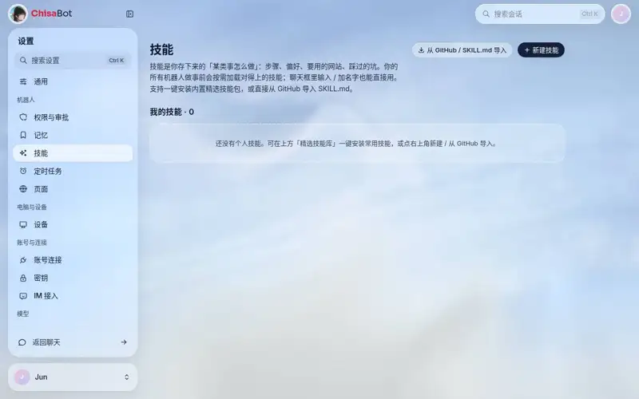 | 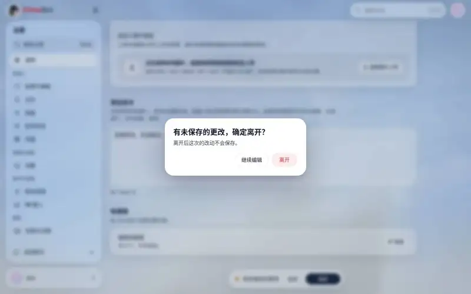 |
| 新建技能写了一半按 Esc | 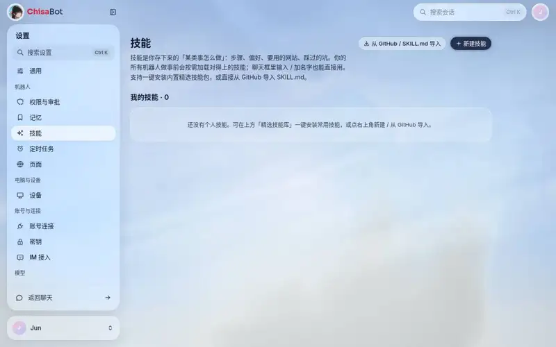 | 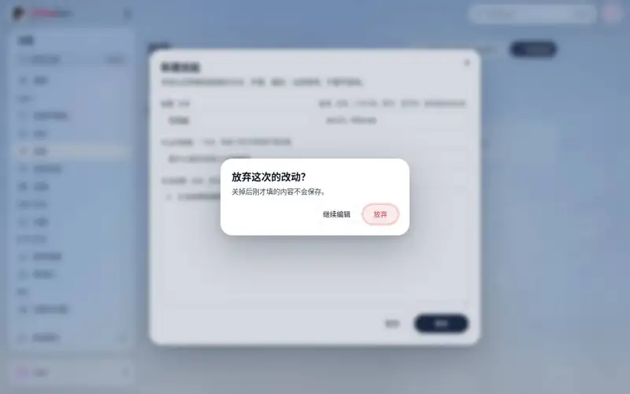 |
| 中文标题的名字 | 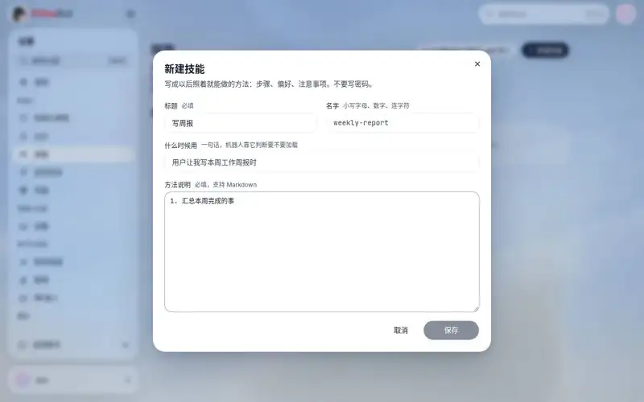 | 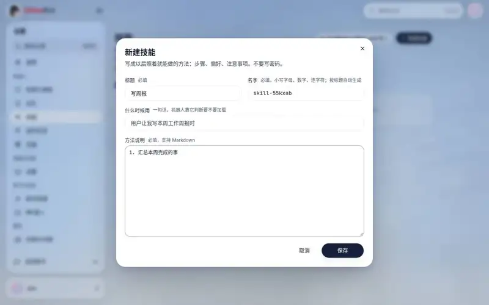 |
| 左栏 | 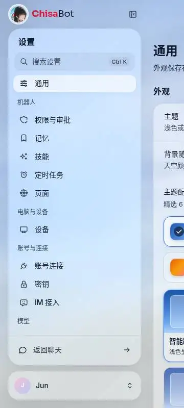 | 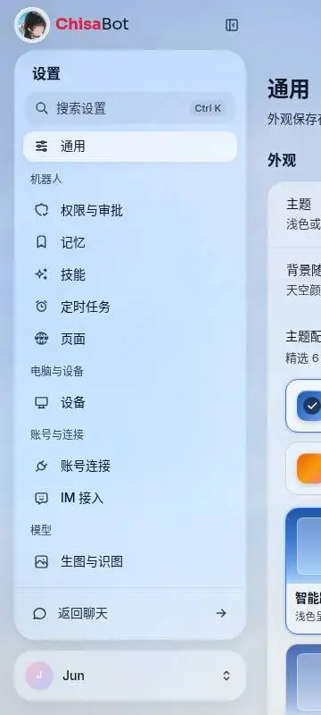 |
| 搜「配色」 | 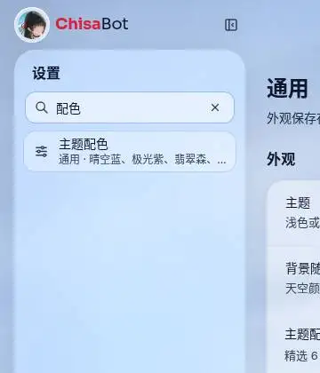 |  |
| 搜「壁纸」 | 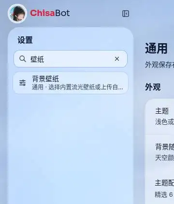 | 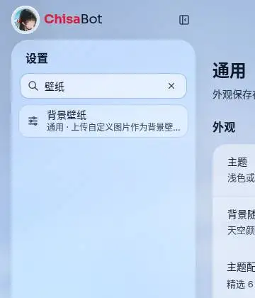 |
| 搜「精选技能」 | 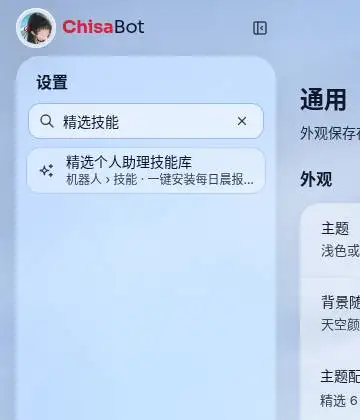 | 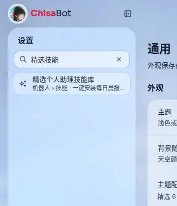 |

浏览器后退的确认：`images/settings-audit/after-back-confirm.webp`；打开 /settings/vault 后的左栏：`images/settings-audit/after-vault-active.webp`。

## 2026-10-29 设置页审查模块 12 复审返修（#428）

**动机**：小爱复审 #428 提的 4 条应修。

**改动**

- 保存栏页都接未保存拦截：全仓找 `<SaveBar`，设置里有三处——常驻指令（已接）、设备详情的「权限」（`components/devices/devices.tsx` 的 `DevicePermissions`）和「本机智能体」（`components/local-agents/device-agents-panel.tsx`），后两处补上 `useUnsavedGuard(dirty)`。工作流编辑页也有 SaveBar，但不在设置里，这次没动。
- 确认框 Esc：去掉 `isConfirmOpen()` 里「关掉后 150ms 内也算开着」。`ConfirmHost` 开着时在 window 捕获阶段监听 keydown，Esc 直接 `preventDefault` + `stopImmediatePropagation` 并关确认框，下面弹窗（Base UI 在 document 上监听）收不到；确认框弹层上的 pointerdown / mousedown / click 也 `stopPropagation`，下面弹窗的「点外面关闭」收不到这次点击。`isConfirmOpen()` 现在就是 `current !== null`。
- 焦点：`confirmDialog()` 打开时记下当前有焦点的元素（连弹两个时保留最早那个），关闭时通过 Popup 的 `finalFocus` 还回去；元素已不在页面上或被禁用时交回 Base UI 默认行为。
- 技能名字：`slugFromTitle` 里拉丁字母少于 4 个（`MIN_LATIN_FOR_PLAIN_SLUG`）时也加 FNV 短串后缀，「周报v2」→ `v2-xxxxxx`；4 个及以上照旧（「Weekly Report」→ `weekly-report`）。服务端撞名两条 409 本来就是中文（`server/src/skills-chisa/tools.ts`），未改。

**测试**：新增 `app/tests/settings-audit-12-confirm.test.tsx`（Esc 不传到 document、按钮点击不冒泡、取消后焦点回输入框、焦点目标兜底、「周报v2」slug、服务端中文报错、保存栏页都接了 `useUnsavedGuard`）。

**截图**：外观没有变化（确认框样式、保存栏都没改），没有补新截图。


## 2026-10-30 主题配色看得出来（fix/palette-theme）

**动机**：Jun 反馈设置里 6 个主题配色选哪个都看不出变化，选了「樱花绯粉」界面还是蓝的。原因有三：① `styles.css` 的 `html[data-palette=…]` 只覆盖了 `--accent-blue`，只染到开关、导航选中；主按钮用 `--ink-primary`，`--accent-color` / `--accent-soft` 都没覆盖。② 「智能跟随主题」时 Hark WebGL 天空按 `harkSceneLight/Dark` 选固定的蓝天 / 夜空场景，引擎没有色相参数，盖住了 `computePaletteSky` 的主题渐变。③ `--glass-bg` 写死白 / 灰。另外查到第 ④ 个：`--sky-1..3` 用 `@property` 注册成了 `inherits: false`，写在 body 上的主题渐变传不到 `#skyph`，占位天空除了最上面一段其余还是蓝色。

**改动**：
- `styles.css` 配色块：5 个非 default 配色的亮 / 暗各自覆盖 `--accent-color`、`--accent-soft`、`--accent-blue*`、`--ink-primary` / `--ink-primary-hover` / `--on-primary`（主按钮、shadcn `--primary`）、`--focus` / `--focus-line`（聚焦环）、`--glass-tint`。亮色主按钮用各色的深一档（如樱花 `#9d174d`，白字），暗色用浅一档（如樱花 `#faa2c1`，深字 `#0b1020`）。
- `styles.css` 末尾新增一节：`--glass-tint` 默认 `transparent`（`:root` 和 `html.dark` 都给）；非 default 时 `--glass-bg` / `--glass-input-bg` 用 `color-mix` 混进约 8% 强调色；大板块底色是 `!important` 写死的，不去抢，改用 `--lg-shadow` 里一层铺满的内阴影叠上 `--glass-tint`（左栏、右栏、账号卡、输入框、卡片）；输入框 `--composer-accent` 跟强调色；偏蓝的柔光薄纱 / 深色压暗层在非 default 时换成中性白 / 黑；`#skyph` 读挂在 `<html>` 上不注册的 `--palette-sky-0..3`。不加模糊、不用 `:has()`、不改布局，没有新动画。
- `appearance.ts`：新增 `usesPaletteGradientSky(state)`（`harkScene === "auto"` 且 palette 不是 default）；`computePaletteSky` 的 root 变量多给 `--palette-sky-0..3`；深色天空亮度从 6–17% 提到 12–26%，樱花暗色色相改为 300–334（深紫红夜）、亮色底部转暖（粉白黄昏），落日暗色改为暖棕夜、海洋 / 翡翠 / 极光暗色饱和度提高，免得都只剩黑色。
- `sky-background.tsx`：`resolveSkyMode` 多一个 `paletteGradient`，为真时和壁纸 / 性能模式一样不启动 WebGL（`data-sky-off`，露出 `#skyph`）；切回 default 或手动选场景时照旧启动。
- 新测试 `app/tests/palette-theme.test.ts`：5 个配色 × 亮 / 暗，`--accent-color`、`--accent-soft`、`--glass-tint`、主按钮颜色都和 default 不同，天空渐变是带主题色相的 hsl 且色相和 default 差 ≥10°；主按钮文字对比度、强调色当文字的对比度都 ≥ 4.5；智能跟随 + 非 default 才走渐变；新增样式无 blur / `:has()`。

**和 Hark 的区别**：Hark 只有固定的 12 个天空场景，配色不影响天空；我们在非 default 配色 + 智能跟随时不跑 WebGL，用主题渐变代替，用户手动选的场景和「背景随时间变化」不受影响。

**截图**：只放在 PR #441 的描述里，不进仓库。

**审查后修改（小爱审 #441，2026-10-30）**：
- 删掉 `docs/images/palette-fix/` 下 15 张提交进仓库的 PNG（单独一个删除提交），上面的截图说明同步改掉；截图不进任何 ChisaBot 分支。
- 写死的蓝色改用主题变量：开关选中、页面加载图标、进度条、info toast 图标，`bot-bubbles.tsx` 日程 / 邮件图标的 `text-[#2563eb]`；侧栏机器人选中条、未读小圆点、模型胶囊悬停描边、模型列表高亮、权限菜单聚焦环、设置搜索命中、跳转闪烁、发送键阴影等 `#2f7cf6` / `rgba(47,124,246,…)` 改成 `var(--pal-accent, 原值)` / `color-mix(in srgb, var(--pal-accent, 原值) N%, transparent)`。`--pal-accent`（= `--accent-color`）、`--pal-accent-soft` 只在 `html[data-palette]:not([data-palette="default"])` 下定义，default 和没有属性时走兜底的原值，与 main 完全相同。白字的未读数字徽章、头像配色、变量定义和 `var(…, #xxx)` 兜底值不改。
- 天空：任何非 default 配色都不启动 WebGL，不管「智能跟随主题」开没开、手动选了哪个场景，`usesPaletteGradientSky` 改为只看 palette；设置页场景选择上方加一行「彩色主题下使用主题天空」（`appearance-preferences.tsx` 只加这一处）。
- `--glass-tint` 不再用 100vmax 内阴影：大板块规则的 `background` 改成 `var(--pal-tint-layer,) var(--lg-surface…)`；`--pal-tint-layer`（`linear-gradient(var(--glass-tint), var(--glass-tint)),`，带逗号）只在非 default 下定义，default 时这一层不存在。一直叠一层透明渐变会改变面板渐变的光栅化，default 像素对不上，所以不用。`--lg-shadow` 恢复原值。
- 「模型加载失败 · 重试」：浅色 `#b4412d`→`#9c3020`，深色新增 `#ff9b87`；真 Chrome 取实际胶囊底色量对比度，6 个配色亮 / 暗都 ≥ 5.0（樱花暗色 5.97，原来深红字压深底不到 4.5）。
- default 像素一致（小爱追加）：真 Chrome 1280×800，main 与本 PR 各截首页（选中行 + 未读圆点）和设置页（含开关），亮 / 暗、default 与无 data-palette 共 8 个画面，每个都至少有一轮 main 对 PR 差 0 像素；其余几处（右上头像按钮、设置页中部）在 main 对 main、PR 对 PR 之间同样出现，是截图本身的抖动。固定时钟、关动画、隐藏 WebGL 画布和头像图片、mock 模型接口。新测试断言 default 兜底值就是 main 的原值。
- 开关颜色：第 ~3075 行 `[data-slot="switch"][data-checked]{background:var(--accent-blue)}` 在亮色下确实盖过开关规则，但各配色都覆盖了 `--accent-blue`，所以开关照样跟主题色。实测 default 亮 rgb(47,116,240) / 暗 rgb(96,165,250)，与 main 相同；樱花亮 rgb(190,24,93) / 暗 rgb(247,131,172)。


## 2026-10-30 P2-3 改窗口大小时暂停毛玻璃（perf/resize-glass-pause）

**动机**：FIX-PLAN P2-3，拖动窗口改大小时大面积 `backdrop-filter` 和阴影每帧重绘，卡顿明显。

**分工**：开发4 写 JS（`resize-state.ts`：resize 第一帧在 rAF 里给 `<html>` 加 `data-resizing`，最后一次 resize 150ms 后去掉，同时暂停 WebGL 壁纸）；前端只写 CSS，只依赖这个属性。

**改动**：新增 `app/src/resize-pause.css`，在 `main.tsx` 里接在 `perf-noblur.css` 之后引入。大板块改 `--lg-blur` / `--lg-shadow` / `--lg-surface` 变量本身（不跟旧规则比 `!important`），外壳和弹出层直接写 `backdrop-filter: none`、`box-shadow: none`、不透明底色；选择器带 `:not(#chisabot-no-blur)` 提优先级。不用 `:has()`、不用通配、不加模糊和动画。新测试 `app/tests/resize-pause.test.ts`。


## 2026-10-30 perf(P2-1)：流式输出时砍掉 props 没变的重渲染

**动机**：卡顿修复计划 P2-1。流式回复每来一个 token，ChannelChat → ConversationView → ChatTranscript 重渲染，顺带把 props 根本没变的整排组件（Composer、ContextMeter、BotModelSelector、PermissionChip、ActivityJumpButton、回到底部按钮、DocCard 的 ChevronDown 等图标）也重渲染一遍。#443 工具 `--react` 统计“parent(shallow-equal)”（props 浅比较相同仍重渲染）在 main 上 3 次为 1368 / 1177 / 1151。

**改动**（不改行为）：
- `React.memo`：Composer、ContextMeter、BotModelSelector、PermissionChip、ActivityJumpButton、CardFollowupButton、`ui/button` 的 AsyncContent / StatusGlyph。
- channel-chat：modelControl / leadingControl / contextControl / agentOptions 用 `useMemo`。
- conversation-view：submitDraft / stopRun / retryStopRun / queueDraft 改成 latest-ref 稳定回调（onStop / onRetryStop 仍只在原来有值时传）。
- 模块级常量 JSX：回到底部按钮 `BOTTOM_PILL`、跟进按钮内容 `FOLLOWUP_CONTENT`、DocCard 展开图标。
- 新测试 `app/tests/stream-rerender-budget.test.tsx`：这些组件是 memo；100 次 token 更新 Composer 最多渲染 2 次。

**结果**（`perf:jank --scenario=stream --runs=3`，CPU 4x，中位数，main `c9509f4` → 本 PR）：
- props 没变的重渲染：1368 / 1177 / 1151 → 36 / 37 / 37（Composer、ContextMeter 每次 72–85 → 2）。
- 非 react 统计：long-task 290 → 235 ms（−19%），script 2222 → 1883 ms（−15%），worst first frame 88 → 74 ms，fps 53.2 → 53.4，INP 104 → 104。
- `--react`（profiling 构建）：long-task 1333 → 637 ms（−52%），p95 帧 66.6 → 50 ms。

**自测**：typecheck、build 通过；test:app 238 个文件共享进程 1808 pass / 0 fail，独立进程 10 个文件全过；改动文件 Biome 问题数与 origin/main 相同。

**评审跟进（#451）**：`latest.current` 改在 `useLayoutEffect` 里写（不在渲染期间改 ref）；ConversationView / Composer 的默认 `agents` 改成模块级空数组（以前每次渲染新建 `[]`）；Composer 发送 / 停止按钮的图标提成模块常量。`commands`（`useSkillCommands` 已 memo）、`droppedAttachments`（state）、按钮 aria-label（字符串字面量）本来就稳定。测试里改 memo `.type` 的部分放进 try/finally，新增一条经 ConversationView 的用例（每个 token 新消息数组 + 新 onSubmit / onStop 闭包），故意把 onStop 改成新闭包时它数到 100 次、失败。

**复测**（main `11bacde` ↔ PR 交替 3 轮，每轮 `--runs=5`，非 trace，15 + 15 次中位数）：fps 46.4 → 51.3，p95 帧 50 → 33.4 ms，long-task 441 → 373 ms，script 2209 → 1939 ms，最长单个 long task 101 → 102 ms，style 1287 → 1316 ms（+2%），layout 237 → 271 ms（+14%）。main 自身三轮中位数的波动：最长 long task 100–112，style 1277–1320，layout 230–241。layout 超出噪声，原因：`useSmoothText` 用 rAF 每帧放一段字；PR 让主线程更空，同一段文字分更多帧放出（React 提交里 SmoothStreamdown 15 → 28–41 次、流式行 73 → 85–102 次；layout 次数 168 → 214），每次 layout 反而更便宜（1.34 → 1.26 ms，style 每次 6.97 → 6.29 ms）。要压回去只能给放字限帧（可见的行为变化），这个 PR 没做。

## 2026-10-29 一键整理记忆：预览确认、不截断、可撤销（分支 `fix/memory-tidy-safety`）

来源：审计报告 `12-settings.md` 必修 1（「一键整理记忆」）。

**动机**：原来设置页的「整理记忆」按钮和「添加」并排，点一下就直接执行：同主题笔记按 `kind + subject` 合并，合并结果 `slice(0, 4000)` 静默截断，被并掉的条目直接删除、没有任何恢复手段；分组不看 `agent_id` / `context`，不同机器人的笔记会被并到一起；整理过程是多条独立语句，中途出错会留下一半；`memory_dream` 作为 `memory/` 工具跳过审批，周报技能可以不打招呼就调用。

**改动**：
1. **预览 + 确认**（`server/src/memory-notes/tidy.ts`）：纯函数 `planTidy` 先算出分组和结果，`GET /api/memory-notes/dream` 返回预览和指纹 `token`。前端（`app/src/components/memory/memory-tidy.ts`）用 `confirmDialog` 列出要合并的组（`confirm.tsx` 新增可选 `items`），确认后 `POST` 带回 `token`；事务里加行锁重新计划，指纹不一致返回 409，不做任何修改。
2. **不截断**：合并后超过 4000 字的整组标为 `too_long`，不合并、不删，只对每条去掉重复行。
3. **可恢复**：新表 `chisabot_memory_tidy_backups`（`batch_id, note_id` 主键，`(owner_user_id, created_at DESC)` 索引）在同一事务里存原文 JSON；每人只保留最近一次、7 天过期。整理后弹 8 秒「撤销」，之后可在「更多」→「撤销上次整理」恢复；撤销时被删的按原 id 放回，被改的只在内容仍等于整理结果时才还原（用户已再编辑的不覆盖，计入 skipped）。
4. **分组**：键 = `kind + agent_id + context + subject`（无主题时用正文）。
5. **事务**：锁、清旧备份、写备份、更新、删除都在 `begin` 里完成，中途失败全部回滚。
6. **审批**：`categoryOfTool` 把 `memory_dream` 归为「删除」（先于 `memory/` 跳过规则）；Hermes 回调路径的记忆工具补上 `confirmations.wrap`。
7. **机器人 / 定时任务整理（#430 评审必改）**：不直接删，也不静默失败。
   - `GrantedTool` 新增可选 `prepareConfirm`（`server/src/plugins/tools.ts`），`confirmations.wrap` 出卡片前先调它：`memory_dream` 在这里算预览，卡片标题写「合并 N 组…（可撤销）」，明细逐组列出（和设置页弹窗共用 `shared/memory-notes.ts` 的 `tidyItems`），预览 `token` 放进执行参数，摘要按它算——用户确认的就是那一份。
   - 定时任务（用户不在场）：沿用 §101 的延后卡片，聊天和「待处理」里留一张带预览的整理建议，机器人回一句在等确认；用户点「确认」后服务器叫机器人重调，token 没变就用这次确认执行。
   - 确认后记忆又变了：token 对不上、摘要不同，`wrap` 把那次确认作废（`consumed_at`，不执行），重出一张卡片，标题写「内容在你确认后有了变化，上次的确认没有执行，请按最新内容重新确认」；卡片过期沿用「这张确认卡片已经过期了，操作没有执行。」；显式传入的旧 token、执行时撞上 409 都回明确的文字。
   - 删除审批设为「直接做」：照常执行，结果里带撤销链接 `/settings/memory?undoTidy=<batchId>`（设置页打开后先问「撤销这次整理？」再撤销），也能在「更多」→「撤销上次整理」或让机器人调新工具 `memory_dream_undo`（不需审批）。已撤销 / 过期的撤销明确提示。
   - 没有可整理的：不出卡片，直接回「记忆已经很整洁」。
   - 定时任务模板文案改为「生成周报，并调用 memory_dream 给我一份整理建议（等我确认后再整理）」，周报技能说明同步。
8. **界面**：「整理记忆…」和「撤销上次整理」放进「添加」右侧的「更多」菜单（复用 `DropdownMenu`），没有改 `styles.css`。

**测试**：
- `server/tests/memory-tidy.test.ts`（不需要数据库）：计划（合并、超长不合并、不同机器人 / 情境不合并、去重、指纹）；内存版 SQL 替身（事务快照回滚）上的整理 + 撤销往返、第 1–7 次写入分别注入失败都整体回滚、token 冲突、撤销跳过已编辑条目；审批分类。
- `server/tests/memory-tidy.integration.test.ts`（真库，需要 `TEST_DATABASE_URL`）：备份表索引、超长不合并 + 不同机器人不合并 + 撤销恢复原样、预览后有变化返回冲突、删除步骤注入失败时笔记和备份都回滚。
- `server/tests/memory-tidy.integration.test.ts` 新增「memory_dream through confirmations」（真库）：定时任务 → 留带预览的卡片、不删；点确认 → 按 token 执行、结果带撤销链接、`memory_dream_undo` 撤销、重复撤销有提示；确认后记忆变了 → 旧确认作废、重出写明原因的卡片、不删；删除设为「直接做」→ 直接执行且可撤销，旧 token / 没东西可整理有明确回复。
- `app/tests/memory-tidy.test.tsx`：确认弹窗条目文案、取消不发请求、确认带 token 并可撤销、没有可合并时不弹确认；聊天撤销链接先确认再撤销、已撤销 / 过期有提示。

**截图**（本地单用户模式 + 临时数据库实拍，`docs/images/memory-tidy/`；整理后的提示已按「0 项不显示」的新文案重拍）：

| 「更多」菜单 | 确认弹窗 | 整理后「撤销」 | 菜单里的「撤销上次整理」 |
| --- | --- | --- | --- |
| 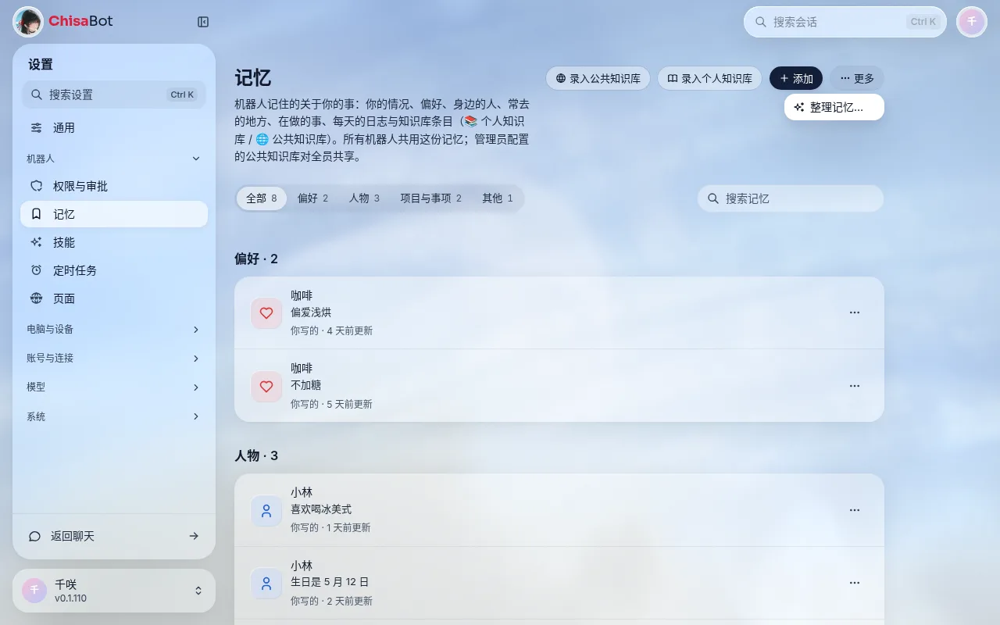 | 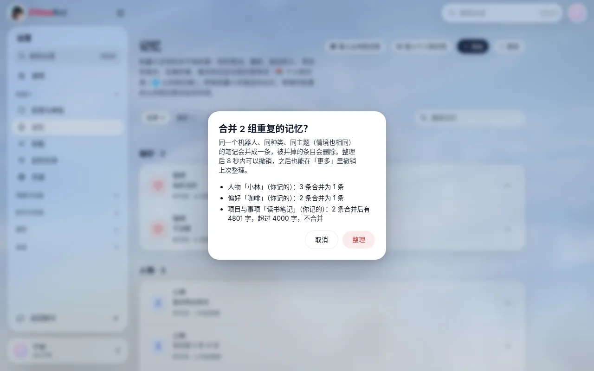 | 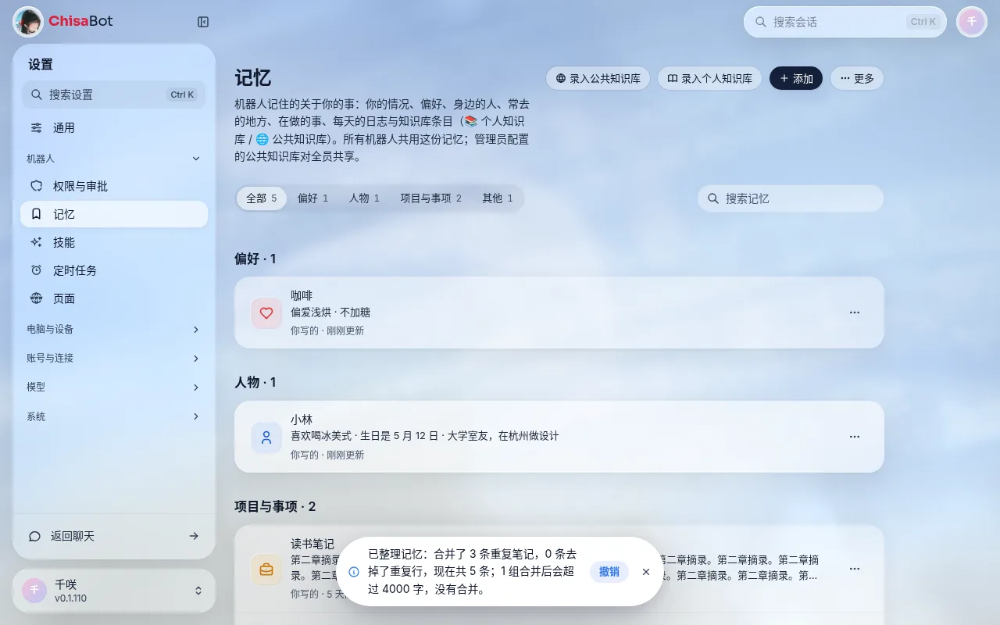 | 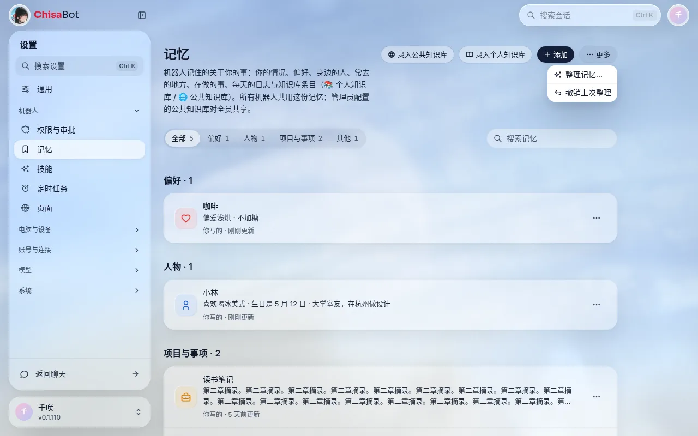 |

| 聊天里的撤销链接（`?undoTidy=`）先确认 | 撤销后的提示 |
| --- | --- |
| 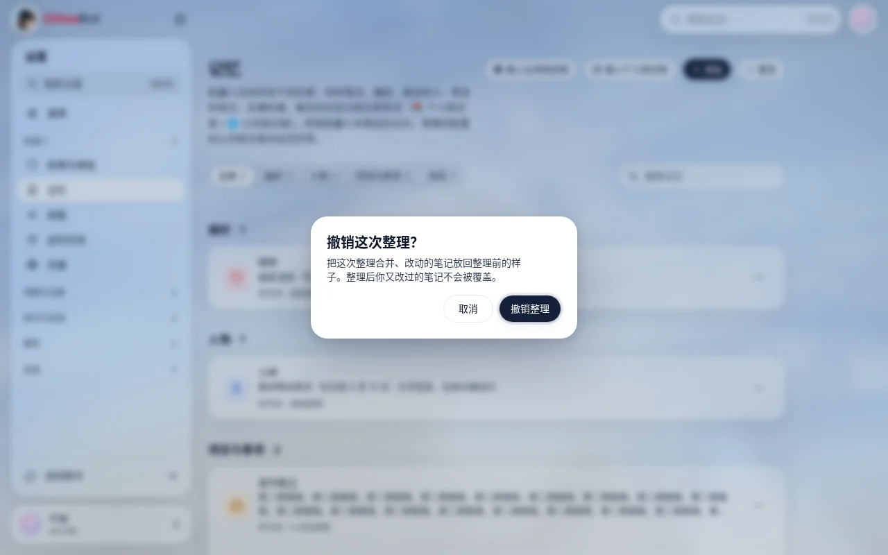 | 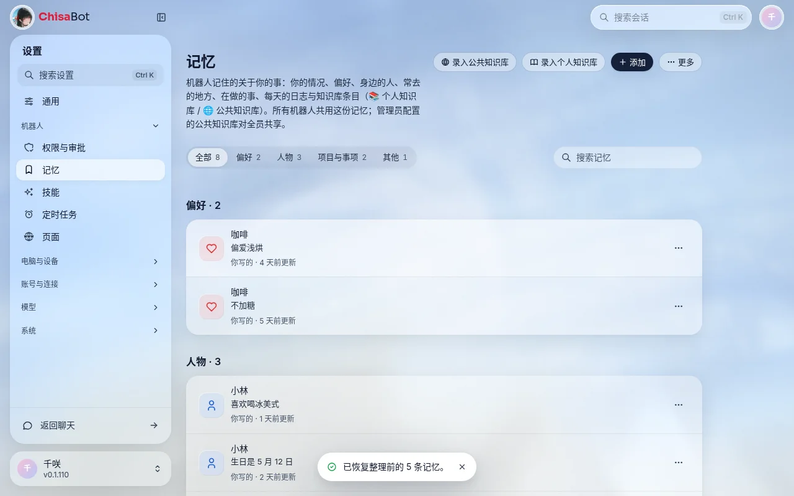 |


## 2026-10-29 外观设置性能与补齐（模块 11 审计：必修 1 + 应修 2–5、8，分支 `dev4/theme-glass-perf`）

### 动机

审计报告（模块 11，主题 / 壁纸 / 玻璃）：任何外观改动都会让整页重算样式。4 倍 CPU 降速下拖「玻璃面板不透明度」（雾度）滑块 INP 2.6s，切配色 / 材质 0.4–1.7s。

先用 headless Chrome 录了 main 的 trace（4x，键盘拖滑块 20 步）确认原因：每一步都是 `<html>` 的「Inline CSS style declaration was mutated」（`root.style.setProperty('--lg-alpha')`），随后一次 UpdateLayoutTree 覆盖全部约 388 个元素，每次约 450ms。原因是 `--lg-surface` / `--lg-surface-strong` 在 `:root` / `html[data-glass]` 上用 `var(--lg-alpha)` 声明，在根上算出值再继承给所有元素，`--lg-alpha` 一变每个元素的继承值都变。另外配色切换时 SkyBackground 往根上写 `--glass-sky`，没有任何 CSS 读它，纯属整页失效。

### 改动

- **玻璃变量不再挂在根上**（`styles.css`）：`--lg-alpha`、`--lg-surface`、`--lg-surface-strong`、`--lg-blur`、`--lg-shadow` 用 `@property … inherits: false` 注册；三档材质（液态 / 晶莹 / 磨砂，浅 / 深）的声明从 `html[data-glass]` 挪到读它们的玻璃面板上，选择器是 `:where(html[data-glass=…]) :where(<面板名单>)`，优先级为 0，不影响原有覆盖关系。名单和 `appearance.ts` 的 `GLASS_SURFACE_SELECTOR` 一致（测试锁住）。渲染预算里给气泡关模糊的那条加上了 `.glass-main :where([data-slot="bubble"] > [data-slot="bubble-content"])`（用 `:where` 压低优先级，免得 Biome 多一条 noDescendingSpecificity），因为 `--lg-blur` 不继承后写在外层气泡上不再生效。
- **雾度滑块**（`appearance.ts`）：`--lg-alpha` 写进单独的 `<style id="chisabot-glass-alpha">` 里一条只命中面板名单的规则（CSSOM 改值），根上不再写行内变量；滑块每一步状态立即更新、样式合并到下一帧（rAF）写一次。根上的 `data-palette` / `data-glass` / `data-wallpaper` 只在值变了时才写。
- **配色**：`SkyBackground` 的配色 effect 依赖收窄到 `[dark, palette]`，去掉没人读的根变量 `--glass-sky`。配色切换仍会改根上的 `--accent-*`（继承变量，确实要整页用到）。
- **换配色的天空换场景挪到点击上屏之后**（`sky-background.tsx`）：换配色时场景 effect 调 `hark.applyScene`，引擎会在里面当场 `tick()` 画一帧（headless 4x 下一两百毫秒）。点配色是离散输入，React 在同一个任务里同步跑完 passive effect，这一帧就算进了点击的 INP。现在等下一帧（rAF）后再 `setTimeout(0)` 换场景，点击先上屏；渐变照常画完。
- **天空出帧让着输入**（新文件 `lib/sky-pace.ts`，`sky-background.tsx` 的节流器调用它）：换配色后天空要画 2.5s 的交叉渐变。慢机 / 没有 GPU（软件 WebGL）上一帧引擎一两百毫秒，按 66ms 一拍出帧时主线程被天空帧排满，而且天空帧跑在 rAF 里，和点击要上屏的那一帧在同一个渲染步骤里，点击的 INP 就带上了一整帧天空（4x 下 240–720ms）。现在 ① 一帧超过 40ms 就把两帧间隔拉到 4 倍帧耗时；② 按下鼠标 / 触摸 / 按键后 300ms 内不出天空帧（已经排进 rAF 的那帧也让开、往后排）。pointermove / wheel 不算，动鼠标不会让天空停。渐变按时间照样走完，慢机上只是帧少一些；快机（一帧 <40ms）照旧 15fps。`wallpaper_core.html`、`lib/sky-fade.ts` 没改。
- **PC 抽屉规则**：`html[data-desktop] body:has([data-slot="sheet-overlay"]) :is(.glass-topbar, .glass-topbar *, .desk-strip)` 去掉 `.glass-topbar *`。trace 里第一次拖滑块冒出「恢复默认」按钮时，这条规则让 Chrome 把 body 整棵子树标脏（4x 下约 500ms）。顶栏里的子元素只声明 no-drag，顶栏整块 no-drag 已覆盖它们，行为不变。
- **地址栏颜色（应修 2）**：新增纯模块 `lib/palette.ts`（配色表、天空色计算、`paletteThemeColor`、`applyThemeColor`）。`meta[name="theme-color"]` 跟随应用的深浅色和配色（默认配色仍是 `#9dbddc` / `#0c1626`，别的配色取天空顶部颜色）。
- **多标签页同步（应修 3）**：`installAppearanceStorageSync` 监听 `storage` 事件，配色、材质、雾度、模糊、压暗、壁纸选择从存储读回并应用，不写回；这边还没写出的同一个滑块值作废。`ThemeProvider` 跟随深浅色，`perf-mode.ts` 跟随性能模式。
- **减少动态效果（应修 4）**：`useReducedMotion` 用 `useSyncExternalStore` 订阅 `prefers-reduced-motion`；打开时动态天空退回快照，并 `stopSkyMotionNow()` 清掉唤醒窗口，当帧停下。
- **启动骨架用用户配色（应修 5）**：`vite.config.ts` 在 index.html 里紧跟天空启动脚本内联 `paletteBootScript()`：读存储里的配色 / 材质，非默认配色就在 body 上写和应用同样的天空颜色，同时写 `data-palette` / `data-glass` 和地址栏颜色。CSP 会自动给内联脚本算 hash。
- **性能模式入口（应修 8）**：设置 › 通用 › 外观新增「性能模式」开关（`components/settings/perf-mode-preference.tsx`）；性能模式下头像表情动画（呼吸、张望、眨眼、蹦跳）也停下（不用 `!important`）。
- 没有新增 `backdrop-filter`，没有改版本号；壁纸压缩、对比度、强制颜色相关代码没动（开发 5 的范围）。

### INP（box 上的 headless Chrome，4x CPU 降速）

main `c99ee37e` 对本分支（已合 main），同一个排队位里交替各跑 3 轮（23:45–23:48 北京时间，box 负载 1 分钟均值 14–31，box 没有 GPU，WebGL 走软件渲染）。设置页，每轮新的临时 Chrome profile，`/api` 和 `/auth` 本地 mock。INP 取该场景所有交互的最大值，样式重算是 CDP `RecalcStyleDuration` 在该场景里的增量。

| 操作（4x CPU） | main INP 1 / 2 / 3 | main 中位 | 本分支 INP 1 / 2 / 3 | 本分支中位 | 样式重算 main → 本分支（ms，3 轮） |
|---|---|---|---|---|---|
| 配色 极光 / 樱花 / 默认（点 3 次） | 360 / 248 / 720 | 360 | 88 / 88 / 96 | **88** | 177 / 139 / 296 → 174 / 158 / 147 |
| 材质 晶莹 / 磨砂 / 液态（点 3 次） | 120 / 144 / 112 | 120 | 72 / 136 / 96 | **96** | 117 / 120 / 105 → 52 / 58 / 81 |
| 雾度滑块 方向键 20 步 | 96 / 104 / 120 | 104 | 80 / 80 / 88 | **80** | 655 / 614 / 685 → 183 / 190 / 167 |
| 雾度滑块 鼠标拖 20 步 | 64 / 72 / 72 | 72 | 56 / 48 / 56 | **56** | 475 / 401 / 405 → 237 / 168 / 195 |

- 本分支所有场景 3 轮都 < 200ms。
- 配色那一行：main 的 INP 主要不是样式重算，而是天空渐变帧挤进点击要上屏的那一帧（见上面「天空出帧让着输入」）。只做到「换场景挪到点击上屏之后」那一步时测过一轮，配色还是 240 / 264 / 296。
- 雾度滑块 main 在这台机器上 INP 不高（约 100ms），但 20 步样式重算合计约 650ms；本分支约 180ms。审计在 Jun 电脑上测到的 2.6s 是另一台机器，数字不直接可比。
- 测量脚本在 box `/workspace/dev4theme-perf/measure.mjs`（PR 开后清理）。

### 测试

- 新增 `app/tests/theme-glass-perf.test.tsx`：玻璃变量注册为不继承、没有只命中根的规则声明它们、面板名单和 CSS 一致、读变量的规则都在名单里；换配色时同步提交里不调 `applyScene`、下一帧之后才调；拖滑块时 `<html>` 没有任何属性 / 样式变动、一帧只写一次；换材质只改 `data-glass`；地址栏颜色；storage 同步（配色 / 材质 / 雾度 / 深浅色 / 性能模式，不写回、作废未写出的值）；减少动态效果；启动脚本；性能模式开关和表情动画规则。
- 新增 `app/tests/sky-pace.test.ts`：快帧照旧 15fps、慢帧拉开间隔、耗时平滑、按下后的保护期和下一帧排期。
- `appearance-preferences.test.ts`、`wallpaper-privacy-storage.test.ts` 改了两处断言：`--lg-alpha` 不再在根上（只改断言，没动壁纸代码）。
- 自测（box，已合 main 的 head）：`bun run typecheck` 通过；`app` build 通过；`bun run test:app` 通过；相关单测（theme-glass-perf / sky-pace / wallpaper-loading / render-budget / appearance-preferences / sky-*）全过。Biome：改动文件上 main 5 个 error / 223 个 warning，本分支 4 / 223，不增加。

### 截图

`docs/images/theme-glass/`（webp，main → 本分支）：

- 设置 › 外观，浅色：`main-settings-appearance-light.webp` → `branch-settings-appearance-light.webp`；深色：`main-settings-appearance-dark.webp` → `branch-settings-appearance-dark.webp`。外观本身没变。
- 性能模式入口：`main-settings-perf-mode.webp`（没有开关）→ `branch-settings-perf-mode.webp`、打开后 `branch-settings-perf-mode-on.webp`。
- 启动骨架（存的配色是樱花 / 浅色、极光 / 深色手机）：`main-splash-*.webp` 是默认蓝天，`branch-splash-*.webp` 直接是用户的配色；地址栏颜色 main 两个 meta 固定 `#9dbddc,#0c1626`，本分支 `#e5a9b5` / `#110e20`（跟配色）。
## 2026-10-29 工具步骤显示按审查修正（模块 7，分支 `fix/tool-steps-audit`，依赖 #404）

从 `feat/hark-reply-steps` 的 `3d65ef4c` 拉出，之后用 merge commit 合进了 #404 的 `f118a530`（第四轮返修）和 `origin/main`；PR base 是 `main`。

- **后台任务卡不再跟着收起**：`delegate_task` 归进 `NOT_WORK`（不算干活步骤，不进「做了 N 步」）。以前它常是一轮里第一个干活的调用，也就是干活卡的锚点；一轮结束后锚点所在那一项被 `quietRows` 整项收起，后台任务卡、停止按钮、进度一起没了，刷新后同样不画。现在 `ChatTranscript` 对「锚点自己画卡片」（`toolDrawsCard`）的安静轮只收干活那一行（`quietWorkOnly`），卡片照画。
- **运行中展开不再标失败**：步骤状态统一由 `workCallState(call, live)` 给出（`done` / `failed` / `running` / `stopped`）；这一轮还在跑时没返回的步骤是 `running`，写「正在…」，`<li data-state="running" class="is-current">`。
- **停止后**：`compactTurns` 把停止时没返回的调用（结果为空或是「This call produced no result」）记成 `stopped`；这一轮不再算安静轮，收成一行（「做了 N 步 · S 步已停止」），点开每一步，没返回的写「（已停止）」，不计进「N 步失败」。
- **并行调用**：同时在跑的两个以上干活调用写「正在搜索 N 项」「正在读取 N 个网页」「正在打开 N 个网页」，不同种的写「正在同时做 N 件事」；同时在画的卡片不算。点开是每一步。
- **网页读取**：`shared/work-step.ts` 的 `pageOf` 给 `web_fetch` 写主机名 + 解码后的路径（不带查询串和锚点，40 字以内整段，过长写 `host/…/最后一段`）。这是 shared 代码，服务端 `server/src/workers/service.ts` 的后台任务步骤文字也跟着变成短路径——只是展示文字，没有逻辑改动。结果开头是 `状态：4xx/5xx`（可带一行 `网址：`）算失败。
- **后台任务卡无障碍**：收起的计划清单、结果正文加 `inert` + `aria-hidden`；各展开按钮的 `aria-expanded` 按真实状态给，带 `aria-controls`；进度放进一个只给读屏的 `role="status"`（`aria-atomic`）。
- **调试模式工具输出**：`ToolLine` 的输出改成 `<pre>` 纯文本，超过 4000 字截断并写还剩多少字，`<details>` 打开时才画。
- 没改 `styles.css`、`main.tsx`、`perf-noblur.css`、`app-sidebar.tsx`、`glass-topbar.tsx`、`wallpaper_core.html`；没加 `!important`、没加大容器 `:has()`、没升版本号。
- **「N 步失败」不重复**：读网页失败时摘要本身写了「看了 1 个网页 · 1 步失败」，没有回答那一轮后面的小字（#404 加的）又写一遍；`WorkRow` 在摘要已含「步失败」时不再在小字和读屏名字里重复。
- 测试：`app/tests/tool-steps.test.tsx`（进行中、停止后、`delegate_task` 不被折叠、并行调用、网页短路径和 HTTP 错误、`WorkRow` / `WorkerCardBody` / `ToolLine` 组件测试），`work-steps.test.ts`、`quiet-turn.test.ts` 按新行为更新。

### 截图

改前是 `3d65ef4c`（#404），改后是本分支。用临时页面挂真实的 `ChatTranscript` / `WorkerCard`，`/api` 全部 404，没连后端；临时页面没提交。

| 情况 | 改前 | 改后 |
|---|---|---|
| 后台任务（这一轮写完、任务还在跑） | 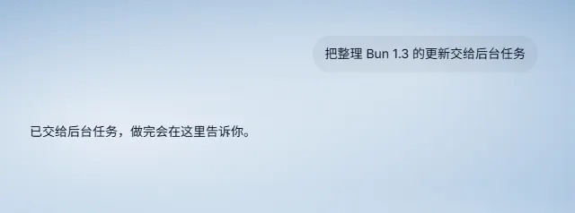 | 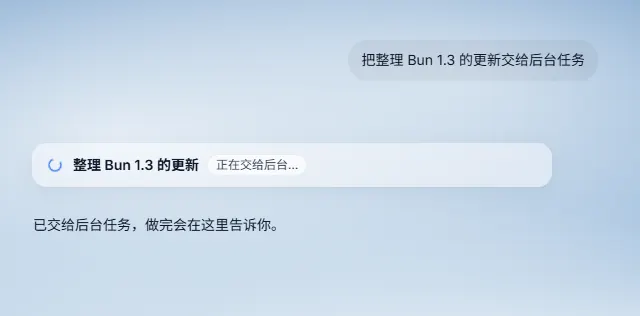 |
| 运行中展开 | 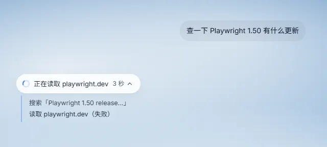 | 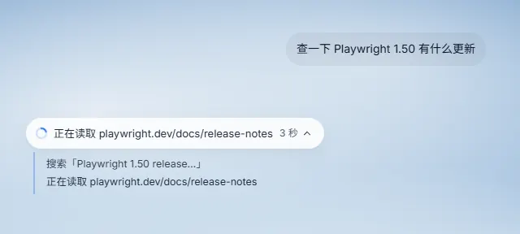 |
| 并行调用 | 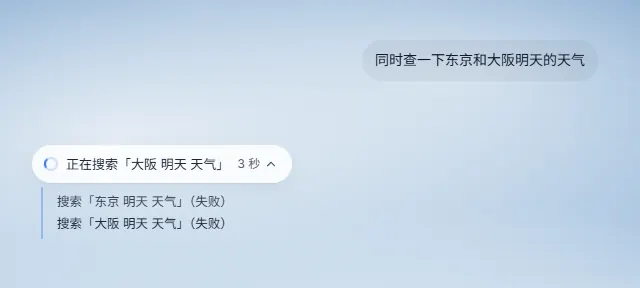 |  |
| 停止后（展开） |  |  |
| 读网页（短路径、HTTP 500 算失败） |  |  |

图片在 `docs/images/tool-steps/`，10 张 webp 共约 50KB，640px 宽、浅色。
