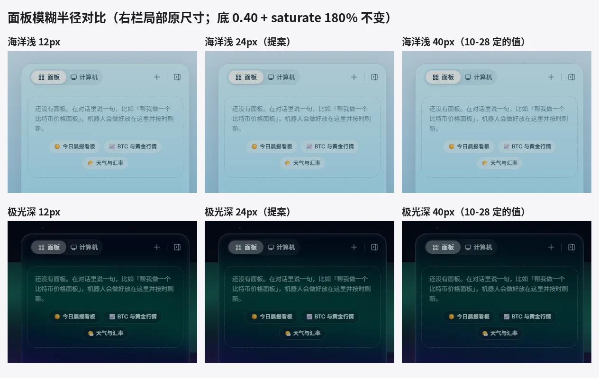
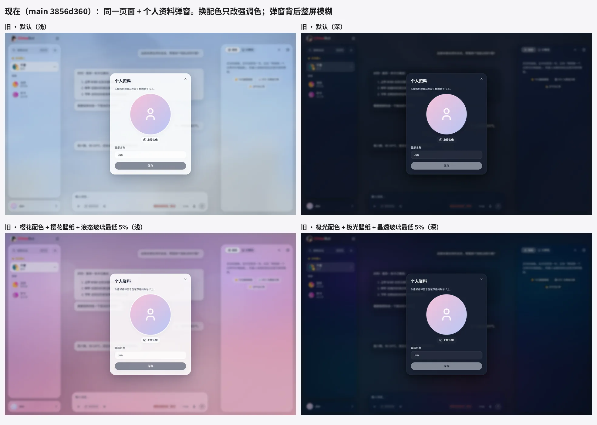
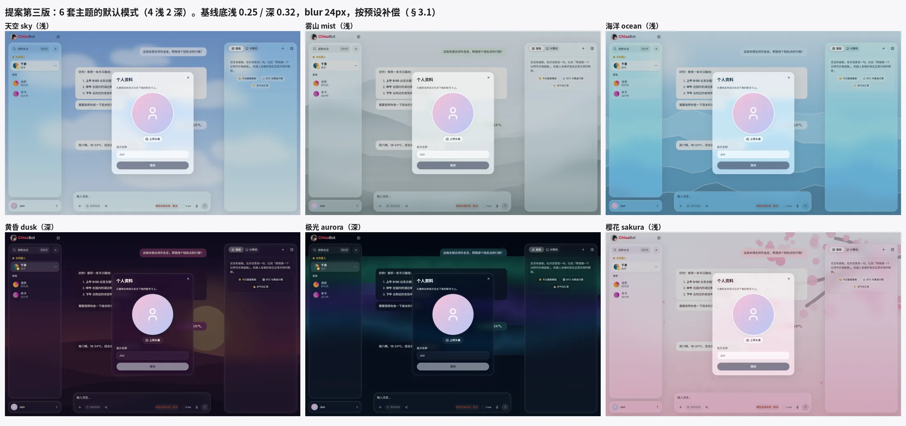
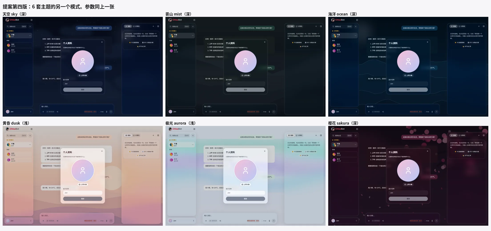
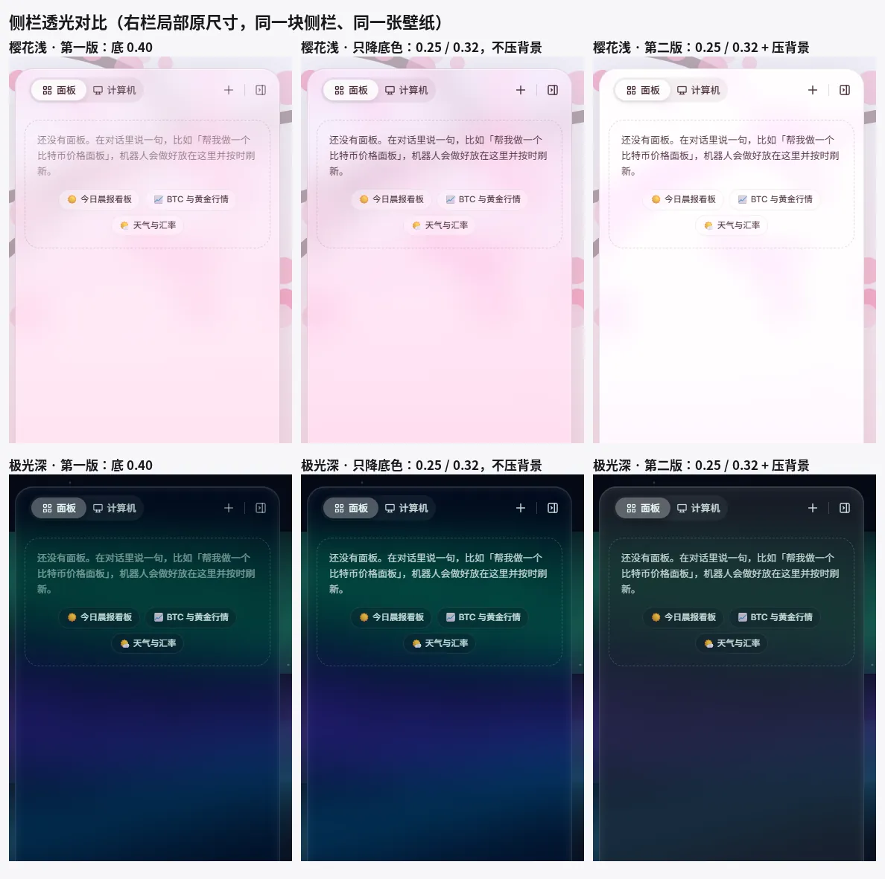

# 主题系统重做：提案

**状态：小爱已批准**（2026-10-29 第四版）。这份文档只写方案，代码一行没改。代码等 #376 合并后再做。

**第四版改了什么**（小爱复审第三版后）：
- 补偿的顺序反过来：**先用局部衬底**，压背景和提高底色放到最后才用。原因是第三版的 5 号图里，aurora 深的绿色极光几乎被压没了，sky 深也明显变灰。
- 所有 12 套的面板都和基线一样：底浅 **0.25** / 深 **0.32**，`blur(24px) saturate(180%)`，**不压背景、不提底色**。第三版里 sky 浅、sky 深、sakura 深、aurora 深和另外 4 套用的 ② 轻压背景、aurora 深的底色 0.36 都去掉了。
- 过不了 AA 的 8 套只给文字所在的列表项 / 卡片加衬底：主题实色的半透明底 + 1px 描边 + 顶部细高光边，和现在的列表卡一个做法，不是灰方块。衬底透明度上限 **0.48**，8 套用到 0.18–0.45（§3.1）。
- 衬底调够以后，**没有一套还需要压背景**（t2 一套都没留）。
- 12 张壁纸主文字最差 **6.32:1**（sakura 深），次文字最差 **4.56:1**（mist 浅），都 ≥ 4.5:1。
- 5 号图右列换成第四版，2–4 号图按第四版重拍（§11）。

**第三版改了什么**（小爱选了方案 ③，已被第四版取代）：基线改成只降底色、不压背景；过不了 AA 的预设按「轻压背景 → 提底色 → 衬底」的顺序补。结果 AA 全过，但压背景把深色壁纸的颜色压淡了。

**第二版改了什么**（第一版审阅后）：
- 小爱已经定了的三件事：
  - 大面板模糊半径用 **24px**（§3）；
  - 手机端的红点放在顶栏左边的抽屉按钮上（RFC「下一步」③）；
  - DESIGN.md §36.1 改成「窗口按钮在最右，头像紧挨在它们左边」（RFC「下一步」④，DESIGN.md §36.1 已改）。
- 面板底色的不透明度降下来：浅色从 0.40 降到 **0.25**，深色从 0.40 降到 **0.32**。原因是 Jun 说「拉到最低也基本不透光」，第一版效果图里的面板还是偏奶白。
- 主文字和次级文字在最不利的壁纸区域实测，都达到 WCAG AA（§3.1）。
- 后续代码 PR 的顺序改了（§10）：第一个 PR 做主题数据和切换，第二个 PR 削减 backdrop-filter。
- 效果图按第二版参数重拍了，新增一张侧栏透光对比图。这张图说明全局压背景会让面板变白或变灰，所以第三版改成了按预设补偿。
- 加了 tid 参考图各自的用途（§11 末尾）。

- 这里只写**主题系统**：有哪些主题、颜色、玻璃参数、设置页布局、令牌命名。
- 通用的组件、间距、圆角规范在 [`DESIGN.md`](../DESIGN.md)，这里不重复。本提案改到的地方：§10「令牌」，以及 §10.5「Hark 令牌与同名旧令牌」的规则（这一节由 #374 加入）。
- 账号卡的去留和左右栏怎么拆 PR，写在 [`docs/rfc/hark-redesign.md`](rfc/hark-redesign.md)，这里不重复。去掉账号卡和本文的关系只有一条：去掉以后，桌面聊天页同屏的玻璃层从 5 层变成 4 层（见 §4）。

## 0. 为什么要重做

Jun 说的三个问题，在 main（`3856d360`）上都找到了原因：

| 现象 | 原因（main 上的代码） |
|---|---|
| 换主题几乎看不出变化 | `html[data-palette=x]` 只改 3 个令牌：`--accent-blue`、`--accent-blue-ink`、`--accent-blue-soft`（`styles.css` 约 L9155–9204）。壁纸、面板、气泡、文字的颜色都不跟着变。 |
| 三种玻璃材质调到最低也不透 | 三档玻璃层（约 L9265–9530）的底色有下限。例如液态浅色是 `clamp(0.38, calc(var(--lg-alpha) * 2.65), 0.7)`：滑块拉到 5–14 时，算出来的值都被抬到 0.38，所以拉了也没变化。<br>这一层还用 `!important` 给侧栏、账号卡、顶栏胶囊、输入框、气泡、`.jr-card`、设置卡都铺了同一块底，再叠上 `.glass-shell` 的嵌套玻璃变量。几层半透明叠在一起，结果就是不透明。 |
| 没有液态玻璃的感觉 | 底色太厚（见上一行）。另外没有高光边和内阴影，只靠 `blur + saturate` 撑。第一版提案的 0.40 还是偏奶白，第二版降到浅 0.25、深 0.32（§3）。 |
| 打开设置卡顿 | 见 §6 的实测：第一次打开时，主线程被占住约 0.2 秒；把 CPU 降到 1/4 速时，要 1.7–4.6 秒。 |

## 1. 删掉什么

- 6 套配色：`data-palette` = default / aurora / emerald / ocean / sunset / sakura。
- 3 种玻璃材质切换：`data-glass` = liquid / crystal / frosted。
- 「玻璃面板不透明度」滑块：`--lg-alpha`，`chisabot-glass-opacity`。
- 三档玻璃那一整层（`styles.css` 末尾的 `--lg-*` 和它的 `!important` 规则）。
- 设置页里的「Hark 动态天空场景」12 宫格，以及每个缩略图里的玻璃演示。

**留下**：自定义壁纸（上传、清除、景深模糊、暗化），在每套主题下都能用；深浅色开关；动态天空。动态天空变成一张可选壁纸，不再是默认（10-28 定的「默认静态壁纸」）。

## 2. 6 套主题

主题的名字沿用 10-28 批准的那 6 个。

- **深色主题**：dusk（黄昏）和 aurora（极光）是深色主题。选中它们时，默认切到深色。
- **深浅两版**：每一套都有深、浅两版，跟着深浅色开关走。
- **一起换**：每套都会同时换掉壁纸、面板底、气泡、文字和强调色，一眼就能看出换了。

| id | 名字 | 默认模式 | 浅色壁纸 | 深色壁纸 |
|---|---|---|---|---|
| `sky` | 天空 | 浅 | 晴空 | 夜空 |
| `mist` | 雾山 | 浅 | 灰绿雾山 | 墨绿夜雾 |
| `ocean` | 海洋 | 浅 | 浅海浪线 | 深海浪线 |
| `dusk` | 黄昏 | **深** | 暖橙晨曦 | 紫红落日 |
| `aurora` | 极光 | **深** | 浅底淡极光 | 深夜极光 |
| `sakura` | 樱花 | 浅 | 粉色花枝 | 酒红夜樱 |

**壁纸**都是静态图，每套主题深浅各一张（原型里用的是 SVG，每张 2–11 KB；正式实现时预先导出成 webp，运行时不跑 SVG 滤镜）。
- 动态天空仍然只在 sky 主题下可选，开关放在「壁纸」入口里。
- 用户上传了自定义壁纸时，用它替换主题壁纸。面板、气泡、文字、强调色仍然按主题走。

### 颜色表

规则：
- **文字**：次文字和弱文字都由主文字算出来。
  - 次文字 = 主文字和面板实色混合：浅色混 12% 面板实色，深色混 15%，结果是**不透明**的颜色，写法 `color-mix(in srgb, var(--text) 88%, var(--glass-bg-solid))`（深色是 85%）。
  - 第一版照抄 Hark，次文字是主文字的 50% 透明。面板变透以后，背后的壁纸会透过文字，最差的地方只有 2.0–3.7:1，达不到 AA（§3.1），所以改了。
  - 弱文字仍然是主文字 × 30%（Hark `--text-tertiary`），只用于占位符、禁用态和装饰，不用于需要读的正文。
- **面板底**：透明度浅色 **0.25**、深色 **0.32**。第一版取的是 Hark `--bg-40` 的 0.40，看起来偏奶白。过不了 AA 的预设怎么补偿见 §3.1。
- **弹窗底**：透明度浅色 0.668、深色 0.618，来自 Hark `--regular-bg`。
- **色相**：上面这些只定了透明度；色相是各个主题自己的，Hark 没有，是这次新加的。

### 天空 `sky`（默认浅色）

| 令牌 | 浅色 | 深色 |
|---|---|---|
| 壁纸 `--wallpaper` | 晴空：蓝天渐变 + 太阳 + 云团；`#2f6fd0 → #7fb4ee → #dcecfb` | 夜空：深蓝渐变 + 星星 + 月亮；`#070d1f → #13254a → #2b4a7a` |
| 面板（玻璃底）`--glass-bg` | `rgba(255,255,255,0.25)` | `rgba(10,16,32,0.32)` |
| 面板实色（性能模式）`--glass-bg-solid` | `#eef5fd` | `#0f182c` |
| 弹窗底 `--glass-pop-bg` | `rgba(255,255,255,0.668)` | `rgba(14,20,36,0.618)` |
| 用户气泡 `--bubble-user-bg` | `#dce9ff` | `#1f3a6b` |
| 机器人气泡 `--bubble-agent-bg` | `rgba(255,255,255,0.88)` | `rgba(18,26,46,0.82)` |
| 主文字 `--text` | `#13233d` | `#eaf1ff` |
| 次文字 `--text-secondary`（主文字混面板实色，不透明） | `#2d3c54` | `#c9d0df` |
| 弱文字 `--text-tertiary`（主文字 30%） | `rgba(19,35,61,0.3)` | `rgba(234,241,255,0.3)` |
| 强调色 `--accent-color` | `#2f74f0` | `#7fb2ff` |
| 边框 `--stroke-primary` | `rgba(19,35,61,0.10)` | `rgba(234,241,255,0.14)` |

### 雾山 `mist`（默认浅色）

| 令牌 | 浅色 | 深色 |
|---|---|---|
| 壁纸 `--wallpaper` | 雾山：灰绿层叠山脊 + 雾带；`#eef2f3 → #c9d5d8 → #8fa3a8` | 夜雾：墨绿层叠山脊 + 暗雾；`#2b373a → #1d2528 → #11171a` |
| 面板（玻璃底）`--glass-bg` | `rgba(250,252,252,0.25)` | `rgba(18,24,26,0.32)` |
| 面板实色（性能模式）`--glass-bg-solid` | `#eef2f2` | `#1a2224` |
| 弹窗底 `--glass-pop-bg` | `rgba(250,252,252,0.668)` | `rgba(20,26,28,0.618)` |
| 用户气泡 `--bubble-user-bg` | `#dbe9e4` | `#23443e` |
| 机器人气泡 `--bubble-agent-bg` | `rgba(255,255,255,0.86)` | `rgba(28,36,38,0.82)` |
| 主文字 `--text` | `#1c2624` | `#e6eeec` |
| 次文字 `--text-secondary`（主文字混面板实色，不透明） | `#353e3d` | `#c7cfce` |
| 弱文字 `--text-tertiary`（主文字 30%） | `rgba(28,38,36,0.3)` | `rgba(230,238,236,0.3)` |
| 强调色 `--accent-color` | `#3f7f73` | `#7cc8b9` |
| 边框 `--stroke-primary` | `rgba(28,38,36,0.10)` | `rgba(230,238,236,0.14)` |

### 海洋 `ocean`（默认浅色）

| 令牌 | 浅色 | 深色 |
|---|---|---|
| 壁纸 `--wallpaper` | 浅海：天光 + 四层浪线；`#d8f3ff → #5bb7e6 → #0b5f8f` | 深海：暗蓝四层浪线；`#021624 → #043456 → #06507a` |
| 面板（玻璃底）`--glass-bg` | `rgba(240,250,255,0.25)` | `rgba(2,20,34,0.32)` |
| 面板实色（性能模式）`--glass-bg-solid` | `#e8f5fc` | `#04192a` |
| 弹窗底 `--glass-pop-bg` | `rgba(244,251,255,0.668)` | `rgba(4,24,40,0.618)` |
| 用户气泡 `--bubble-user-bg` | `#d3efff` | `#0b3d5e` |
| 机器人气泡 `--bubble-agent-bg` | `rgba(255,255,255,0.86)` | `rgba(6,30,48,0.82)` |
| 主文字 `--text` | `#082a40` | `#e2f4ff` |
| 次文字 `--text-secondary`（主文字混面板实色，不透明） | `#234257` | `#c1d3df` |
| 弱文字 `--text-tertiary`（主文字 30%） | `rgba(8,42,64,0.3)` | `rgba(226,244,255,0.3)` |
| 强调色 `--accent-color` | `#0a84c6` | `#4cc2ff` |
| 边框 `--stroke-primary` | `rgba(8,42,64,0.10)` | `rgba(226,244,255,0.14)` |

### 黄昏 `dusk`（默认深色）

| 令牌 | 浅色 | 深色 |
|---|---|---|
| 壁纸 `--wallpaper` | 晨曦：暖橙沙丘 + 太阳；`#fde6d2 → #f7b08a → #c9789b` | 黄昏：紫红天空 + 落日 + 沙丘；`#140c2b → #4b1f5a → #c4536b → #f59a5b` |
| 面板（玻璃底）`--glass-bg` | `rgba(255,248,244,0.25)` | `rgba(26,14,36,0.32)` |
| 面板实色（性能模式）`--glass-bg-solid` | `#fbefe8` | `#1f1229` |
| 弹窗底 `--glass-pop-bg` | `rgba(255,248,244,0.668)` | `rgba(30,16,40,0.618)` |
| 用户气泡 `--bubble-user-bg` | `#ffe1cf` | `#5a2a4f` |
| 机器人气泡 `--bubble-agent-bg` | `rgba(255,255,255,0.86)` | `rgba(36,20,44,0.82)` |
| 主文字 `--text` | `#3a1d24` | `#fff1ea` |
| 次文字 `--text-secondary`（主文字混面板实色，不透明） | `#51363c` | `#ddd0cd` |
| 弱文字 `--text-tertiary`（主文字 30%） | `rgba(58,29,36,0.3)` | `rgba(255,241,234,0.3)` |
| 强调色 `--accent-color` | `#d9552f` | `#ff9a62` |
| 边框 `--stroke-primary` | `rgba(58,29,36,0.10)` | `rgba(255,241,234,0.14)` |

### 极光 `aurora`（默认深色）

| 令牌 | 浅色 | 深色 |
|---|---|---|
| 壁纸 `--wallpaper` | 淡极光：浅底 + 粉绿紫光带；`#f4f7ff → #e6ecfb → #dfe6f7` | 极光：深夜底 + 青绿 / 紫光带 + 星星；`#030814 → #06122a → #071a2e` |
| 面板（玻璃底）`--glass-bg` | `rgba(248,250,255,0.25)` | `rgba(6,12,24,0.32)` |
| 面板实色（性能模式）`--glass-bg-solid` | `#f0f3fb` | `#0a1220` |
| 弹窗底 `--glass-pop-bg` | `rgba(248,250,255,0.668)` | `rgba(8,14,28,0.618)` |
| 用户气泡 `--bubble-user-bg` | `#dff5ef` | `#173f4a` |
| 机器人气泡 `--bubble-agent-bg` | `rgba(255,255,255,0.86)` | `rgba(12,20,36,0.82)` |
| 主文字 `--text` | `#14202e` | `#e8fbf6` |
| 次文字 `--text-secondary`（主文字混面板实色，不透明） | `#2e3947` | `#c7d8d6` |
| 弱文字 `--text-tertiary`（主文字 30%） | `rgba(20,32,46,0.3)` | `rgba(232,251,246,0.3)` |
| 强调色 `--accent-color` | `#6b4de6` | `#45e6c0` |
| 边框 `--stroke-primary` | `rgba(20,32,46,0.10)` | `rgba(232,251,246,0.14)` |

### 樱花 `sakura`（默认浅色）

| 令牌 | 浅色 | 深色 |
|---|---|---|
| 壁纸 `--wallpaper` | 樱花：粉色渐变 + 花枝 + 花瓣；`#fff3f6 → #ffd6e2 → #f6a6bf` | 夜樱：酒红渐变 + 花枝 + 花瓣；`#22101a → #3d1a2c → #5a2440` |
| 面板（玻璃底）`--glass-bg` | `rgba(255,248,250,0.25)` | `rgba(30,14,22,0.32)` |
| 面板实色（性能模式）`--glass-bg-solid` | `#fcf0f3` | `#24121b` |
| 弹窗底 `--glass-pop-bg` | `rgba(255,248,250,0.668)` | `rgba(34,16,26,0.618)` |
| 用户气泡 `--bubble-user-bg` | `#ffe0ea` | `#5a2340` |
| 机器人气泡 `--bubble-agent-bg` | `rgba(255,255,255,0.88)` | `rgba(40,20,30,0.82)` |
| 主文字 `--text` | `#3b1a26` | `#ffeef4` |
| 次文字 `--text-secondary`（主文字混面板实色，不透明） | `#52343f` | `#decdd3` |
| 弱文字 `--text-tertiary`（主文字 30%） | `rgba(59,26,38,0.3)` | `rgba(255,238,244,0.3)` |
| 强调色 `--accent-color` | `#d6336c` | `#ff8fb3` |
| 边框 `--stroke-primary` | `rgba(59,26,38,0.10)` | `rgba(255,238,244,0.14)` |

## 3. 玻璃参数

数值取自 Hark 的 CSS（`/workspace/hark-style/` 下的 `DIbOvjd7.css`、`oexeq8lI.css`、`rTJw52XU.css`），不是凭感觉定的。表里每个值都写了出处。

| 参数 | 大面板（侧栏 / 输入框 / 顶栏） | 弹窗（对话框 / 菜单 / 弹层） | 出处 |
|---|---|---|---|
| 底色 | 主题的 `--glass-bg`，透明度浅 **0.25** / 深 **0.32**，所有预设一样，不再按预设加厚（§3.1） | 主题的 `--glass-pop-bg`，浅 0.668 / 深 0.618 | 大面板：第一版用 Hark `--bg-40` 的 0.40，第二版按 Jun「拉到最低也基本不透光」降到浅 0.22–0.28、深 0.30–0.35 区间的中间值。弹窗：Hark `--regular-bg`（浅 `rgba(255,255,255,.668)`，深 `rgba(29,29,31,.618)`），不变 |
| 模糊 | `blur(24px)`（小爱已定） | `blur(12px)` | Hark 模糊刻度 4 / 8 / 16 / 20 / 24 / 50（`rTJw52XU.css`）；Hark 弹层 `._157n8na0` 用 `blur(12px)` |
| 饱和度 | `saturate(180%)` | `saturate(180%)` | **不是 Hark 的**：Hark 不加 saturate。这个值来自 10-28 的批准（「blur40 + saturate180」）和 macOS（apple.com 导航栏 `saturate(180%) blur(20px)`） |
| 列表项衬底 `--glass-row-bg`（按预设） | 默认透明。8 套预设给文字所在的列表项（侧栏的机器人行、会话行、菜单按钮，右栏的空状态卡）加衬底：这套主题的面板实色 `--glass-bg-solid` 的半透明（0.18–0.45，**上限 0.48**），加 1px `--stroke-primary` 描边和顶部 1px 高光边（同下面的高光边），圆角 10px。每套的值见 §3.1 | 不加 | 新加的。只铺在行 / 卡下面，面板本身不加厚，行与行之间照样透。和列表卡同一种做法（实色半透明 + 细边），不是灰方块 |
| 压背景 | **所有预设都不加**。只留给自定义壁纸兜底：衬底加到 0.48 还过不了时，才用最轻的 `contrast(0.85)` + 浅 `brightness(1.1)` / 深 `brightness(0.9)` | 不加 | **不是 Hark 的**。第二版全局加、第三版按预设加，都会把壁纸颜色压淡，第四版去掉 |
| 高光边 | 浅 `inset 0 1px 0 rgba(255,255,255,.5)`；深 `inset 0 1px 0 rgba(255,255,255,.1)` | 同左 | 浅色取 Hark `--bg-50` 的白 50%；深色取 Hark `--stroke-primary-on` `rgba(255,255,255,.1)`。Hark 的 `--continuous-inset` 是 0.04，在深色壁纸上看不出来，所以没用 |
| 内阴影 | `inset 0 0 10px 2px rgba(255,255,255,.07)` | 同左 | Hark `--handoff-inner-glow` |
| 描边 | 1px 主题 `--stroke-primary`（浅 0.10 / 深 0.14） | 同左 | Hark `._11ah0wx6` 1px `--stroke-primary`（`rgba(29,29,31,.14)` / `rgba(245,245,247,.14)`）；浅色降到 0.10，否则在彩色壁纸上发脏 |
| 外阴影 | `0 8px 40px rgba(29,29,31,.12)` | 同左 | Hark 弹层 `0 8px 40px #1d1d1f1f` |
| 圆角 | 24px | 24px | Hark `._11ah0wx2`、`._157n8na0` |

一个元素只写**一层** `backdrop-filter`，玻璃不嵌套：玻璃里面的东西（列表行、胶囊、气泡）都不再模糊。

大面板完整的写法（浅色）：

```css
background: rgba(255 255 255 / 0.25);            /* 主题的 --glass-bg */
backdrop-filter: blur(24px) saturate(180%);       /* 所有预设一样，不压背景 */
border: 1px solid var(--stroke-primary);
box-shadow: inset 0 1px 0 rgba(255 255 255 / 0.5),      /* 高光边 */
            inset 0 0 10px 2px rgba(255 255 255 / 0.07), /* 内阴影 */
            0 8px 40px rgba(29 29 31 / 0.12);
```

深色的高光边换成白 0.1，底色换成主题的深色 `--glass-bg`。

列表项衬底（只在需要补偿的预设里有值，写在自己的 `html[data-preset=x]` / `html.dark[data-preset=x]` 里）：

```css
/* 例：sky 深 */
--glass-row-bg: rgb(15 24 44 / 0.45);            /* 面板实色 #0f182c 的半透明 */
/* 侧栏机器人行、会话行、菜单按钮、右栏空状态卡 */
background: var(--glass-row-bg, transparent);
border-radius: 10px;
box-shadow: inset 0 0 0 1px var(--stroke-primary), /* 细描边，用 inset 不改布局 */
            inset 0 1px 0 var(--glass-highlight);  /* 顶部高光边 */
```

没有补偿的预设不写 `--glass-row-bg`，行就是透明的，也不画描边。

### 3.1 文字对比度实测（WCAG AA）

**测法**：
- 用 6 套主题的 12 张壁纸，整屏 1440×900 铺满 36 块和侧栏参数完全一样的玻璃（每块 228×138），让玻璃覆盖壁纸的每一个区域，包括太阳、月亮、极光带这些最亮或最暗的地方。
- 在 Chrome 里渲染，文字设成透明再截图。每块玻璃去掉 16px 边距（文字只出现在内边距里面），按 8×8 像素取平均颜色。
- 每张壁纸取对比度**最差**的那个 8×8 小块，算主文字和次文字的对比度。AA 的要求是正文 ≥ 4.5:1。
- 第一版、第二版的原始数据在 `/workspace/theme/aa/final.json`。

- 列表项衬底的测法：在每块玻璃里面再铺一块和衬底一样的底（主题实色半透明 + 1px 描边 + 高光边，四周留 12px，圆角 10px），取样范围不变。
- 脚本在 `/workspace/theme/aa/`：截图 `aa4.mjs`（第四版）/ `aa3.mjs`（第三版），计算 `aa.py`、`tiers.py`，需要的衬底 `under3.py`。第四版的参数在 `v4.cfg.json`，截图和结果在 `g6/`；第三版各档在 `g5/`。

**补偿怎么选**（小爱复审后定的顺序，每套单独选）：
1. **先加局部衬底**：给文字所在的列表项 / 卡片加主题实色的半透明底（带细描边和高光边）。透明度从 0 往上加，取刚好够的值再加 0.02 余量，**上限 0.48**。
2. 衬底到上限还过不了，才用很轻的压背景：先 `contrast(0.85)`（浅 `brightness(1.1)` / 深 `brightness(0.9)`），再 `contrast(0.8)`（浅 1.15 / 深 0.85），并在文档里写明是哪一套、为什么。
3. 最后才提高这一套的 `--glass-bg`（浅 ≤ 0.30，深 ≤ 0.36）。

第四版实测 8 套都在第 1 步过了，第 2、3 步一套都没用。

**各档实测**（第三版时测的，留作对照；最差区域，「主 / 次」。最后一列是第四版的算法：只在基线上加主题实色衬底，刚好够 AA 的透明度）：

| 壁纸 | 基线：0.25 / 0.32，不压背景 | ① | ② | 底色提到 0.30 / 0.36 | ② + 底色 0.30 / 0.36 | 基线上需要的衬底 |
|---|---|---|---|---|---|---|
| sky 浅 | 5.48 / 3.87 | 6.09 / 4.3 | 6.41 / 4.52 | 5.86 / 4.14 | 6.79 / 4.79 | 0.16 |
| sky 深 | 3.01 / 2.21 | 3.91 / 2.88 | 4.44 / 3.26 | 3.27 / 2.4 | 4.78 / 3.51 | 0.43 |
| mist 浅 | 4.63 / 3.26 | 5.28 / 3.72 | 5.63 / 3.96 | 5.07 / 3.57 | 6.06 / 4.27 | 0.26 |
| mist 深 | 9.13 / 6.81 | 9.31 / 6.95 | 9.57 / 7.15 | 9.52 / 7.11 | 9.87 / 7.37 | – |
| ocean 浅 | 4.32 / 3.06 | 4.94 / 3.5 | 5.19 / 3.69 | 4.71 / 3.34 | 5.58 / 3.96 | 0.32 |
| ocean 深 | 8.9 / 6.53 | 9.3 / 6.82 | 9.58 / 7.03 | 9.2 / 6.75 | 9.91 / 7.27 | – |
| dusk 浅 | 4.45 / 3.16 | 5.08 / 3.6 | 5.38 / 3.81 | 4.88 / 3.46 | 5.82 / 4.13 | 0.30 |
| dusk 深 | 3.07 / 2.25 | 4.05 / 2.97 | 4.56 / 3.34 | 3.38 / 2.48 | 4.98 / 3.65 | 0.42 |
| aurora 浅 | 9.93 / 7.04 | 10.63 / 7.54 | 11.02 / 7.81 | 10.21 / 7.23 | 11.25 / 7.97 | – |
| aurora 深 | 4.03 / 2.93 | 5.18 / 3.77 | 5.75 / 4.18 | 4.46 / 3.24 | 6.32 / 4.59 | 0.28 |
| sakura 浅 | 9.02 / 6.41 | 9.59 / 6.81 | 9.89 / 7.03 | 9.32 / 6.62 | 10.2 / 7.25 | – |
| sakura 深 | 4.96 / 3.64 | 6.02 / 4.41 | 6.54 / 4.8 | 5.37 / 3.94 | 6.96 / 5.11 | 0.18 |

- 基线（不压背景）只有 4 套能过：mist 深、ocean 深、aurora 浅、sakura 浅。
- 卡住的基本是**次文字**：它是主文字混 12% / 15% 面板实色，比主文字低一截。
- 压背景（①、②）和提底色都是改整块面板，会把壁纸颜色压淡（第三版 5 号图里 aurora 深的极光、sky 深的夜空）。衬底只改文字下面那一小块，所以放到第一位。
- 只靠衬底，8 套需要的透明度是 0.16–0.43（最后一列），都在上限 0.48 以内，所以第四版不用压背景，也不提底色。

**结果：第四版每套的补偿和最差对比度**（面板全部是基线：底 0.25 / 0.32，不压背景）：

| 壁纸 | 第一版：底 0.40，次文字 50% | 第二版：全局压背景（已放弃） | 基线：只降底色 | 第三版（已放弃） | 第四版补偿 | **第四版** | 最差区域的背景色 |
|---|---|---|---|---|---|---|---|
| sky 浅 | 6.81 / 2.46 | 7.74 / 5.47 | 5.48 / 3.87 | 6.41 / 4.52（② 轻压背景） | 衬底 0.18 | **6.52 / 4.61** | `#62aaff` |
| sky 深 | 3.63 / 2.05 | 6.38 / 4.69 | 3.01 / 2.21 | 6.37 / 4.69（② + 列表项衬底 0.25） | 衬底 0.45 | **6.39 / 4.7** | `#4f5769` |
| mist 浅 | 6.08 / 2.35 | 7.08 / 4.99 | 4.63 / 3.26 | 6.47 / 4.56（② + 列表项衬底 0.13） | 衬底 0.28 | **6.47 / 4.56** | `#93acad` |
| mist 深 | 9.82 / 3.74 | 10.38 / 7.75 | 9.13 / 6.81 | 9.13 / 6.81（不补偿） | 不补偿 | **9.13 / 6.81** | `#2d4144` |
| ocean 浅 | 5.58 / 2.26 | 6.61 / 4.69 | 4.32 / 3.06 | 6.52 / 4.63（② + 列表项衬底 0.20） | 衬底 0.34 | **6.57 / 4.66** | `#76b3e0` |
| ocean 深 | 9.61 / 3.68 | 10.74 / 7.88 | 8.9 / 6.53 | 8.9 / 6.53（不补偿） | 不补偿 | **8.9 / 6.53** | `#204563` |
| dusk 浅 | 5.79 / 2.3 | 6.75 / 4.79 | 4.45 / 3.16 | 6.49 / 4.6（② + 列表项衬底 0.17） | 衬底 0.32 | **6.58 / 4.67** | `#d898b6` |
| dusk 深 | 3.71 / 2.06 | 6.57 / 4.81 | 3.07 / 2.25 | 6.46 / 4.74（② + 列表项衬底 0.24） | 衬底 0.44 | **6.48 / 4.75** | `#735038` |
| aurora 浅 | 10.97 / 2.91 | 12.87 / 9.13 | 9.93 / 7.04 | 9.93 / 7.04（不补偿） | 不补偿 | **9.93 / 7.04** | `#d0c0ff` |
| aurora 深 | 4.83 / 2.34 | 7.93 / 5.76 | 4.03 / 2.93 | 6.32 / 4.59（② + 底色 0.36） | 衬底 0.30 | **6.53 / 4.75** | `#046554` |
| sakura 浅 | 9.98 / 2.78 | 11.27 / 8.01 | 9.02 / 6.41 | 9.02 / 6.41（不补偿） | 不补偿 | **9.02 / 6.41** | `#ffaed7` |
| sakura 深 | 5.82 / 2.64 | 8.43 / 6.19 | 4.96 / 3.64 | 6.54 / 4.8（② 轻压背景） | 衬底 0.20 | **6.32 / 4.64** | `#903c58` |

第四版 12 张壁纸全部达到 AA：**主文字最差 6.32:1（sakura 深），次文字最差 4.56:1（mist 浅）**。

**结论**：
- 4 套不补偿：mist 深、ocean 深、aurora 浅、sakura 浅。
- 8 套只加列表项衬底：sky 浅 0.18、sakura 深 0.20、mist 浅 0.28、aurora 深 0.30、dusk 浅 0.32、ocean 浅 0.34、dusk 深 0.44、sky 深 0.45（主题实色的半透明，上限 0.48）。
- **没有一套用压背景，也没有一套提高底色**，所以 12 套的面板都和基线一样透。
- **规矩**：这 8 套里，玻璃面板上需要读的文字都要放在带衬底的行或卡里，分组标题这类直接放在面板上的字也一样。不放进去的话，就只有基线的数字（上表第 4 列），过不了 AA。
- 次文字原来的「主文字 50% 透明」在透明面板上不可能达标，所以改成了不透明的颜色（§2 颜色表）。
- **自定义壁纸**：用户上传以后，按 §3.1 的方法在侧栏、输入框的位置取样一次，按上面同样的顺序自动补偿：先加衬底（上限 0.48），还不够再用最轻的压背景，最后才提底色（最多 0.40）。这一条放进 §10 的第一个 PR。

### 模糊半径：24px（小爱已定）

10-28 批准的是 `blur(40px)`。这次的要求是「透得过去，能清楚看出壁纸的颜色和形状」。原型按第四版参数（面板都是基线；ocean 浅衬底 0.34，aurora 深衬底 0.30），只改模糊半径，分别用 12、24、40px 截了右栏局部（海洋浅色、极光深色，`images/theme-proposal/4-blur-radius.webp`）：
- **40px**：浪线和极光带都糊成了一片颜色，看不出形状。
- **12px**：形状最清楚，但文字后面的壁纸细节会干扰阅读。
- **24px**：介于两者之间，而且在 Hark 自己的模糊刻度上。

提案写的是 24px，小爱在第一版审阅时已经确认用 24px。



## 4. 玻璃只用在哪里

只有下面 4 类地方有玻璃，每处只有**一层**：

1. **侧栏**：左栏卡片 `.glass-side-card`、收起态 `.glass-mini-card`、右栏 `.rail-card`、手机抽屉（`sheet-content`）。
2. **输入框**：`.glass-composer`。
3. **顶栏 / 顶部切换器**：`.glass-search`、`.glass-seg`。顶栏上的按钮和胶囊不模糊（#374 的 `is-flat`）。
4. **弹窗**：对话框、抽屉、下拉菜单、右键菜单、弹层、Ctrl K 面板（`.glass.is-pop`）。

其他地方**一律不模糊**：
- 气泡、卡片、设置卡、提示条、更新横幅、色板的勾、全屏遮罩都不模糊。
- 这些地方改用主题的实色（`--bubble-*`、`--glass-bg-solid`），或者只压暗不模糊（全屏遮罩）。

**同屏层数**（桌面聊天页）：
- 现在（#363 之后）：左栏、右栏、账号卡、输入框。#375 的说明里记的是桌面 5 层。
- 原型截图开着弹窗时量到 5 层，账号卡还在：左栏、右栏、账号卡、输入框、弹窗。
- #374 把搜索搬到顶栏、再按 RFC 去掉账号卡以后，是左栏、右栏、顶栏搜索、输入框，共 **4 层**。打开弹窗时再加 1 层。
- 手机：抽屉加输入框，共 2 层（#378）。

### backdrop-filter 盘点（main `3856d360`）

**怎么数**：在 `app/src` 和 `app/public` 的 `*.css` / `*.ts` / `*.tsx` 里搜 `backdrop-filter`。

| 口径 | 行数 |
|---|---|
| 搜 `backdrop-filter`（**和小爱的 76 一致**，含注释） | **76** |
| 再加上 Tailwind `backdrop-blur-*` / `backdropFilter`，以及 `index.html`、`sw.js`、`wallpaper_core.html` | 80 |
| 其中 `styles.css` 里的行 | 70 |
| 其中 `styles.css` 里的真声明：会模糊的 35 条，`none` 14 条 | **49** |
| `styles.css` 里 `transition-property` 里提到的 | 1 处 |

**改完以后**，`styles.css` 里只剩 4 条会模糊的声明：
- L639 弹层、L643 对话框 / 抽屉；
- `.glass`、`.glass.is-pop`，所有大面板都改用这两个类。

另外留 5 条 `none`：§37 的退出动画 3 条、`.glass.is-flat`、系统「减少透明度」。其他文件里只剩 0 条（壁纸引擎是禁区，那里只是注释，不动）。

下表「删 → .glass」的意思是：这个位置仍然有玻璃，但不再自己写 `backdrop-filter`，改加 `.glass` 类，由 `.glass` 统一给。

| 行 | 选择器 | 现在的值 | 决定 | 替代 |
|---|---|---|---|---|
| L639 | 下拉 / 右键 / 选择 / 弹层 / 组合框内容 | `--glass-pop-filter` | **保留** | 弹窗，12px |
| L643 | `dialog-content`、`sheet-content` | `--glass-filter` | **保留** | 弹窗 / 手机抽屉 |
| L665 | `[data-slot=sidebar-inner]`（设置 / 管理页的左栏） | `--glass-filter` | 删 | 设置 / 管理页左栏本来就是 `.glass-side-card`，改 `.glass` |
| L690 | `.glass-shell … > sidebar-inner` | `none` | 删 | L665 删掉后就不需要了 |
| L697 | `.glass-shell [data-mobile]` 手机抽屉 | `--glass-filter` | 删 | 和 L643 落在同一个元素上，是重复声明 |
| L743 | `.glass-seg` | `--glass-filter` | 删 → `.glass` | 顶部切换器 |
| L770 | `.glass-search` | `--glass-filter` | 删 → `.glass` | 顶栏搜索 |
| L862 | `.glass-card` | `--glass-filter` | 删 | 左右栏卡片改 `.glass`；其余 `.glass-card` 不模糊，用 `--glass-bg-solid` |
| L1603 | `.glass-composer` | `--glass-filter` | 删 → `.glass` | 输入框 |
| L1834 | `.model-popover` | pop | 删 | 它本身就是弹层，L639 已经给了 |
| L2603 | `.page-loader-card` | pop | 删 | 实色 `--glass-bg-solid` |
| L2721 | `.glass-toast` | pop | 删 | 实色 |
| L3050 | `.sg-savebar` | pop | 删 | 实色 |
| L3162 | 手机抽屉（第二处） | `--glass-filter` | 删 | 同 L697 |
| L3170 | `.auth-card` 登录卡 | `--glass-filter` | 删 | 实色（登录页没有别的玻璃，不算弹窗） |
| L3501 | `.jr-card .jr-card` | `none` | 删 | `.jr-card` 本身不再模糊，不需要再关 |
| L3622 | 嵌套 `.jr-card` | `none` | 删 | 同上 |
| L3946 | `transition-property` 里列了 `backdrop-filter` | — | 删 | 不对模糊做过渡（10-28 的规则） |
| L4029 | `.topbar-search .glass-search` | `none` | 删 | 由 `.glass` 类控制 |
| L4049 | `.topbar-search[data-open] .glass-search` | `--glass-filter` | 删 → `.glass` | 展开后仍是同一层 |
| L4243 | `.rail-card .glass-card` | `none` | 删 | L862 删后不需要 |
| L4289 | `.rail-sheet` 的 `sheet-content` | `--glass-filter` | 删 | L643 已经给了 |
| L4371 | `.update-banner` | pop | 删 | 实色 |
| L4815 | `.context-popover` | pop | 删 | 它是弹层，L639 已经给了 |
| L6131 | 遮罩 / 内容 `[data-ending-style]` | `none` | **保留** | §37 关弹窗时不重算模糊 |
| L6137 | `@keyframes glass-hold` | `none` | **保留** | 同上 |
| L6160 | 对话框 / 抽屉 / 菜单内容（§37.3） | `none` | **保留** | 同上 |
| L6486 | `.install-hint` | pop | 删 | 实色 |
| L7208 | 裸气泡 | `none` | 删 | 气泡不再模糊 |
| L7324 | 状态卡头部操作 | `none` | 删 | 同上 |
| L7424 | `.chat-work-done` | `none` | 删 | 同上 |
| L7712 | `.bm-menu` | pop | 删 → `.glass.is-pop` | 弹窗 |
| L7725 | `.bm-manager` | pop | 删 → `.glass.is-pop` | 弹窗 |
| L7810 | `.perm-popover` | pop | 删 → `.glass.is-pop` | 弹窗 |
| L8094 | `.live-panel-src-pop` | pop | 删 → `.glass.is-pop` | 弹窗 |
| L8729 | `.chat-spotlight-panel` | pop | 删 → `.glass.is-pop` | Ctrl K 面板 |
| L9398 | 三档层：左栏 / 账号 / 收起态 / 右栏卡 | `var(--lg-blur) !important` | 删 | 改 `.glass`；账号卡按 RFC 去掉 |
| L9406 | 三档层：顶栏胶囊和按钮（浅） | `!important` | 删 | 胶囊和按钮不模糊，用 `--fill-tertiary` |
| L9412 | 同上（深） | `!important` | 删 | 同上 |
| L9470 | 三档层：输入框 | `!important` | 删 | 由 L1603 改出的 `.glass` 给 |
| L9484 | 三档层：机器人气泡 + `.jr-card` | `!important` | 删 | 用 `--bubble-agent-bg` 实色 |
| L9491 | 三档层：嵌套 `.jr-card` | `none !important` | 删 | 不需要 |
| L9498 | 三档层：用户气泡 | `!important` | 删 | 用 `--bubble-user-bg` 实色 |
| L9520 | 三档层：设置卡（`.page-rows`、`.sg-card`、表单、带边框的圆角块） | `!important` | 删 | 用 `--glass-bg-solid` |
| L9621 | `.appearance-swatch-check` | `blur(4px)` | 删 | 实心勾 |
| L9690 | `.appearance-wallpaper-glass-demo > i` | `blur(6px)` | 删 | 缩略图里不再放玻璃演示 |
| L9857 | `.glass` | `--glass-filter` | **保留** | 唯一的大面板玻璃 |
| L9864 | `.glass.is-pop` | `--glass-pop-filter` | **保留** | 唯一的弹窗玻璃 |
| L9869 | `.glass.is-flat` | `none` | **保留** | 顶栏按钮 |
| L9881 | 系统「减少透明度」下的 `.glass` | `none` | **保留** | #375 合并后由 `perf-noblur.css` 接手 |

`styles.css` 以外：

| 位置 | 现在 | 决定 | 替代 |
|---|---|---|---|
| `app/index.html:36` `.boot .gl`（含 `-webkit-` 一份） | `saturate(160%) blur(22px)` | 删 | 启动画面用实色 |
| `app/public/sw.js:214` 离线页 `.card` | 内联 CSS | 删 | 实色 |
| `components/ui/sheet.tsx:29`、`dialog.tsx:43` 遮罩 | `backdrop-blur-xs` | 删 | 全屏遮罩只压暗。现在打开任何对话框，整屏都会被模糊一遍，见截图 `1-old` |
| `avatar-picker.tsx:131` 遮罩 | `backdrop-blur-sm` | 删 | 同上 |
| `chat-transcript.tsx:2695` 看大图的遮罩 | `backdrop-blur-sm` | 删 | 同上 |
| `computer-view.tsx:713` 小标签 | `backdrop-blur-sm` | 删 | 半透明底 |
| `agent-orb.tsx:402` | `blur(calc(var(--blur-amount)*2))` | 删 | 点阵层用半透明底（#375 对它也只是关掉模糊） |
| `wallpaper_core.html:2227` | 只是注释 | 不动 | 禁区 |
| `lib/perf-mode.ts:9` | 只是注释 | 不动 | — |

> #375（`perf/global-no-backdrop`）还没合并，它会新增 `perf-noblur.css`。上面的行号以 main `3856d360` 为准，真正动手时要按当时的 main 重新核一遍。

## 5. 性能模式

和 #375 的 `DESIGN.md §10.3.1` 一致：性能模式下没有任何 `backdrop-filter`，玻璃一律换成**不透明**的颜色。

不同的地方只有一点：#375 用的是统一的 `--glass-bg-opaque`（浅 `rgb(246 247 250)`、深 `rgb(29 31 36)`），这里改成每套主题自己的 `--glass-bg-solid`（见颜色表里「面板实色」那一行）。
- 这样性能模式下照样能看出是哪套主题。
- 实现时让 `--glass-bg-opaque: var(--glass-bg-solid)`，#375 的规则一条都不用改。

## 6. 设置页卡顿：原因和实测

**测法**：
- 用 main 的构建（`d2387db0`，界面和 `3856d360` 相同），在本机 Chrome 无头模式下跑，1440×900，所有 `/api` 都由本地假数据回答。
- 从聊天页点账号卡，再点「设置」，用 CDP `Tracing`（`devtools.timeline`）录下来。
- 「出现」= 外观设置的 DOM 插进页面；「画完」= 再等两帧 `requestAnimationFrame`。
- 每种情况跑 3 次。脚本在 `C:\Users\48818\hark-redesign-shots\harness\settings-trace.mjs`，汇总在 `trace-sum.mjs`。

| 情况 | 点击 → 出现 | 点击 → 画完 | 主线程：脚本 / 样式 / 布局 / 绘制（ms） | 长任务 |
|---|---|---|---|---|
| 第一次打开，CPU 原速 | 110 / 125 / 137 ms | 201 / 212 / **238** ms | 64–80 / 51–67 / 72–80 / 4–6 | 2–3 个，每个 54–95 ms |
| 第一次打开，CPU 降到 1/4 速 | 1.3 / 1.7 / 3.2 s | 1.8 / 2.7 / **4.6** s | 790–1510 / 230–1960 / 740–970 / 9–133 | 2–3 个，0.9–1.9 s |
| 关掉全部模糊，第一次，原速 | 123 / 130 / 131 ms | 228 / 234 / 240 ms | 70–76 / 59–61 / 86–90 / 5 | 2–3 个 |
| 第二次打开（已经开过一次），原速 | 85 / 86 / 85 ms | 108 / 109 / 113 ms | 46–48 / 49–53 / **5–6** / 4 | 1 个 86 ms |
| 第二次打开，1/4 速 | 0.85–0.94 s | 1.14–1.16 s | 434–508 / 485–604 / 38–74 / 31–41 | 1 个 0.16–0.24 s |

**看出来的原因**：

1. **卡在主线程，不是在模糊上**：
   - 把页面上所有 `backdrop-filter` 关掉以后，打开时间没有变短（238 → 240 ms）。
   - GPU 主线程在这段时间里只忙了 31–46 ms。
   - 设置页同屏确实有 **17 层**模糊：天空缩略图里的玻璃演示 12 层、色板的勾 2 层、左栏、账号卡、输入框。这些会拖慢之后的滚动和拖滑块，但不是「打开慢」的原因。
2. **第一次打开多出约 100 ms，几乎全在布局上**（72–80 ms，第二次只要 5 ms）。推测有两个来源：一是懒加载的设置页代码第一次执行；二是第一次排版 400–670 个新节点（包括第一次用到的中文字形）。具体是哪一个还没拆开。
3. **样式计算每次都要约 50 ms**，第二次打开也一样，而一次只算 563 个元素。
   - `styles.css` 有 9883 行，3799 个规则块，其中 `:is()` 94 处、`:has()` 29 处、`!important` 170 处。
   - 每个元素都要和这些规则比一遍。三档玻璃层、6 套配色、3 种材质的覆盖规则，都是这次可以删掉的部分。
4. **设置页本身东西太多**：6 个色板、12 个天空缩略图（每个里面有两层玻璃演示）、3 种材质、3 条滑块、上传区，再加天空偏好。这些每次都要渲染。

**改法**（都在后面的代码 PR 里做）：
- 设置页只留一排主题缩略图和一个壁纸入口（§7），节点数大约减半。
- 删掉三档玻璃层和配色覆盖层（§1），让样式计算变快。
- 缩略图是静态图，不再放玻璃演示。
- 在账号菜单打开时就预加载设置页的代码（现在是点了「设置」才开始预加载）。

每个代码 PR 都用同一个脚本复测，要求第一次打开在原速下低于 120 ms，1/4 速下低于 1 s。

## 7. 设置页布局

只有**一排主题缩略图**和**一个壁纸入口**，没有两个宫格：

```
外观
┌──────────────────────────────────────────────────────────────┐
│ 主题                                                          │
│ ┌──────┐ ┌──────┐ ┌──────┐ ┌──────┐ ┌──────┐ ┌──────┐          │
│ │ 天空 │ │ 雾山 │ │ 海洋 │ │ 黄昏 │ │ 极光 │ │ 樱花 │  ← 一排，窄屏横向滚动
│ │  ✓   │ │      │ │      │ │ 深   │ │ 深   │ │      │          │
│ └──────┘ └──────┘ └──────┘ └──────┘ └──────┘ └──────┘          │
│ 缩略图 = 该主题当前模式的壁纸 + 一块面板色 + 一个强调色圆点（静态图片，不模糊） │
├──────────────────────────────────────────────────────────────┤
│ 深浅色     ( 跟随系统 | 浅色 | 深色 )                            │
├──────────────────────────────────────────────────────────────┤
│ 壁纸       主题壁纸 · 动态天空（仅 sky）· 自定义图片   [更换 ›]     │
│            └ 点开是一个弹窗：上传 / 清除 / 景深模糊 / 暗化          │
└──────────────────────────────────────────────────────────────┘
```

- 选主题：一次点击 = 一次写入（§9），立刻换整套颜色，不需要「保存」。
- 选中 `dusk` / `aurora` 时，如果当前是「跟随系统」，就切到深色；如果用户手动选过浅色，就保留浅色。这条规则需要小爱确认。
- 壁纸的滑块（景深模糊、暗化）放进壁纸弹窗里，不在外观页上常驻。

## 8. 令牌命名

沿用 Hark 的名字，不另起一套。main 的 `styles.css` 开头已经写了预设怎么覆盖令牌。这次的扩充如下：

- 预设覆盖的令牌从 5 个扩到 10 个：`--wallpaper`、`--glass-bg`、`--glass-bg-solid`、`--glass-pop-bg`、`--bubble-user-bg`、`--bubble-agent-bg`、`--text`、`--accent-color`、`--accent-soft`、`--stroke-primary`。另有一个**只在需要补偿的预设里写**的令牌：`--glass-row-bg`（列表项衬底，主题实色的半透明），默认透明（§3.1）。
- 写法是 `html[data-preset=x]`（浅）和 `html.dark[data-preset=x]`（深）。
- **跟着算的令牌不进预设**：`--text-secondary`（`--text` 混 `--glass-bg-solid`，浅 12% / 深 15%）、`--text-tertiary`（`--text` 30%）、`--fill-*` 都用 `color-mix` 算出来（DESIGN.md §10.5 第 2 条），预设里不写。`--ink-2` 和 `--muted-foreground` 改成指向 `--text-secondary`，不再各自写 72% / 50%。
- **玻璃参数是全局的，不跟主题变**：`--glass-blur: 24px`、`--glass-pop-blur: 12px`、`--glass-saturate: 180%`、`--glass-highlight`（高光边，深浅两值）、`--glass-inner`（新增：内阴影）、`--glass-shadow`、`--glass-radius: 24px`。
- **透明度跟着深浅走**：`--glass-bg` 的透明度浅色 0.25、深色 0.32，写在各个预设的颜色里（§2 颜色表）。
- **旧名字改成别名**：`--ink-1..4`、`--foreground`、`--muted-foreground`、`--accent-blue*`、`--line*` 都改成指向上面这些令牌，而且**只定义一次**。
  - 现在 `--accent-blue` 在 `styles.css` 里定义了 12 处，`--ink-1` 4 次，`--line` 4 次，`--bubble-user-bg` 4 次。
  - 组件里的写法先不动，等以后的 PR 再改成新名字。
- **深色值必须有**：
  - DESIGN.md §10.5 第 1 条（#374 加入）：凡是和旧层同名的令牌，`html.dark` 里必须给深色值。
  - 预设也一样：`html[data-preset=x]` 里写了的每一个令牌，`html.dark[data-preset=x]` 里都必须有。原因是两者特异度都是 0,1,1，浅色预设写在后面，会盖掉 `html.dark` 的基础深色值。
  - `app/tests/hark-token-dark.test.ts` 会扩展成也检查预设。
- **不用 `!important`**：覆盖靠特异度（§10.5 第 3 条）。三档玻璃层删掉以后，`!important` 会减少一批。

## 9. 存储

- **现状**：外观设置在 main 上分散在 8 个 localStorage 键里：`chisabot-theme-palette`、`-wallpaper-id`、`-wallpaper-custom-url`、`-wallpaper-blur`、`-wallpaper-dim`、`-glass-style`、`-glass-opacity`、`-hark-scene`。
  - main 的 `updateAppearance` 已经只写改动过的键（注释：「one slider tick used to rewrite all eight keys」）。所以「每次改动写 8 个键」在 main 上已经不成立。
  - 但 8 个键仍然要分别读、分别迁移。
- **提案**：合并成一个键 `chisabot-appearance`，存 `{ v: 1, preset, wallpaper: { kind: "preset" | "sky" | "custom", blur, dim } }`。
  - 自定义壁纸的图片数据按 #376 存进 IndexedDB（`wallpaper-store.ts`），这个键里只放占位标记。
  - 拖滑块时只改内存里的状态，松手（或停下 300 ms）以后才写一次。
  - 启动时读到旧的 8 个键，就迁移一次，然后删掉旧键。`palette` 按色相对应到最接近的预设：aurora → aurora、ocean → ocean、sunset → dusk、sakura → sakura、emerald → mist、default → sky。

## 10. 依赖和后续 PR 顺序

代码部分**要等壁纸 PR #376 合并**（`fix/wallpaper-privacy-upload`，`efa5abe9`）。#376 改了 `lib/appearance.ts`、`appearance-preferences.tsx`，还新增了 `lib/wallpaper-store.ts`，这三处都是本提案要改的地方。#376 合并以后再从 main 拉分支。

每个 PR 都：
- 只做一件事；
- 不升版本号，不加 `!important`；
- 附改动前后的截图，并用 §6 的脚本复测。

小爱已经定了前两个 PR 的顺序：**先做主题数据和切换，再削减 backdrop-filter**。

| 顺序 | PR | 内容 | 依赖 |
|---|---|---|---|
| 1 | 主题数据和切换，同时删掉旧的 | 加主题数据：`html[data-preset=x]` 和 `html.dark[data-preset=x]` 的 10 个令牌、6 套静态壁纸、`--glass-*` 新数值（§3）和每套的列表项衬底（§3.1 的 `--glass-row-bg`）、次文字新算法（§2）、旧名字改成别名。设置页换成一排主题缩略图加壁纸入口（§7）。同时删掉旧的 6 个配色（`data-palette`）、3 种玻璃材质（`data-glass`）、雾度滑条（`--lg-alpha` / `chisabot-glass-opacity`），以及末尾三档玻璃层（就是 RFC 表里的第 8 项）。再加上自定义壁纸的 AA 取样和自动补偿（§3.1，衬底上限 0.48，底色上限 0.40）。扩展 `hark-token-dark.test.ts` 检查预设，新增对比度测试 | #376 合并。要改 `appearance-preferences.tsx`（禁区），需要文件负责人同意 |
| 2 | 削减 backdrop-filter | 按 §4 的表删掉和改类，大面板统一用 `.glass` / `.glass.is-pop`，遮罩去掉模糊；更新 `render-budget.test.ts` | 1；#375 合并后要和 `perf-noblur.css` 对一遍 |
| 3 | 存储收口 | 合并成一个键，迁移旧的 8 个键（§9） | 1 |
| 4 | 去掉账号卡 | 见 [RFC「下一步」](rfc/hark-redesign.md#下一步) | #374 合并；和 1–3 互不依赖 |

## 11. 效果图

**怎么做的**：
- 用同一个页面：桌面聊天页，有左栏、气泡、输入框，开着「个人资料」弹窗，1440×900。
- 原型是在截图时往页面里注入 CSS，再在 localStorage 里设一张自定义壁纸，**没有提交进仓库**。第四版的原型 CSS 和主题数据在 Ayase 的 `C:\Users\48818\hark-redesign-shots\theme\proto4\v4\`（`proto.css`、`themes.json`；第三版在 `proto3\v3\`，第二版在 `proto2\v2\`），截图脚本是同目录上两级的 `harness\theme-shot.mjs`。

**放在哪**：
- 拼好的图在 `docs/images/theme-proposal/`，就是下面这 5 张，整个目录约 390 KB（391,522 字节）。2、3、4、5 都换成了第四版的图，1 没变。旧图已经替换掉，要看可以查 git 历史。
- 原图（PNG）不进仓库：
  - 第四版整页、模糊半径：box `/workspace/theme/r5/raw/{v4,blur}/`，Ayase `hark-redesign-shots\theme\shots5\`；
  - 基线和第三版：box `/workspace/theme/r4/raw/{base,v3}/`，Ayase `hark-redesign-shots\theme\shots4\`；
  - 第二版、第一版：box `/workspace/theme/r3/raw/`，Ayase `hark-redesign-shots\theme\shots2\`、`shots3\`；
  - 拼图脚本：box `/workspace/theme/r5/mk.py`。







**侧栏透光对比**：右栏局部原尺寸，左列是基线（只降底色，不压背景），右列是第四版。三行分别是 sky 深（衬底 0.45，衬底最厚的一套）、aurora 深（衬底 0.30）、sakura 浅（不补偿，两列应当一样）。



**已选方案 ③，按第四版的顺序做**（小爱定）：面板都和基线一样，过不了 AA 的预设只在文字下面加衬底。
- 第四版和基线并排看，面板部分完全一样：极光的绿色、夜空的蓝色都和基线一样透上来，没有变白、变灰或变淡。
- 区别只在列表项和空状态卡下面多了一块主题色的半透明底和细高光边，和列表卡一个样子。
- 第三版的轻压背景（aurora 深的极光被压淡、sky 深发灰）和第二版的全局压背景都不再用。


### 参考图（tid）

Jun 给的 tid 截图在 `/workspace/feedback/tid/`，**不提交进仓库**。下面几张各有用处。用之前都要先换成我们自己的令牌（`--glass-*`、`--text-*`、`--accent`、圆角 24px），不照搬它们的颜色、字号和间距：
- **输入框 → 06、04**：06 是压在深色内容上的胶囊输入框，04 是浅色卡片底部的胶囊按钮组，两张都是真玻璃（背后的内容透得过来，边缘有一圈高光），照这个做输入框的质感。
- **底部面板 → 08**：从底部升起的大圆角面板，背后的照片糊开但颜色还在，按钮是同一种玻璃的胶囊，照这个做手机端和小窗的底部面板。
- **空状态和加载 → 05**：同一个搜索框的默认、空、无结果、搜索中、有结果几种状态排在一起，照这个把面板库、搜索这些地方的空状态和加载状态补齐。
