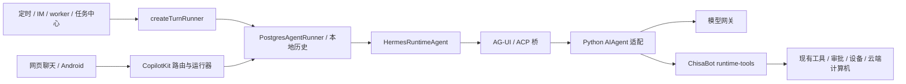
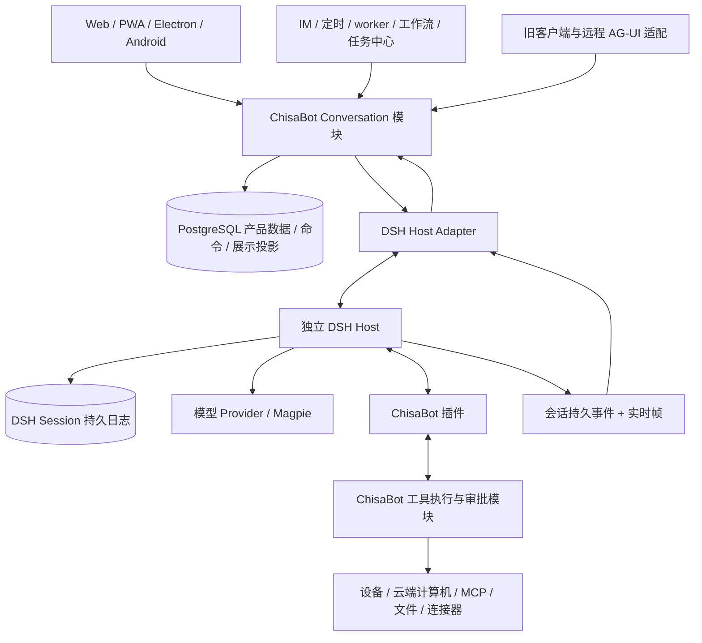

# ChisaBot 采用 DSH 主内核的完整设计与迁移方案

> **状态：已实施完成（`v0.1.138`–`v0.1.143`）**。DSH 已作为 ChisaBot 唯一内置执行内核正式上线，旧 `/api/copilotkit` 兼容路由与过渡内核已在后续收尾中彻底移除；上线验收证据见[实施记录](pipeline-runs/20261107-dsh-migration.md)。本文档作为架构设计与迁移历史档案保留。

日期：2026-11-07 · 设计基线：v1 · 状态更新：已实施完成（v0.1.138–v0.1.143）。

用户发出一个请求后，应能持续看到正文、工具进度和需要自己决定的事项；关闭窗口、换设备或短暂断网不会让任务重新执行；点击停止后，当前执行结束，尚未处理的补话留在原处。旧对话、设备、文件、记忆、模型设置和主动任务仍然可用。

本方案选择 **独立 DSH Host + ChisaBot 插件 + ChisaBot 自有聊天状态层**。DSH 接管模型与工具循环、执行会话和上下文压缩；ChisaBot 保留产品、身份、业务权限与交付。聊天前后端移除对 CopilotKit 的运行依赖，已有远程 AG-UI Bot 和原生客户端通过兼容接口继续工作。

这是实施依据。文中新增的模块名、表名、接口和阈值均为设计约定；现有事实、上游能力与待验证项分别标明。正文中的“必须”是目标契约，不表示当前代码已经达到。

**Android 方向更新（用户于 2026-11-08 明确要求）**：新客户端直接使用桌面端同一 React 前端的手机响应式布局；Kotlin 壳保留登录、扫码绑定、系统文件与权限、下载、返回、键盘和更新。旧原生客户端协议继续兼容。新主界面必须单独进行实机验收，原 Compose 页面通过不能代替这一要求。实现说明见 [Android 客户端](android-native.md)。

## 阅读导航

- [1. 目标与完成条件](#1-目标与完成条件)
- [2. 证据基线与现状](#2-证据基线与现状)
- [3. 技术选择与取舍](#3-技术选择与取舍)
- [4. 目标架构和数据所有权](#4-目标架构和数据所有权)
- [5. 身份、会话、运行与任务](#5-身份会话运行与任务)
- [6. 运行接口和消息提交](#6-运行接口和消息提交)
- [7. 状态机、停止与补话](#7-状态机停止与补话)
- [8. 事件、流式输出与断线恢复](#8-事件流式输出与断线恢复)
- [9. 工具执行和副作用](#9-工具执行和副作用)
- [10. 审批与用户问题](#10-审批与用户问题)
- [11. 模型、凭据与上下文](#11-模型凭据与上下文)
- [12. 前端去除 CopilotKit，保留交互和视觉质量](#12-前端去除-copilotkit保留交互和视觉质量)
- [13. 后台任务、主动能力与其他入口](#13-后台任务主动能力与其他入口)
- [14. 数据迁移、旧对话与编辑](#14-数据迁移旧对话与编辑)
- [15. 部署、版本、健康与运维](#15-部署版本健康与运维)
- [16. 灰度、切换与回滚](#16-灰度切换与回滚)
- [17. 实施工作包与依赖](#17-实施工作包与依赖)
- [18. 需要在实施中判定的具体契约](#18-需要在实施中判定的具体契约)
- [19. 验收：证明用户能够持续完成任务](#19-验收证明用户能够持续完成任务)
- [20. 完工交付与依赖退休](#20-完工交付与依赖退休)
- [附录 A：请求示例](#附录-a一条真实请求如何穿过新系统) · [附录 B：来源](#附录-b设计来源)

## 1. 目标与完成条件

### 1.1 解决的具体问题

| 问题                                       | 本次应改变的机制                                     | 用户看到的结果                                         |
| ------------------------------------------ | ---------------------------------------------------- | ------------------------------------------------------ |
| 模型错误、桥接错误、备用模型失败混在一起   | 统一错误分类，保留主请求与每次备用尝试的归属         | 看得懂哪里失败，已有输出保留，可采取对应动作           |
| 文本出气泡、空白区过大、流式结束时布局突变 | 固定消息身份与内容块类型，保留已完成的渲染修复       | 同一段正文始终在同一气泡，滚动不突跳                   |
| 多层运行状态互相覆盖                       | 一个执行会话所有者；产品状态从事实投影               | 刷新、切后台、换设备看到一致状态                       |
| 工具执行和前端接力纠缠                     | 所有实际工具由服务端负责，前端负责展示与提交人的决定 | 无浏览器时任务也能继续，不会因缺卡片回执重复执行       |
| 取消影响共享桥接进程，或者只停止界面       | 单会话取消、工具撤销、后台任务生命周期分别落实       | 停 A 不影响 B；仍在清理时显示“正在停止”                |
| 历史、压缩、模型设置有多个来源             | 执行历史和压缩归 DSH；产品设置归 ChisaBot            | 长对话无需每轮跨桥复制完整历史，模型切换按既有规则生效 |

换内核和修复显示各自有责任方。DSH 的输出协议能减少前端猜测，但气泡、Markdown、滚动及错误卡仍由 ChisaBot 实现。

### 1.2 完成迁移必须同时满足

1. Web、PWA、Electron 所加载的网页、Android（新 Web 主界面及旧原生协议）、IM、定时任务、后台 worker、工作流、任务中心和 Bot 间交接均有可用执行路径。
2. 正文、思考、工具、审批、附件、组件、后台进度和终态具有稳定身份，可重放、可分页、可跨端恢复。
3. 工具权限、付款约束、设备能力开关、接管状态、账号隔离、审批偏好及审计不被 DSH 默认工具绕过。
4. 旧历史可读、旧链接有效、原对话可继续；所有待处理审批、补话、任务和附件都有明确迁移处置。
5. 停止、断线、进程退出、模型切换和结果未知的副作用有真实验收证据。
6. `@copilotkit/*` 不再是 ChisaBot 生产聊天与后台执行的依赖；兼容路由名称和 AG-UI 协议可按消费者需要保留。
7. 已接收的 DSH 对话在发布回滚后仍可读取；回滚不倒退工具执行账本或丢弃新历史。

### 1.3 本次架构不扩大的范围

保留账号体系、设备节点、云端计算机、保险箱、IM 连接器、长期记忆、技能管理、文件交付、任务中心和当前产品导航。它们通过新运行接口接入，业务功能不借迁移重新设计。DSH 自带的任务、定时器、记忆或工具只有在明确接替对应职责后才启用。

## 2. 证据基线与现状

### 2.1 使用的源码版本

| 对象                | 本轮核对范围                                                                                                            | 对设计的约束                                                 |
| ------------------- | ----------------------------------------------------------------------------------------------------------------------- | ------------------------------------------------------------ |
| ChisaBot            | 当前 `fix/chat-reliability` 工作树，基线 `9a00ed625f1e3508fa66da2ea036f573db0c4f92`，包版本 `0.1.137`，含未提交聊天修复 | 实施必须保留这些修复；版本号不是线上已验收证明               |
| 官方 DSH            | `0.2.2-rc.1`，提交 `fcc0ad462172522aaf5c93a7b2e01f6b9f0b0159`                                                           | 第一候选固定此版本；官方声明 Node `>=24.9.0`                 |
| Whale Isle 内置 DSH | pin 为 `0.2.1-rc.4` / `504a01a9578abc2c6f1fb896b1dc322c9fe24f66`，含下游扩展                                            | 可复用经验，不能把下游特性当官方契约，也不能整树复制代替选版 |
| DSH SDK 发布标签    | 本轮核对时 SDK `latest` 与 DSH `latest` 不同，SDK `next` 指向 `0.2.2-rc.1`                                              | 精确锁版本，禁止依靠无版本安装得到兼容组合                   |

官方 DSH 仍是 developer preview，存在破坏性变更。来源及版本差异见[内核接口核对](research/20261107-dsh-kernel-sources.md)。本方案的可靠性判断来自接口与代码分析；迁移后的性能、故障恢复和真实客户端验收安排在第 19 章。

### 2.2 当前执行链路



关键现状：

- `server/src/copilot.ts` 同时负责模型构造、提示、工具组装、内核选择、远程 Bot 和 CopilotKit 挂载。
- `server/src/local-conversations.ts` 继承 CopilotKit `AgentRunner`，管理 PostgreSQL 历史、运行、事件、锁、流式接力和停止。
- `server/src/turns/run-turn.ts` 复制了上游未公开的无头回合流程，并调用 `ɵ` 开头的锁接口；后台消费者也必须迁移。
- `server/src/agents/hermes-runtime.ts` 每轮准备宿主身份和工具，`copilot.ts` 在 Hermes 路径裁剪或压缩整段历史后再次发送。
- `server/src/agents/runtime-tools.ts` 的执行授权与真实调用捕获相关；目前调用去重主要是存活运行内的 Promise 复用，不能直接视为跨进程副作用恢复账本。
- 前端 `useAgent`、工具渲染上下文、运行接力与 UI 聚合状态相连；换服务器模型循环不会自行移除 CopilotKit。
- 原生 Android 直接使用 `/api/copilotkit/...` 和 AG-UI 事件，不能随前端网页一起删除这些接口。

现有总览[architecture.md](architecture.md)部分段落日期早于当前源码。具体调用关系以以上入口及本轮研究清单为准。

### 2.3 已有聊天修复如何继承

当前工作树已修复普通正文出气泡、普通 Markdown 被自动转文档卡、围栏中指令误解析、结束后新增人工留白、失效备用模型筛选和错误归类。渲染检查和定向检查见[本轮可靠性记录](pipeline-runs/20261107-chat-reliability.md)。这些结果属于当前候选，不是 DSH 路径的验收结果。

迁移沿用 `bot-bubbles.tsx` 的正文规则和 `chat-transcript.tsx` 的节点、滚动处理；在新数据源下再次验证关键表现。不得通过退回旧聊天组件使这些修复消失。

## 3. 技术选择与取舍

### 3.1 采用完整 DSH Host

采用公开 Agent、Session、工具与模型扩展接口。ChisaBot 通过 Host 的 Session Controller/Gateway 驱动执行、订阅历史与实时帧；自己的插件负责权限绑定、工具调用和生命周期协调。

官方的简化 stdio SDK 适合启动任务，但当前缺少单会话取消和实时 assistant 帧通道。`run()` 的结果是收到输入后到下一次整体 idle 之间的最后回复，不能直接代表某条产品任务已经完成。官方新版已支持 SDK 审批回传，不能沿用本地旧版“SDK 无审批”的结论。详见[SDK 与 Host 的区别](research/20261107-dsh-kernel-sources.md#sdk-有用但不能忽略三个缺口)。

### 3.2 不选择的实现方式

| 方式                                     | 本项目不采用的原因                                                                      |
| ---------------------------------------- | --------------------------------------------------------------------------------------- |
| 保持现有所有权不变，只把 Python 换成 DSH | 历史、压缩、运行和工具接力仍有两套管理者，维护成本没有实质下降                          |
| 直接把 DSH `run()` 套进聊天接口          | 缺实时流、单会话停止，且区间结果不能准确绑定产品任务                                    |
| 只抽 DSH agent-loop 到 Bun 进程          | 需要重组其服务依赖、持久化和插件装配，失去采用完整 runtime 的主要收益；Bun 兼容也未验证 |
| 全量替换成 DSH 自带网页                  | 不能自然保留 ChisaBot 的 Bot、渠道、任务中心、设备和既有交互                            |
| 将 Whale Isle vendor 整体复制进来        | 带入桌面补丁和升级耦合；插件和公开接口能完成的部分不应变成私有 fork                     |
| 继续保留 CopilotKit 为所有内核的总运行器 | 用户明确要摆脱该依赖，且后台的私有接口耦合仍然存在                                      |
| 同一请求双跑 Hermes 和 DSH 比较效果      | 会重复工具副作用和模型费用；比较使用受控独立样本或纯事件回放                            |

直接 AI SDK / Pi core 更适合“只换循环、其余自行维护”的目标；本次选择 DSH 是为了接替完整执行职责。若第 17 章的最小整合验证无法满足关键契约，再按证据收窄，而不是静默降级成另一个方案。

## 4. 目标架构和数据所有权

### 4.1 模块关系



浏览器只连接 ChisaBot。DSH 接口保持在受信任内网；DSH 版本、原始事件和凭据不成为前端契约。

### 4.1.1 Host 连接与审批通道的具体选择

固定版本的 DSH Host HTTP carrier 不接受 Bearer token。Adapter 使用官方 `/connect?token=...&interactions=none` 握手，保留 API Cookie，并以同一凭据建立 HTTP 和 Gateway WebSocket。Cookie 绑定该连接的 Peer；socket 断开后重新握手，不反复使用失效 Cookie。优先复用官方 Node client/Connection 传输实现，避免自写一套不完整的 cookie/Peer 生命周期。

审批选择 **插件内的 terminal answerer**，经 ChisaBot 自有交互通道等待决定；不同时启用远程 answering Peer 竞争同一审批。后端持有的 Host owner 凭据仍是特权凭据，每次调用先核对 actor 与产品绑定，浏览器拿不到它。包含 token 的握手 URL、Cookie 和重定向诊断不进入普通访问日志。来源见[Host 契约补充](research/20261107-dsh-migration-contracts.md#23-connection-的鉴权契约)。

### 4.2 唯一事实来源

| 数据或决定                             | 所有者                | 另一侧如何使用                             |
| -------------------------------------- | --------------------- | ------------------------------------------ |
| 账号、角色、Bot 所有权、频道成员       | ChisaBot              | 运行前绑定，工具执行时重查授权             |
| 用户请求、补话、停止、显式恢复         | ChisaBot 命令与收件箱 | 接纳后提交到确定的 DSH Session             |
| 模型输入历史、步骤、工具调用事实、压缩 | DSH Session           | ChisaBot 从持久事件构造展示投影            |
| 模型连接、Bot 模型覆盖、备用顺序       | ChisaBot 设置         | DSH 接受确定版本的路由快照                 |
| 长期记忆、技能、文件、页面             | ChisaBot              | 插件提供按权限筛选的内容或工具             |
| 审批偏好、决定、外部操作回执           | ChisaBot              | 插件等待或恢复一个已绑定的具体操作         |
| 设备权限、接管、急停、本地 agent       | 现有 ChisaBot 执行器  | DSH 调用现有受治理工具                     |
| 任务中心、Outbox、调度、重试策略       | ChisaBot              | 把一次执行交给 DSH，按实际结果更新产品任务 |
| DSH Session 的实时帧                   | DSH 当前进程          | 临时显示；持久结算到达后由日志事实替换     |
| 气泡、卡片、显示游标                   | ChisaBot 展示投影     | 可由 DSH 日志与 ChisaBot 产品事实重建      |

PostgreSQL 展示投影是读取优化，不再作为新 DSH 会话的模型历史反向回灌。ChisaBot 工具账本记录外部效果；DSH 日志记录 Agent 观察到的调用结果，两者各自回答不同问题。

### 4.3 进程、账号与工作区隔离

首版部署采用 **每账号一个独立 DSH Host 实例和持久目录**；单用户部署只有一个实例。同一账号的 Bot 可有多个并发 Session，通过 Agent 作用域隔离工具、提示与工作区授权。

个人线程按现有线程所有者确定执行域；共享/团队线程同样沿用已有所有权规则，显式记录执行域和本次 actor，两者不能混为一人。对同一共享线程不会因为换了发言者就自动换 runtime。每轮工具、记忆和私人连接仍按实际 actor 及团队授权装配。

- 多账号实例由部署配置分配独立容器或等价操作系统隔离，ChisaBot 依据服务端账号映射选择实例；不把 Docker socket 交给 Web 应用。
- 没有准备好实例的账号继续留在原内核，不能被路由到管理员实例。全量切换前所有现有账号都要完成分配。
- 新账号开通流程必须包含对应 runtime 的准备和健康确认；准备期间不能宣称 Agent 已可用。
- 一个 runtime 的多个 Session 共用进程，普通停止只作用于 Session。进程失效会影响该账号的活跃 Session，需要一起准确标记中断。
- 不向 runtime 挂载完整 ChisaBot 数据库、宿主 HOME、设备令牌目录或 Docker 控制口。实际用户文件操作继续通过既有工具执行器。
- 首版不开 DSH 原生本地 shell、任意文件写入、自动 MCP 发现及会改变宿主的 coding 工具。需要这些能力时挂载 ChisaBot 现有的受治理实现。

这一选择增加少量账号级实例管理，换取清晰的凭据和故障范围。账号量增长后可优化部署密度，但不能仅凭 Agent 作用域宣称实现了操作系统级隔离。

## 5. 身份、会话、运行与任务

### 5.1 标识含义

| 标识                            | 含义与生命周期                                                        |
| ------------------------------- | --------------------------------------------------------------------- |
| `actorId`                       | 本次操作经认证的使用者；由服务端确定                                  |
| `botId`                         | 提供能力和角色的 Bot；可见性不等于执行所有权                          |
| `threadId`                      | ChisaBot 对话身份；旧链接、频道映射和历史入口继续使用                 |
| `commandId`                     | 一次用户或系统指令的幂等身份；网络重试使用相同值                      |
| `runId`                         | ChisaBot 接受一次执行所建立的运行记录；可包含补话和多个 DSH turn      |
| `bindingId` / `bindingRevision` | 一个产品线程与某个内核会话的绑定及其修订；切换或编辑分支时递增        |
| `runtimeInstanceId`             | 账号所属 DSH Host 实例                                                |
| `runtimeGeneration`             | Host 本次进程生命周期；只用于存活状态和实时帧，不能作为持久日志去重键 |
| `sessionId`                     | DSH 持久执行会话；普通后续对话复用，不每轮重建                        |
| `turnId` / `stepId`             | DSH 执行边界；一个 step 对应模型请求及相应工具阶段                    |
| `toolCallId`                    | 模型提出的一次工具调用，结合 Session/step 才确定作用域                |
| `taskId` / `workerId`           | 产品任务或后台工作的身份；不等于 run 完成状态                         |

### 5.2 绑定规则

线程已有 owner、Bot 和频道映射继续保留。新增绑定由 `(threadId, bindingRevision)` 唯一标识，记录 runtime、Session、内核版本和迁移切点。请求携带旧 revision 时，服务端返回当前状态或冲突，不把晚到的提交写进新分支。

一个普通线程同一时刻只有一个活动执行所有者。跨线程并行不拿账号级全局执行锁；账号实例只做有界并发容量控制。同一个线程允许多个观察者，但不能有两个各自推进模型的执行器。

群聊和 Team Bot 不把参与者的多段历史拼成一个共享 DSH Session：保留现有群聊协调器，按 Bot 的执行线程建立绑定，再把产物投影到共享频道。身份使用实际发起者及已有团队授权，不能借 Bot 所有者的登录态访问其私人设备。

### 5.3 Run 与任务成功分开

`run.completed` 表示该执行区间正常收尾，所有需要归属的持久结算已收到。它不表示工作流验收通过、邮件已交付或 Outbox 已批准。

产品任务仍由原任务模块根据结构化产物、依赖、审批与交付回执判定 `succeeded`。DSH `idle`、最后一段 assistant 文本或 HTTP 200 都不足以替代这个判断。用户在执行中追加的指令要记录属于哪个 run / turn，不能用高层 SDK 的“最后回复”猜对应关系。

### 5.4 执行所有权与 ChisaBot 自身重启

执行记录保存 runtime、generation、run、binding 和递增 fence；短期派发 lease 只决定哪个 ChisaBot 实例负责派发/观察，不代表模型工作已结束。

ChisaBot 重启而 DSH 仍在运行时，先按绑定重新握手和 follow，恢复观察者；不能沿用旧 runner 的“启动时释放全部孤儿锁”来重新发送已接纳请求。旧清锁逻辑仅用于明确的 legacy 运行，不影响 DSH 绑定。

lease 到期后先查询对应 Host 与工具执行器：原执行仍活跃就接管观察；原执行已终止才结算并释放下一条输入；状态未知就保持该运行待确认，禁止第二个执行器推进同一请求。fence 在插件 pre-step 和工具派发前校验，旧持有者恢复连接也不能继续派发。

账号内并发容量可排队，但前台交互与后台任务要有可配置配额，避免一个长后台任务占满所有接纳槽。排队状态、位置变化和撤回都来自服务端，容量限制不表现为无反馈的“思考中”。

## 6. 运行接口和消息提交

### 6.1 对产品暴露一个 Conversation Interface

以下是 ChisaBot 自己的目标接口，不是对 DSH 方法名的转录。实现保持少量入口，具体状态查询和幂等规则隐藏在模块内部。

```ts
interface ConversationService {
  submit(
    actor: AuthenticatedActor,
    command: ConversationCommand,
  ): Promise<CommandReceipt>;
  snapshot(
    actor: AuthenticatedActor,
    query: SnapshotQuery,
  ): Promise<ConversationSnapshot>;
  follow(
    actor: AuthenticatedActor,
    query: FollowQuery,
  ): AsyncIterable<ConversationFrame>;
}

type ConversationCommand =
  | SendCommand
  | SteerCommand
  | StopCommand
  | ResumeInboxCommand
  | AnswerInteractionCommand
  | EditOrRegenerateCommand;

// 每种命令都有 commandId、threadId 和 expectedBindingRevision；
// 内容、附件、目标 run/interaction 等字段属于具体命令。
// actor、工具授权、provider endpoint、原始历史不能由客户端指定。
```

`CommandReceipt` 区分 `accepted`、`alreadyAccepted` 和明确拒绝，包含稳定的命令、运行和绑定标识。后台 `TurnRunner` 通过同一模块提交并观察所属运行终态，保持现有 `onText`、产物、initiator、取消和审批 continuation 的调用意义。

### 6.2 客户端接口

建议新增 `/api/conversations/:threadId/commands`、`/snapshot`、`/events` 和命令状态查询。事件下行采用现有部署可支持的 SSE，控制操作走 HTTP；不另造通用双向 RPC。

| 请求                               | 请求要点                                         | 响应合同                                                        |
| ---------------------------------- | ------------------------------------------------ | --------------------------------------------------------------- |
| `POST .../commands`                | commandId、绑定 revision、具体动作及产品资源引用 | 新接纳返回 202；幂等重复返回 200 和原 receipt；均不等待模型完成 |
| `GET .../commands/:commandId`      | 认证使用者可见的命令 ID                          | 返回 stored、dispatched、runtime-accepted 或终态/拒绝原因       |
| `GET .../snapshot`                 | 可选历史窗口/分页位置                            | 返回稳定消息、活动 run、交互、队列及 viewRevision               |
| `GET .../events?afterRevision=...` | ChisaBot 自有显示游标                            | snapshot 或连续 committed 增量，以及独立 live 帧                |

401/403 表示身份或权限不满足；404 表示目标不存在或不可见；409 表示绑定/运行修订或相同 commandId 内容冲突；422 表示内容/附件不合法；503 表示接纳前依赖不可用。命令一旦持久接纳，后续启动失败通过命令/run 状态报告，不能再用一个无归属的网络错误诱导客户端创建新命令。

Stop 携带用户所见的 run 身份；晚到 Stop 不停止后来建立的另一轮。处于工具接力间隙或仅有未派发输入时，命令同时校验队列/绑定修订并暂停相应输入。批量“发送保留消息”提交明确的源 ID 集合，而不是模糊地恢复服务器此刻所有暂停项。

SSE 的 `id` 只对应已提交的 viewRevision；live 帧和心跳不推进它。客户端断线后恢复的是 ChisaBot 显示游标，Adapter 再按 DSH opening snapshot 的合同恢复上游，二者不是同一个 afterSeq。

保留 `/api/copilotkit/threads/...` 及原生 Android 使用的 run/stop/truncate 路由，由兼容 Adapter 转到 Conversation 模块并输出旧协议。名称保留不要求继续加载 CopilotKit 包。远程 AG-UI Bot 的输入输出由单独 Adapter 处理。

### 6.3 一条消息的接纳顺序

1. 验证登录、来源、线程可见性、Bot 可用性及 attachment 所有权。
2. 在短 PostgreSQL 事务中检查 `commandId`、绑定 revision 和队列状态，记录命令与用户显示消息。相同 ID、相同内容返回原接纳结果；相同 ID、不同内容拒绝。
3. 提交事务后取得该线程执行权，记录命令与 DSH request/message 身份映射，向确定的 Session 发送。
4. 收到 DSH durable inbox / user-message 接纳证据后，把命令标记为 runtime 已接纳。若 HTTP 响应丢失，先查询或重放接纳证据，再决定是否用相同 requestId 补交。
5. 前端本地乐观消息以 `commandId` 合并服务端确认，原 DOM 身份不变。

PostgreSQL 与 DSH 日志没有跨存储事务。采用“持久命令 → 幂等提交 → 接纳对账”，而不是声称两处原子写入。若所选 DSH 入口不提供所需的持久 requestId 去重，由 ChisaBot 插件在 Session 日志中记录命令来源并公开接纳查询；该能力是第一个实施阶段的必验项。

固定版本的 `session.prompt` 已能按 inbox/日志中的 requestId 去重，Adapter 优先复用它。用户收到的 accepted 以 ChisaBot 命令事务为准，保证原始输入可查。runtime 接纳观察与其存储 flush 保证分开记录；崩溃后若 DSH 日志没有该输入，只有确认没有关联工具效果和活跃所有者时才能用原身份补交，否则先对账。

查询流断开不取消任务；用户取消必须提交显式 Stop 命令。浏览器关闭也不会重复提交 prompt。

## 7. 状态机、停止与补话

### 7.1 把执行状态和连接状态拆开

运行状态：`queued → starting → running ↔ waiting → completed/failed`；可从非终态进入 `stopping → stopped`，进程或恢复故障进入 `interrupted`。`waiting` 带原因：approval、user-question、managed-child 或受治理的外部等待。

连接状态单独是 `connecting / online / reconnecting / offline`。网络断开不会把运行改成 failed；模型完成也不会把仍在清理的工具假装改成 stopped。

| 状态                         | 可接受的用户操作                   | 离开状态的证据                                 |
| ---------------------------- | ---------------------------------- | ---------------------------------------------- |
| queued / starting            | 撤回、停止                         | 接纳、启动失败或撤回持久确认                   |
| running                      | 补话、打断、停止                   | DSH 执行事件、交互请求或终态                   |
| waiting                      | 回答、拒绝、停止、受规则允许的补话 | 交互消耗、取消或依赖完成                       |
| stopping                     | 查看进度；新消息留队列             | Agent 停止、受当前运行管理的工具清理完成       |
| interrupted                  | 查看已完成内容，显式恢复或新发消息 | 未决操作隔离后可接新命令；恢复原操作先完成对账 |
| completed / failed / stopped | 新请求、编辑、重新生成             | 新运行建立；旧运行终态不复活                   |

### 7.2 停止的具体事务与执行顺序

DSH 当前 `session.cancel` 会保留 inbox，并且返回的是“取消已请求”。ChisaBot 原合同要求停止后未处理补话持久暂停。直接透传不能满足这个合同。

1. 在命令事务中将目标运行置为 `stopping`，暂停 `ThreadInbox` 的未处理项，建立递增的执行 fence。此后新的旧 fence 工具调用、审批消费和队列派发被拒绝。
2. 插件关闭本 Session 的输入投递；撤回已经进入 DSH inbox 但尚未开始的可识别输入，并在 ChisaBot 留下暂停记录。取消与投递要经过同一 Session 串行控制入口。
3. 调用公开 Agent 取消能力，取消当前模型请求、待答交互及前台工具；如使用 controller 的 `keepInbox` 行为，插件的 pre-step fence 必须阻止剩余输入自动启动。
4. 向实际设备/云端执行器传播取消，等待其终止或明确回报不能立即终止；撤销本运行尚未消费的能力凭据。
5. DSH 与工具清理证据齐全后，持久化 `stopped`。到达请求响应期限但清理尚未结束时返回接纳并继续显示 `stopping`；不能把超时当清理成功。

普通聊天 Stop 处理当前对话运行及其前台子工作。已明确创建的独立后台 worker 按现有产品语义通过 worker 卡片停止；任务中心的取消按任务树传播。界面需要区分“停止当前回答”和“停止此任务”，不能让一个按钮隐式终止账号内其他工作。

### 7.3 补话与打断

ChisaBot 保留 `queued / paused / read / answered / withdrawn` 等产品队列意义；DSH inbox 只承接被派发的输入，不再成为另一套用户待办收件箱。

- 普通补充通过 `steer` 在允许的执行边界进入；未完成的输入有稳定 ID 和 receipt。
- “停一下，改做……”先完成当前动作撤销，再派发新指令。不能假设 `steer` 会立即终止正在运行的工具。
- Stop、失败、重启后的旧暂停项不因刷新、新发一条消息或自动调度而重新开始。
- “发送这条”只原子认领一项，产生新的 commandId，其他项继续暂停。
- “发送全部”对用户看到的源 ID 集合执行同样的认领，批次可幂等查询，不把操作期间晚到的新暂停项一并发送。
- 发送响应未知时以 commandId 查询接纳；撤回要写持久终态，以阻挡晚到的提交。

### 7.4 进程丢失

Host 丢失时，记录该 generation 的活跃运行为待对账；已收到的持久事件继续可读，实时未结算片段显示中断。重启后恢复同一 Session 的持久事实，检查工具账本与输入接纳，暂停未完成输入。没有自动重新执行整轮的“恢复”按钮实现。

旧 generation 的 callback、向旧等待对象提交的 approval 和实时帧全部失效。用户新提交的决定如需恢复原操作，走第 10 章的重新绑定和复核流程。恢复历史不等于恢复 shell、浏览器进程或网络请求；实际外部资源由原执行器确认。

## 8. 事件、流式输出与断线恢复

### 8.1 两类事件分别处理

DSH 的持久 Session 事件与 `agent/assistant-stream` 临时帧不同。完整 assistant stream 在调用结算时进入持久 message/attempt；进程在结算前退出，未结算帧不具备持久恢复保证。

“持久事件”是逻辑日志类型，不自动代表每次通知都已完成磁盘持久化。官方 Persistence 合同中 append 表示接纳和排序，flush 才是持久性屏障。ChisaBot 的 committed 指自身投影事务已提交；恢复时还要核对 DSH 真正存下的源范围。发现展示水位领先于恢复后的源日志时，保留已有显示记录并标记运行中断，结合命令与工具账本处理，不能仅推进游标假装源日志存在。备份、切换和受控关闭必须经过官方存储 flush/close 屏障。

若源日志丢失了已经展示的尾部，不允许在同一绑定中把后来的新事件认成相同 sourceSeq 的旧事件。冻结该绑定的续写，保留中断观察记录，通过明确的新执行段承接已知状态；恢复动作先处置关联副作用。正常重连、正常进程重启只要源前缀一致，就继续使用原绑定。

| 通道              | 身份                                                  | 用途                           | 断线恢复                           |
| ----------------- | ----------------------------------------------------- | ------------------------------ | ---------------------------------- |
| 持久执行事实      | bindingId + sessionId + sourceSeq                     | 消息、工具、步骤、运行结算     | 按 seq 补齐，重复去重              |
| ChisaBot 产品事实 | command/approval/task 等持久 ID 与修订                | 接纳、暂停、交互决定、任务交付 | 从产品数据补齐                     |
| 实时 assistant 帧 | runtimeGeneration + session/turn/step/attempt + index | 即时文字、思考、参数片段       | 请求 active baseline，不能盲接旧帧 |
| 浏览器展示增量    | threadId + viewRevision                               | 更新消息和状态                 | snapshot + 游标补齐                |

同一个 DSH 事件可产生多个展示变更，投影器以 source key 和固定子序号防重复。runtimeGeneration 不参与持久事件的 identity，否则重启会把同一历史变成新消息。

### 8.2 展示契约

```ts
type ConversationFrame =
  | { kind: "snapshot"; revision: string; snapshot: ConversationSnapshot }
  | { kind: "committed"; revision: string; changes: ConversationChange[] }
  | {
      kind: "live";
      generation: string;
      attemptId: string;
      index: number;
      delta: LiveDelta;
    }
  | { kind: "live-reset"; generation: string; active: ActiveAttemptSnapshot[] };
```

这里的标识是接口示意，底层 DSH branded 类型由 Adapter 解码。浏览器不直接依赖 DSH 内部 ContentBlock 或 SessionEvent 的字段布局。

每条消息包含稳定 messageId、来源运行、角色、显式内容块和结算状态。内容块包括 text、reasoning、tool-call/result、attachment、artifact、interaction、component、system-notice。过程正文和最终正文都属于 assistant 消息，不因“正在工作”而掉出气泡。

用户消息以 commandId 关联乐观显示、服务器接纳和 DSH user-message；收到源事件时更新同一条，不新增另一条用户消息。assistant 消息以明确 attempt/settlement 关联；任何合并都不依赖“文字看起来相同”。

### 8.3 投影与实时结算

投影器在同一数据库事务里更新消息行、展示事件和源游标；提交后广播。source key 已存在则返回原结果。查询页面只使用已提交水位，不能先展示终态再异步遗漏最后一段结果。

实时气泡先以 attempt 身份创建。持久结算到达后通过明确的 attempt/turn/step 映射原位升级为正式消息，不新建第二个气泡；不同模型重试的失败 attempt 保留归属，正文不会拼成一个虚假的成功回复。

没有对上来源的帧先请求 baseline；跨 gap 不追加。工具参数尚未完整时只展示“准备调用”，完整 schema 校验和持久调用确认后才执行。

### 8.4 重连顺序

固定版本的 `session.follow` 没有 `afterSeq` 参数，每次开流先返回 opening snapshot，再返回事件与可选实时帧。分页使用 `session.events`，旧 `page` 已弃用；`wait(afterSeq)` 的同名字段只是输出筛选，不能拿来恢复 follow。优先复用官方 `SessionEventStream` / `RemoteJournalStream` 的顺序和 gap repair，再转换为 ChisaBot 协议。

1. 先建立 follow，再读 `session.events` 对应历史页，使用 opening snapshot 和水位协调并发到达的事件。
2. 持久 seq 有缺口则补页；只有连续部分推进源游标。
3. Host generation 改变时清除旧实时状态，重新读取活动 attempt、运行与交互投影。
4. ChisaBot SSE 断开后，客户端带最后提交 revision 重连；超过保留窗口则取完整 snapshot。
5. 重连只恢复观察，不发送 prompt、不批准工具、不重新认领暂停队列。

只有物理连接丢失自动进入重连；业务拒绝、日志损坏和无法修补的连续性错误进入明确故障状态，不能无限重试。

### 8.5 性能策略

实时 delta 按动画帧或小批次合并通知；不每个 token 重建完整消息数组或 JSON 序列化全部历史。持久 projection 按已结算事件更新。长对话使用现有尾部窗口与分页，跨窗口保留消息 key。活跃内容按消息局部订阅，Sidebar、任务列表和整个频道不跟每个 token 重绘。

慢客户端可丢弃已经被新 active baseline 覆盖的临时帧，不能丢持久事件后继续假装连续；持久积压通过分页补齐。

## 9. 工具执行和副作用

### 9.1 工具注册与实际执行

ChisaBot 每次建立或更新运行上下文时，按 actor、Bot、initiator、任务风险和已授予能力生成工具清单。DSH 插件通过公开 `ctx.tools` 在 Agent 作用域注册这些工具，执行回到既有 ChisaBot executor。

新建和 resume 都要在 Agent setup 阶段重建该作用域。不能把恢复前的工具列表或旧授权当作当前权限，也不能在 setup 尚未完成时启动模型。

工具名称、schema、参数和调用身份由受信任插件发送；HTTP body 中的 actor/bot 字段不能提升权限。服务端重建 `withConfirmActor`、`withConfirmTurn`、审计 initiator、模型连接作用域等上下文，不能依赖跨进程仍存在的 AsyncLocalStorage。

当前“等宿主事件流捕获调用再允许工具执行”的依赖应被去掉。插件在 DSH 工具管线拥有完整、已验证的调用事实：先登记调用和能力范围，再执行。这样不再由聊天回放速度决定工具捕获是否超时。

### 9.2 持久执行账本

新增工具操作记录，以 `(bindingId, sessionId, turnId, stepId, toolCallId)` 为唯一执行身份，保存不可变名称、规范化参数、权限快照、执行 fence、外部 receipt 和结果。

状态：`registered → waiting_approval → dispatching → running → succeeded/failed/cancelled`；无法判断外部效果时进入 `outcome_unknown`。拒绝或撤销可在派发前直接终止。

| 重复或故障                           | 处理                                                   |
| ------------------------------------ | ------------------------------------------------------ |
| 相同身份、相同参数，已成功           | 返回已有结果，不再调用外部执行器                       |
| 相同身份、参数不同                   | 拒绝，报告调用身份冲突                                 |
| 同一操作仍在本进程执行               | 加入现有观察，不开启第二次调用                         |
| 数据库已记 dispatching，进程随后退出 | 按外部 receipt 查询；无查询能力则 outcome_unknown      |
| 外部支持幂等键                       | 使用稳定 operationId；恢复先查询，再按该提供方契约处理 |
| 外部无幂等/查询能力                  | 不自动重做写操作，由明确核实或新授权决定下一步         |

数据库事务不能覆盖邮件发送、浏览器点击和设备命令。账本的作用是保存已知结果和不确定性，不承诺所有外部操作恰好执行一次。

### 9.3 工具权限继续由原执行器判定

沿用设备关闭/询问/允许、完全访问有效期、账号归属、文件根目录、购买限制、Bot 权限、工作流风险限制和接管状态。发送前再检查最新的停止 fence 与权限撤销，不能只在工具目录生成时检查一次。

DSH 默认 shell/MCP/文件工具不能成为另一条绕过这些规则的路径。远程自定义工具只通过现有获授权连接加载。无头与网页使用同一个 executor，展示组件只返回结构化产物，不等待浏览器执行副作用。

## 10. 审批与用户问题

### 10.1 复用现有决定，新增内核关联

当前既有 `confirmations`，也有带 `ApprovalContinuation` 的通用 approvals 和设备本机审批。迁移先保留各自政策和记录，不再新增一套“DSH 用户偏好”。新增 interaction 关联记录把现有记录 ID、runtime、Session、操作 ID 和当前等待关联起来。

同一操作只有一个有效决定。网页、手机和设备同时回答时，事务只接纳一次，其他端读取已决定状态。审批卡片内容来自实际参数快照；参数、对象、权限或执行 fence 改变，旧决定不能授权新操作。

### 10.2 正常等待与 late approval

正常等待时，ChisaBot 持久化请求，再由 DSH 插件等待结果；决定到达后重新查权限、运行状态和操作账本，才执行。拒绝、超时和停止都有独立终态。

人晚些时候批准，而旧调用已经结束时，沿用现有“可以在原对话接着做”的产品能力，但不能复活一个已经消失的 Promise：

1. 检查对应操作仍未派发、未撤销、未被编辑替代，批准内容仍完全一致。
2. 建立有来源的恢复命令，引用原 interaction/operation；ChisaBot 执行器消费该批准并执行一次，或对已有 receipt 读取结果。
3. 通过公开输入/上下文接口把结构化恢复结果交给当前有效 Session，明确标记为外部恢复结果；不伪造旧 DSH tool call 尚在等待。
4. 若旧操作结果未知，先对账；不能用“再次批准”掩盖可能已执行的事实。

这是需要实现的 ChisaBot 恢复流程，DSH 的实时审批回调本身不提供跨进程待答恢复。

### 10.3 保留现有交互语义

- `allow_once`、已有的持久规则、`deny` 和 `handled` 分别保留；handled 表示人已处理，不再替人执行。
- 设备本机和网页的审批仍指向同一个具体操作，不各弹一张互不相干的决定。
- 任务中心 Outbox 的“批准一个交付/任务版本”不自动批准该任务之后产生的所有工具调用。
- 用户问题的选择项、自由文本、已回答状态和原 thread 链接保留；模型追问与操作审批分类型显示。
- 重启后不能继续回答的旧交互要显式标记状态，或提供上述恢复入口，不能永远留一个不可点击的“1 个问题”。

## 11. 模型、凭据与上下文

### 11.1 设置仍只有一个管理入口

沿用 ChisaBot 的活动连接、部署默认模型、Bot 模型覆盖、备用顺序和模型目录。现有主契约是一个部署活动连接，Bot 覆盖模型 ID；连接作用域的其他已有实现按当前调用方保留，不借迁移添加新用户配置门槛。

每次 run 接纳时生成不可变的 ModelRouteSnapshot：连接修订、协议、模型 ID、上下文与输出上限、能力、推理选项、候选备用列表和带修订的凭据引用。普通设置变更从下一轮生效；明确的凭据撤销即时生效，并使受影响请求停止或失败。模型切换不重置对话。

凭据由 ChisaBot 的现有安全存储解析，交给账号绑定的 runtime 受信任配置提供方。只在受保护通道/文件或内存中提供，禁止进入 prompt、浏览器事件、公开健康响应、普通日志和 Git。部署共享模型连接不等于共享私人设备、保险箱或会话凭据。

### 11.2 Provider 与失败处理

官方 DSH 支持多 provider 和自定义兼容网关；仍须逐项验证 Magpie 的实际协议、工具参数、reasoning、图片输入、输出上限和 usage。不能因为 `/models` 返回 ID 就认定推理成功。

同模型重试由 DSH 的有界请求策略执行。官方 step 会固定模型选择，`agent/request` 禁止改 provider/model/reasoningEffort，错误钩子只返回 retry 决定；因此不能用 `model.select(backup)` 加 retry 冒充当前请求的自动 fallback。内置 retry 的 normal 默认有五次重试，本项目应显式配置总预算，避免与网关重试叠加。来源见[模型路由契约](research/20261107-dsh-migration-contracts.md#6-模型路由重试和-fallback)。

**自动备用模型是保留功能，也是正式切流的必备项。** 首选在公开 LLM provider Adapter 中实现 ChisaBot 路由策略：ChisaBot 提供候选、能力和预算，Adapter 负责一次模型请求范围内的尝试。P0 先验证 prepared-call 的能力声明、失败 attempt、实际模型与 usage 是否能正确记录；不能仅对内部变量赋值就认定接入完成。

该实现必须满足以下条件：

- 同模型瞬时失败在有界预算内重试；鉴权、模型不存在、配额、协议错误分别分类。
- 备用列表沿用本轮 freshness 修复：只有新鲜完整目录能证明候选已失效；空、旧或失败目录不能静默抹掉配置。
- 允许换模型的失败发生在模型请求阶段；已经完成的工具调用不因 fallback 再执行。
- 流中失败保留失败 attempt，与下一次 attempt 分开显示，不能拼接成一段成功文本。
- 展示主模型失败和备用尝试的实际归属，备用 404 不能改写成“主模型不存在”。

模型切换需要重新检查上下文窗口、输出上限、工具、推理和多模态能力。只有能够满足已准备请求的候选才可直接替代；需要重新准备输入时必须经过受支持的新请求边界。已经输出的失败 attempt 应结算，再开始新 attempt，不隐藏或拼接前一段内容。

如果公共 provider 路径无法保持这些语义，P0 要交付最小的上游扩展方案并验证，再决定候选版本；此时不能把手动选择备用模型当作完整迁移验收通过，也不能自动重放整条用户任务。实现接口尚需验证，但保留功能要求已确定。

### 11.3 期限分层

连接/接纳期限、模型请求期限、工具期限、审批等待、任务执行预算和停止清理是不同计时器。是否收到 token、是否在执行工具、是否等待人，分别影响相应计时器；不以一个“30 秒没有正文”通杀所有阶段。

第一阶段保持现有明确的业务预算和可配置项，收集真实延迟后再调整。取消模型请求不能取消整个 runtime，工具在后台工作也不能被误判为无首字卡死。

### 11.4 上下文与记忆

DSH Session 管理模型可见历史和压缩。ChisaBot 的 `history-budget.ts` 对 DSH 路径退出，只在 legacy 路径保留；压缩结果进入 DSH 持久日志，前端显示该来源的上下文使用情况。

长期记忆、用户长期指令、Bot 角色、技能索引、设备状态与任务上下文仍由 ChisaBot 生成，通过公开 system-prompt / inject 扩展接入，并带来源修订。稳定指令避免每个 token 或每个小步骤重组；动态状态按需要更新。外部文件、网页、邮件与旧聊天导入内容保留来源标记，不能被提升为宿主指令。

图片、文档和音视频继续以 ChisaBot attachment ID 作为产品标识，DSH 只拿经授权解析的模型输入或 runtime 媒体引用。压缩可改变模型上下文，不能删除用户原文件或改变历史展示。

## 12. 前端去除 CopilotKit，保留交互和视觉质量

### 12.1 前端模块分工

| 目标模块                                  | 责任                                   | 主要替换对象                             |
| ----------------------------------------- | -------------------------------------- | ---------------------------------------- |
| `app/src/lib/chat/session-client.ts`      | 同源命令、snapshot、SSE、重连          | CopilotKit transport 与 run/connect 调用 |
| `app/src/lib/chat/session-store.ts`       | 单线程消息投影、运行、交互、队列、游标 | `agent.messages` 及分散的运行补偿状态    |
| `app/src/lib/chat/conversation-scope.tsx` | 给卡片提供 thread/bot 和操作回调       | `useCopilotChatConfiguration`            |
| `app/src/lib/chat/renderers/`             | 工具、活动、产物的纯渲染注册表         | `useRenderTool`、`useRenderToolCall`     |
| `app/src/lib/chat/sandbox-surface.tsx`    | 已发布 HTML 组件和管理预览             | `OpenGenerativeUIActivityRenderer`       |
| Composer 的 attachment state              | 上传、取消、重试、草稿与已接纳引用     | SDK `useAttachments`                     |
| 兼容 Adapter                              | 旧历史、旧协议转产品消息               | 旧 AG-UI 回放与字段正规化逻辑            |

`ConversationView`、`ChatTranscript`、Composer、Markdown、现有卡片、滚动与 UI 记忆继续作为呈现层。`ChannelChat` 只组合会话状态和用户操作，退出“自己修补 SDK 执行过程”的职责。

完整文件与消费者清单见[前端迁移核对](research/20261107-chat-ui-kernel-migration-map.md)。以上是建议路径，可在实施时按现有目录习惯调整，但职责不能重新散回多个组件。

### 12.2 三种状态独立显示

- 执行：具体 run 的 starting/running/waiting/stopping/终态。
- 连接：connecting/online/reconnecting/offline。
- 历史：loading/ready/partial/unavailable。

打开旧对话加载历史不会触发“正在回答”；网络断开显示重连提示，但保留后台运行事实。只有后端明确拒绝接纳的内容才恢复成待发送草稿；已接纳内容保持消息位置和 commandId。

### 12.3 气泡、内容块与卡片

1. 所有可见 assistant text 都进入同一套气泡，不因 step、final、流结束或错误改变容器。
2. 普通 Markdown 保持原结构；显式文档产物或现有明确的 `doc` / `summary` 围栏才进入文档卡。代码围栏中的示例不得触发卡片解析。
3. 工具卡按稳定 call identity 更新；未知工具用通用行，局部渲染失败不清空整段聊天。
4. 只有图片、文件、结构化卡片的有效交付也可完成一轮；不能再依据“没有 assistant 文本”推断失败。空壳卡、失败卡和永久 skeleton 不算交付。
5. reasoning 是独立内容块，默认展示策略沿用产品规则，不能混入正文或工具参数。
6. 错误卡附着到对应 run/attempt；主模型与备用模型错误、连接恢复提示、工具拒绝不合并成一个泛化标题。

### 12.4 工具展示与前端交互

渲染器输入包含稳定 callId、名称、参数快照、结果、阶段、thread/bot、attempt 和呈现类别；注册表只负责展示。把计算机/技能/Gallery 中的真实执行迁到服务器受治理工具。

确实需要浏览器的人机交互采用 `interaction.requested` 与显式 answer 命令：例如用户选择表单、交还电脑或组件提出后续问题。卡片按钮发出的新提问也走正常 command 接纳，不能绕过暂停和幂等规则。

HTML 沙箱模块覆盖聊天、组件列表预览、单组件预览三个入口；复用发布与组件授权，规定 iframe sandbox、来源与消息校验。已撤销组件不能借旧注册表继续调用宿主。`json-render` 的 schema 与注册表保留。

### 12.5 滚动、草稿和附件

保留 keyed 节点、阅读锚点、尾部窗口、上滑不抢滚动、跟底及 reduced-motion。完成/停止不新建大块人工留白；历史前插不改变用户正在看的位置。工具从展开转折叠也要检查可视内容连续性。

草稿继续本地保存；已提交的文本、附件和技能引用由服务器队列持久管理。这会补齐目前忙时附件/技能仅留在本地队列的缺口。上传失败、取消、仅图发送、编辑后保留附件及跨线程切换都必须沿用。

### 12.6 删包的结束条件

替换所有 Hook、Context、types、渲染器和管理页后，再删除生产依赖 `@copilotkit/react-core`、`@copilotkit/runtime` 及没有剩余消费者的相关包。同步清理 Vite 分包、a2ui stub、SDK CSS、Inspector 隐藏规则和旧 SDK 专用补偿。

AG-UI 保留在远程 Bot、旧历史和兼容入口的 Adapter 中；shared 类型改为产品契约，不能改成导入 DSH 内部类型。依赖清理通过生产依赖图、实际入口构建和各消费者验收确认，不能只检查 package.json 字面删除。

## 13. 后台任务、主动能力与其他入口

### 13.1 统一执行入口，保留业务所有者

| 入口                    | 现有责任方                      | 迁移后如何运行                                          | 完成的依据                          |
| ----------------------- | ------------------------------- | ------------------------------------------------------- | ----------------------------------- |
| 网页 / Android          | 频道与 Bot 线程                 | Conversation submit/follow                              | run 终态与持久消息                  |
| IM                      | `server/src/im/`                | 保留平台 inbound ID 作为来源幂等键，调用统一 TurnRunner | 回答持久化及平台发送回执分开记录    |
| 定时任务                | `server/src/schedules/`         | 调度器继续拥有到期和重试，执行落入原 thread             | 执行结果和交付记录                  |
| 后台 worker             | `server/src/workers/service.ts` | 独立执行线程，卡片和结果入箱沿用                        | worker 终态、产物、向主线程交付回执 |
| 工作流 / 职责           | workflows / responsibilities    | 步骤调用统一执行接口，保留步骤和审批来源                | 工作流/职责自身判定                 |
| 任务中心                | `server/src/task-center/`       | 复用依赖、lease、风险和 Outbox；只替换 runTurn          | 任务版本、依赖、审批和交付完成      |
| 面板刷新                | live-panels                     | 保留工具子集与非交互预算                                | 面板版本更新及数据结果              |
| Bot 间 handoff          | work queue / handoff runner     | 每 hop 保留独立目标 Bot 线程和 initiator                | 回执投递到原对话且无重复            |
| 设备本地 Agent          | local-agents                    | 原设备执行器继续工作，DSH 可调用委派工具                | 设备执行终态与结果交付              |
| 远程 AG-UI / Mastra Bot | agents 的现有远程类型           | 协议 Adapter 接 Conversation，不强制改成 DSH            | 该远端协议的结果及产品结算          |

### 13.2 DSH 子代理与产品后台任务不混用

DSH subagent 属于一个执行任务内部的协作关系。ChisaBot worker、任务中心任务、Bot handoff 是用户可见的产品对象，有自己的权限、队列、产物和交付规则。

首版只把 DSH 子代理用于明确启用的内部子工作；其工具范围不超过父任务，用户决定回到原任务，输出保留实际执行者。独立 worker 不因为 DSH root idle 就标记 done，也不默认在停止当前回答时取消所有独立任务。

任务中心仍维护 L1–L5、风险分级和 Outbox。L5 不能提升工具权限；发送、公开发布等实际动作继续消耗具体授权。DSH 的 goal/schedule/workflow 不同时调度同一件产品任务，避免双重唤醒。

### 13.3 关掉网页后的交付

后台所有者观察指定 run 与其所等待的子工作，而不是前端连接。文字、附件、卡片和交付 ID 先持久化，再触发通知。用户离线不影响工具运行；没有人回答审批时按现有政策等待或停在明确的 waiting 状态，不能按“无人在线”自动批准。

## 14. 数据迁移、旧对话与编辑

### 14.1 新增数据结构

以下新增表名为建议，实施时通过版本化数据库迁移创建；旧表先保留。业务数据已有表继续复用。

| 数据             | 建议表                                                    | 关键字段与约束                                                                                         |
| ---------------- | --------------------------------------------------------- | ------------------------------------------------------------------------------------------------------ |
| 内核绑定         | `chisabot_runtime_bindings`                               | thread、revision、kernel、runtime、session、版本、状态、legacy 截点；每线程最多一个 active             |
| 命令接纳         | `chisabot_conversation_commands`                          | owner、thread、commandId、type、payload、bindingRevision、dispatch/receipt 状态；同线程 commandId 唯一 |
| 产品 run         | `chisabot_conversation_runs`                              | runId、绑定、发起者、状态、输入关联、停止 fence、开始/结束与原因                                       |
| 显示消息         | `chisabot_conversation_messages`                          | 稳定消息 ID、所属 thread/run、原始来源、内容块、结算状态、分支可见性                                   |
| 显示事件与源游标 | `chisabot_conversation_events` / `..._projection_cursors` | thread revision、source key、changes；源游标与投影同事务提交                                           |
| 工具操作         | `chisabot_tool_operations`                                | 复合调用身份、immutable args、状态、审批关联、receipt、结果、fence                                     |
| 交互关联         | `chisabot_runtime_interactions`                           | 原审批/问题 ID、operation、Session、状态、决定修订；已有审批政策表不复制                               |
| 迁移记录         | `chisabot_conversation_migrations`                        | 旧线程截点、状态、计数、异常清单、导入/续接来源、候选绑定                                              |

DSH Session 先使用官方持久化实现和独立持久卷。首版不另写 PostgreSQL SessionPersistence provider，以免在内核迁移中再承担一套存储引擎兼容工作。

### 14.2 迁移前完整盘点

盘点按账号、Bot、线程输出计数和异常项：历史消息/事件/运行、频道映射、附件、审批、收件箱、worker、本地 agent 任务、任务中心依赖与 Outbox、定时任务和通知链接。模型、技能、记忆、设备、连接器等记录原地保留，不为了换内核搬进 DSH。

旧历史兼容两种 toolCalls 形态，以及 `content:null` 的无正文工具消息。损坏项单独记录且保持原始数据，不能因一项解析失败清空整段历史；未知元信息保留原始归档供兼容读取。

### 14.3 先保留产品历史，再建立执行连续性

所有旧可见历史仍由 ChisaBot 的 legacy reader 展示，messageId、附件链接、时间和来源保持稳定。DSH Session 从迁移截点建立，不每轮重新灌入旧对话。

迁移不要求把 AG-UI 事件强行转换为虚构的 DSH request/step/usage 历史。默认采用 **原历史保留 + 显式上下文续接**：

1. 在线程空闲、审批和副作用处置明确时确定不可变截点。
2. 生成续接上下文：近期完整对话、已经确定的要求和结果、未完成事项、必要文件引用，带原 messageId 和来源。长历史按可用窗口生成摘要，并保留可按权限检索完整旧记录的能力。
3. 通过公开 system-prompt / inject / admitted message 接口将续接材料作为“历史上下文”提供，不伪造用户刚发了旧指令，不自动调用任何旧工具。
4. 新用户消息作为第一条新输入进入 DSH；前端在同一 thread 显示旧历史和新执行结果，迁移标记可在详情查看。
5. 续接内容和生成依据持久保存，可重建、可审查；如果无法覆盖仍待处理的关键要求，线程保持原绑定，先修正续接再切换。

如果官方公共 seed 能表达经验证的原始对话，可在同一迁移器中采用确定性的转换；但只能使用真实可表达的语义，不能编造模型请求、工具执行、时间或用量。默认连续性方案不依赖未经验证的通用 transcript import 接口。

这保留完整用户历史与继续对话能力。模型看到的是明确的续接上下文，与从创建起一直由 DSH 执行的原生日志不同；此差异在迁移记录中保留，不隐藏。

### 14.4 队列、审批与正在执行的任务

| 迁移时状态                           | 处理                                                       |
| ------------------------------------ | ---------------------------------------------------------- |
| 空闲且无未决副作用                   | 可准备新 Session 和续接上下文                              |
| 正在执行或停止中                     | 等原所有者结算；不将一半 run 搬到新内核                    |
| paused 补话                          | 原 ID 和状态保留；切换不会自动发送                         |
| 已入 DSH/旧 runtime 但接纳结果未知   | 先对账，禁止两边都投递                                     |
| 待审批且尚未派发                     | 原决定记录保留；绑定到可恢复操作后切换，否则旧绑定继续处理 |
| 外部操作 outcome_unknown             | 对账或人工核实前保持原执行范围，不迁成“待重试”             |
| worker / workflow / task-center 在跑 | 原执行继续；后续新 run 按已记录绑定选择，不能跨版本猜测    |
| 编辑/截断进行中                      | 等 revision 操作完成，再确定截点                           |

### 14.5 激活是一次受控切换

先准备候选 Session、验证其静态上下文和展示读取，再在数据库短事务中比较旧 revision、空闲状态和迁移截点，更新 active binding。准备失败只留候选记录，不切产品线程。

数据库激活成功而响应丢失时，重试读绑定得到原结果；失败候选不会被当作活动线程。切换后晚到的旧 runtime 事件可归档到旧 binding，但不能更改新分支状态。

### 14.6 编辑与重新生成

保留“编辑/重新生成由服务端决定当前可见历史，跨端一致”的合同。DSH 支持范围内的最新 idle 消息编辑可使用其公开接口；涉及更早截断、已有工具效果或其他不支持的目标时，创建新执行分支和绑定 revision，保留旧审计日志。

当前可见历史改变不撤销文件修改、邮件发送或设备动作。编辑前明确处理 pending approval、旧队列、后台任务与活动执行；原附件仍引用同一产品资源。新分支不能重用旧的操作授权，旧流也不能追加到新分支。

### 14.7 删除、归档与保留

归档仅改变产品展示，不删 Session。删除 Bot/线程沿用产品权限和依赖清理规则，先撤销执行与凭据，再标记绑定不可运行。DSH 日志和文件依据既有保留/删除要求清理，失败须有可追踪状态，不能留下仍可执行的孤立 Session。

旧数据的实际删除是后续独立维护动作；迁移完成条件是可读、可继续、依赖映射正确，而不是马上删除旧表。

## 15. 部署、版本、健康与运维

### 15.1 版本和运行环境

ChisaBot 服务端继续使用现有 Bun；DSH 使用独立满足官方要求的 Node 容器。DSH runtime、Host/Gateway 所需包、ChisaBot 插件和客户端适配依赖锁在同一兼容版本，不以包管理器的 latest 标签决定。

新增专用 Cordis `chisabot` profile，仅加载 Host 会话、持久化、模型、所需压缩和 ChisaBot 插件等能力，通过官方 `dsh --profile chisabot` 启动。profile 的 `package.json` 声明 bundles，`cordis.patch.yml` 定义组合；`--from-default-profile` 会替换 profile，不用于日常启动。关闭 TUI、自动浏览器、默认原生 coding 工具及重复业务调度。实际可启动的 manifest、包清单和健康接口作为第 17 章第一阶段产物，不能把简化 SDK 或一次性 headless profile 当该 composition 的代替品。

官方 Web profile 可用于初始接口验证，但包含网页和默认工具，不是最终配置。Host Web carrier 不支持用 `0.0.0.0` 作为监听地址；同机选 loopback，跨容器部署配置可达的具体本地 IP，并验证连接/重连路径。组合配置输出可能含敏感值，诊断产物必须脱敏。

插件通过公开接口装配；确需上游修正时，先记录所缺合同、保持小范围补丁并推动上游。不能在长期实现中隐式 monkey-patch 私有 Agent 方法。

### 15.2 配置合同

| 配置                                    | 目标含义                                                         |
| --------------------------------------- | ---------------------------------------------------------------- |
| 现有 `CHISABOT_AGENT_KERNEL` 扩展 `dsh` | 新建内置执行绑定的部署默认值，不能覆盖已记录的线程绑定           |
| runtime 目标配置                        | 账号到 Host 地址、凭据引用、持久卷、版本的服务端映射             |
| 灰度策略                                | 限定可新建 DSH 绑定的账号/Bot；独立于 DSH 进程是否启动           |
| 插件协议版本                            | ChisaBot 与插件的能力握手；不兼容拒绝接纳新工作                  |
| 模型连接                                | 继续来自现有数据库设置，不能被 DSH HOME 的另一份模型配置暗中覆盖 |

配置不一致时就近报错并阻止该 runtime 接纳，不能静默切另一个内核继续执行同一请求。已接纳运行固定在原 binding，网络错误不触发跨内核重跑。

现有 compose 的物理卷名和网络名保留，DSH 新增自己的持久卷，不改 PostgreSQL、workspace、profiles 的映射。当前宿主更新器仍是唯一部署执行者，应用继续只写更新请求。

### 15.3 健康分层

| 检查               | 证明什么                              | 故障时影响                       |
| ------------------ | ------------------------------------- | -------------------------------- |
| ChisaBot liveness  | 主进程响应                            | 进程管理                         |
| ChisaBot readiness | 数据库和必要产品依赖可用              | 是否接新产品请求                 |
| DSH readiness      | 进程、插件、存储、所需方法和版本可用  | 对应账号是否可新建执行           |
| Session health     | 某个会话的日志、owner、活动状态可解释 | 只阻止该会话有风险的操作         |
| 模型诊断           | 指定模型能否进行实际请求              | 区分网关/模型故障和 runtime 故障 |

健康查询本身不产生付费模型请求。发布流程若启用 DSH，必须要求对应 readiness 通过；不能沿用旧 Hermes 的提示性检查规则把必需 runtime 故障忽略。后台已有 run 的健康也要检查，不以首页打开代替。

### 15.4 备份与恢复

备份包含 PostgreSQL、DSH Session 持久卷、产品附件引用所对应的存储、runtime/plugin 版本与绑定映射。执行前短暂停止新接纳，记录源水位并等待投影到达；数据库备份和日志快照附带同一备份批次及水位关系。

恢复先禁用自动调度与新接纳，启动对应可读版本，验证绑定、日志和投影连续性，再重建显示投影。工具账本记录的已执行与未知操作必须保留；备份回退不能撤销现实中的邮件、付款、文件变化。外部回执晚于备份时先对账，再开放对应任务。

### 15.5 可观测性与错误分类

所有诊断可关联 actor 的内部标识、thread、run、command、binding、Session、step、operation 和 runtime generation；普通日志只记录必要元信息，不记 prompt 全文和凭据。

至少区分：接纳冲突、无权限、runtime 不可达、版本不匹配、模型鉴权/配额/限流/模型不存在/超时/协议错误、工具拒绝/执行失败/结果未知、等待用户、取消未完成、历史损坏、事件缺口。面向用户的文字与管理员诊断分开，错误必须带可行动的恢复方式。

观测时间点包括接纳、runtime 接纳、模型请求、首个可见输出、工具开始/结束、审批等待、最终结算、停止请求/实际完成；据此分辨模型慢、审批等待、工具慢和渲染慢。

## 16. 灰度、切换与回滚

### 16.1 先发布可读两种历史的兼容版本

第一份部署候选同时能读取旧历史和 DSH 投影，保留旧客户端兼容路由，默认仍用原绑定。DSH 新建与灰度独立控制。未产生 DSH 数据前，可以回退到原版本。

一旦已有正式 DSH 对话，最低可回退应用版本变为“理解 DSH 绑定和历史”的兼容版本。不能将完全不认识新数据的旧镜像当作无损回滚路径。

### 16.2 灰度顺序

1. 隔离环境：真实模型 + 非破坏性工具 + 审批 + 停止 + 断线/进程恢复。
2. 一次性测试 Bot：新建 DSH 对话，覆盖 Web、原生兼容接口和后台执行。
3. 指定账号的新对话：原对话继续原内核，观察真实使用。
4. 指定旧对话迁移：带附件、工具、长历史和已暂停输入，确认继续对话质量。
5. 按账号/Bot 扩大新绑定，再迁完剩余符合条件的旧线程。
6. 依赖与消费者迁移完成后，将 DSH 设为默认，停止建立新的 Hermes/builtin 内置绑定。

每一步只运行一个执行内核。可并行比较渲染投影或使用独立测试数据，不能对真实写操作双跑。

### 16.3 出现故障时的回滚动作

1. 关闭新的 DSH 绑定/迁移，暂停新工作派发；现有运行按可观察状态完成或受控停止。
2. 保留 PostgreSQL、工具账本、DSH 日志和已接受命令，冻结故障版本写入并记录最后水位。
3. 回到已验证的兼容应用与配套 runtime/plugin。较旧 DSH 不能读取新日志时，保持原读取器或恢复受支持的版本，不能覆盖式降级日志。
4. 未迁移线程可继续原内核；已迁移线程优先恢复其配套 DSH。需要改回其他内核时，只对已空闲且副作用明确的线程建立新的 binding 和续接上下文。
5. 重连客户端只读取状态。命令接纳未知、操作结果未知和旧暂停输入不因回滚自动重发。

回滚验收包括切换后新增的一条完整对话、一个工具结果、一个审批、一条暂停补话和一个附件仍可访问。恢复命令和版本关系应在发布前作为运维文件实际演练一次。

## 17. 实施工作包与依赖

### 17.1 阶段 0：最小完整整合，决定能否进入迁移

构建固定版本的无 UI Host composition 与 ChisaBot 插件，使用隔离账号和存储完成一条真实链路：

**发送 → 实时文字 → 一个现有工具 → 审批 → 停止/继续 → 断线续读 → 进程重启读取原 Session。**

同时运行第二条会话，证明取消第一条不终止第二条。验证命令幂等、插件接入、Host 鉴权和媒体输入。输出可启动源码、固定依赖、运行证据及已知限制。只返回模型一句话不构成这个阶段完成。

自动备用模型还须单独通过“主模型失败 → 合法备用请求 → 记录实际模型 → 不重做已完成工具”的验证。这个问题会改变公开接口是否足够，是开始大规模迁移前的优先验证项。P0 可用最小测试客户端驱动真实 Host 和现有受治理工具；产品前端及完整迁移在 P1–P6 完成，不再另造一个脱离目标合同的演示循环。

若某个关键能力没有公共接口，先判断能否在 ChisaBot 插件中完成；需要改私有内核或无法保留产品语义时，记录具体缺口和最小可行调整，再决定推进范围。

### 17.2 工作包

| 包                       | 产物与主要改动                                                     | 依赖         | 退出条件                                  |
| ------------------------ | ------------------------------------------------------------------ | ------------ | ----------------------------------------- |
| P0 Host 整合             | composition、插件入口、版本与鉴权、客户端兼容、真实链路和 fallback | 固定上游契约 | 阶段 0 全链路与备用模型验证通过           |
| P1 Conversation 内核接口 | commands、binding、run、快照/事件、DSH Adapter、兼容入口           | P0           | 幂等、单会话状态、重连/恢复明确           |
| P2 工具与交互            | 现有 executor 接入、operation 账本、审批/问题、停止 fence          | P1           | 副作用、late approval、撤销与结果未知通过 |
| P3 前端状态替换          | store/client/scope、纯渲染、附件、HTML 沙箱、原交互                | P1/P2 契约   | 实际 UI、所有预览消费者、无浏览器后台通过 |
| P4 后台消费者            | TurnRunner、IM、worker、任务中心、工作流、handoff                  | P1/P2        | 每类真实入口及交付可用                    |
| P5 数据连续性            | 盘点、legacy reader、续接、编辑分支、迁移工具                      | P1–P4        | 旧对话和未决对象逐项对上，能回滚          |
| P6 部署灰度              | 新卷、runtime 映射、健康、更新器、备份与回滚                       | P0–P5        | 隔离环境和指定真实客户端验收              |
| P7 依赖退休              | 删除 CopilotKit 生产依赖、旧接力、私有锁接口和残留配置             | P3–P6        | 依赖图与消费者证明已完成替换              |

同一状态机和协议由一个实施负责人维护。工具/审批、前端呈现和部署可在接口确定后分工；不能由多个并行负责人分别发明 run、终态或恢复语义。

### 17.3 主要代码迁移地图

| 当前位置                                                      | 改动方向                                                                                |
| ------------------------------------------------------------- | --------------------------------------------------------------------------------------- |
| `server/src/copilot.ts`                                       | 提取模型/提示/工具的产品逻辑；DSH Adapter 不继承 BuiltInAgent；最终退出 CopilotKit 挂载 |
| `server/src/local-conversations.ts`                           | 分离旧历史 reader 与新 Conversation 模块；移除 AgentRunner 继承和前端续跑               |
| `server/src/turns/run-turn.ts`                                | 改为统一执行接口的消费者，退出 `ɵ` 锁调用与上游私有流程复制                             |
| `server/src/agents/hermes-runtime.ts` / `runtime-tools.ts`    | 旧绑定期间保留；提取可复用授权/executor，DSH 不继续使用 capture 等待桥                  |
| `server/src/thread-inbox.ts` / `thread-truncate.ts`           | 保留产品队列、暂停和编辑合同，改为命令与 binding revision 驱动                          |
| `server/src/approvals/` / `confirmations/`                    | 保留政策和记录，接 operation 与 runtime interaction                                     |
| `server/src/index.ts`                                         | 将各 `createTurnRunner`、copilotRuntime.history/lock/runner 调用改到统一入口            |
| `server/src/task-center/` / `workers/` / `schedules/` / `im/` | 保留业务状态机，替换执行与终态订阅                                                      |
| `app/src/lib/copilot/`                                        | 分拆成新 chat 状态、渲染器和 legacy Adapter，逐项退休原模块                             |
| `channel-chat.tsx` / `chat-transcript.tsx` / Composer         | 接新状态，保留气泡、滚动、附件及草稿行为                                                |
| `app/src/components/component-preview.tsx` / 管理组件路由     | 替换 SDK 沙箱 renderer，保留预览与授权                                                  |
| `shared/task-center.ts` / `reply-sources.ts`                  | 用产品事件与明确 legacy variant 表达，退出 SDK 类型扩散                                 |
| `android/.../AppViewModel.kt` / `chat/Model.kt`               | 第一阶段由兼容路由保证可用；后续原生接新协议仍独立验收                                  |
| `deploy/compose.yaml` / 更新器 / 健康与内核状态               | 添加独立 runtime 版本与存储，保持旧物理卷和可回滚读取版本                               |

## 18. 需要在实施中判定的具体契约

这些项目有明确验证动作和责任，不留为笼统的“后续优化”。

| 项目                                                                   | 责任模块                 | 最早验证阶段 | 不满足时的处理                                                                                         |
| ---------------------------------------------------------------------- | ------------------------ | ------------ | ------------------------------------------------------------------------------------------------------ |
| 无 UI Host 最小 composition 可启动，Gateway 鉴权与 Session follow 可用 | runtime/plugin           | P0           | 按官方 Host 组合补足依赖，不退回缺取消的 SDK 聊天路径                                                  |
| 官方 Node client 的必要传输模块在现有 Bun 进程可用                     | Host Adapter             | P0           | 根据实际不兼容点选择官方传输的受支持装配；必要时仅将 Adapter 放在 Node 侧，保留产品接口和既有 Bun 服务 |
| requestId 持久去重与接纳查询                                           | Conversation/plugin      | P0/P1        | 插件记录来源 receipt；未解决前不接正式写任务                                                           |
| 取消与 inbox 竞争能保持 paused 语义                                    | Conversation/plugin      | P1/P2        | 单 Session 控制入口与 pre-step fence；不靠取消共享进程                                                 |
| 审批重启后有真实恢复路径                                               | tools/interactions       | P2           | 使用操作账本恢复命令；原 Promise 失效要可见                                                            |
| Magpie 实际工具/多模态/推理协议                                        | model Adapter            | P0           | 调整明确的 provider 配置，保留不支持项和对应错误                                                       |
| 自动跨模型 fallback 能通过公共接口保持请求与日志语义                   | model Adapter / 上游扩展 | P0           | 完成 provider Adapter 或最小公开扩展；没有完成则不正式切流                                             |
| DSH 运行中模型策略与子代理默认能被产品约束                             | runtime/plugin           | P0/P2        | 禁用未接治理的能力，完成接线后再开放                                                                   |
| 旧历史续接覆盖未完成要求、附件和来源                                   | migration                | P5           | 不激活该线程绑定；修复转换清单                                                                         |
| 当前发布/回滚体系能同时管理应用和 runtime                              | deploy                   | P6           | 保留兼容基线，不进行全量切换                                                                           |
| 多账号、Team Bot 不借用其他人的工具身份                                | identity/tools           | P1/P2/P6     | 补齐授权映射与实例隔离，保持未验证账号原绑定                                                           |

## 19. 验收：证明用户能够持续完成任务

### 19.1 验收层次

1. 产品实现完成后，补齐发生变化的契约检查；复用已有气泡、节点身份、滚动、队列和权限测试。
2. 真实本地/隔离运行检查执行、持久化和界面；fake provider 适合故障注入，不代替真实模型与工具链。
3. 指定正式客户端和真实部署候选检查全部关键入口；验收记录写明源码、构建、runtime/plugin 版本和实际运行实例。
4. 本地关键行为与实际 UI 通过后再按仓库当前规则进行 CI 和发布；文档阶段不触发这些操作。

### 19.2 必须通过的场景

| 编号 | 操作                                                           | 通过依据                                                                                                                   |
| ---- | -------------------------------------------------------------- | -------------------------------------------------------------------------------------------------------------------------- |
| A01  | 普通新对话、连续多轮、长历史                                   | 消息不重复；DSH 持久历史连续；不用每轮传全量旧历史                                                                         |
| A02  | 文本、表格、多标题、代码、围栏示例                             | 流式/结束/停止均在气泡；普通 Markdown 不误变文档卡                                                                         |
| A03  | 上滑阅读、加载旧页、折叠工具、窄屏                             | 阅读锚点稳定；idle 无新增大块留白；reduced-motion 正确                                                                     |
| A04  | 仅图片/文件/卡片交付                                           | 有效产物可读可下载；不误报“没有回答”                                                                                       |
| A05  | 发送响应丢失后重试                                             | 一个 command 只被接纳一次，用户消息与工具效果不重复                                                                        |
| A06  | 回答中断网、关闭网页、另一设备打开                             | runtime 继续；重连按水位恢复；不重发 prompt                                                                                |
| A07  | 重复/乱序/缺口/新 generation 实时帧                            | 有缺口补读；正式消息原位结算，文本和参数不重复                                                                             |
| A08  | 模型请求中 Stop，另一线程同时运行                              | 第一条真实停止，第二条继续；不关闭共享 Host                                                                                |
| A09  | 工具执行中 Stop，随后 late callback                            | executor 收到取消；未结束则显示 stopping；晚到结果不复活 run                                                               |
| A10  | 审批中 Stop；随后另端批准                                      | 决定不执行被撤销动作；所有端看到一致终态                                                                                   |
| A11  | 文字/附件/技能补话后 Stop、刷新、发新话                        | 旧暂停项保留；“发送这条”只派发指定项                                                                                       |
| A12  | 审批允许/拒绝/handled/过期/双端竞争                            | 一次有效决定，调用归属准确，无重复执行                                                                                     |
| A13  | 审批等待时重启 runtime，再 late approve                        | 旧等待正确结束；通过操作账本恢复或明确说明不可恢复                                                                         |
| A14  | 工具已产生效果但回执丢失                                       | 有幂等/查询能力则对账；否则 outcome_unknown，不自动再做                                                                    |
| A15  | 主模型无效/配额/超时、备用无效、目录过旧                       | 错误归属正确；重试预算有界；已完成工具不重跑                                                                               |
| A16  | 图片、推理级别、输出上限、模型切换                             | 实际 provider 参数正确；旧 run 与新 run 设置边界一致                                                                       |
| A17  | 网页关闭后跑 IM/定时/worker/任务中心                           | 每类入口有真实结果和交付回执；原 thread 可查看                                                                             |
| A18  | Bot handoff、子代理、设备 local-agent                          | 权限与上下文归属正确；父子状态与产品任务互不混淆                                                                           |
| A19  | 历史导入后继续、编辑旧消息、重新生成                           | 旧 ID/文件可用；新 binding 一致；旧流与审批不污染新分支                                                                    |
| A20  | 切换后回滚，再打开新旧对话                                     | 新历史、工具结果、审批、暂停输入和附件全部可访问                                                                           |
| A21  | 第二账号越权读取/停止/回答审批；Team Bot调用                   | 服务端拒绝越权；实例和工具授权均符合实际 actor                                                                             |
| A22  | 原生 Android 原版本兼容、新 Android Web 主界面与远程 AG-UI Bot | 旧路由和事件仍可用；未偷偷要求所有客户端同时升级；新 Android 实机呈现同一 Web 手机布局并保留系统文件、返回、键盘与恢复能力 |
| A23  | 聊天与管理页 HTML/json-render 预览                             | 组件正常展示；授权撤销有效；不依赖 CopilotKit 包                                                                           |
| A24  | DSH 源日志可用但投影缺失/落后                                  | 可重建至相同消息和状态；不触发模型或工具重执行                                                                             |
| A25  | ChisaBot 重启/派发 lease 到期，而 DSH 仍在工作                 | 重新接管观察；不释放成可重跑请求；原 run 只执行一次                                                                        |
| A26  | 源日志已 flush 与未 flush 尾部的故障恢复                       | 水位差异可解释；丢失尾部不复用冲突 sourceSeq；副作用先对账                                                                 |

### 19.3 体验与性能目标

下列是初始验收目标，需在记录中注明设备、模型、网络、历史规模和并发数；不是当前测量结果。

- 发送、停止、回答审批在本地下一次渲染内有反馈；模型响应时间不阻塞接纳回执。
- warm runtime 的服务端接纳开销以 P95 不超过 500 ms 为初始目标，模型首 token 延迟单独统计。
- 停止请求应在 1 秒内得到“已接纳或明确失败”的响应；实际工具终止时间另记，未终止不能虚报成功。
- 真实首个输出到 UI 可见的附加延迟以 P95 不超过 150 ms 为初始目标；采样注明批处理与渲染开销。
- 在一条长对话和两条并行工具对话中，观测内存、事件积压、首屏/补页时间；不得随每个 token 扫描并复制全部历史。

目标失败时先区分接纳、runtime、provider、executor、投影、网络或浏览器的耗时，修对应模块。调整目标须给测量原因，不能用降低标准代替解决功能性错误。

### 19.4 验收记录的最小内容

记录场景、输入、版本、实际实例、命令/运行/操作关联 ID、观察结果和必要截图/日志。外部效果采用可查询回执或可检查的文件/设备结果；截图证明呈现，不能单独证明后端停止或未重复执行。

真实外发、支付或破坏性工具使用隔离目标和对应授权；普通验收可用可撤销的文件变更及受控连接器。不要为对比而对真实用户操作重复执行。

## 20. 完工交付与依赖退休

最终交付应同时包含：

1. DSH composition、ChisaBot 插件、Conversation 模块、前端状态替换及所有后台调用方。
2. 固定版本配置、数据库迁移、旧历史 reader/续接工具、迁移清单和未完成项的实际归属。
3. 独立可用的健康诊断、运行监控、备份与回滚说明，及一次真实回滚证据。
4. 第 19 章验收矩阵结果；失败项必须说明影响的入口和下一责任方，不能把“接口接通”记作全项目完成。
5. 更新后的架构、模型、审批、运行维护和客户端兼容文档；旧 Hermes 文档按仍有的绑定标记用途。
6. CopilotKit 生产依赖与私有运行器耦合已移除的证据，保留必要 AG-UI 兼容并说明消费者。

Hermes/builtin 旧执行路径只有在所有活动绑定、审批恢复、后台消费者和回滚需求均已退出后才退休。之后仍可保留独立远程 Agent 适配能力，不能把历史数据清理和删除用户记录混成依赖清理。

## 附录 A：一条真实请求如何穿过新系统

以“读取工作区资料，生成一份文件，需要发送时先确认”为例：

1. 用户提交内容与文件引用，Conversation 记录 command 和 run；浏览器得到明确接纳。
2. Adapter 选择已有 DSH Session，插件加载该 run 的模型路由、指令、可用工具和权限范围。
3. DSH 输出实时正文；ChisaBot 投影为气泡。读取工具由现有 executor 执行，结果写 operation 账本并返回 DSH。
4. 文件生成工具产出 ChisaBot artifact 引用。用户可下载，结果在关闭网页后仍存在。
5. 发送工具触发原审批政策，持久化具体对象、内容和 operation；界面显示一张待答卡，模型状态为等待决定。
6. 用户同意后服务端消费决定，发送执行器返回 receipt；DSH 收到结果并总结，产品交付记录引用 receipt。
7. 第 5 步若用户停止，停止 fence 撤销等待。晚到批准不会触发发送。第 6 步若回执丢失，则查询外部状态或显示结果待确认，不能自动再发送。

此流程同时验证正文、工具、文件、审批、停止、幂等和交付。它比单纯让模型回答一句话更接近 ChisaBot 的实际用途。

## 附录 B：设计来源

### 当前项目源码与既有合同

- [当前会话运行器](../server/src/conversations/)、原内核装配 `server/src/copilot.ts`（已移除）、[无头回合](../server/src/turns/run-turn.ts)、[服务装配入口](../server/src/index.ts)。
- [宿主工具桥](../server/src/agents/runtime-tools.ts)、[补话队列](../server/src/thread-inbox.ts)、[历史编辑](../server/src/thread-truncate.ts)、[通用审批类型](../server/src/approvals/types.ts)、[确认卡片](confirmations.md)。
- [任务中心运行](../server/src/task-center/runtime.ts)、[任务中心合同](../shared/task-center.ts)、[后台 worker](../server/src/workers/service.ts)。
- [模型设置](models.md)、[账号](accounts.md)、[单聊天路径 ADR](adr/0013-single-chat-path.md)、[聊天可靠性](chat-reliability.md)、[在线更新](online-update.md)、[部署 Compose](../deploy/compose.yaml)。
- [前端及共享协议迁移清单](research/20261107-chat-ui-kernel-migration-map.md)。

### DSH 与候选调查

- [DSH 官方能力、版本和限制](research/20261107-dsh-kernel-sources.md)。
- [Host 鉴权、流式、存储、审批及 fallback 的实施契约](research/20261107-dsh-migration-contracts.md)。
- [官方架构固定提交](https://github.com/deepseek-ai/deepseek-harness/blob/fcc0ad462172522aaf5c93a7b2e01f6b9f0b0159/docs/architecture.md)。
- [官方 Agent 接口](https://github.com/deepseek-ai/deepseek-harness/blob/fcc0ad462172522aaf5c93a7b2e01f6b9f0b0159/packages/core/agent/README.md)、[Session Controller](https://github.com/deepseek-ai/deepseek-harness/blob/fcc0ad462172522aaf5c93a7b2e01f6b9f0b0159/packages/api/session-controller/README.md)、[Gateway](https://github.com/deepseek-ai/deepseek-harness/blob/fcc0ad462172522aaf5c93a7b2e01f6b9f0b0159/packages/api/gateway/README.md)。
- [官方工具扩展](https://github.com/deepseek-ai/deepseek-harness/blob/fcc0ad462172522aaf5c93a7b2e01f6b9f0b0159/docs/cookbook/adding-a-tool.md)、[模型配置](https://github.com/deepseek-ai/deepseek-harness/blob/fcc0ad462172522aaf5c93a7b2e01f6b9f0b0159/docs/user/guide/providers.md)。
- [Hermes 评估](research/20261107-hermes-kernel-sources.md)、[轻量内核比较](research/20261107-kernel-alternatives.md)、[Pi core 资料](research/20261107-pi-kernel-sources.md)。
