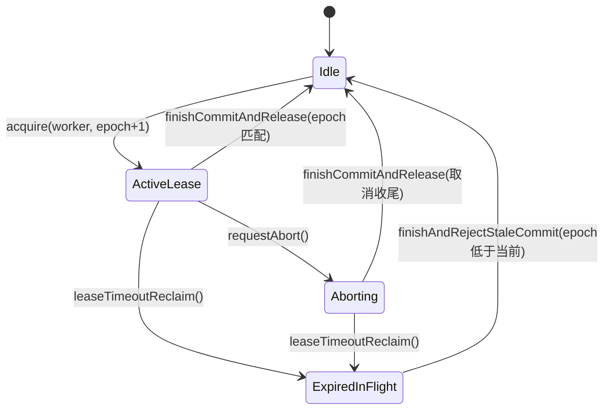
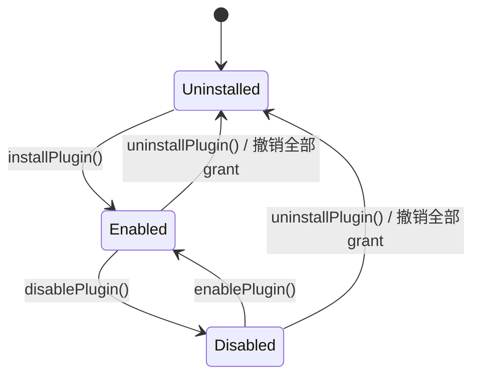
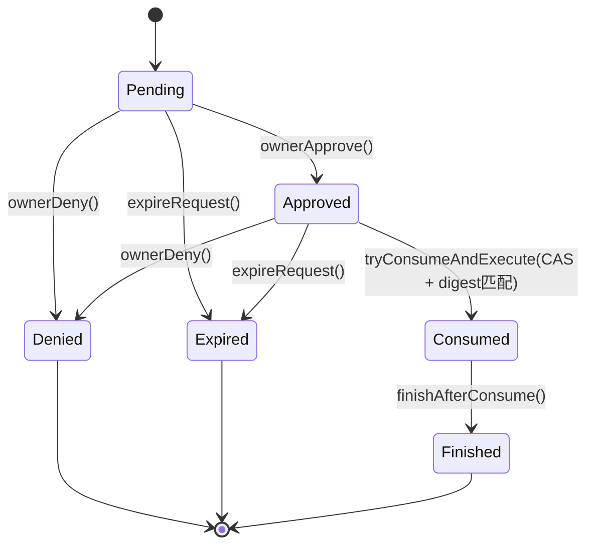
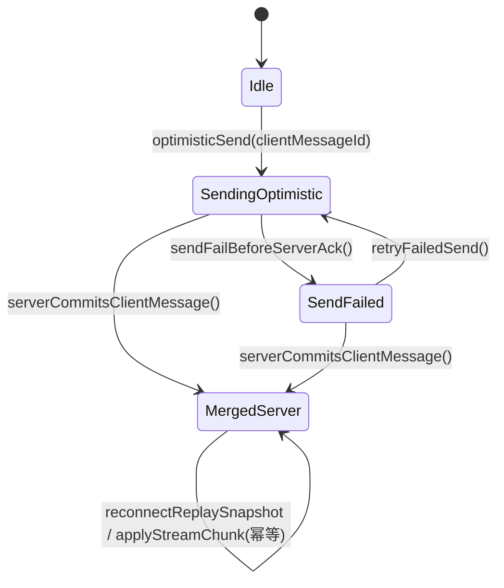

# ChisaBot 核心状态机形式化状态图与不变式清单

本文档记录通过确定性状态空间模型检验器（[model-checker.ts](file:///c:/AI/ChisaBot/shared/verification/model-checker.ts)）与 `fast-check` 随机属性测试进行穷举证明的核心状态机，以及每个检验器必须持续捕杀的注入缺陷变异体。

## 1. 会话回合租约与栅栏锁（`server/src/local-conversations.ts`）



- 证明文件：[formal-conversation-locks.test.ts](file:///c:/AI/ChisaBot/server/tests/formal-conversation-locks.test.ts)
- 核心不变式：`singleActiveLeaseExclusion`（单会话同一时刻至多 1 个未过期活动回合）、`fencingTokenProtectsLeaseAndTranscript`（旧 `epoch` 无法释放新锁或写入历史）、`committedEpochsStrictlyIncreasing`。
- 必杀变异体：释放锁漏检 `leaseEpoch`、迟到写回漏检栅栏令牌。

## 2. 插件授权、策略与审计三层状态机（`server/src/plugins/store.ts`）



- 证明文件：[formal-plugin-grants.test.ts](file:///c:/AI/ChisaBot/server/tests/formal-plugin-grants.test.ts)
- 核心不变式：`noImplicitPrivilegeEscalation`（仅 `enabled && Bot grant && policy=allow` 可直接免审执行）、`uninstallLeavesNoActiveGrants`、`everyDecisionLeavesAuditRecord`（每次允许/提示/拒绝裁决均留痕）。
- 必杀变异体：停用插件仍允许已有 `grant` 执行、拒绝路径漏记审计日志。

## 3. 一次性敏感操作审批门与多副本 CAS（`server/src/approvals/service.ts`）



- 证明文件：[formal-approval-gate.test.ts](file:///c:/AI/ChisaBot/server/tests/formal-approval-gate.test.ts)
- 核心不变式：`atMostOnceExecution`（多副本并发读写时 `executedCount <= 1`）、`payloadDigestBinding`（`actionDigest` 不一致绝不执行）、`ownerAuthorityRequired`、`consumedNeverMovesBackToPendingOrApproved`。
- 必杀变异体：多副本基于读时旧快照竞争放行导致二次执行、跳过 `actionDigest` 校验。

## 4. 前端聊天账本与重连快照合并（`app/src/lib/conversations/thread-sync.ts`）



- 证明文件：[formal-chat-ledger.test.ts](file:///c:/AI/ChisaBot/app/tests/formal-chat-ledger.test.ts)
- 核心不变式：`noDuplicateClientMessageRender`（重连后同 `clientMessageId` 至多显示 1 条）、`idempotentStreamChunkApplication`（重复分片绝不二次拼接）、`failureBeforeAckNeverPollutesAuthority`；并对真实导出函数 `applyStoredAnswer` 执行 `fast-check` 随机载荷属性测试。
- 必杀变异体：重连快照漏匹配 `clientMessageId` 产生消息双影、重复流式分片未去重导致正文翻倍。

## 运行命令

```powershell
bun test server/tests/formal-conversation-locks.test.ts server/tests/formal-plugin-grants.test.ts server/tests/formal-approval-gate.test.ts app/tests/formal-chat-ledger.test.ts
```
