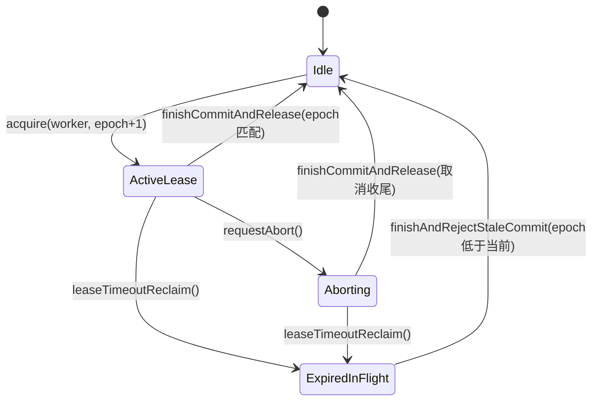
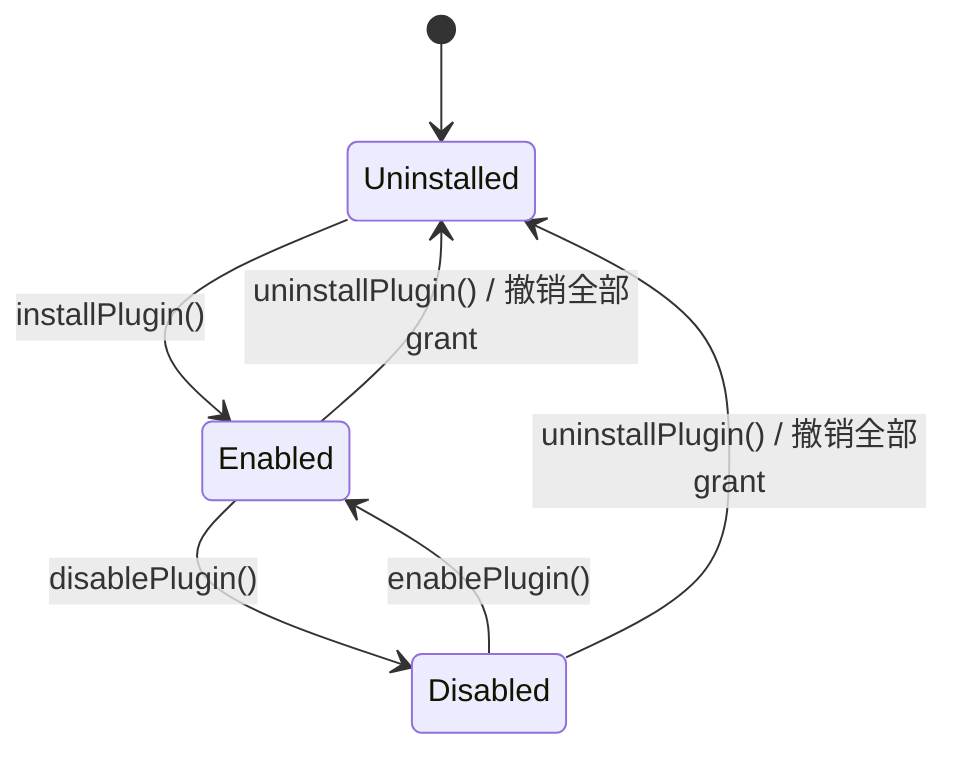
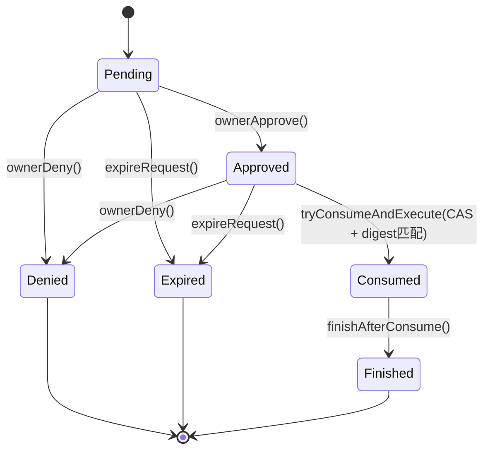
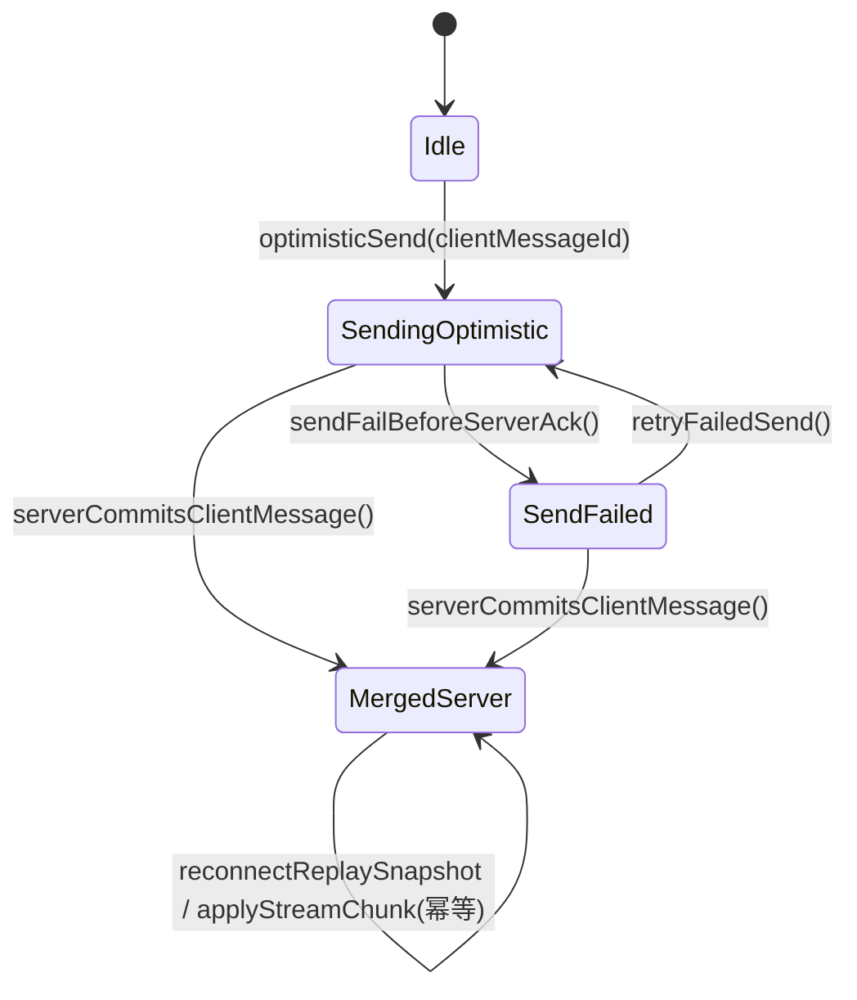
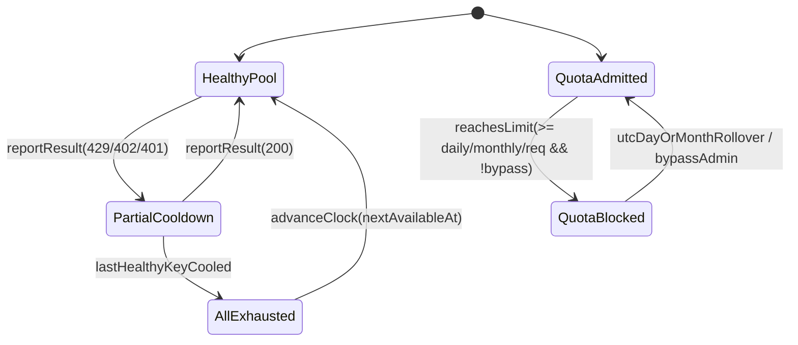
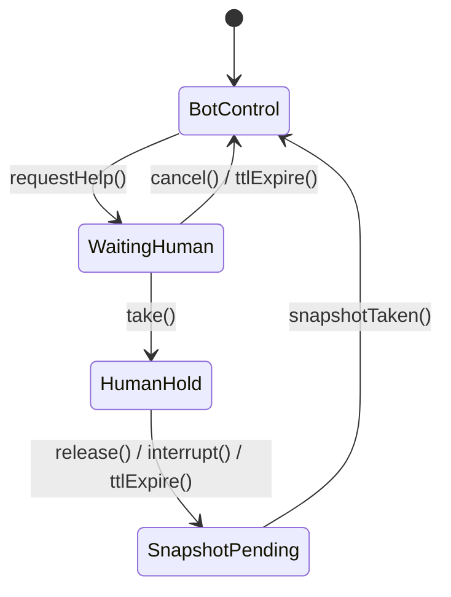
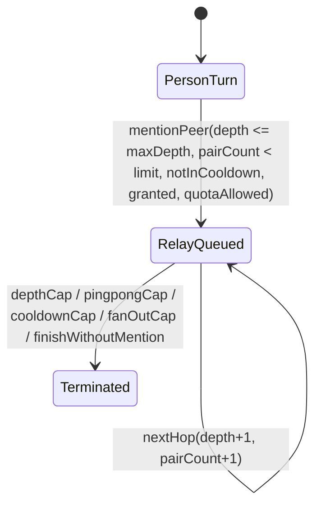
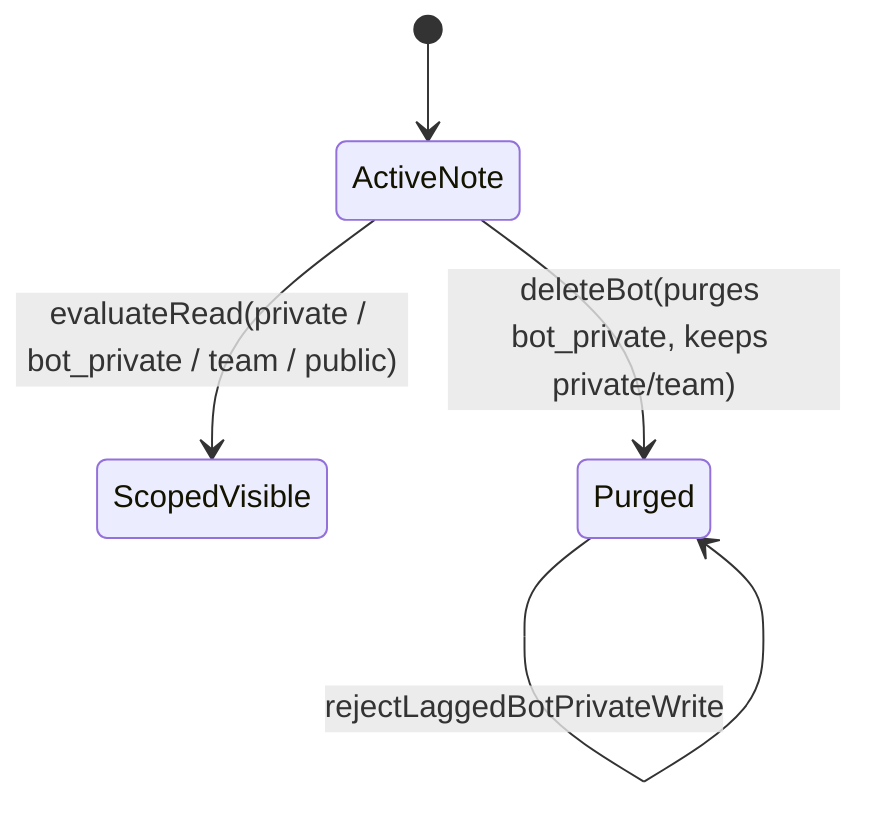

# ChisaBot 核心状态机形式化状态图与不变式清单

本文档记录通过确定性状态空间模型检验器（[model-checker.ts](file:///c:/AI/ChisaBot/shared/verification/model-checker.ts)）与 `fast-check` 随机属性测试进行穷举证明的核心状态机，以及每个检验器必须持续捕杀的注入缺陷变异体。

## 1. 会话回合租约与栅栏锁（`server/src/local-conversations.ts`）



- 证明文件：[formal-conversation-locks.test.ts](file:///c:/AI/ChisaBot/server/tests/formal-conversation-locks.test.ts)
- 核心不变式：`singleActiveLeaseExclusion`（单会话同一时刻至多 1 个未过期活动回合）、`fencingTokenProtectsLeaseAndTranscript`（旧 `epoch` 无法释放新锁或写入历史）、`committedEpochsStrictlyIncreasing`。
- 必杀变异体：释放锁漏检 `leaseEpoch`、迟到写回漏检栅栏令牌。

## 2. 插件授权、策略与审计三层状态机（`server/src/plugins/store.ts`）



- 证明文件：[formal-plugin-grants.test.ts](file:///c:/AI/ChisaBot/server/tests/formal-plugin-grants.test.ts)
- 核心不变式：`noImplicitPrivilegeEscalation`（仅 `enabled && Bot grant && policy=allow` 可直接免审执行）、`uninstallLeavesNoActiveGrants`、`everyDecisionLeavesAuditRecord`（每次允许/提示/拒绝裁决均留痕）。
- 必杀变异体：停用插件仍允许已有 `grant` 执行、拒绝路径漏记审计日志。

## 3. 一次性敏感操作审批门与多副本 CAS（`server/src/approvals/service.ts`）



- 证明文件：[formal-approval-gate.test.ts](file:///c:/AI/ChisaBot/server/tests/formal-approval-gate.test.ts)
- 核心不变式：`atMostOnceExecution`（多副本并发读写时 `executedCount <= 1`）、`payloadDigestBinding`（`actionDigest` 不一致绝不执行）、`ownerAuthorityRequired`、`consumedNeverMovesBackToPendingOrApproved`。
- 必杀变异体：多副本基于读时旧快照竞争放行导致二次执行、跳过 `actionDigest` 校验。

## 4. 前端聊天账本与重连快照合并（`app/src/lib/conversations/thread-sync.ts`）



- 证明文件：[formal-chat-ledger.test.ts](file:///c:/AI/ChisaBot/app/tests/formal-chat-ledger.test.ts)
- 核心不变式：`noDuplicateClientMessageRender`（重连后同 `clientMessageId` 至多显示 1 条）、`idempotentStreamChunkApplication`（重复分片绝不二次拼接）、`failureBeforeAckNeverPollutesAuthority`；并对真实导出函数 `applyStoredAnswer` 执行 `fast-check` 随机载荷属性测试。
- 必杀变异体：重连快照漏匹配 `clientMessageId` 产生消息双影、重复流式分片未去重导致正文翻倍。

## 5. 多 Key 粘性轮换池与每用户配额账本（`server/src/conversations/key-pool.ts`、`server/src/quotas/service.ts`）



- 证明文件：[formal-quota-keypool.test.ts](file:///c:/AI/ChisaBot/server/tests/formal-quota-keypool.test.ts)
- 核心不变式：`stickyStabilityWhenHealthy`（池健康时同一 `stickyKey` 选择结果稳定）、`healthyPoolNeverExhaustedAndExhaustedReturnsRetryAt`、`recoveryAfterCooldown` / `recoveryAfterLongCooldown`、`nonBypassedUserBlockedAtLimit`、`dailyNeverExceedsMonthly`。
- 必杀变异体：Key 冷却永不过期、粘性映射随机漂移、配额边界误用 `>` 放行、忽略管理员 `bypassAdmin=false` 开关。

## 6. 云端浏览器人工接管与恢复快照栅栏（`agent-computer/src/control.ts`）



- 证明文件：[formal-computer-takeover.test.ts](file:///c:/AI/ChisaBot/server/tests/formal-computer-takeover.test.ts)
- 核心不变式：`human-exclusive-bot-rejection`（`holder === "human"` 时拒绝一切 Bot 读/写动作）、`stale-snapshot-guard-after-release`（人工释放、中断或超时归还后必须重新采集 `snapshotTaken()` 方可恢复 Bot 变更操作）、`human-drive-only-when-holder`。
- 必杀变异体：绕过 `holder === "human"` 互斥校验、释放控制权时遗漏 `resumeSnapshotRequired = true`。

## 7. 多 Bot 群聊接力防死循环守卫（`server/src/channels/group.ts`）



- 证明文件：[formal-group-relays.test.ts](file:///c:/AI/ChisaBot/server/tests/formal-group-relays.test.ts)
- 核心不变式：`maxRelayDepthInvariant`（所有入队接力 `depth <= GROUP_RELAY_MAX_DEPTH`）、`pairPingpongAndTerminationInvariant`（单向 `(speaker -> peer)` 接力严格有界且所有环形/扇出路径有限步终止）。
- 必杀变异体：移除 `depth_cap` 导致三节点环突破深度上限、放松 `maxDepth` 且移除 `pingpong_cap` 导致双向乒乓失控。

## 8. 长期记忆四级隔离与删 Bot 清理（`shared/memory-notes.ts`、`server/src/memory-notes/service.ts`、`server/src/agents/purge.ts`）



- 证明文件：[formal-memory-visibility.test.ts](file:///c:/AI/ChisaBot/server/tests/formal-memory-visibility.test.ts)
- 核心不变式：`noCrossUserOrBotPrivateLeak`（跨用户、同主兄弟 Bot `bot_private` 与群聊场景全面隔离）、`deletedBotBotPrivatePurgedAndLaggedWriteBlocked`（删 Bot 清除 `bot_private` 且拦截滞后写入）、`sharedMappingAndReadOnlyPublic`、`searchAndTidyMatchReadPolicy`；同时验证 `<= 4000` 字符按 `(kind, id)` 确定的稳定前缀缓存。
- 必杀变异体：读校验遗漏 `agent_id` 导致兄弟 Bot 越权读取 `bot_private`、删 Bot 漏清旧 `bot_private`、未拦截已删 Bot 滞后写入、`isGroupChat` 漏检导致私人记忆渗入群聊。

## 运行命令

```powershell
bun test --timeout 15000 server/tests/formal-conversation-locks.test.ts server/tests/formal-plugin-grants.test.ts server/tests/formal-approval-gate.test.ts server/tests/formal-quota-keypool.test.ts server/tests/formal-computer-takeover.test.ts server/tests/formal-group-relays.test.ts server/tests/formal-memory-visibility.test.ts app/tests/formal-chat-ledger.test.ts
```
