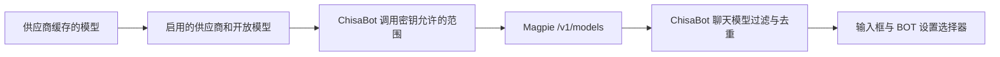

# Magpie 深度集成

[文档首页](README.md) · [模型配置与切换](models.md) · [部署说明](../deploy/README.zh-CN.md) · [维护与排错](operations.md)

Magpie 将多个模型服务、账户和路由规则放在一个网关后面。ChisaBot 保存一个网关连接，获取它开放的模型目录，再为每个 BOT 保存独立模型 ID。两边职责如下：

| ChisaBot | Magpie |
| --- | --- |
| 网页登录、BOT、对话与数据持久化 | 供应商连接、上游账户和访问密钥 |
| 聊天框及 BOT 设置中的模型选择 | 模型开放范围、账户路由与协议转换 |
| BOT 选择权限、工具权限和审计 | 上游额度、故障、模型可用状态与请求用量 |
| 本轮 BOT 模型快照与模型权限判断 | 将完整模型 ID 路由到相应供应商或路由组 |

ChisaBot 不去修改 Magpie 的每个客户端配置，也不从其私人配置文件读取上游密钥。模型目录与推理都使用 ChisaBot 保存的同一个网关连接。

## 部署 Magpie

Magpie 支持官方镜像、CLI 与 Web 界面。优先按本仓库 [部署模板](../deploy/README.zh-CN.md) 连接内部网络和登录网关，安装与版本细节参考 [Magpie 官方 Docker 说明](https://github.com/yetone/magpie/blob/main/docs/reference.md#docker) 与 [官方项目](https://github.com/yetone/magpie)。发布或长期运行时固定自己验证过的版本或镜像摘要。

| 接口 | 默认端口 | 用途 |
| --- | --- | --- |
| 模型网关 | `3425` | 模型目录与推理 API |
| Web 管理界面 | `3430` | 供应商、账户、调用密钥和设置 |

这两个接口不同。ChisaBot 的模型 API 地址应填写 `3425` 的网关前缀，管理入口应指向受到登录保护的 Web 界面，不能把 `3430` 的网页地址当作模型 API。

官方 CLI 的 Web 启动方式为：

```sh
magpie web --addr 0.0.0.0:3430 --no-open
```

该命令绑定容器或服务内部地址；哪些端口对外开放，以部署模板和反向代理配置为准。Web 管理密钥与模型网关调用密钥分别管理。不要把上游账户密钥或 Web 管理密钥填成 ChisaBot 的模型调用密钥。

服务端容器与 Magpie 位于同一网络时，可使用 `http://magpie:3425/v1`。服务名 `magpie` 只是模板示例，按自己的网络调整。容器内的 `127.0.0.1` 指容器自身，通常不能用它访问另一容器。

### ChisaBot 管理入口（遗留可选项）

> 自带内嵌管理控制台（管理后台 → 模型平台 Magpie → `/magpie-admin/`）后，本节的独立入口已不再是推荐做法，仅为兼容仍用它构建的旧部署而保留。新部署不需要设置。

曾用构建期 `VITE_MAGPIE_MANAGEMENT_URL` 指定一个受保护的 Magpie Web 管理地址，重新构建前端后，ChisaBot 管理页面会额外显示一个 **Magpie 模型管理** 公开链接入口。该值只提供公开网页链接，不是模型 API 基址，不影响目录或推理连接。

链接中不要包含 Web 管理密钥、上游密钥或账号密码；访问控制由网页登录网关及 Magpie 管理认证负责。未配置该值时不显示该额外入口，模型 API 连接仍可按管理员设置运行。

## 配置顺序

1. 在 Magpie **供应商（Providers）** 中添加自己使用的模型服务或账户，启用需要的供应商。
2. 在 Magpie 中确认希望向客户端开放的模型。上游缓存中的模型不一定全部对外开放。
3. 创建供 ChisaBot 使用的独立调用密钥，设置它的模型范围及其他限制。
4. 在 ChisaBot **管理 → 模型配置** 中选择兼容协议，填写网关 API 基址、调用密钥以及一个完整的默认模型 ID。
5. 测试连接并保存。打开 BOT 的模型选择器刷新，确认看到需要的供应商与模型。
6. 为一个 BOT 选模型并发送简短消息，查看 Magpie 用量/请求记录中的实际模型与状态；再给另一个 BOT 选不同模型，确认两者独立。

要让 ChisaBot 可以选择网关当前开放的全部模型，需要将其专用调用密钥的模型范围设为 **全部模型**，清除原先只允许一个模型的限制。仍可以按部署需要保留调用密钥的额度和其他约束。该操作不等于启用所有供应商，也不会让被供应商配置隐藏的模型自动出现。

## 协议和地址

ChisaBot 的协议表示**它向网关发送的协议**，不要求所有上游都使用相同协议。Magpie 可以在支持的接口间转换，但具体上游是否支持工具、流式输出或某种内容，仍需要实际验证。

| ChisaBot 协议 | 推荐 API 基址示例 | 目录请求 | 测试连接 / 推理入口 |
| --- | --- | --- | --- |
| OpenAI 兼容 | `http://magpie:3425/v1` | `GET /v1/models` | `POST /v1/chat/completions` |
| Anthropic | `http://magpie:3425/v1` | `GET /v1/models` | `POST /v1/messages` |

OpenAI 兼容请求使用 `Authorization: Bearer …`。Anthropic 请求使用 `x-api-key` 和 `anthropic-version: 2023-06-01`。它们由 ChisaBot 服务端按保存的连接生成，用户浏览器不直接携带这些密钥请求 Magpie。

不要把 `/v1/chat/completions`、`/v1/messages` 或 Web 管理 URL 当作 API 基址。ChisaBot 会在基址之后追加具体操作路径，填操作地址会导致路径重复。没有路径的地址规范化为 `/v1`；非空自定义路径保留，适配自己的代理前缀时要确认实际路由。

上游文档中 Anthropic SDK 可能使用无 `/v1` 的 Magpie 根地址。本分支采用自己的基址规范化与操作拼接方式，以此处 ChisaBot 配置表为准。

## 目录与调用密钥

目录经过多层选择：



“全部”指当前网关向该调用密钥开放的目录。它不等于所有供应商缓存的总和，不包含已禁用或隐藏的模型，也不保证全部上游调用成功。

ChisaBot 保留完整 `provider/model` ID。不能把 `provider-a/model-x` 改成 `model-x`；前缀是 Magpie 路由的一部分，同名模型可能属于不同供应商。路由组等网关返回的完整 ID 也应原样保存。

目录获取仅使用已保存的连接；API 调用者不能指定新的 URL。服务端提供 30 秒缓存，选择器刷新对应 `GET /api/models?refresh=1`。更换连接或密钥后，缓存与旧连接隔离。目录投影与边界见 [模型目录实现](models.md#目录缓存和运行快照)。

## 每 BOT 选择与请求链路

ChisaBot 保存 `agents.override.model`，不会为每个 BOT 复制 Magpie 密钥。聊天输入框和 BOT 设置使用同一个服务端值，保存成功后同步，重启不会重置。

```text
用户选择完整 ID
  → ChisaBot 检查 BOT 权限与当前目录
  → 保存这个 BOT 的 model 覆盖值
  → 下一轮解析全局连接 + BOT 覆盖模型
  → 权限、用量判断和模型执行共用本轮快照
  → 按保存的协议请求 Magpie
  → Magpie 路由、转换并调用上游
  → 回复回到 ChisaBot 的持久化会话
```

正在输出的回复保持本轮已经解析的连接，切换影响后续轮次。路由选择、标题与语音摘要等辅助调用仍用部署默认模型。独立远程 AG-UI BOT 在其远程服务选择模型，不使用 ChisaBot 的本地覆盖。

## 用量与可用性验证

推荐用一条无工具的简短消息验证，随后分别检查：

1. BOT 设置返回的是选中的完整 ID。
2. Magpie 请求记录中的实际模型、上游状态和协议转换方向。
3. ChisaBot 收到正常完成事件，并能重新打开已保存回复。

目录获取成功，只验证了 `/models` 可访问。管理页面测试默认模型成功，也只验证了这个模型当时的短推理请求。完整对话、工具调用和其他模型仍需按实际使用场景验证。

Magpie 可能将请求在协议之间转换；确认实际模型 ID 比只查看客户端注册名称更可靠。ChisaBot 内部会为频道注册本地运行标识，但请求网关时应使用 BOT 的真实模型 ID。

## 常见问题

| 现象 | 检查顺序 |
| --- | --- |
| Magpie 有很多模型，ChisaBot 只有一个 | 供应商启用状态 → 开放模型 → ChisaBot 专用调用密钥是否限制为单模型 → 选择器刷新 |
| 模型列表 `401` / `403` | 是否用了网关调用密钥 → 该密钥是否启用 → 允许范围与网关访问限制 |
| 列表正常，某个模型 `403` | 完整 ID → 上游账户是否授权该模型 → Magpie 请求记录；目录出现不代表上游授权通过 |
| 找不到接口或模型 | API 基址是否为网关 `/v1` → 是否错误指向 GUI → 是否缺供应商前缀 |
| `429` 或间歇失败 | 调用密钥限额、上游账户额度、路由组规则与服务商状态 |
| 更换供应商后 BOT 仍用旧模型 | BOT 有独立覆盖值；重新选当前目录中的 ID，或选择“部署默认” |
| 列表加载失败但需要恢复默认 | 选择“部署默认”；清除覆盖值不依赖目录请求成功 |
| GUI 能打开，但应用连不到网关 | ChisaBot 服务端容器的网络/DNS/端口，不能以用户浏览器连通来代替服务端连通 |

一般运维检查、备份与升级见 [维护与排错](operations.md)。

---

# Magpie 模型平台接入指南

ChisaBot 把自托管的 [Magpie](https://github.com/yetone/magpie)（`ghcr.io/yetone/magpie`）作为默认模型网关：所有机器人的聊天、长期任务和面板请求都经由 Magpie 转发，模型列表也从 Magpie 同步。Magpie 的管理控制台直接内嵌在 ChisaBot 的「管理后台 → 模型平台 Magpie」里，沿用 ChisaBot 登录，不再需要单独的入口。

## 架构

```
浏览器 ──HTTPS──▶ 登录网关 (nginx :8443) ──▶ ChisaBot (127.0.0.1:3001)
                                              │  /api/…              ChisaBot 自身
                                              │  /magpie-admin/…     反向代理 → magpie:3430（管理控制台）
                                              └─ 模型请求            → magpie:3425/v1（网关 API）
```

- **网关 API**：ChisaBot 容器通过 Docker 网络 `openbot_magpie` 访问 `http://magpie:3425/v1`，使用 Magpie 中名为 `ChisaBot` 的调用密钥（caller key）。该密钥加密保存在 ChisaBot 数据库（「管理后台 → 模型设置」），不会出现在浏览器里。
- **管理控制台**：ChisaBot 服务器在 `/magpie-admin/` 下反向代理 `http://magpie:3430`。代理在服务端注入 Magpie 的 Web key（Cookie `magpie_web_3430`），并把控制台里的 `/api/…` 调用改写到 `/magpie-admin/api/…`。

## 部署配置

`/opt/chisabot-zh/compose.yaml`（ChisaBot 服务）：

```yaml
    volumes:
      # Magpie web key，仅容器内的 API 用户（uid 1002）可读。
      - ./secrets/magpie-web.key:/etc/chisabot/magpie-web.key:ro
    environment:
      MAGPIE_ADMIN_URL: http://magpie:3430
      MAGPIE_WEB_KEY_FILE: /etc/chisabot/magpie-web.key
      MODEL_CATALOG_REFRESH_MINUTES: "10"
```

Web key 文件从 Magpie 的私密配置复制，权限 `0400`、属主 `1002:1002`：

```sh
install -d -m 700 /opt/chisabot-zh/secrets
install -m 400 -o 1002 -g 1002 /opt/magpie/private/web.key /opt/chisabot-zh/secrets/magpie-web.key
```

> 使用文件而不是环境变量：容器内的环境变量对机器人计算机的用户可读，文件只给 API 用户读。重新生成 Magpie Web key 后需要重新复制文件并重启 ChisaBot。

| 变量 | 作用 | 默认 |
| --- | --- | --- |
| `MAGPIE_ADMIN_URL` | Magpie 管理端地址（容器网络内）。未设置时「模型平台 Magpie」页显示未配置。 | 无 |
| `MAGPIE_WEB_KEY_FILE` / `MAGPIE_WEB_KEY` | Magpie Web key（16+ 位 `A-Za-z0-9-._~`）。缺少时只能显示连接信息，不能读取提供方状态或内嵌控制台。 | 无 |
| `MODEL_CATALOG_REFRESH_MINUTES` | 模型列表后台自动同步间隔（分钟），`0` 关闭。 | `10` |

## 模型接口（默认走 Magpie）

「管理后台 → 模型设置」保存的连接（当前）：

- 协议：Anthropic（Magpie 同时提供 OpenAI 兼容接口，两者都可以）
- 接口地址：`http://magpie:3425/v1`
- 默认模型：`opencode-zen/mimo-v2.6-flash-free`
- API Key：Magpie 的 `ChisaBot` 调用密钥（只保存在服务器）

仍然可以在「模型设置」里换成任何 OpenAI 兼容或 Anthropic 接口（如 MiniMax、New API）；compose 中的 `BOT_MODEL` / `OPENAI_BASE_URL` 只是在数据库没有保存连接时的后备。

> 阶跃星辰（StepFun）提供方因实名认证限制当前不可用，已在 Magpie 中停用，不要设为默认。

## 模型同步

- 来源：`GET {接口地址}/models`（Magpie 返回在 Magpie 中勾选开放给网关的模型，带 `display_name` 和 `magpie_label`，例如 `MiMo-V2.6-Flash Free · OpenCode Zen`）。ChisaBot 从 `magpie_label` 取提供方名称，用于选择器分组。
- 何时同步：服务启动后约 3 秒、每 `MODEL_CATALOG_REFRESH_MINUTES` 分钟、模型选择器或「模型平台 Magpie」页点「刷新 / 立即同步模型」时；在内嵌控制台里保存了设置（任意 `/api/…` 写操作成功）后，下一次读取会立即重新同步。
- 缓存：成功结果缓存 10 分钟；网关暂时不可用时，普通读取继续返回上一次的列表（`stale: true`，选择器底部提示），手动刷新则报告失败。
- 提供方健康：`/api/models` 在来源是 Magpie 时附带 `providers: [{ id, name, ready, enabled }]`（来自 Magpie 管理接口，缓存 60 秒），选择器在分组标题旁显示状态点（绿 = 就绪，红 = 未就绪，灰 = 已停用）。

## 管理后台 → 模型平台 Magpie

- `/admin/magpie`：网关状态、Magpie 版本、就绪的提供方、可用模型数、上次同步；ChisaBot 接入信息（是否经由 Magpie、接口地址、默认模型、同步状态）；提供方列表。
- `/admin/magpie/console`：内嵌的 Magpie 控制台（iframe，同源 `/magpie-admin/`），可「重新载入」或「新窗口打开」。
- 接口：`GET /api/admin/magpie[?refresh=1]` 返回 `MagpieOverview`（`shared/model-selection.ts`），只含安全字段。

## 安全

- 只有 ChisaBot 管理员能访问 `/api/admin/magpie` 和 `/magpie-admin/*`（服务端 `requireAdmin`）；公网请求先经过登录网关的会话校验。
- Magpie Web key 只在 ChisaBot 服务端使用，浏览器的 Cookie / Authorization 不会转发给 Magpie，Magpie 返回的 `Set-Cookie` 被丢弃。
- Magpie 本身不校验 Origin，所以代理对非 GET 请求要求同源（`Origin` 与 `Host` 一致、`Sec-Fetch-Site` 不是跨站），否则返回 403。
- 代理响应带 `Content-Security-Policy: frame-ancestors 'self'`，只允许 ChisaBot 自己内嵌；它在现代浏览器中优先于登录网关统一添加的 `X-Frame-Options: DENY`，因此无需修改网关配置。
- 模型网关 API（`:3425`）和管理端口（`:3430`）仍只绑定 loopback / Docker 网络。

## 旧的独立入口

登录网关上的 `https://<域名>:2053`（同样需要 ChisaBot 登录）保留不变，可作为备用入口；`VITE_MAGPIE_MANAGEMENT_URL` 不再用于导航，界面统一跳到内嵌页面。

## 回滚

`/opt/chisabot-zh/rollback-to-glass-20261010k.sh`：恢复 `compose.yaml.before-glass-20261010l`（镜像 `glass-20261010k`，去掉 Magpie 环境变量和挂载）并重建容器。

## 版本与更新（一键升到最新）

镜像是**标签**，不是写死的摘要（`deploy/magpie.compose.yaml` 里是 `${MAGPIE_IMAGE:-ghcr.io/yetone/magpie:latest}`）。
「管理后台 → 模型平台 Magpie」的「网关版本与更新」卡可以就地升到该标签的当前版本，不用上服务器敲命令。

- **「有没有新版」比的是镜像摘要**，不是版本号：Magpie 的镜像只有标签，版本号要问它自己的接口（卡片上「当前版本」那一行）。
  摘要一样 = 没有新版；**查不到远端摘要时说「未知」，不说「已是最新」**。
- **宿主机每 30 分钟查一次** registry 的 manifest（`deploy/updater/magpie.sh --check`：只读，不拉镜像、不碰容器，
  所以不占更新锁），结果写 `spool/state/magpie.json`；点「检查更新」会立刻查一次。
- **点「更新到最新版」**排队一个 `magpie` 请求，宿主机 `chisabot-updater` 执行：先 `docker compose pull`（拉不动就
  不动正在跑的容器）→ `up -d` 重建 → 健康检查。**健康检查不过会自动回退到上一版摘要**，并把这次更新报成失败。
  它和 ChisaBot 自己的更新**共用一把锁**，两者不会同时跑。
  - 回退的做法是把旧镜像**重新打回那个标签**再重建，所以 compose 里写 `${MAGPIE_IMAGE}` 还是写一个固定标签都成立。
    早期实现只靠环境变量插值，遇到固定标签会**静默不生效**（看起来回退了、其实还在跑新镜像）——回退不能交给插值。
- **应用容器没有 docker socket**，所以页面上的按钮只是排队，真正干活的是宿主机上的更新程序（[online-update.md](online-update.md)）。
  更新程序太旧（低于 `SYSTEM_UPDATE_UPDATER_VERSION`）时页面不给按钮，而是提示先做一次系统更新。
- **想钉住自己验证过的版本**：把 `MAGPIE_IMAGE` 设成一个摘要（`deploy/.env`、compose 的 `environment`，或
  `deploy/updater/config.env`）。钉住之后仍然按摘要比，只是要手动改那个值。

配置项（`deploy/updater/config.env`）：

| 变量 | 默认 | 说明 |
|---|---|---|
| `MAGPIE_DIR` | `/opt/magpie` | 目录里要有 `compose.yaml` |
| `MAGPIE_IMAGE` | `ghcr.io/yetone/magpie:latest` | 镜像引用；想钉版本就写摘要 |
| `MAGPIE_CONTAINER` | `magpie` | 容器名 |
| `MAGPIE_PROBE_URL` | `http://127.0.0.1:3430/` | 健康探测地址（有 HTTP 响应就算活着） |
| `MAGPIE_HEALTH_TIMEOUT_SEC` | `60` | 健康检查等多久才判失败并回退 |
