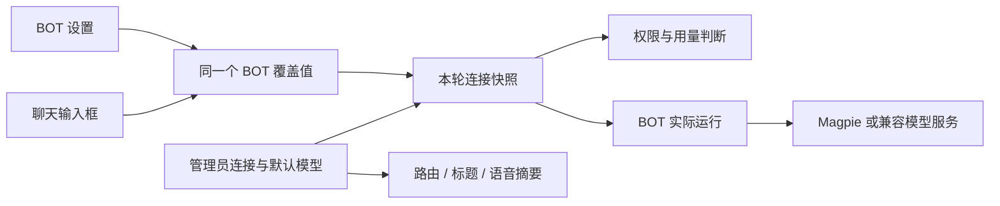

# 模型配置与 BOT 模型切换

[文档首页](README.md) · [快速开始](getting-started.md) · [Magpie 深度集成](magpie.md) · [维护与排错](operations.md)

## 三层设置

| 层级 | 管理位置 | 作用 |
| --- | --- | --- |
| 模型连接 | 管理 → 模型配置 | 整个部署共用的协议、API 基址与密钥 |
| 部署默认模型 | 管理 → 模型配置 | 未指定独立模型的 BOT，以及辅助模型调用 |
| BOT 模型覆盖 | 聊天输入框、BOT 设置 | 这个 BOT 后续对话使用的模型 ID |

目前一个部署使用一个活动模型连接。BOT 选择会覆盖模型 ID，沿用活动连接的协议、地址和密钥。需要在同一连接中选择多个供应商时，由 Magpie 在一个网关后统一提供这些模型。

有效模型的计算规则：

```text
BOT 有独立覆盖值 → 使用该值
BOT 的覆盖值为 null → 使用部署默认模型
```

部署默认模型的修改不会抹掉已有 BOT 覆盖值。复制 BOT 会保留其模型选择，之后各自独立保存。

## 管理员配置连接

在管理模型页面填写以下字段：

| 字段 | 含义与示例 |
| --- | --- |
| 协议 | `openai`（OpenAI 兼容）或 `anthropic` |
| API 基址 | 例如 `http://magpie:3425/v1`，必须能从 ChisaBot 服务端访问 |
| 默认模型 | 完整模型 ID；Magpie 示例为 `provider/model-name` |
| 使用 API Key | 需要鉴权时启用；无密钥本地兼容服务可关闭 |
| API Key | 由服务端加密保存，浏览器读取配置时只获知是否存在密钥 |

点击 **测试连接** 会使用表单中的协议、地址和模型发起短推理请求，并不会保存配置。确认成功后点击保存。保存成功也不等于网关内所有模型都可调用，需要针对实际使用的模型验证。

同一协议、同一地址下，密钥输入留空可沿用已保存密钥；更换协议或地址时，需填写新密钥或选择不用密钥。已有数据库保存的连接优先于启动环境回退值，直接改环境变量不一定改变当前活动连接。

地址不能包含用户名、密码、查询参数或锚点。没有路径时会规范化到 `/v1`；已有路径会保留，因此建议明确填写正确的 API 前缀，不要填 `/chat/completions` 或 `/messages` 等操作地址。详见 [Magpie 协议说明](magpie.md#协议和地址)。

## BOT 模型选择

在聊天输入框打开模型选择器，搜索展示名称、供应商或完整 ID，然后选择模型。也可以打开同一个 BOT 的设置修改。两处共用服务端保存的值，没有两份独立草稿。同一个 BOT 的多个聊天或频道共用这个选择，模型不按每条会话单独保存。

保存成功才会更新显示并发送同步通知；失败会保留原设置。本页保存模型期间会阻止发送新消息，避免新消息抢先使用旧配置。已开始的回复继续使用本轮已确定的连接，下一轮使用新选择。

跨标签页通过 `BroadcastChannel` 和浏览器存储通知重新读取服务端状态；回到页面时也会重新读取。通知只携带 BOT 标识，不携带模型密钥。不同设备不会收到浏览器广播，回到页面或重新加载时可读取最新服务端值。

选择 **部署默认** 会删除 `agents.override.model`，随后跟随部署默认模型。该覆盖值保存在数据库中，应用重启或租户包启动同步不会重置它。

## 谁可以修改

| BOT / 操作 | 权限 |
| --- | --- |
| 修改全局模型连接与默认模型 | 登录的管理员 |
| 修改自己拥有、由本部署执行的 BOT | BOT 所有者或管理员 |
| 修改系统 BOT 的模型 | 管理员；仅模型覆盖，不开放其他系统配置修改 |
| 查看别人的 BOT | 按原有 BOT 可见性判断；可见不代表有权修改 |
| 独立远程 AG-UI BOT | 模型由远程服务管理，不提供本地切换 |

这是应用角色授权，与服务器操作系统的 `root` 登录无关。BOT 删除或所有权变化时，保存操作会在事务内重新检查权限，避免使用旧页面绕过限制。

## 模型目录的含义

目录来自活动连接的 `/models`，保留完整 ID并去重。对有明确标记的纯图像、视频、嵌入、语音等非聊天模型进行筛除；可以输出文本的多模态聊天模型不会仅因使用其他接口而被排除。

目录不代表服务商所有模型，也不是所有模型都通过了推理测试。Magpie 的供应商启用状态、开放模型以及调用密钥模型范围共同决定目录。详见 [目录与调用密钥](magpie.md#目录与调用密钥)。

选择的模型后来被移除时，覆盖值仍可查看，选择器会提示该模型不在当前目录。可刷新后重新选择，或恢复默认。目录暂时加载失败时，读取已有选择和清除覆盖值仍可进行；设置新模型需要可用的目录来校验。

## API 与保存结构

接口使用正常登录鉴权；写入还要通过应用的来源检查。浏览器不传入任意目录 URL，不持有供应商密钥。

| 接口 | 结果 |
| --- | --- |
| `GET /api/admin/model-settings` | `{ config }`，含 `hasApiKey` 与 `source`，不返回密钥 |
| `PUT /api/admin/model-settings` | 保存全局连接，返回 `{ config }` |
| `POST /api/admin/model-settings/test` | `{ ok, message, latencyMs }`，只测试表单连接 |
| `GET /api/models` | `{ models, fetchedAt }` |
| `GET /api/models?refresh=1` | 请求刷新目录 |
| `GET /api/agents/:agentId/model` | 返回 `AgentModelState` |
| `PUT /api/agents/:agentId/model` | 接收且只接收 `{ "model": "完整ID" }` 或 `{ "model": null }` |

`AgentModelState` 示例只使用占位 ID：

```json
{
  "agentId": "example-bot",
  "model": "provider/model-a",
  "overrideModel": "provider/model-a",
  "defaultModel": "provider/model-default",
  "available": true,
  "canManage": true
}
```

`available` 表示该 BOT 是否由本部署执行并支持选择模型，**不表示模型在目录中或上游健康**。`canManage` 表示当前用户可否保存覆盖值。

全局连接存于 `enterprise_settings` 的 `model_connection` 设置，密钥经凭据服务加密保存。BOT 仅在 `agents.override.model` 保存模型 ID，与其他覆盖字段合并，不复制协议和密钥。

常见响应：未登录 `401`，无权修改 `403`，找不到 BOT `404`，无效或不在目录中的 ID `400`，远程 BOT 或目录无法用于选择时 `409`，服务暂不可用 `503`。错误文字只使用安全分类，不回传原始上游错误或密钥。

## 目录缓存和运行快照

服务端目录缓存 30 秒，并将同一连接的并发请求合并。刷新绕过有效期缓存，但会共享正在进行的同连接目录请求。缓存按协议、规范化地址、鉴权模式和密钥摘要区分；切换连接后，旧请求不会覆盖新连接的目录。

目录请求的连接及响应读取均限时 15 秒，响应最多 2 MiB、最多 10,000 条；不接受声称还有下一页的响应，不跟随重定向。只投影 `id`、`label`、`provider` 与可选 `contextWindow`，不透传上游任意字段。

每次浏览器或后台运行使用独立的 `AsyncLocalStorage` 范围。全局连接及每 BOT 连接各缓存一个本轮解析 Promise，让策略检查、模型权限、用量归属和实际执行看到同一个模型及密钥快照。已解析的运行不会因为管理员中途改连接而拼接新旧配置。

BOT 对话使用其覆盖模型；辅助路由、标题生成与语音摘要等沿用全局默认模型。模型切换不会将这些辅助调用全部改为 BOT 的模型。



## 源码入口

- [全局连接保存与测试](../server/src/model-settings.ts)
- [API 地址规范化](../shared/model-base-url.ts)
- [目录抓取、过滤与缓存](../server/src/model-catalog.ts)
- [BOT 选择事务与权限](../server/src/agents/model-selection.ts)
- [安全共享类型](../shared/model-selection.ts)
- [每次运行的连接快照](../server/src/model-connection-context.ts)
- [前端查询与同步](../app/src/lib/model-selection/queries.ts)、[跨标签通知](../app/src/lib/model-selection/sync.ts)

## 额度用完时自动换模型（2026-10-15）

聊天回合的模型调用在还没输出任何内容前被拒（HTTP 429 / 402，或错误里写着 quota / daily limit / 额度），服务器立刻换一个候选模型
重发，并把被拒的模型冷却到错误里写的恢复时间（读不出来就 10 分钟，最多 24 小时）。

- 候选：`CHISABOT_MODEL_FALLBACKS=模型id,模型id`；`CHISABOT_MODEL_FALLBACKS=off` 关闭。没设时取模型目录里与当前模型同一平台前缀
  （例如 `clinepass/`）的其它模型，按目录顺序最多 3 个。
- 其它错误不回退；管理员自检不回退。日志：`{"type":"model-fallback","event":"primary-quota"|"used",…}`。
- 代码：`server/src/agents/model-fallback.ts`；见 DESIGN.md「成熟度 1」一节。

## 备用模型（管理员排序，2026-10-15）

设置 → 模型 →「备用模型」：主模型额度用完（429 / 402 / quota）或模型服务 5xx / 过载时，按这里排好的顺序换下一个（最多 8 个）。

- 优先级：这里的列表 → `CHISABOT_MODEL_FALLBACKS` → 同平台自动挑选。列表为空 = 不指定。
- 存在 `enterprise_settings`（key `model_fallbacks`），接口 `GET/PUT /api/admin/model-fallbacks`（仅管理员），服务端缓存 30 秒。
- 冷却：额度按错误里写的恢复时间；5xx 2 分钟。400 / 401 / 网络错误不换。
- 换过的那一轮，对话末尾一行淡色小字「主模型额度用完，已改用 X」（`GET /api/copilotkit/threads/:id/fallbacks`）。
- 管理员自检 `/api/admin/smoke` 也走回退，结果里 `fallback` 写明换成了谁。
- 代码：`server/src/agents/model-fallback.ts`、`server/src/agents/model-fallback-settings.ts`、`app/src/components/settings/fallback-models.tsx`；见 DESIGN.md §61。
