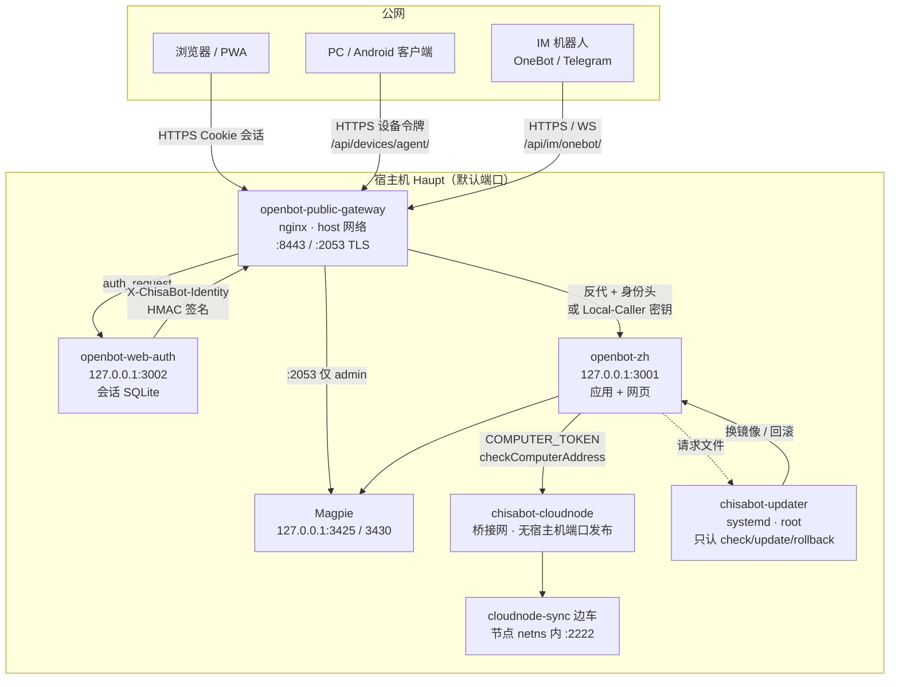

# 网关 / 节点信任边界（PRD-P1-05）

[← 运维手册总览](README.md) · 相关：[gateway.md](gateway.md)、[hosts.md](hosts.md)、[cloud-node.md](cloud-node.md)、[pc-node.md](../pc-node.md)

一页图：谁可以直连谁、身份头从哪来、哪些口绝不能对公网开放。

## 1. 总览

## 2. 谁可直连谁

| 来源 | 可直连 | 不可直连 | 身份怎么证明 |
|------|--------|----------|--------------|
| 公网浏览器 | 仅网关 `:8443` | `3001` / `3002` / Magpie / 节点 | Cookie 会话 → 网关 `auth_request` → `X-ChisaBot-Identity` |
| PC / 手机客户端 | 网关 `/api/devices/agent/`（**免浏览器登录**） | 应用 loopback | 设备令牌；网关在该路径**清空**身份头防伪造 |
| IM 适配器 | 网关 `/api/im/onebot/` | 同上 | `Authorization`；仅此处允许无 Origin 的 WS 升级 |
| 宿主机脚本 / 烟雾 | `127.0.0.1:3001` | — | `X-ChisaBot-Local-Caller: $CHISABOT_GATEWAY_SECRET`（与网关密钥同值） |
| 应用 → Magpie | loopback `3425` | 公网直连 Magpie 管理口 | 管理口经网关 `:2053` + admin 角色头 |
| 应用 → 电脑节点 | 节点桥接 IP（经 `locate` + 地址检查） | 节点任意出网打私网（防火墙丢） | `COMPUTER_TOKEN`；`checkComputerAddress` 拒外站 |
| 云端节点出站 | 公网（可选经出口代理） | 私网 / 元数据 / 宿主机（`DOCKER-USER`） | 节点防火墙；浏览器导航另有 SSRF 地板 |

## 3. 身份头规则（硬）

- **网关模式开**（配置了 `CHISABOT_GATEWAY_SECRET`）：缺 `X-ChisaBot-Identity` / `X-ChisaBot-Local-Caller` 的请求**不是**管理员，也不能冒充用户。
- **单用户模式**（未配网关密钥）：整站视为本地管理员——**绝不能**把 `3001` 暴露到公网。
- 设备代理、IM、公开页 `/p/`：网关必须**去掉**身份头，避免客户端自带伪造头。
- Local-Caller 密钥与登录服务 `identitySecret`、应用 `.env` 三处一致；轮换要一起改。

## 4. 出站信任（SSRF / 出口）

服务器替用户取 URL（链接预览、`web_fetch`、vault、MCP、图片下载）一律走 `shared/net/guardedFetch`：

- DNS 解析后钉死公网 IP；重定向逐跳重检；
- 拦 RFC1918 / loopback / 链路本地 / CGNAT / 映射 IPv6 / NAT64 / 6to4 / Teredo；
- 拒绝时打 `SSRF_DENIED` 预算计数（见 [production-checklist.md](../production-checklist.md)）。

电脑流浏览器导航另有 `checkNavigationTarget` + 节点防火墙双层。

## 5. 部署时别踩的坑

1. 不要把 `3001`/`3002`/`3425` publish 到 `0.0.0.0`。
2. 回滚网关前先去掉应用 `.env` 的 `CHISABOT_GATEWAY_SECRET` 并重建，再换旧 nginx（见 [gateway.md](gateway.md) §4）。
3. 更新器只接受 `check` / `update` / `rollback` 三种请求文件，不执行请求里的任意字符串。
