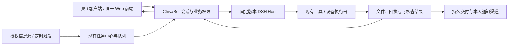

# ChisaBot 个人助理生产交付计划

> **状态：已实施完成（`v0.1.138`–`v0.1.143`）**。计划内的产品契约修补、桌面与手机布局对齐、持久交付恢复及连续操作体验收口均已合入主线并发布；详细验收记录见[个人助理实施记录](pipeline-runs/20261108-assistant-production.md)与[连续操作体验记录](pipeline-runs/20261111-smooth-experience.md)。

日期：2026-11-08（Asia/Shanghai） · 状态：已实施完成（v0.1.138–v0.1.143）。

目标：让 Chisa 在已安装桌面客户端中，长期使用一个可靠的个人助理；服务器能够持续执行、准确交付、发现故障并恢复。首个生产范围是单用户私人部署，保留现有 React 界面和 DSH 内核。

## 1. 决策：已有能力继续用，修补真实缺口后放行

**此前开发已经构成个人助理的主体。现在需要的是一轮生产收尾，不是重新选框架、重写任务中心或再做一套客户端。**

当前已实现对话与工具、记忆、技能、个人信息源、晨报、定时任务、后台 worker、任务中心、设备操作、审批和持久恢复。之前把“个人账号尚未连接日历/邮箱”说成能力不足不准确；旧功能目录也把已经实现的晨报写成“未做”。本计划以当前源码和运行证据为准。

生产放行尚有三个层次的工作：

1. **修产品合同**：来源失败不能说成“没有新内容”；任务不能只有总结就算完成；邮件/通知的未知结果不能当作可重试失败；凭据不经过普通模型参数；日历重复事件与时区要正确。
2. **补实际使用链路**：在正式桌面端连接真实授权源，验证读取、完成任务、审批、本人收件、关闭重开。当前隔离和内部接口证据继续有效，但不能替代这条路径。
3. **完成可维护发布**：把当前运行代码变成可追溯版本，补 DSH 健康监控、完整周期备份、保留策略和可用回滚，处理遗留预览环境与旧配置。

推荐按下文 P0–P5 执行。实现与预览验证完成后发布候选，经正式用户路径验收和七天连续使用观察，再标记为“个人生产版本”。七天是本计划的观察窗口，不是现有稳定性结论。

## 2. 本轮依据与已确认状态

| 项目         | 当前事实                                                                                                                 | 对计划的影响                                           |
| ------------ | ------------------------------------------------------------------------------------------------------------------------ | ------------------------------------------------------ |
| 核心执行     | 生产使用 DSH `0.2.2-rc.1`，Chisa 独立 Host；生产执行依赖已移除 旧聊天前端框架                                            | 固定现版本，沿公开 Host/Session 接口改进；不再迁移内核 |
| 单用户       | 用户要求清理后，只保留 Chisa 和一个生产 DSH Host                                                                         | 不重建测试账号；功能保持单用户易用，保留现有权限边界   |
| 用户数据     | Chisa 的 426 条对话、87 个聊天文件保留；七条记忆笔记                                                                     | 迁移、更新、清理不得以删除历史换稳定性                 |
| 个人连接     | 日历、邮箱、通知 Webhook 尚未连接；IM 未连接                                                                             | 连接是启用任务；对应可靠性缺陷另列为代码工作           |
| 定时状态     | 唯一既存定时任务为 `paused / waiting`                                                                                    | 保持暂停；验收另建明确的短期任务，不能悄悄恢复旧任务   |
| 已有证据     | R5 的 E01–E18 覆盖模型/工具、审批、Stop、恢复、前端、升级回滚等                                                          | 未受新改动影响的证据复用，不从头重跑整个迁移           |
| 桌面实用证据 | Electron 加载服务器同一前端；尚缺当前正式安装版本、真实登录与实际设备执行的完整验收                                      | 首要补验对象是桌面端和服务器；Android 截图不替代       |
| 发布身份     | 起草时基线 `9a00ed62`、版本 `0.1.137`，生产使用手工归档镜像；实施后已将迁移源码保存为 `e6ad6934`，本轮候选身份见实施记录 | 旧基线 SHA 不能代表新增实现；发布须绑定实际源码与镜像  |

详细实现定位见 [本地能力核对](research/20261108-assistant-capability-baseline.md)；迁移证据见 [R5 实施记录](pipeline-runs/20261107-dsh-migration.md)。上述计数是核对时快照，后续正常使用会变化。

计划起草时的只读运维快照如下；完整备份、保留策略调整与当前可达性以[实施记录](pipeline-runs/20261108-assistant-production.md)为准：

- 更新器读取 `ChisaAlter/ChisaBot` 的 `main`；线上 `KEEP_IMAGES=1`、`KEEP_BACKUPS=2`，仓库默认值均为 5。
- 当前更新脚本对 `backups/*/` 按数量直接清理，未区分迁移/人工恢复材料。仅调大数量不能解决重要备份被后续更新清理的问题。
- 已有每日数据库备份 timer，最近运行成功；其脚本只有数据库备份，未发现对 DSH、登录 SQLite、工作区或浏览器配置的备份操作。未取得异机副本证据。
- `/api/admin/health` 聚合 app、DB、模型网关、computer 等；DSH 就绪检查存在于部署工具与 `/api/admin/runtime-kernel`，尚未接入综合健康。
- DSH 实例有 512 MiB、1 CPU、96 PID 限制；应用容器未设明确内存/CPU 上限。单次采样 DSH 约 127 MiB、应用约 558 MiB，不能据此认定高峰容量。
- 服务器还有十个本次迁移相关的隔离/预览容器；当前 Android 验收环境仍有消费者。收尾须按实际依赖归档和退出，不做全局容器清理。

运维快照保存在本地忽略目录 `work/production-plan-ops-readonly.json`；公开文档不保存服务器地址、连接凭据或私人内容。

## 3. 首个生产版本承诺什么

### 3.1 五条完整用户路径

| 用户实际交办                         | 首版承诺                                                                             | 完成凭据                                                       |
| ------------------------------------ | ------------------------------------------------------------------------------------ | -------------------------------------------------------------- |
| “整理今天日程和最近需要注意的邮件”   | 读取已授权的 ICS 日历、IMAP 邮件头与摘要信息，生成现有晨报；说明数据时间、缺失和失败 | 来源条目/链接、查询范围、采集时间；真实空结果与读取失败分开    |
| “看这些资料，给我一份整理结果”       | 使用附件、网页或授权目录生成可打开的报告/文件；需要时交给现有设备执行器              | 持久文件引用、实际可读内容、来源与结论对应                     |
| “记住这个偏好，下次按这个办”         | 通过现有记忆保存带条件偏好，跨会话使用、更正和忘记                                   | 用户可查看编辑；更正覆盖旧值，忘记后不再被记忆检索注入         |
| “明天提醒我，并继续跟进这件事”       | 定时/任务中心持久执行；关闭客户端后仍能在本人选定渠道收到提醒、待批准或失败信息      | 到点运行记录、交付状态、原任务跳转；暂停和取消有效             |
| “拟好这封邮件，确认后发给指定收件人” | 先形成完整草稿，经既有审批后纯文本 SMTP 发送；记录服务器接纳或未知结果               | 固定收件人/主题/正文、批准记录、发送操作与回执关联；不重复发送 |

邮件首版承诺与现有实现一致：IMAP 只读邮件头与摘要所需字段，SMTP 纯文本发送。完整正文/附件阅读、邮件规则管理、标准线程回复、Google OAuth 和日历写入属于后续明确能力；不能在界面承诺当前没有的合同。

首版支持一台常用 Windows 设备的现有 `device_*` 路径。独立 coding agent 可用时再认证其中一种；不把安装多个 CLI 变成基本文件操作的前置条件。

### 3.2 产品范围

- 桌面端是主入口；服务器负责持续执行、数据和交付，网页为同一产品入口。Android 维持共用前端，只有本计划影响到的合同才补验。
- 聊天、任务中心、现有“账号连接/定时任务/记忆/权限”页面承接复杂度。补状态、错误和操作，不新增一套生产控制台。
- 保留多 Bot 能力；首轮日用优先围绕一个主助理，专门任务再委派。没有任务需要时不增加代理层级。
- 保留账号隔离设计，但当前仅开通 Chisa；不恢复历史测试身份或开启多人运营功能。
- 不引入 Kubernetes、第二个消息中间件、第二个向量库、第二套任务状态机。现有 PostgreSQL、DSH Session 和宿主更新器足以承接首版。

## 4. 借鉴开源项目时保留清晰职责

外部资料以 [开源实现核对](research/20261108-assistant-upstream-patterns.md) 中的仓库身份、固定提交和原始源码为准。本轮确认 早期上游模板 是 `早期上游基础模板`；`aibot-fans/dsh-bot` 是社区 DSH 插件；`BotHarness/DeepSeekBot`（Tobs）是另一个社区产品。它们均不能混称为 DeepSeek 官方 Bot。

| 参考及固定提交                       | 借鉴的具体做法                                                     | 在 ChisaBot 的落点                                     | 保留的取舍                                                               |
| ------------------------------------ | ------------------------------------------------------------------ | ------------------------------------------------------ | ------------------------------------------------------------------------ |
| 早期上游模板 `e49a0a9f`              | 完整交付目标/正文持久化、发送前复核权限、发送中断后的 unknown      | P2：扩展既有 IM 交付合同到邮件/本人通知                | 不重新接回 Intelligence，不整体恢复已精简的企业通知系统                  |
| dsh-bot `fa15588f`                   | 无变化/失败不触发模型，触发水位与任务建立同事务；交互/后台容量分配 | P1/P3：复用来源去重与任务队列，补前台可用性与等待原因  | 不搬它的群协作 UI；必要持久接口缺失时不静默降级去重                      |
| dsh-bot `fa15588f` / Tobs `e421ab46` | 记忆可审阅、来源可追溯、用户更正优先；队列失败与等待时间可见       | P4：验证现有记忆更正/遗忘；P3：沿现有健康入口呈现      | 不换成 Git 记忆权威或新增向量库                                          |
| Tobs 的备份设计与当前实现差异        | 备份清单要明确真正支持的数据范围；暂存校验后再激活恢复             | P3：把 ChisaBot 已有 DB/Session 卷备份扩为周期完整备份 | Tobs 当前代码把 DSH Session 标为 unsupported，不能当它已经完成的能力照搬 |

原始依据：[早期上游模板 交付恢复](https://github.com/ChisaAlter/ChisaBot/blob/main/docs/THIRD_PARTY_NOTICES.md)、[dsh-bot 触发器](https://github.com/aibot-fans/dsh-bot/blob/fa15588fb62b7605d00c63bf23fa55b1ac54bb70/packages/runtime/src/engine/triggers.ts#L208-L360)、[交互容量与投递](https://github.com/aibot-fans/dsh-bot/blob/fa15588fb62b7605d00c63bf23fa55b1ac54bb70/packages/runtime/src/effects/delivery.ts)、[记忆合并](https://github.com/aibot-fans/dsh-bot/blob/fa15588fb62b7605d00c63bf23fa55b1ac54bb70/packages/runtime/src/memory/service.ts#L120-L160)、[Tobs 外发决策](https://github.com/BotHarness/DeepSeekBot/blob/e421ab46416475bda9738ba81ea5df669d4d8749/docs/adr/0039-external-outbox-is-idempotent-but-not-exactly-once.md)、[实际备份 manifest](https://github.com/BotHarness/DeepSeekBot/blob/e421ab46416475bda9738ba81ea5df669d4d8749/packages/core/src/portability/package.ts#L495-L515)。表中“落点”为本计划的采用决策。

采用原则：吸收可靠的状态与交付模式，保持 ChisaBot 现有身份、权限、数据、桌面入口和 DSH 适配。上游 README 的功能清单不能作为本部署验收结果，复制代码前检查固定版本许可证与依赖。早期上游模板/Tobs 根许可证为 MIT，dsh-bot 代码为 Apache-2.0，但其美术与部分组件另有许可；本计划不复制这些资产或打包组件，详细来源见开源核对笔记。

权威来源保持单一：

| 对象                                    | 负责模块                           | 不可混淆的边界                                       |
| --------------------------------------- | ---------------------------------- | ---------------------------------------------------- |
| 模型循环、模型历史、压缩、执行 Session  | DSH                                | 一次工具结束不等于用户任务完成                       |
| 用户显示历史、命令、审批、暂停输入      | ChisaBot Conversation / PostgreSQL | 页面断开不终止执行，也不重发 prompt                  |
| 长期目标、计划、依赖、人工 Inbox/Outbox | 现有任务中心                       | Outbox 的待决定事项与通知“发件记录”是不同对象        |
| 定时与一次跟进                          | 现有 schedules / work queue        | 不复活已精简的 routines UI，不建立第二个 cron 所有者 |
| 外部效果和交付结果                      | 工具操作账本 + 现有交付机制        | 生成文本、服务器接纳、收件人送达分别记录             |
| 密钥与连接                              | 现有安全设置、保险箱和加密存储     | 模型持有连接引用，不持有原始密码/带密钥 URL          |
| 发布和恢复                              | 现有串行更新器                     | 只发布可追溯候选，兼容检查通过才允许回滚             |

## 5. 工作包与实施顺序

每个工作包只设一位执行所有者。主负责人负责整合、实际用户路径和放行；并行人员不得同时改同一状态机、`index.ts` 装配区或生产配置。下列是分工角色，执行时可由同一人兼任。

### P0：固定当前可恢复基线，防止更新覆盖成果

**负责人：发布/运维；优先级 P0；依赖：无。**

1. 梳理当前 dirty/untracked 改动，保留所有已有工作，形成包含实际 DSH 迁移与客户端修复的提交和候选版本。记录应用 commit、前端资源、DSH/插件版本、镜像身份、数据库迁移及 reader 版本；不得继续用旧基线 SHA 代指新镜像。
2. 在受控候选进入正常发布分支前，明确阻止一键更新选到缺少 DSH 迁移的旧代码。复用更新器的候选/兼容检查；不把“自动回滚大概会救回来”当发布策略。
3. 保护 `dsh-cutover`、`chisa-only` 等人工备份：迁入独立保护区或增加明确保留标记，普通备份清理只处理自己创建的可轮换批次。
4. 保留现有已合格运行镜像及其源码。`dsh-safe` 与当前同镜像标签只能用于恢复当前基线，不能冒充一个经过验证的旧代码版本。
5. 整理现有预览依赖：正在使用的保留；不用的停用并归档必要证据，确认唯一消费方退出后再删除任务自有资源。不影响 ChisaCloudCode、Magpie、其他项目、旧恢复卷或用户正在使用的环境。
6. 更新真实运维清单中的容器、卷、备份路径与回滚规则，纠正旧文档“任意旧镜像均可回滚”“默认保留数量即线上数量”的说法。

**完成标准**：能从确定源码构建同一功能候选；更新入口不再指向无法承载当前数据的版本；重要恢复材料不受通用清理影响。此阶段不需要重新证明全部聊天功能。

### P1：让信息读取和任务结果可信

**负责人：个人助理业务；优先级 P0；依赖：P0 的源码基线；可与 P2/P3 的独立模块并行。**

#### P1.1 信息源状态贯通

现状：任务中心 `scanCalendar/scanEmails` 已有严格失败语义；旧 `listEvents/listEmails` 会静默用缓存，`checkProactiveUpdates` 可能把失败变成“暂无”。

改动：沿现有 service 返回来源状态、采集时间、查询窗口、错误类别及缓存标记。聊天、晨报、手动巡检、任务发现消费同一解释。可用缓存继续展示，但必须说明“上次成功时间”；失败不推进成功游标、不产生“无需处理”的结论。旧事件不能因未来列表为空而混入“今日安排”。

位置：`server/src/personal-sources/service.ts`、`server/src/task-center/sources.ts`、现有账号连接与晨报呈现。

验收：未连接、真实空结果、认证失效、断网且有缓存四种状态正确；一个源失败时，其余源可给部分结果，且整体不是假装完整成功。

#### P1.2 日历语义

保留 ICS 设置与工具，采用成熟解析组件处理 `TZID`、重复规则、例外、改期、取消与全天事件。只展开请求时间窗口，按 `UID + occurrence` 保存身份；时区使用日历声明与用户设置。没有声明的浮动时间按照明确的账号时区解释，禁止统一静默当成 `+08:00`。

执行时比较候选库对当前 Node/Bun、重复规则和包许可的兼容后固定版本；不为读取订阅引入日历写服务。不能解析的语义应报告限制，不能漏会却显示读取成功。

验收：日常重复会议、单次改期/取消、全天日程、跨时区及夏令时边界；同一 occurrence 不重复提醒。

#### P1.3 任务按成果完成

现状：Bot executor 可仅凭非空 `replyText` 产生 summary，任务服务据此标记成功。

改动：在既有任务结果中关联完成条件和成果证据。保留现有状态枚举及兼容 reader，必要时增补结果字段；从首版的四类结果做起：

| 结果类型  | 必需证据                                       | 不能算成功的情况                           |
| --------- | ---------------------------------------------- | ------------------------------------------ |
| 阅读/整理 | 可读报告，来源与结论对应，说明无法取得的来源   | 只输出计划，或来源全失败却给出“整理完成”   |
| 文件      | 持久 artifact 引用、文件可读、必要内容符合要求 | 只写出文件名，没有文件或下载不可用         |
| 外发      | 对应交付记录及明确的已接纳/已送达状态          | SMTP/平台结果未知，只有模型说“发了”        |
| 设备      | 原设备任务回执、退出状态、目标文件/结果        | 设备离线、工具被拒、缺产物，仍生成成功总结 |

停止、等待批准、需要登录和结果未知沿现有状态表达；迟到总结不能把 cancelled/stopped 改回 succeeded。既有消费方按版本读到新增字段，缺字段的旧任务按旧事实展示，不伪造证据。

位置：`server/src/task-center/runtime.ts`、`service.ts`、`local-agent-runner.ts`、现有任务详情；如需迁移，沿现有迁移与 reader 管理。

**P1 出口**：一项资料任务和一项文件任务有可打开成果；对应工具拒绝/缺文件场景不再显示“成果已交付”。

### P2：让提醒和外发有准确、持久的结果

**负责人：交付与审批；优先级 P0；依赖：P0；该所有者统一管理发送状态机。**

#### P2.1 优先接通一个本人通知渠道

现有 `chisabot_im_outbox` 已具备持久发送与未知结果处理，应复用其合同和可复用实现。个人通知 Webhook 仍是直接发送，旧 `deliveryNotifications` 则是空实现；仅配置旧 push 表不会恢复通知。

优先使用现有个人通知 Webhook 作为本人提醒出口；若用户选择现有 IM，则使用同一通知入口的 IM adapter。选择取决于用户实际拥有的目标，不预先安装新消息平台。此前真实 IM 验收仍处于用户暂缓状态，本计划没有恢复外发授权。

把以下生产者接到同一持久交付入口：到点提醒、任务完成、待批准/待登录、执行失败。复用现有站内活动作为可回看的内容来源；通知目标固定到用户明确选择的会话/地址，不能静默选择“最近聊过的私聊”。

#### P2.2 精确状态，不承诺做不到的“恰好一次”

每个交付记录包含原 owner、task/run、通知种类、固定目标与正文、幂等键、尝试时间、平台回执及错误。复用现有 `pending/sending/sent/outcome_unknown` 等语义；若已有字段不足，只补必要字段，不再建第二个平台。

- 可证明尚未发出的失败按有界退避重试。
- HTTP 2xx 之外还检查所选平台的业务结果码。
- SMTP `250` 表示服务器接纳；除非平台有进一步回执，否则不显示“收件人已收到/已读”。
- DATA/请求可能已经提交、回执丢失时保存 `outcome_unknown`，不换新 ID 自动重发。SMTP 的 Message-ID 本身不保证收件服务去重。
- 有查询/幂等能力的平台先对账；无此能力时让用户核对后决定继续。重启恢复同一记录。
- 批准必须绑定发送对象和完整内容；修改收件人/正文后重新确认。系统自身发给本人的通知与代用户向他人发信采用不同授权用途。

现有 SMTP `email_send` 把执行异常变成普通拒绝字符串，导致 gateway 把这次调用记为 completed；需要改成明确的执行结果/异常类别，让真正未知的发送进入已有暂停与核对路径。不能只在 UI 改一句报错。

#### P2.3 凭据只走既有安全入口

`email_connect` 的应用密码和 `notify_webhook_connect` 的完整密钥 URL 不再作为普通模型工具参数传递。复用设置表单、保险箱安全输入与服务端加密存储；模型只得到连接 ID、用途、状态与公开范围。

检查 DSH 原生日志、产品历史、操作 args、确认卡、错误及导出是否会保存这类值。当前是源码路径风险，尚未证实真实凭据曾泄漏。旧记录若存在敏感内容，执行者只统计命中位置和数量，不输出内容；采取最小权限限制及凭据轮换，历史修复遵循用户数据要求和审计规则，不悄悄清空会话。

邮件、网页和文档内容始终作为不可信输入；其中出现的“替用户批准/发送/读取密钥”等句子不授予权限。沿现有审批、出口和工具授权执行，外部内容不能改变固定收件目标或扩大设备目录范围。

**P2 出口**：授权前零外发；批准后固定内容单次接纳；200+业务错误正确失败；提交后断线显示未知且不重发；重启可查；真实本人目标收件通过。外部收件目标和授权未就绪时，继续其他工作，此项保留待接入，不能用 fixture 标为真实送达。

### P3：让服务器可观察、可恢复、能长期运行

**负责人：发布/运维；优先级 P0；依赖：P0；复用现有运维入口。**

#### P3.1 健康与故障定位

把被选中的 DSH runtime readiness 纳入 `/api/admin/health`：Host 可连接、所属账号一致、版本/插件/reader 匹配、持久存储可读、恢复队列无异常卡住。未选中的旧 Hermes 不参与当前主内核健康判定。保留 `/health` 作为轻量进程探活，不能让模型一次配额告警触发容器重启循环。

在现有结构化日志和 budgets 中补可关联的 owner/task/run/operation/delivery ID、接纳耗时、排队年龄、运行年龄、审批等待、未知结果和通知失败。日志不记录凭据、完整邮件或私人文件内容；上报错误以代码和有限上下文定位。

报警接入选定本人渠道，同时保留独立于应用进程的宿主检查。至少关注：DSH 不可用、连续任务失败、未知外发结果、备份过期、磁盘阈值、证书到期。应用自身挂掉时，不能只靠应用内部通知报故障。

#### P3.2 完整备份与恢复

已有迁移/回滚演练保留；新增工作是把完整备份变成周期性的运维能力，覆盖：

- PostgreSQL 业务、会话投影、任务/操作/交付账本；
- Chisa DSH Session 卷和 reader/版本信息；
- 登录 SQLite、账号/设备认证所需配置；
- 工作区文件、附件、浏览器 profile；
- Compose、网关/更新器配置、受限密钥文件及可重建版本清单。

复用现有维护/排空/snapshot 路径，形成同一批次的一致快照；不要把不同时间的 DB 和 Session 卷拼成“完整恢复”。周期备份先选低峰窗口，明确暂停接纳时长和活跃任务无法排空时的处理，不能强杀正在产生外部效果的任务。

推荐首版目标：每天完整一致快照，保存至少 7 个日备份和 4 个周备份；在另一个故障域保存加密副本。单 VPS 故障的 RPO 先承诺不超过 24 小时，之后有需要再引入更细恢复策略。新增异机存储是实际依赖，不把同机第二目录当异地。

恢复验证使用最近合格批次在隔离环境完成：登录可用、原 Chisa 会话/文件可读、DSH 可继续、待批准/暂停项不被重放、一次已产生效果的任务不会再次执行。依然不能回滚外部世界已经发生的动作。

#### P3.3 资源、版本与旧服务

- 先采集真实代表性任务峰值，再给应用、浏览器和 DSH 设置资源预算。现有 DSH 512 MiB 限制作为基线；实测峰值缺少余量或出现 OOM 时调整，不能用一次空闲采样定容量。
- 避免在生产剩余内存不足时运行 10 GiB 构建；优先复用独立构建/预览环境或限制单次构建。观察主机共享服务，不能为了 ChisaBot 停止其他项目。
- 单用户初始建议同时最多两个自主后台任务，前台请求优先；沿现有任务中心/worker 设置实现。统计模型用量与步骤/时间上限，费用没有精确价格时标未知而非显示零。具体每日费用上限是用户预算配置，不能猜金额。
- 沿 R5 A15 的未完成范围补模型失效、429/配额、超时、失效备用与目录过期场景：沿现有 fallback 预算有限尝试，区分模型拒绝与网络失败，已完成工具不能因换模型再执行。真实模型与目录参数保持一致，不用受控 provider 绕过真实输出限制。
- `KEEP_IMAGES` 至少保留当前和两个独立合格候选；结合已有清理保护实现，不能只数标签。重要手工备份独立保护。
- 核对旧 Hermes 无活动绑定、恢复消费者和回滚依赖后，再停用/归档主机服务。旧协议入口保留到已安装客户端兼容范围明确；删除代码不是证明切换成功的必要手段。

**P3 出口**：DSH 真故障在健康面和独立告警中可见；完整周期备份和异机副本可定位；恢复演练成功；现役更新/回滚入口只接受兼容候选。

### P4：准备真实连接并完成候选桌面验证

**负责人：主负责人整合；优先级 P0；依赖：对应 P1/P2 实现完成。**

1. 在候选的现有账号连接页验证一个真实日历订阅、一个真实邮箱的安全接入；仅读取用户授权范围。没有密码时给出安全设置入口，不能要求把密码贴到聊天。配置移交使用既有受限存储，不把真实凭据放入 fixture 或文档。
2. 连接一个本人通知目标；明确允许发送的验收内容和对象后才外发。此前 IM 暂缓继续有效，不能因授权“生产计划”自动恢复。
3. 使用现有晨报与任务中心，将读取、摘要、待办、成果和通知关联到同一个任务/运行。不要再做第二个首页或新的 Inbox。
4. 选择一台已安装的 Windows 桌面客户端，用独立应用资料验证候选和指定验收目录，保留日常登录与正在进行的操作。以实际 `device_*` 操作验证文件可读写、越界被拒、长命令可停止，设备掉线不冒充完成；正式服务器登录全链留到 P5 发布候选后验收。
5. 做带条件的偏好记忆、更正、跨会话调用与遗忘验收；沿现有七条笔记和正常产品入口，验收只用新增的可识别测试内容，完成后按授权清理。
6. 修正文档中已过时的“晨报未实现”“旧原生 Android 主界面”“旧 routines/push 仍可直接启用”等说明，保持功能目录与实际入口一致。

**P4 出口**：候选实现和桌面系统交互就绪，真实连接与收件目标已获相应授权，来源状态、任务结果与交付记录相互一致。此时记录的是候选证据；P5 切换后才完成正式服务器的五条用户路径，不能把二者混报。

### P5：候选发布、真实验收与七天日用观察

**负责人：主负责人；依赖：P0–P4 必要项合格。**

1. 每个模块先完成实现，再准备并运行定向测试；修复改变的行为通过后再合成候选。复用 R5 的有效证据，不把测试数当质量目标。
2. 本地严格 QA、真实渲染和相关实际检查通过后，CI 只作最终验证。累计失败计数跨提交/分支保留；超过三次仍未通过时停止继续触发和生成候选，重新判断方法。
3. 使用现有串行部署流程发布确定候选。先备份并排空，切换镜像和账号 Host，读版本/reader/健康，必要冒烟通过后恢复接纳。
4. 正式桌面登录走用户真实入口，不注入内部身份头、模拟响应或数据库会话；服务端 API 验证保留为内部证据，不能称为真实桌面验收。
5. 故障注入和大范围破坏恢复在隔离环境完成；正式环境只做必要的可撤销任务，不故意使生产掉线来“补验”。
6. 连续七天使用第 3 节流程，记录漏发、重复、失败误报成功、来源过期、恢复问题和资源趋势。发生实质修复时重验受影响路径；纯文案改动不重置整段观察，严重重复外发/数据损坏则撤销放行并重新验证相关稳定期。

**P5 出口**：第 8 节必过项无未决失败；核心场景真实完成；用户拿到当前版本、使用入口、已启用连接、已知限制和恢复位置。

## 6. 关键改动的位置与责任

| 工作                  | 主要位置                                                                                          | 所有者       | 影响的消费者                           |
| --------------------- | ------------------------------------------------------------------------------------------------- | ------------ | -------------------------------------- |
| 来源状态 / ICS        | `server/src/personal-sources/service.ts`、`task-center/sources.ts`                                | 个人助理业务 | 账号连接、晨报、聊天工具、任务发现     |
| SMTP / Webhook / 通知 | `personal-sources/service.ts`、`im/delivery.ts`、`conversations/tool-gateway.ts`、`index.ts` 接线 | 交付与审批   | 定时、任务、待批准、失败提醒、外发工具 |
| 安全接入              | 账号连接表单、`vault/`、`conversations/tool-operations.ts` 的持久边界                             | 交付与审批   | 模型参数、确认卡、历史、日志、导出     |
| 成果判断              | `task-center/runtime.ts`、`service.ts`、`local-agent-runner.ts`、任务详情                         | 个人助理业务 | 父子任务结算、重试、交付与 UI          |
| 健康 / 备份 / 发布    | `ops-health.ts`、`agents/kernel-status.ts`、`deploy/dsh/`、`deploy/updater/`                      | 发布/运维    | 管理页、宿主告警、更新与回滚           |
| 桌面实用验证          | `pc/`、现有 React 路由、`server/src/devices/`                                                     | 主负责人     | 实际登录、WSS、设备权限、文件成果      |

`index.ts` 的装配修改统一由集成人员落地；接口先约定再并行实现。交付状态和任务状态各自单一所有者，避免两条路径分别解释同一个外部结果。

## 7. 首版质量目标与成本控制

这些是待测的放行目标，不是现有性能成绩。单用户代表负载：一个前台聊天、最多两个后台任务、一次文件/浏览器操作；注明模型、网络和历史规模。

| 指标             | 首版目标                                         | 计量与例外                                                      |
| ---------------- | ------------------------------------------------ | --------------------------------------------------------------- |
| 已接纳命令持久性 | 零丢失、零重复接纳效果                           | 以 command/run/operation 对应账本为准                           |
| 已批准外发       | 零无授权发送、零未知结果自动重发                 | 平台接纳与收件分开，无法证明的状态显示未知                      |
| 任务成功准确性   | 验收集零“无成果却成功”                           | 文件/回执/来源检查决定，模型总结仅辅助                          |
| 来源可信度       | 读取失败、旧缓存、未连接不冒充新鲜空结果         | 同一状态贯通聊天、晨报和任务发现                                |
| 前台接纳         | warm 请求服务端 P95 ≤ 500 ms                     | 采用 R5 设计目标；模型首 token 另测，不混在接纳耗时             |
| Stop             | 请求在 1 秒内接纳或明确失败                      | 工具真实结束另计，结束前保持 stopping                           |
| 调度开始         | 正常在线时到点后 60 秒内开始或明确显示排队原因   | 比既有 15 秒 sweep 留余量；审批等待、设备离线和停机补偿独立记录 |
| 本人通知         | 无外部故障时，已生成通知 60 秒内得到平台接纳结果 | 实际收件单独观察；平台无送达回执时不承诺最终送达 SLA            |
| 服务可用性       | 月目标 99.5%，先报告实际观察窗口                 | 单 VPS 有故障域；七天结果不外推成月 SLA                         |
| 应用回滚         | 兼容镜像回滚目标 ≤ 10 分钟                       | 不回退业务数据库；实际演练记录耗时                              |
| 灾难恢复         | 首版 RPO ≤ 24 小时，RTO ≤ 2 小时                 | 以完整异机备份和干净环境恢复实测为准；缺异机副本则不能承诺      |

模型和工具费用记录实际用量，不编造价格；按现有 timeout、步骤限制和任务并发控制成本。确需延长任务时在原任务明确提示，不能靠无限重试或再开代理绕过预算。

## 8. 放行矩阵

| 编号 | 必验路径                   | 通过标准                                                                                 | 验证位置                                                                        |
| ---- | -------------------------- | ---------------------------------------------------------------------------------------- | ------------------------------------------------------------------------------- |
| G01  | 源码 → 镜像 → 更新入口     | 版本可追溯，依赖固定，目标含当前迁移，更新不可抹掉 DSH 数据                              | 本地构建 + 隔离更新 + 生产只读身份                                              |
| G02  | 正式桌面登录与对话         | 真实登录、多轮、流式气泡、长内容、停止、重开和文件成果完整                               | 已安装 Windows 客户端 → 正式服务器 → 真实模型                                   |
| G03  | 真实个人来源与晨报         | 读取范围正确、时区/重复事件正确、失败/缓存明确、无 demo 伪成功；外部内容不能授予工具权限 | 授权真实源；异常/恶意内容注入在隔离环境                                         |
| G04  | 定时 → 关闭应用 → 本人收件 | 一次任务一次有效交付，能回原任务；暂停/取消不复活                                        | 授权本人目标；未授权保持 pending，不冒充通过                                    |
| G05  | 邮件草稿 → 批准 → 发送     | 批准绑定完整内容，真实测试收件；丢回执未知且不重发                                       | 授权收件目标 + 隔离 SMTP 故障验证                                               |
| G06  | 任务成果与负例             | 真实报告/文件可打开，缺产物/工具拒绝不能成功，取消后不翻转                               | 实际任务入口 + 定向失败场景                                                     |
| G07  | 长期记忆                   | 跨会话使用、更正和忘记符合用户意图                                                       | 正式桌面新增专用测试事实                                                        |
| G08  | 桌面设备                   | 指定目录文件处理、越界拒绝、长命令停止、离线真实状态                                     | 真 Windows 设备；协议 peer 只是辅助                                             |
| G09  | DSH/API 恢复与模型故障     | 新消费者不重做已确认效果，待批/暂停/未知状态保留；配额/超时/fallback 有界，故障归属正确  | 复用 R5；补新交付/结果合同、A15 未覆盖故障及 A13 已保存审批但等待回执丢失的窗口 |
| G10  | 备份/回滚                  | 最近完整批次可恢复，登录/会话/文件/待决数据可读，旧效果不重放                            | 隔离恢复；生产核对备份运行与兼容状态                                            |
| G11  | 监控/告警                  | DSH 故障和备份过期实际触发可见信号，独立检查不依赖 app 存活                              | 隔离故障 + 宿主检查 + 授权本人通知                                              |
| G12  | 日用稳定性                 | 七天核心场景可用，无未处理的数据丢失、重复外发、假成功和隐性来源失败                     | 真实使用记录；记录失败，不按测试数抵消                                          |

G04/G05/G11 的外部动作需要具体目标与授权；实现、隔离验证、配置入口准备和其他验收先完成。用户继续暂缓 IM 时，不能擅自启用 IM，也不能把没做的消息验收涂成绿色。可选择现有本人 Webhook 完成明确授权的提醒路径。

故障时优先停止接纳或暂停受影响功能，保留当前数据库和外部效果记录；回滚仅选择 reader 兼容镜像。邮件发送或其他未知效果先核对，不能用恢复旧数据库让它“忘记已经做过”。

## 9. 节奏、依赖与交付物

以下为当前已知范围的工作量估计，实施后按实际缺陷调整，不是无条件工期承诺。

| 阶段                     | 建议工作量 | 可并行关系               | 阶段产物                                  |
| ------------------------ | ---------- | ------------------------ | ----------------------------------------- |
| P0 基线与恢复保护        | 0.5–1 天   | 先于发布；业务阅读可并行 | 固定候选身份、受保护备份、更新路径约束    |
| P1 信息与成果合同        | 2–3 天     | 与 P2/P3 独立模块并行    | 新鲜度、日历、成果验收改动及定向证据      |
| P2 交付与安全接入        | 2–3 天     | 单一发送状态所有者       | 持久通知/SMTP结果、既有安全设置入口       |
| P3 运维闭环              | 1–2 天     | 与业务修复并行，恢复串行 | DSH综合健康、周期完整备份、保护与恢复证据 |
| P4/P5 候选整合和真实验收 | 1–2 天     | 等对应实现与连接授权     | 正式桌面路径记录、合格版本、用户使用说明  |
| 日用观察                 | 7 个自然日 | 修复合格候选后开始       | 实际失败和恢复记录、最终放行结论          |

按两条独立实现线加一位集成人员，预计约 5–8 个工作日到可日用候选，再完成七天观察。单人顺序实施约 7–11 个工作日；外部凭据/收件授权等待单独计，不以等待为由拖住独立工作。

最终交付：

1. 可重建的源码版本、固定依赖与镜像；适用的客户端安装/更新资料。
2. 现有界面中可用的五条个人助理路径，以及清楚的来源、等待、失败与成果状态。
3. 一份沿 G01–G12 填写的实际验收记录，复用既有证据并明确未做项。
4. 当前配置清单和健康入口、独立告警、完整备份/异机副本、已演练恢复流程。
5. 简短使用说明：在哪里接日历/邮箱、怎样设提醒、怎样确认外发、怎样看结果与暂停，及当前能力边界。

不以“容器启动”“测试通过很多项”“模型能回复”单独宣布完成。放行由上述用户路径和恢复条件共同决定。

## 10. 实施时真正需要用户提供的内容

目前无需为了这份计划再做偏好问卷。执行到接入阶段才需要：一个日历源、一个邮箱的既有安全登录方式、一台常用电脑与允许目录、一个本人通知目标；测试邮件还需明确收件地址和发送授权。异机备份目标若无现成资源，须确定存储位置与费用。

这些依赖由主负责人记录为“负责人/当前状态/何时需要”。先完成代码、预览、配置入口和可审查的发送内容，再请求相应的用户操作；不让用户逐项管理开发过程。

## 11. 依据

- [现有能力与必要修补](research/20261108-assistant-capability-baseline.md)：按当前源码逐项区分已实现、配置缺口和合同缺陷。
- [开源项目与可借鉴模式](research/20261108-assistant-upstream-patterns.md)：仓库身份、固定提交、许可证与原始源码。
- [DSH 迁移 R5](pipeline-runs/20261107-dsh-migration.md)：已完成的执行、UI、生产切换和单账号整理证据。
- [DSH 主内核方案](dsh-kernel-migration.md)、[运行时与回滚](ops/dsh-runtime.md)、[账号运行时](ops/dsh-accounts.md)：继续沿用的执行与数据合同。
- [真实用户路径验证要求](testing.md)、[发布流程](release.md)：正式客户端验收与版本交付入口；本计划以当前用户约束执行“先实现、后定向验证、最后 CI”。

本计划新增的指标、分工和首版范围是针对 ChisaBot 的工程决策；开源参考不替本项目承担生产验证。
